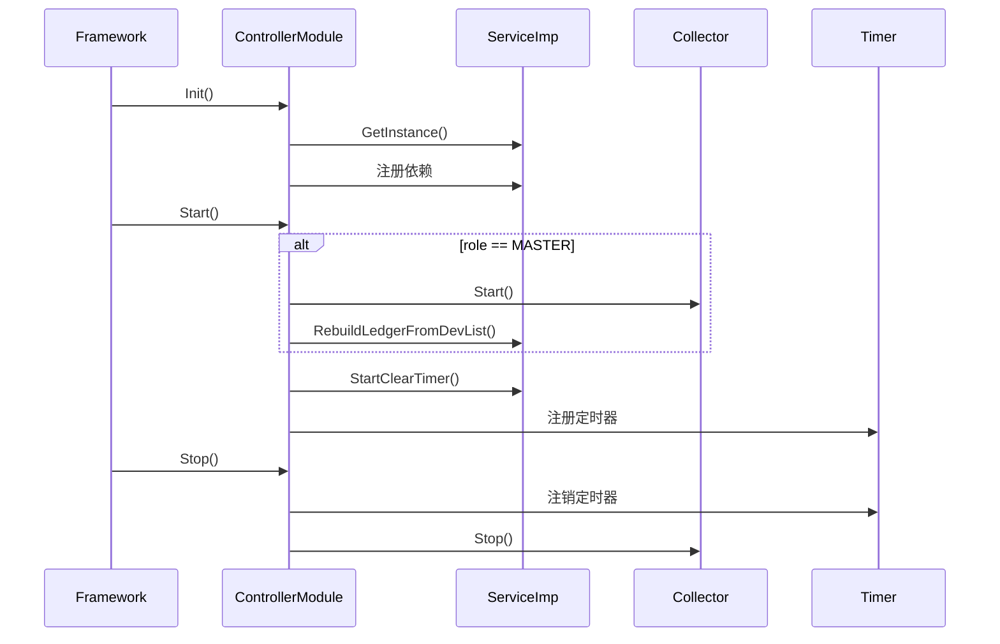
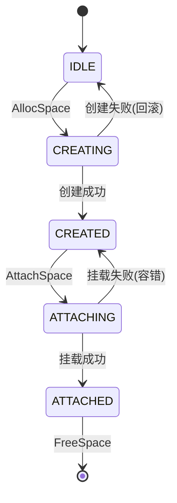
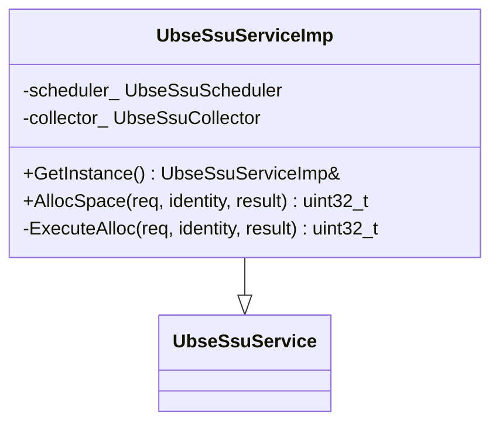
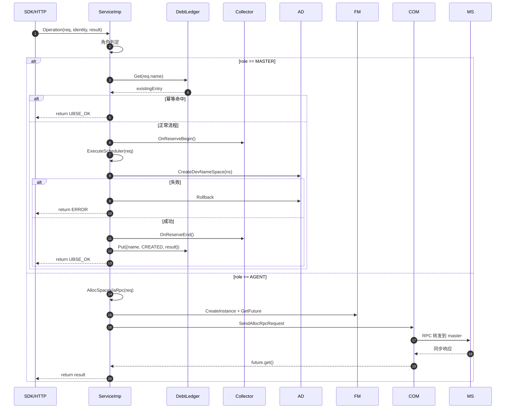
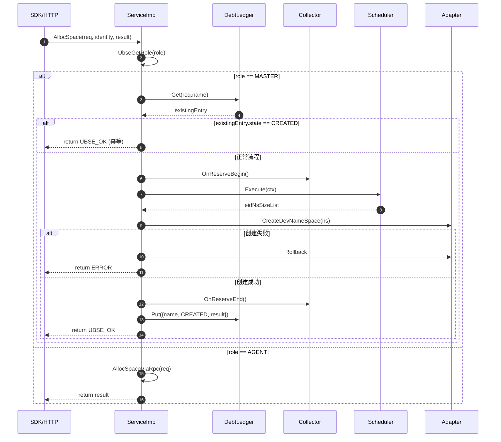

# 模块设计文档生成指南

本 skill 为代码模块生成结构化的设计文档(Module Design Document),从设计视角描述模块的架构、子模块、接口、关键流程、并发控制与设计亮点,作为开发实现、代码评审与维护演进的依据。

本 skill 支持三种工作模式:
- **设计驱动模式**:从需求分析文档正向设计,适用于新模块开发阶段(代码尚未实现)
- **代码反推模式**:从源码反推设计,适用于遗留系统文档化、代码审计
- **混合模式**:已有部分代码 + 新增需求,适用于增量开发场景

## 1. 何时触发

### 1.1 触发条件(满足任一即触发)

- 用户明确要求生成"设计文档"、"模块设计文档"、"design document"
- 用户给出某模块路径并要求输出设计
- 用户要求分析模块架构、类设计、时序图
- 用户要求文档化某模块的设计决策与并发控制
- 用户要求梳理模块的关键流程与时序
- 用户要求基于需求文档进行模块设计
- 用户描述新模块需求并要求输出设计

### 1.2 不触发的情况

- 用户要求生成需求分析文档(应使用 requirement-analysis-doc skill)
- 用户要求生成测试设计文档(应使用 test-design-doc skill)
- 用户仅询问单个函数/类的功能(直接回答即可)
- 用户仅要求修改已有设计文档的个别章节(直接编辑即可)

### 1.3 工作模式判定

根据用户输入特征自动选择工作模式:

| 模式 | 触发特征 | 信息来源 |
|------|----------|----------|
| 设计驱动模式 | 用户提供需求文档/PRD/用户故事;模块尚未编码;新立项模块 | 需求文档、PRD、用户故事、合规要求 |
| 代码反推模式 | 用户给出源码路径;模块已实现;遗留系统文档化 | 源码、接口、注释、测试 |
| 混合模式 | 已有部分代码 + 新增功能需求;增量开发 | 需求材料为主,代码验证为辅 |

**判定规则**:
- 若用户明确给出源码路径(如 `src/controllers/xxx`)且代码已存在 → 代码反推模式
- 若用户提及需求文档/PRD 或描述新模块需求,且代码尚未实现 → 设计驱动模式
- 若用户给出源码路径同时提及新增功能/改造 → 混合模式
- 若特征不明确,使用 `AskUserQuestion` 澄清:是基于需求文档设计,还是基于现有代码反推?

### 1.4 与需求/设计文档的衔接

设计文档回答"怎么做",需求文档回答"做什么"。无论哪种模式,设计文档都应:
- 引用需求文档的 FR-XXX 功能需求,说明设计如何实现
- 引用需求文档的 NFR-XXX 非功能需求,说明设计如何达标
- 在"设计亮点"章节说明如何满足关键 NFR

**模式差异**:
- 设计驱动模式:以需求文档为唯一事实源,设计决策必须覆盖所有 FR/NFR
- 代码反推模式:以代码为事实源,反向映射到 FR/NFR(若需求文档存在)
- 混合模式:已有代码部分反推,新增需求部分正向设计,差异部分需标注

## 2. 文档标准结构

设计文档必须包含以下 13 章,章节顺序与标题固定:

```
1. 模块定位与职责      —— 核心职责、在系统中的位置
2. 目录结构与文件职责  —— 源码目录树、文件职责表
3. 模块入口与生命周期  —— 模块初始化/启动/停止流程
4. 服务接口与数据模型  —— 对外接口、枚举、结构体、状态机、接口错误码设计
5. 核心子模块设计      —— 各子模块的类设计、关键方法、协作关系
6. 接入层设计          —— IPC/HTTP/CLI 接入层
7. 关键流程详解        —— 核心流程的时序图(mermaid)
8. 并发控制与一致性保证 —— 锁层次、幂等性、一致性策略
9. 依赖关系            —— 模块内/模块外依赖
10. 关键设计模式与亮点 —— 设计模式应用、创新点
11. 关键约束与注意事项  —— 业务约束、技术约束、避坑指南
12. 测试要点           —— 测试策略与关键用例指引
13. 附录               —— 缩略语、错误码、相关文档
```

## 3. 各章节编写指南

### 3.1 第 1 章 模块定位与职责

**1.1 模块概述**:一段话描述模块的核心定位与价值。

**信息来源对照**:
- 设计驱动模式:从需求文档的"业务背景与目标"提取
- 代码反推模式:从模块注释、README、AGENTS.md 提取
- 混合模式:以需求文档为主,代码注释补充

**1.2 核心职责**:用表格列出 5~10 项核心职责,每项含说明:

| 职责 | 说明 |
|------|------|
| XXX | XXX |

职责提取来源:
- 设计驱动模式:从需求文档的 FR-XXX 功能需求推导(每类操作对应一项职责)
- 代码反推模式:从服务契约的纯虚接口提取;从模块入口的 `Init/Start/Stop` 生命周期方法提取;从关键子模块的存在意义提取(如 Collector 负责设备视图维护)
- 混合模式:已有代码部分反推,新增功能部分从新增 FR 推导

**1.3 在系统中的位置**:使用 drawio-skill 绘制系统位置图,描述模块在系统架构中的位置,包含:
- 上游接入层(HTTP/SDK/CLI)
- 本模块的核心组件
- 下游依赖(适配器、外部库)
- 跨节点协同关系(master/agent)

绘制规范:
- 使用 drawio-skill 生成可编辑的 `.drawio` 源文件,并导出 PNG 供文档引用
- 每个方框标注组件名 + 一句话职责
- 箭头标注通信协议(HTTP/UDS/RPC)
- 归档与引用路径见 [5.6 架构图绘制规范](#56-架构图绘制规范drawio-skill)

### 3.2 第 2 章 目录结构与文件职责

**2.1 源码目录树**:用 ASCII 树展示模块目录结构。

**模式差异**:
- 设计驱动模式:规划拟建的目录结构(标注"规划中"),作为开发实施的目录蓝图
- 代码反推模式:如实展示现有目录结构
- 混合模式:现有目录 + 新增子目录(用 `# 新增` 标注)

```
src/controllers/<module>/
├── <module>_controller_module.{h,cpp}   # 模块入口
├── <module>_service_imp.{h,cpp}         # 服务实现
├── <module>_<submodule>.{h,cpp}         # 子模块
├── ipc/                                 # IPC 接入层
│   ├── <module>_ipc_handler.h
│   └── handler/                         # 具体 handler
├── message/                             # 消息定义
├── debt/                                # 账本子目录(可选)
└── ...
```

**2.2 文件职责表**:用表格列出每个关键文件的职责:

| 文件 | 关键类/函数 | 职责 |
|------|-------------|------|
| xxx.h | class Xxx | XXX |

提取要点:
- 文件名 + 关键类名 + 一句话职责
- 按目录分组,层次清晰
- 标注对外暴露的接口 vs 内部实现

**2.3 目录规范约束(必须遵循)**:设计目录结构时必须遵循 [目录规范文档](../../docs/conventions/目录规范文档.md) 的归档规则,在"源码目录树"之后用专门小节列出本模块的目录归档约束。

**约束一:头文件归档(`src/include/` 镜像 `src/` 层级)**

`src/include/` 的子目录**必须镜像 `src/` 的模块目录层级**,禁止按模块名平铺;根目录禁止直接存放头文件。

| 头文件来源 | 归档目录 | 示例 |
|------------|----------|------|
| `src/framework/<module>/` 下的模块 | `src/include/framework/<module>/` | `src/include/framework/log/ubse_logger.h` |
| `src/adapter_plugins/<module>/` 下的模块 | `src/include/adapter_plugins/<module>/` | `src/include/adapter_plugins/mti/ubse_mti_def.h` |
| `src/api_server/` / `src/ras/` / `src/message/` | `src/include/<对应层级>/` | `src/include/api_server/ubse_api_server.h` |
| 跨模块共享基础定义 | `src/include/common/` | `src/include/common/ubse_error.h` |

**约束二:控制器对外接口归档(`controllers/` 冻结)**

`src/include/controllers/<module>/` 为**冻结目录**,仅保留现有头文件,不再新增。

| 头文件类型 | 归档目录 | 说明 |
|------------|----------|------|
| 控制器**新增**对外接口/服务契约 | `src/include/plugin_services/<module>/` | 新增控制器对外接口的**唯一入口** |
| 控制器**现有**头文件 | `src/include/controllers/<module>/` | 保持现状,可维护但**不得新增** |
| 控制器内部实现细节头文件 | `src/controllers/<module>/` 源码目录内 | 不放入 `src/include/` |

**约束三:UT 目录镜像 `src/` 层级**

`test/UT/` 的子目录**必须镜像 `src/` 的模块目录层级**,禁止按模块名平铺;根目录仅存放 UT 框架入口文件。

| 被测源码路径 | UT 归档目录 | 示例 |
|--------------|-------------|------|
| `src/framework/<module>/` | `test/UT/framework/<module>/` | `test/UT/framework/log/test_ubse_logger.cpp` |
| `src/controllers/<module>/` | `test/UT/controllers/<module>/` | `test/UT/controllers/ssu/test_ubse_ssu_scheduler.cpp` |
| `src/adapter_plugins/<module>/` | `test/UT/adapter_plugins/<module>/` | `test/UT/adapter_plugins/mti/test_ubse_lcne_module.cpp` |
| `src/addons/<plugin>/` | `test/UT/addons/<plugin>/` | `test/UT/addons/rmrs/test_rack_mempooling_plugin.cpp` |

**模式差异**:
- 设计驱动模式:规划的目录结构必须符合上述约束,在目录树中标注每个新增目录的归档路径(如头文件标注"归档到 `src/include/plugin_services/<module>/`")
- 代码反推模式:如实展示现有目录结构,但若发现违反约束的目录(如头文件平铺、UT 平铺),在"目录规范偏差"小节列出并给出迁移建议
- 混合模式:现有目录反推 + 新增目录必须符合约束,标注新增部分的归档路径

**目录规范偏差检查清单**(代码反推/混合模式时填写):
- [ ] 头文件是否按 `src/` 层级镜像归档(无平铺)
- [ ] 控制器新增对外接口是否在 `plugin_services/` 下(未放入冻结的 `controllers/`)
- [ ] UT 目录是否镜像 `src/` 层级(无平铺)
- [ ] 偏差项是否已列出迁移建议

### 3.3 第 3 章 模块入口与生命周期

**3.1 模块入口类**:说明模块入口类的设计。

**模式差异**:
- 设计驱动模式:设计拟建的入口类(继承 `UbseModule`),规划持有的核心成员
- 代码反推模式:从 `<module>_controller_module.h` 如实提取类名(通常继承 `UbseModule`)、`kModuleName` 常量、持有的核心成员(如 `UbseSsuService` 实例)

**3.2 生命周期流程**:用 mermaid `sequenceDiagram` 或 ASCII 描述 `Init → Start → Stop` 流程:



**3.3 关键初始化步骤**:用表格列出初始化的顺序与依赖:

| 步骤 | 动作 | 依赖 |
|------|------|------|
| 1 | 获取 ServiceImp 单例 | 无 |
| 2 | 注册 IPC dispatcher | UbseComModule |
| 3 | 注册 HTTP 路由 | UbseHttpModule |
| 4 | 启动 collector(master) | UbseHaModule(角色判定) |

### 3.4 第 4 章 服务接口与数据模型

**4.1 服务契约**:说明对外服务契约。

**模式差异**:
- 设计驱动模式:设计拟建的服务契约(抽象基类名、`kServiceName`、纯虚接口列表),需覆盖所有 FR-XXX
- 代码反推模式:从 `src/include/plugin_services/<module>/<module>_service.h` 如实提取抽象基类名、`kServiceName`、纯虚接口列表(用表格列出:接口名、功能、输入、输出)、服务获取方式(如 `GetSsuService()`)

**4.2 关键枚举**:列出模块对外暴露的枚举,用代码块展示并注释:

```cpp
enum class UbseSsuNsState : uint8_t {
    IDLE = 0,      // 初始/失败回退
    CREATING = 1,  // Master正在创建NS
    CREATED = 2,   // NS创建完成,等待Agent Attach
    ATTACHING = 3, // Agent正在Attach
    ATTACHED = 4,  // 全部完成
};
```

**4.3 关键数据结构**:列出核心 `struct` 定义,用代码块展示并注释每个字段。

**4.4 状态机**:若模块含状态机,用 mermaid `stateDiagram-v2` 描述:



状态机提取要点:
- 设计驱动模式:根据需求文档的业务流程设计状态机(状态 + 合法转换 + 触发事件)
- 代码反推模式:从 `enum class *State` 提取状态;从状态转换代码(如 `IsStatusTransitionValid`)提取合法转换;标注触发事件与异常分支
- 混合模式:现有状态机反推 + 新增状态从新增 FR 推导

**4.5 接口错误码设计**:每个对外接口**必须**说明其返回的错误码及触发场景,作为接口契约的一部分。

**设计要求**:
- 错误码遵循项目统一错误码体系,参见 [ubse_error.h](../../../../src/include/ubse_error.h):
  - 对外暴露错误码:范围 1~9999,需暴露给 SDK 时使用,新增需同步至 `src/include/ubse_error.h` 与 `src/sdk/c/include/ubs_error.h`
  - 内部错误码:范围 10000+,对外统一返回 `UBSE_ERR_INTERNAL`(1005),不暴露内部实现细节
- 每个接口列出可能的错误码及触发场景,用表格说明
- 幂等场景的错误码(如重复创建返回成功)需明确标注

**表格规范**:

| 错误码 | 常量 | 触发场景 | 是否对外暴露 |
|--------|------|----------|--------------|
| 0 | `UBSE_OK` | 成功;或幂等命中(如同名已存在) | 是 |
| 1006 | `UBSE_ERR_EXISTED` | 资源已存在且非幂等接口 | 是 |
| 1007 | `UBSE_ERR_NOT_EXIST` | 资源不存在 | 是 |
| 1013 | `UBSE_ERR_ALLOCATE` | 调度算法分配失败(容量不足/无可用设备) | 是 |
| 1005 | `UBSE_ERR_INTERNAL` | 内部错误(底层 dlopen 失败、序列化失败等) | 是(内部错误统一对外) |

**模式差异**:
- 设计驱动模式:根据需求文档的 FR-XXX 与 AC-XXX 验收标准设计每个接口的错误码,覆盖所有正常与异常分支
- 代码反推模式:从服务实现的 `Execute*` 方法、`if/else` 分支、`return UBSE_ERR_*` 语句提取实际返回的错误码及触发条件
- 混合模式:现有接口错误码反推 + 新增接口从新增 FR 的异常场景推导

**提取要点**(代码反推模式):
- 使用 `Grep` 搜索 `return UBSE_ERR_|return UBSE_ERROR_|return UBSE_.*_ERROR_` 提取各接口实际返回的错误码
- 从错误码的 `#define` 注释与触发条件代码提取场景说明
- 区分对外错误码(1~9999)与内部错误码(10000+),内部错误码在对外接口设计中统一映射为 `UBSE_ERR_INTERNAL`

### 3.5 第 5 章 核心子模块设计(核心章节)

每个核心子模块单独一节展开,结构如下:

```
### 5.X 子模块名

#### 5.X.1 职责
一段话描述子模块的核心职责。

#### 5.X.2 类设计
用类图(mermaid classDiagram)或表格展示类的继承关系与关键成员:



#### 5.X.3 关键方法
用表格列出关键方法:

| 方法 | 功能 | 关键逻辑 |
|------|------|----------|
| AllocSpace | 分配入口 | 角色判定,master本地/agent RPC |

#### 5.X.4 协作关系
描述与其他子模块的协作,用 ASCII 图或文字说明。

#### 5.X.5 设计要点
列出该子模块的设计要点(如幂等性、并发控制、错误处理)。
```

**子模块识别要点**:
- 设计驱动模式:根据需求文档的 FR-XXX 功能需求划分子模块(单一职责原则),每个子模块承担一类功能
- 代码反推模式:从服务实现类(`ServiceImp`)的成员变量识别(每个成员通常对应一个子模块);从目录结构识别(每个子目录或独立文件通常对应一个子模块);从职责单一性识别
- 混合模式:现有子模块反推 + 新增子模块从新增 FR 划分

### 3.6 第 6 章 接入层设计

**6.1 IPC 接入层**:从 `ipc/` 目录提取:
- 抽象基类(如 `UbseSsuHandler`)的模板方法模式
- 三阶段处理:`Unpack → Handle → Pack`
- 具体 handler 列表(用表格列出)

**6.2 HTTP 接入层**:从 `*_http_handler.*` 提取:
- 路由注册方式
- 路由表(Method + URL + Handler + 功能)
- 鉴权方式(mTLS、证书 CN/OU 提取)

**6.3 CLI 接入层**(可选):从 `src/cli/<module>/` 提取:
- 命令注册方式
- 命令列表(命令 + 子命令 + 功能)
- wire 契约结构(字段顺序/宽度对齐)

**6.4 跨节点 RPC**:从 `*_rpc_processor.*` 提取:
- RPC 处理器注册方式
- OpCode 列表(用表格列出:OpCode、消息类型、方向、用途)
- Future 异步等待机制

### 3.7 第 7 章 关键流程详解(核心章节)

为每个核心流程绘制时序图,使用 mermaid `sequenceDiagram`:

```
### 7.X 流程名

#### 7.X.1 场景说明
一段话描述流程的触发条件、参与方与目标。

#### 7.X.2 时序图


#### 7.X.3 关键步骤说明
用表格列出关键步骤的说明:

| 步骤 | 说明 |
|------|------|
| 1 | 角色判定,master/agent 走不同分支 |
| 2 | 幂等检查,避免重复处理 |

#### 7.X.4 异常处理
列出异常分支与处理策略:

| 异常场景 | 处理策略 |
|----------|----------|
| namespace 创建失败 | 回滚已创建 namespace + 释放预留 |
| RPC 超时 | 重试 3 次后失败,调用 Free 清理 |
```

**必须绘制时序图的流程**:
- 核心业务流程(分配、释放、挂载、卸载等)
- 跨节点协同流程(master/agent RPC)
- 故障切换/恢复流程
- 并发冲突处理流程

**时序图规范**:
- 使用 `autonumber` 自动编号
- 使用 `alt/else/end` 表达条件分支
- 使用 `loop` 表达循环
- 使用 `Note over` 标注关键状态变化
- 参与者用简短别名(如 SI、DL、CL)
- 跨节点场景用虚线分隔不同节点

### 3.8 第 8 章 并发控制与一致性保证

**8.1 并发层次**:用表格列出所有锁与并发机制:

| 层次 | 机制 | 保护对象 |
|------|------|----------|
| 资源级 | `UbseLoggingLockGuard(name)` | 同名资源的并发请求串行化 |
| 调度级 | `schedulerLock_` (mutex) | 调度算法串行执行 |
| 缓存级 | `shared_mutex` + shared_lock | 读写分离 |
| 账本级 | `shared_mutex` + COW shared_ptr | 高并发读写不互斥 |

**8.2 一致性保证**:分小节描述:
- 幂等性设计(分配幂等、释放幂等、权限幂等)
- 容量一致性(预扣/预释放、原子快照读、延迟清除容错)
- 状态机一致性(合法转换校验、容错转换、非法转换不阻断)
- 跨节点恢复(账本重建、状态推断、脏记录清理)

提取要点:
- 从 `lock_guard`/`unique_lock`/`shared_lock` 的使用位置提取锁层次
- 从 `atomic`/`condition_variable` 的使用提取并发原语
- 从幂等检查代码(如 `if (existingEntry.state == CREATED) return OK`)提取幂等策略
- 从 COW/shared_ptr 的使用提取无锁并发策略

### 3.9 第 9 章 依赖关系

**9.1 模块内依赖**:用 ASCII 树或 mermaid 描述模块内组件的依赖关系:

```
controller_module
  └─▶ service_imp
        ├─▶ collector
        │     └─▶ reservation_mgr
        ├─▶ scheduler
        │     └─▶ filter_chain (framework)
        ├─▶ direct_to_vm_manager
        └─▶ debt_ledger
```

**9.2 模块外依赖**:用表格列出对其他模块/库的依赖:

| 依赖 | 用途 |
|------|------|
| `framework/com` | RPC 通信 |
| `framework/ha` | 选主 |
| `framework/timer` | 定时器 |
| `framework/thread_pool_module` | 任务执行器 |

**9.3 外部库依赖**:列出 dlopen 加载的动态库及函数指针:

| 库 | 加载方式 | 关键函数 |
|----|----------|----------|
| libssu.so | dlopen | acquire_dev_info, create_namespace, ... |

### 3.10 第 10 章 关键设计模式与亮点

识别 5~8 项设计模式或设计亮点,每项含模式名、应用位置、价值:

| 模式/亮点 | 应用位置 | 价值 |
|-----------|----------|------|
| 责任链模式 | UbseSsuScheduler | 调度算法可扩展,filter 可插拔 |
| 模板方法模式 | UbseSsuHandler | 统一 Unpack/Handle/Pack 三阶段 |
| COW + shared_ptr | DebtLedger | 高并发读写不互斥 |
| 预扣/预释放 | ReservationMgr | 弥补采集周期时延,防止超分 |

设计模式识别要点:
- 责任链:filter chain、handler chain
- 模板方法:基类定义流程,子类实现步骤
- 单例:`GetInstance()` 静态方法
- 工厂:`Factory::Create()` 静态方法
- 观察者:事件注册与回调
- COW:写时复制 + shared_ptr
- 状态机:enum state + 转换函数

### 3.11 第 11 章 关键约束与注意事项

**11.1 业务约束**:从代码常量、校验逻辑提取:

| 约束 | 依据 |
|------|------|
| name 最大 48 字符 | SSU_NAME_MAX_LEN 常量 |
| 单设备最大 namespace 数 128 | MAX_NS_PER_DEV 常量 |

**11.2 技术约束**:从架构设计、加载方式提取:

| 约束 | 依据 |
|------|------|
| 必须通过 dlopen 加载 libssu.so | UbseDlManager 实现 |
| 账本操作只在 master 端 | ExecuteAlloc 角色判定 |

**11.3 避坑指南**:列出开发与维护中的注意事项:

| 注意事项 | 说明 |
|----------|------|
| OnReserveBegin/End 必须成对调用 | 否则预留泄漏导致超分 |
| master 重启后必须调用 RebuildLedger | 否则账本丢失 |

### 3.12 第 12 章 测试要点

简要描述测试策略(详细设计见测试设计文档):

| 测试层 | 重点 |
|--------|------|
| UT | 调度器算法、状态机、幂等性 |
| IT | RPC 通信、模块装配 |
| E2E | 端到端业务链路 |

列出关键测试场景(5~10 项),每项标注对应的测试文件:

| 场景 | 测试文件 |
|------|----------|
| 调度器分配成功 | test_ubse_ssu_scheduler.cpp |
| VFE 直通全流程 | test_ubse_ssu_direct_to_vm_manager.cpp |

### 3.13 第 13 章 附录

**13.1 缩略语**:列出模块用到的专业缩略语:

| 缩略语 | 全称 | 含义 |
|--------|------|------|
| SSU | Storage Subsystem Unit | 存储子系统单元 |

**13.2 错误码**:从 `enum class` 或 `#define` 提取错误码表。

**13.3 相关文档**:关联项目内文档,使用相对路径链接:
- 需求分析文档
- 测试设计文档
- CODE_WIKI.md

## 4. 编写流程

### 4.1 设计驱动模式流程(从需求正向设计)

适用于新模块开发阶段,代码尚未实现。

**步骤 1:需求收集**
1. 阅读需求分析文档 `docs/design/modules/<模块名>/<模块名>模块需求分析文档.md`
2. 提取所有 FR-XXX 功能需求、NFR-XXX 非功能需求、AC-XXX 验收标准
3. 提取约束条件(CON-XXX)
4. 若需求文档不存在,使用 `AskUserQuestion` 收集关键需求:
   - 模块核心功能?
   - 性能指标?(如响应时间、并发数)
   - 是否需要跨节点协同?
   - 是否需要状态机?
   - 关键约束?(如兼容性、协议)

**步骤 2:设计建模**
1. 划分子模块(单一职责原则,每类 FR 对应一个子模块)
2. 设计服务契约(抽象基类 + 纯虚接口,覆盖所有 FR)
3. 设计数据模型(枚举、结构体、状态机)
4. 设计关键流程时序图(覆盖所有 FR 的主流程与异常分支)
5. 设计并发控制(根据 NFR-REL 可靠性需求)
6. 识别设计模式(根据 NFR-XXX 选择合适模式)

**步骤 3:文档生成**
1. 用 `TodoWrite` 创建 13 章节任务清单
2. 按章节顺序生成,每章标注"设计驱动模式"
3. 标注 TBD 项(如"持久化方案待定")与 Assumption 项(如"假设单 master 部署")
4. 每个设计决策需关联 FR-XXX / NFR-XXX

**步骤 4:设计评审**
1. 检查是否覆盖所有 FR-XXX
2. 检查是否满足所有 NFR-XXX
3. 标注待澄清项(TBD)与假设项(Assumption)
4. 提示用户进行设计评审

### 4.2 代码反推模式流程(从源码反推设计)

适用于遗留系统文档化、代码审计,代码已实现。

**步骤 1:信息收集**

**必须阅读的关键文件**(按阅读顺序):

1. **模块入口**:`src/controllers/<module>/<module>_controller_module.{h,cpp}`
   - 提取:模块生命周期、依赖关系、初始化顺序、持有的核心成员

2. **服务契约**:`src/include/plugin_services/<module>/<module>_service.h`
   - 提取:对外接口、枚举、结构体、Doxygen 注释

3. **服务实现**:`src/controllers/<module>/<module>_service_imp.{h,cpp}`
   - 提取:业务编排、master/agent 分支、并发控制、错误处理

4. **核心子模块**:`src/controllers/<module>/<module>_<submodule>.{h,cpp}`
   - 提取:每个子模块的类设计、关键方法、协作关系

5. **接入层**:
   - `ipc/` 目录:IPC handler 抽象基类 + 具体 handler
   - `*_http_handler.*`:HTTP 路由注册
   - `*_rpc_processor.*`:RPC 处理器
   - `src/cli/<module>/`:CLI 命令(可选)

6. **适配器**:`src/adapter_plugins/<module>/`
   - 提取:硬件操作接口、dlopen 加载、数据结构映射

7. **消息定义**:`message/` 目录
   - 提取:跨节点消息的序列化/反序列化

8. **测试**:`test/UT/controllers/<module>/`、`test/UT/adapter_plugins/<module>/`
   - 提取:测试场景、Mock 依赖、边界值

9. **需求文档**:`docs/design/modules/<模块名>/<模块名>模块需求分析文档.md`(若存在)
   - 提取:FR/NFR/AC,用于反向映射设计决策

**辅助工具调用**:
- 使用 `LS` 列出模块目录结构,生成目录树
- 使用 `Grep` 搜索 `class.*: public` 提取继承关系
- 使用 `Grep` 搜索 `std::lock_guard|std::unique_lock|std::shared_lock|std::mutex|std::shared_mutex|std::atomic` 提取并发机制
- 使用 `Grep` 搜索 `enum class.*State` 提取状态机
- 使用 `Grep` 搜索 `MOCKER_CPP_VIRTUAL|TEST_F` 从测试提取关键场景
- 使用 `Grep` 搜索 `sequenceDiagram|stateDiagram` 查看已有 mermaid 图
- 使用 `SearchCodebase` 进行语义搜索(如"how does alloc handle rollback")

**步骤 2:文档生成**
1. 先用 `TodoWrite` 创建 13 章节的任务清单
2. 按章节顺序生成,每章完成立即标记 completed
3. 时序图必须使用 mermaid `sequenceDiagram`,状态机使用 `stateDiagram-v2`
4. 类图使用 mermaid `classDiagram` 或表格
5. 使用相对路径链接关联项目内文档与代码
6. 引用代码位置时标注文件名(如 `ubse_ssu_service_imp.cpp:ExecuteAlloc`)
7. 若需求文档存在,反向映射设计决策到 FR/NFR

### 4.3 混合模式流程(已有代码 + 新增需求)

适用于增量开发场景。

**步骤 1:信息收集**
1. 阅读需求文档,识别新增的 FR-XXX / NFR-XXX
2. 按"代码反推模式"的信息收集步骤,阅读现有代码
3. 识别现有代码已覆盖的 FR 与新增 FR 的差异

**步骤 2:差异化设计**
1. 现有功能:按代码反推模式如实描述
2. 新增功能:按设计驱动模式正向设计
3. 差异部分:用表格列出"现有 vs 新增",标注改造点

**步骤 3:文档生成**
1. 现有部分标注"已实现",新增部分标注"待实现"
2. 新增设计决策需关联新增 FR-XXX
3. 标注 TBD 项与 Assumption 项

### 4.4 跨模块设计文档联动更新(所有模式通用)

**核心原则**:设计文档不是孤立的。当本模块的设计涉及**修改或新增其他模块的代码**时,必须同步更新被影响模块的设计文档,确保文档与代码的一致性。

**触发条件**(满足任一即触发):
- 本模块新增了对外接口,其他模块需调用此接口
- 本模块修改了数据模型,其他模块依赖此模型
- 本模块新增了依赖(如 `framework/thread_pool`),且该依赖模块的设计文档未记录此依赖关系
- 本模块在 `src/include/` 下新增了头文件,其他模块会 include 此头文件
- 本模块新增了子目录,且该子目录属于其他模块的源码目录(如 `src/controllers/ssu/vsock/`)

**联动更新流程**:

1. **识别受影响模块**:在生成/更新本模块设计文档后,从以下维度识别受影响模块:
   - 第 9 章"依赖关系"中列出的模块外依赖
   - 第 2 章"目录结构与文件职责"中新增/修改的文件所属的模块
   - 第 1 章"在系统中的位置"drawio 系统位置图中关联的上下游模块
   - 第 6 章"接入层设计"中 IPC/HTTP/CLI 关联的调用方模块

2. **检查受影响模块的设计文档是否存在**:
   - 使用 `Glob` 搜索 `docs/design/modules/<受影响的模块名>/` 或 `docs/design/framework/<受影响的模块名>/`
   - 若设计文档不存在,在"相关文档"中标注,不强制创建

3. **更新受影响模块的设计文档**:
   - 第 9 章"依赖关系":若本模块新增了对该模块的依赖,在该模块的"模块外依赖"表中添加被依赖项
   - 第 6 章"接入层设计":若本模块新增了接入方式(如 vsock),在该模块的接入层设计中添加新的接入方式
   - 第 1 章"在系统中的位置":若系统位置图需要更新,更新 drawio 源文件并重新导出 PNG
   - 第 13 章"相关文档":添加本模块设计文档的链接

4. **更新文档版本**:在受影响模块的设计文档头添加修订记录:

```
> 修订历史:
> - V1.X (YYYY-MM-DD): 因 vsock server 通用框架设计,新增 vsock 接入层依赖,更新第 6/9 章
```

**更新范围约束**:
- 仅更新与本模块设计决策直接相关的章节,不自作主张修改无关章节
- 若受影响模块的设计文档有 FR/NFR 关联,补充对应的 FR/NFR 引用
- 若受影响模块的代码尚未修改(仅设计阶段),在更新内容中标注 `[待实现]`

**质量校验清单**:
- [ ] 已识别所有受本设计影响的模块
- [ ] 受影响模块的设计文档已更新(或已标注"无需更新"的原因)
- [ ] 更新内容标注了来源(如"因 vsock server 通用框架设计")
- [ ] 文档版本号已递增,修订历史已记录

### 4.5 时序图绘制要点(所有模式通用)

**必须绘制时序图的流程**:
- 每个对外接口的完整调用链(如 AllocSpace、FreeSpace、AttachSpace)
- 跨节点协同流程(master/agent RPC 转发)
- 故障切换与恢复流程
- 并发冲突处理流程

**时序图规范**:
- 使用 `autonumber` 自动编号步骤
- 使用 `alt/else/end` 表达条件分支(如 master vs agent)
- 使用 `loop` 表达循环(如循环创建 namespace)
- 使用 `Note over` 标注关键状态变化(如"pendingOps_++")
- 参与者用简短别名(如 SI=ServiceImp, DL=DebtLedger)
- 跨节点场景用 `Note over` 虚线分隔不同节点
- 每个时序图后附"关键步骤说明"表格

**时序图信息提取方法**:
- 设计驱动模式:根据需求文档的业务流程设计时序(参与者 + 消息 + 分支 + 异常),需覆盖所有 FR-XXX 的主流程与异常分支
- 代码反推模式:从服务实现的 `Execute*` 方法提取主流程;从方法调用链提取参与者与消息;从 `if/else` 分支提取 alt/else;从 `for` 循环提取 loop;从 `UBSE_LOG_ERROR` 提取异常分支
- 混合模式:现有流程反推 + 新增流程从新增 FR 设计

### 4.6 质量校验阶段

生成完成后,逐项校验:

**结构完整性**:
- [ ] 13 章全部生成,无遗漏
- [ ] 每章有明确的小节结构
- [ ] 表格、代码块、mermaid 图格式正确
- [ ] 第 4 章每个对外接口有错误码设计(错误码 + 常量 + 触发场景 + 是否对外暴露)

**内容准确性**(模式相关):
- 设计驱动模式:
  - [ ] 设计决策覆盖所有 FR-XXX 功能需求
  - [ ] 设计满足所有 NFR-XXX 非功能需求
  - [ ] TBD 项与 Assumption 项已标注
- 代码反推模式:
  - [ ] 类名、方法名与代码一致
  - [ ] 状态机与代码 `enum class` 一致
  - [ ] 时序图的消息流向与代码调用链一致
  - [ ] 锁机制与代码 `lock_guard` 使用一致
  - [ ] 依赖关系与 `CMakeLists.txt` 一致
  - [ ] 接口错误码与代码 `return UBSE_ERR_*` 实际返回一致,内部错误码(10000+)已映射为 `UBSE_ERR_INTERNAL`
- 混合模式:
  - [ ] 现有部分与代码一致,新增部分覆盖新增 FR
  - [ ] 差异部分已标注"现有 vs 新增"

**可读性**:
- [ ] 剩余 ASCII 图(目录树/依赖树/协作图)对齐美观
- [ ] mermaid 图语法正确(可在 markdown 渲染器预览)
- [ ] 表格列宽合理,内容简洁
- [ ] 代码块有语言标注(cpp/mermaid/bash)

**目录规范合规性**(所有模式):
- [ ] 头文件归档符合 `src/include/` 镜像 `src/` 层级规则(无平铺)
- [ ] 控制器新增对外接口归档到 `src/include/plugin_services/<module>/`(未放入冻结的 `controllers/`)
- [ ] UT 目录镜像 `src/` 层级(无平铺,如 `test/UT/framework/<module>/` 而非 `test/UT/<module>/`)
- [ ] 设计驱动模式:规划目录已标注归档路径
- [ ] 代码反推/混合模式:目录规范偏差已列出并给出迁移建议

**可追溯性**:
- [ ] 引用代码位置标注文件名(代码反推模式)
- [ ] 设计决策关联 FR-XXX / NFR-XXX(所有模式)
- [ ] 关联文档使用相对路径链接

**归档规范性**:
- [ ] 文档输出到 `docs/design/modules/<模块名>/` 目录
- [ ] 文件名符合 `<模块名>模块设计文档.md` 规范
- [ ] 图片存放到 `docs/design/images/<模块名>/`,引用路径为 `../../images/<模块名>/xxx.png`
- [ ] 架构图(系统位置图等)使用 drawio-skill 绘制,`.drawio` 源文件与导出 PNG 已归档
- [ ] 已更新 `docs/design/README.md` 的文档清单表

**跨模块联动**(所有模式):
- [ ] 已识别所有受本设计影响的模块(从第 1/2/6/9 章提取)
- [ ] 受影响模块的设计文档已更新依赖关系、接入层、系统位置图等章节
- [ ] 更新内容标注了来源(如"因 vsock server 通用框架设计")
- [ ] 受影响模块的文档版本号已递增,修订历史已记录

## 5. 编写规范

### 5.1 文档头格式

**设计驱动模式**:
```
# <模块名> 模块设计文档

> 工作模式:设计驱动模式(从需求正向设计)
> 需求文档:`docs/design/modules/<模块名>/<模块名>模块需求分析文档.md`
> 适用版本:当前主线
> 文档版本:V1.0
> 编写日期:YYYY-MM-DD
> 评审状态:待评审

---
```

**代码反推模式**:
```
# <模块名> 模块设计文档

> 工作模式:代码反推模式(从源码反推设计)
> 源码路径:`src/controllers/<module>/`
> 服务契约:`src/include/plugin_services/<module>/<module>_service.h`
> 适用版本:当前主线
> 文档版本:V1.0
> 编写日期:YYYY-MM-DD

---
```

**混合模式**:
```
# <模块名> 模块设计文档

> 工作模式:混合模式(已有代码 + 新增需求)
> 源码路径:`src/controllers/<module>/`
> 需求文档:`docs/design/modules/<模块名>/<模块名>模块需求分析文档.md`
> 适用版本:当前主线
> 文档版本:V1.0
> 编写日期:YYYY-MM-DD
> 评审状态:待评审

---
```

### 5.2 模式标注规范

文档中需明确标注模式相关内容:

| 标注 | 含义 | 适用模式 |
|------|------|----------|
| `[设计驱动]` | 基于需求正向设计,尚未实现 | 设计驱动、混合模式的新增部分 |
| `[已实现]` | 代码已实现,反推描述 | 代码反推、混合模式的现有部分 |
| `[待实现]` | 设计完成,待开发实现 | 设计驱动、混合模式的新增部分 |
| `[TBD]` | 待澄清项,需进一步确认 | 所有模式 |
| `[Assumption]` | 假设项,需评审确认 | 所有模式 |

### 5.3 语言与风格

- 使用中文编写(除非用户另有要求)
- 技术术语保留英文(如 namespace、VFE、master/agent、dlopen)
- 表格优先于长文本描述
- 代码示例使用 ```cpp 代码块
- 时序图使用 mermaid `sequenceDiagram`
- 状态机使用 mermaid `stateDiagram-v2`
- 类图使用 mermaid `classDiagram` 或表格
- 架构图使用 drawio-skill 绘制(见 5.6)
- 文档内链接使用相对路径(如 `../../images/<模块名>/xxx.png`、`../xxx.md`)
- 引用代码位置标注文件名(如 `ubse_ssu_service_imp.cpp:ExecuteAlloc`)

### 5.4 输出位置

文档输出到 `docs/design/modules/<模块名>/<模块名>模块设计文档.md`,遵循设计文档三层归档规则(架构/框架/模块):

```
docs/design/
├── architecture/         # 架构设计
├── framework/            # 框架设计
├── modules/              # 模块文档(按模块分子目录)
│   └── <模块名>/         # 本模块文档目录
│       ├── <模块名>模块需求分析文档.md
│       ├── <模块名>模块设计文档.md   ← 本 skill 生成
│       └── <模块名>模块测试设计文档.md
├── images/               # 图片资源(按层级分目录)
│   ├── architecture/
│   ├── framework/
│   └── modules/          # 模块文档图片存放于此
│       └── <模块名>/     # 按模块归档 .drawio 源文件与导出图片
└── README.md             # 文档索引(新增文档需更新此文件)
```

**图片与架构图归档规则**:
- 架构图(系统位置图等)必须使用 drawio-skill 绘制,产出可编辑的 `.drawio` 源文件,并导出 PNG 供文档引用
- `.drawio` 源文件与导出图片归档到 `docs/design/images/<模块名>/`(按模块分子目录)
- 归档文件命名:`<英文主题名>.drawio`(可编辑源文件)+ `<英文主题名>.png`(导出 PNG)。主题名用英文、描述性、不含章节号(避免章节调整导致失效),如 `system-architecture`、`deployment-position`
- 文档内引用使用相对路径:模块文档 `../../images/<模块名>/<英文主题名>.png`;特性文档 `../../../images/<模块名>/<特性名>/<英文主题名>.png`(特性文档深一级,需多加一层 `../`)
- 新增文档后需更新 `docs/design/README.md` 的文档清单表

**归档规则参考**:[docs/design/README.md](../../../docs/design/README.md)

### 5.5 图表编号

每个图/表建议编号,便于交叉引用:

| 类型 | 编号格式 | 示例 |
|------|----------|------|
| 架构图 | 图 X-Y | 图 1-1(第 1 章第 1 个图) |
| 时序图 | 图 7-X | 图 7-1(AllocSpace 时序图) |
| 状态机 | 图 4-X | 图 4-1(Namespace 状态机) |
| 表格 | 表 X-Y | 表 5-1(关键方法表) |

### 5.6 架构图绘制规范(drawio-skill)

本 skill 涉及的**架构图**(如 1.3 系统位置图)必须使用 drawio-skill 绘制,禁止用 ASCII 字符画替代。

**调用方式**:生成文档遇到需要架构图的章节时,调用 drawio-skill 完成绘制与导出。

**绘制与归档流程**:
1. 调用 drawio-skill,确定图类型(架构图/泳道图)与内容(组件、连接、协议标注)
2. 生成 `.drawio` 源文件,归档到 `docs/design/images/<模块名>/`
3. 使用 draw.io CLI 导出 PNG
4. 使用 drawio-skill 的 `validate.py` 校验结构(悬空连线、重复 id、父容器错误)
5. 文档中引用导出 PNG:模块文档 `../../images/<模块名>/<英文主题名>.png`;特性文档 `../../../images/<模块名>/<特性名>/<英文主题名>.png`
6. 保留 `.drawio` 源文件,便于后续维护编辑

**校验项**:
- [ ] `.drawio` 源文件已归档到 `docs/design/images/<模块名>/`
- [ ] 导出 PNG 文档引用路径正确
- [ ] 图内容与文档章节描述一致(组件、连接、协议标注)

## 6. 与其他文档的关系

设计文档是文档体系的承上启下环节:

```
需求分析文档 (FR/NFR/AC)  ←  定义"做什么"
       │
       ▼
设计文档 (架构/类/时序)    ←  定义"怎么做"(本 skill)
       │
       ├──> 测试设计文档   ←  验证"是否做到"
       │
       └──> 代码实现       ←  落地"具体代码"
```

**一致性要求**:
- 设计文档的类/函数应覆盖需求文档的所有 FR-XXX 功能需求
- 设计文档的并发控制应满足需求文档的 NFR-REL 可靠性需求
- 设计文档的性能设计应满足需求文档的 NFR-PERF 性能需求
- 测试文档的用例应覆盖设计文档的所有关键流程

## 7. 示例

### 7.1 代码反推模式示例

参考已生成的设计文档:
- [SSU模块特性设计文档.md](../../../docs/design/modules/ssu/SSU模块特性设计文档.md) —— 完整 13 章示例(代码反推模式)

该文档的关键特征:
- 第 1 章:9 项核心职责 + 系统位置图(drawio)+ 跨节点协同图
- 第 5 章:6 个核心子模块设计(Collector/Scheduler/DebtLedger/ReservationMgr/DirectToVmManager/Adapter)
- 第 7 章:4 个关键流程时序图(AllocSpace master/agent、FreeSpace、AttachSpace、FeDeviceAlloc),均使用 mermaid `sequenceDiagram` + `autonumber` + `alt/else`
- 第 8 章:8 层并发机制 + 5 类一致性保证(分配幂等/释放幂等/容量一致/状态机一致/跨节点恢复)
- 第 10 章:责任链、模板方法、COW、预扣/预释放等设计亮点

### 7.2 设计驱动模式示例

**用户输入示例**:
```
为新的"配额管理"模块生成设计文档,需求文档已存在:
docs/design/modules/quota/配额管理模块需求分析文档.md
```

**处理流程**:
1. 识别为"设计驱动模式"(用户提供需求文档,模块尚未编码)
2. 阅读需求文档,提取 FR-QUOTA-SET/CHECK/ADJUST/QUERY 4 类功能需求
3. 设计子模块:QuotaMgr(配额管理)/ QuotaChecker(校验)/ QuotaPersistor(持久化)
4. 设计服务契约:`UbseQuotaService` 抽象基类,4 个纯虚接口
5. 设计状态机:IDLE → SETTING → ACTIVE → ADJUSTING → ACTIVE
6. 设计关键流程时序图:SetQuota / CheckQuota / AdjustQuota
7. 设计并发控制:配额读写锁 + 原子计数器
8. 生成 13 章文档,输出到 `docs/design/modules/quota/配额管理模块设计文档.md`
9. 标注 TBD 项(如"配额数据是否需要持久化到数据库?")与 Assumption 项(如"假设配额数据存储在 master 内存,故障切换时从账本重建")
10. 提示用户进行设计评审

### 7.3 混合模式示例

**用户输入示例**:
```
为 src/controllers/ssu 输出设计文档,补充配额管理功能的需求:
- FR-QUOTA-SET: 设置 SSU 设备配额
- FR-QUOTA-CHECK: 分配时校验配额
```

**处理流程**:
1. 识别为"混合模式"(给出源码路径 + 新增功能需求)
2. 按"代码反推模式"阅读现有 SSU 代码,识别已实现的 FR-ALLOC/FREE/ATTACH 等
3. 按"设计驱动模式"设计新增的 FR-QUOTA-SET/CHECK
4. 差异化设计:
   - 现有部分(标注"[已实现]"):Collector、Scheduler、DebtLedger 等
   - 新增部分(标注"[待实现]"):QuotaChecker 子模块,作为 Scheduler 的 filter 注入
5. 设计改造点:在 Scheduler 责任链中新增 QuotaFilter
6. 生成 13 章文档,差异部分用"现有 vs 新增"表格对比

### 7.4 时序图示例



### 7.5 状态机示例


