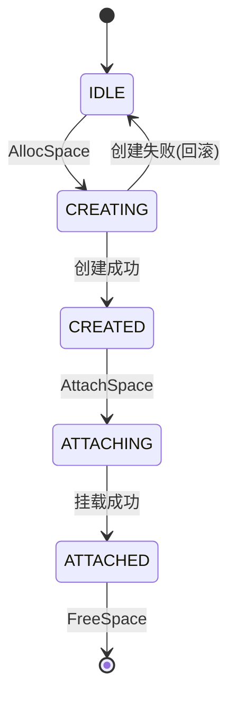

# 需求分析文档生成指南

本 skill 生成结构化的需求分析文档(Requirement Analysis Document),从需求视角描述模块的功能与非功能要求,作为设计、开发、测试与验收的依据。支持两种工作模式:

- **需求驱动模式(Requirement-Driven)**:从原始需求(用户故事、PRD、市场需求、口述描述)出发,正向分析并编写需求规约。适用于新模块开发、需求评审、立项阶段。
- **代码反推模式(Code-Driven)**:从已有代码反推需求规约。适用于遗留系统文档化、代码审计、文档补全。

两种模式输出结构完全一致(12 章标准结构),差异仅在于信息来源与编写路径。

## 1. 何时触发与模式选择

### 1.1 触发条件(满足任一即触发)

- 用户明确要求生成"需求分析文档"、"需求文档"、"requirement analysis document"
- 用户描述新功能/新模块的需求(如"我们要做一个 XXX 模块,需要支持 YYY")
- 用户给出某模块路径并要求分析需求
- 用户要求从代码反推需求规约
- 用户要求为某模块编写验收标准/验收用例
- 用户提供 PRD/用户故事/市场需求文档,要求转化为需求规约

### 1.2 模式判定

| 用户输入特征 | 模式 | 信息来源 |
|--------------|------|----------|
| 描述新模块/新功能,无代码 | 需求驱动 | 用户口述、PRD、用户故事 |
| 提供需求文档/PRD/用户故事 | 需求驱动 | 用户提供的需求材料 |
| 给出代码路径要求分析 | 代码反推 | 源码、接口、注释、测试 |
| 已有代码但要求补需求文档 | 代码反推 | 源码为主,需求材料为辅 |
| 既有需求描述又有代码 | 混合模式 | 需求材料为主,代码验证 |

**判定优先级**:若用户同时提供需求描述和代码路径,优先采用需求驱动模式,代码作为验证与补充。

### 1.3 模式澄清

若输入不足以明确判定模式,使用 `AskUserQuestion` 询问:

```
问题:本次需求分析文档的信息来源是什么?
选项:
1. 从已有代码反推需求(代码反推模式)
2. 基于我提供的需求描述/PRD 编写(需求驱动模式)
3. 两者结合:需求描述为主,代码验证为辅(混合模式)
```

### 1.4 不触发的情况

- 用户要求生成设计文档(应使用 design-doc 思路)
- 用户要求生成测试文档(应使用 test-design 思路)
- 用户仅询问单个函数/类的功能(直接回答即可)
- 用户仅要求修改已有需求文档的个别章节(直接编辑即可)

## 2. 文档标准结构

需求分析文档必须包含以下 12 章,章节顺序与标题固定:

```
1. 引言            —— 文档目的、范围、术语、参考资料
2. 业务背景与目标   —— 业务痛点、目标、用户角色
3. 总体需求         —— 系统定位、运行环境、架构关系
4. 功能需求         —— 核心:按功能域拆分,含 FR-XXX 编号
5. 非功能需求       —— 性能/可靠性/安全/可用性/可维护性/可扩展性/兼容性
6. 约束条件         —— 业务约束 + 技术约束
7. 场景分析         —— 典型主流程 + 异常分支
8. 数据模型         —— 核心实体关系 + 关键数据结构
9. 接口清单         —— 对外接口 + 内部接口
10. 风险与对策      —— 风险识别 + 应对措施
11. 验收标准汇总    —— 功能验收 + 非功能验收
12. 附录            —— 错误码、常量、相关文档
```

## 3. 各章节编写指南

### 3.1 第 1 章 引言

**1.1 文档目的**:一句话说明文档目标(作为设计/开发/测试/验收的依据)。

**1.2 文档范围**:列出文档涵盖的需求域(如存储资源分配、释放、挂载等),从源码模块功能边界反推。

**1.3 术语与缩略语**:从代码注释、命名中提取专业术语,形成表格:

| 术语 | 全称 | 含义 |
|------|------|------|
| XXX  | XXX  | XXX  |

**1.4 参考资料**:关联项目内文档(CODE_WIKI.md、设计文档、AGENTS.md)+ 外部规范(NVMe Spec、协议 RFC)。

### 3.2 第 2 章 业务背景与目标

**2.1 业务背景**:分析模块解决的痛点(3~5 条),从模块存在意义反推。例如:"传统存储资源管理存在资源利用率低、扩展性差、运维复杂等痛点"。

**2.2 业务目标**:用表格量化目标与衡量指标:

| 目标 | 衡量指标 |
|------|----------|
| 资源池化 | 多设备统一调度,按需分配 |
| 动态分配 | 秒级完成,无需人工干预 |

**2.3 用户角色**:识别模块的使用者(平台管理员、业务用户、虚拟机、运维系统),列出典型操作。

### 3.3 第 3 章 总体需求

**3.1 系统定位**:说明模块在系统架构中的位置(上层依赖什么、下层被什么依赖)。

**3.2 运行环境**:从 `CMakeLists.txt`、构建脚本、AGENTS.md 提取:

| 项目 | 要求 |
|------|------|
| 操作系统 | openEuler Linux ARM64 |
| 编译器 | GCC 10+,C++17/C11 |
| 依赖库 | libxxx.so |

**3.3 架构关系**:使用 drawio-skill 绘制架构关系图,描述模块与上下游的关系(上游接入层、下游依赖、跨节点协同)。绘制与归档规范见 [5.6 架构图绘制规范](#56-架构图绘制规范drawio-skill)。

### 3.4 第 4 章 功能需求(核心章节)

#### 3.4.1 功能域识别

**需求驱动模式**:
- 从用户故事分解功能域:`As a <角色>, I want <功能>, so that <价值>` → 一个用户故事通常对应一个功能域
- 从 PRD 章节结构映射:PRD 的功能模块章节 → 功能域
- 从业务流程分解:将端到端业务流程拆分为可独立验收的功能单元
- 从用户操作场景提取:列出用户可执行的操作,每类操作对应一个功能域

**代码反推模式**:
- 从模块的对外接口(通常在 `src/include/plugin_services/<module>/<module>_service.h` 的纯虚接口)反推功能域
- 每个主要接口对应一个功能域,编号 `FR-XXX`
- 从 IPC handler / HTTP handler 列表补充功能域

**混合模式**:以需求驱动的功能域列表为主,用代码接口验证是否遗漏。

#### 3.4.2 功能域展开模板

每个功能域按以下子章节展开:

```
### 4.X 功能名(FR-XXX)
#### 4.X.1 需求描述
一段话描述功能目标(从用户价值视角描述,而非技术实现)。

#### 4.X.2 输入参数
| 参数 | 类型 | 必填 | 约束 |
|------|------|------|------|
| name | string | 是 | 最大 48 字符,全局唯一 |

#### 4.X.3 功能规则
**FR-XXX-01 规则名**
- 具体规则描述

#### 4.X.4 输出结果
列出返回的数据结构。

#### 4.X.5 验收标准
| 编号 | 验收项 |
|------|--------|
| AC-XXX-01 | 验收描述 |
```

#### 3.4.3 规则编写要点

**需求驱动模式**:
- 从业务规则直接编写(如"分配容量必须为 4K 对齐")
- 从用户故事验收条件提取(用户故事的 Acceptance Criteria → AC-XXX)
- 从业务约束推导(如"单租户最大分配容量不超过集群总容量 80%")
- 从合规要求提取(如"操作日志保留 180 天")
- 用 MoSCoW 优先级标注(Must/Should/Could/Won't)

**代码反推模式**:
- 从 `if/else` 分支提取条件规则(如"当 nsNum==1 时,strategy 不生效")
- 从 `for` 循环提取批量处理规则
- 从 `try/catch` 或错误返回提取异常处理规则
- 从注释提取业务约束
- 从常量定义提取边界值(如 `MAX_NS_PER_DEV = 128`)
- 注意区分"业务规则"与"实现细节",仅记录业务规则

**混合模式**:需求驱动的规则为主,代码中的边界值与异常处理作为补充约束。

#### 3.4.4 输入参数约束来源

| 约束类型 | 需求驱动模式来源 | 代码反推模式来源 |
|----------|------------------|------------------|
| 长度限制 | 业务规则、合规要求 | `strncpy_s` 的 sizeof、`constexpr` 常量 |
| 取值范围 | 业务语义、物理约束 | `EXPECT_GE`/`EXPECT_LE` 断言、enum 定义 |
| 格式校验 | 业务规范(如 GUID 格式) | 正则校验、`isdigit`/`isalpha` 调用 |
| 互斥/依赖 | 业务规则(如 A 触发时 B 不可用) | 状态机分支、锁的获取顺序 |

### 3.5 第 5 章 非功能需求

按以下 7 类组织,每类用表格列出编号、需求项、指标/说明:

| 类别 | 编号前缀 | 需求驱动模式来源 | 代码反推模式来源 |
|------|----------|------------------|------------------|
| 性能 | NFR-PERF | SLA、业务场景要求、竞品基准 | 代码超时常量、线程池大小、队列容量 |
| 可靠性 | NFR-REL | 业务可用性要求、RTO/RPO 指标 | 重试逻辑、幂等设计、状态恢复、故障切换 |
| 安全 | NFR-SEC | 合规要求(等保/GDPR)、安全评审 | mTLS、身份验证、权限校验、安全函数(strncpy_s) |
| 可用性 | NFR-AVAIL | 用户习惯、易用性要求 | 多接入方式(SDK/HTTP/CLI)、多语言 SDK |
| 可维护性 | NFR-MAINT | 运维要求、团队规范 | 结构化日志、traceId、插件化、UT 覆盖 |
| 可扩展性 | NFR-SCALE | 业务增长预测、容量规划 | 多节点扩展、设备规模、配置化 |
| 兼容性 | NFR-COMPAT | 部署环境约束、升级路径 | 操作系统、库版本、语言标准 |

**需求驱动模式要点**:
- 性能指标必须可量化且有依据(如"基于 P99 SLA ≤ 3s"或"参考线上峰值 QPS 5000")
- 可靠性指标明确 RTO/RPO(如"故障切换 RTO ≤ 30s, RPO = 0")
- 安全指标引用合规标准(如"满足等保三级要求")
- 每项 NFR 应标注优先级(Must/Should/Could)

**代码反推模式要点**:
- 从代码常量推导当前实现的性能边界(如 `MAX_TIMEOUT_SECONDS = 30` → 单次操作超时 ≤ 30s)
- 从重试逻辑推导可靠性能力(如 `MAX_RETRY_COUNT = 3` → 失败重试 3 次)
- 标注"现状"与"建议"两列,识别代码实现与理想指标的差距

示例:
```
| NFR-PERF-01 | 单次 alloc 响应时间 | ≤ 3 秒(需求驱动,来自 SLA) |
| NFR-REL-03  | 操作幂等性 | alloc/free 均支持幂等(代码反推,见 ExecuteAlloc 幂等检查) |
| NFR-SEC-01  | mTLS 双向认证 | HTTP 接入必须使用 mTLS(需求驱动,来自安全评审) |
```

### 3.6 第 6 章 约束条件

**6.1 业务约束**:

| 模式 | 来源 | 示例 |
|------|------|------|
| 需求驱动 | 业务规则、合同条款、法规要求 | 单租户最大分配容量不超过集群总容量 80%;操作日志保留 180 天 |
| 代码反推 | 代码常量、校验逻辑 | name 最大 48 字符(受 SSU_NAME_MAX_LEN 限制);单设备最大 namespace 数为 128 |

| 编号 | 约束 |
|------|------|
| CON-BIZ-01 | name 最大 48 字符(受 SSU_NAME_MAX_LEN 限制) |
| CON-BIZ-07 | 单设备最大 namespace 数为 128 |

**6.2 技术约束**:

| 模式 | 来源 | 示例 |
|------|------|------|
| 需求驱动 | 技术选型、部署架构、团队能力 | 必须支持 ARM64 架构;主备高可用,不能单点 |
| 代码反推 | 架构设计、CMakeLists、加载方式 | 必须通过 dlopen 加载 libssu.so;账本操作只在 master 端 |

| 编号 | 约束 |
|------|------|
| CON-TECH-01 | 必须通过 dlopen 加载 libssu.so,不能静态链接 |
| CON-TECH-03 | 账本操作只在 master 端进行 |

### 3.7 第 7 章 场景分析

为每个关键用户角色编写 1~2 个场景,每个场景包含:

```
### 7.X 场景名
**角色**:xxx
**前置条件**:xxx

**主流程**:
1. 用户调用 XXX(...)
2. 系统校验参数
3. 系统执行 XXX
4. 返回结果

**后置条件**:xxx

**异常分支**:
- 异常情况1:返回 XXX 错误
- 异常情况2:执行 XXX 回滚
```

典型场景至少覆盖:
- 正常业务流程
- 并发场景
- 故障切换场景
- 隔离/权限场景

### 3.8 第 8 章 数据模型

**8.1 核心实体关系**:简单关系用 mermaid `erDiagram` 描述(1:N、N:1、N:M);复杂关系图使用 drawio-skill 绘制并归档(见 [5.6](#56-架构图绘制规范drawio-skill))。

| 模式 | 实体识别方式 |
|------|--------------|
| 需求驱动 | 从业务领域名词提取实体(如"存储空间"、"命名空间"、"租户") |
| 代码反推 | 从 `struct`/`class` 定义提取实体 |

**8.2 关键数据结构**:

| 模式 | 来源 |
|------|------|
| 需求驱动 | 基于业务语义设计字段,标注约束(长度/范围/格式),不绑定具体语言类型,可用伪代码或 UML |
| 代码反推 | 直接从代码的 `struct` 定义提取,用 ```cpp 代码块展示,标注字段含义 |

需求驱动模式示例(伪代码):
```
结构 存储空间分配请求 {
    name: string       // 请求标识,业务唯一,最大 48 字符
    nsSize: uint64     // 总容量(字节),必须为 4K 对齐
    nsNum: uint32      // namespace 数量,1~128
}
```

代码反推模式示例:
```cpp
struct UbseSsuAllocSpaceReq {
    std::string name;              // 请求标识,最大 48 字符
    uint64_t nsSize;               // 总容量(字节)
    uint32_t nsNum;                // namespace 数量
};
```

**8.3 状态机**:若模块含状态机,用 mermaid `stateDiagram-v2` 描述状态转换:

| 模式 | 来源 |
|------|------|
| 需求驱动 | 从业务流程推导状态(如"待分配 → 分配中 → 已分配 → 释放中 → 已释放") |
| 代码反推 | 从 `enum class *State` 与状态转换代码提取 |



### 3.9 第 9 章 接口清单

**9.1 对外服务接口**:

| 模式 | 来源 |
|------|------|
| 需求驱动 | 从功能域推导所需接口,定义接口名/输入/输出/错误码,标注 Must/Should |
| 代码反推 | 从 `src/include/plugin_services/<module>/<module>_service.h` 的纯虚接口提取 |

用表格列出:

| 接口名 | 功能 | 输入 | 输出 | 优先级 |

需求驱动模式应额外标注:
- 接口是否幂等
- 是否为同步/异步
- 鉴权要求

**9.2 跨节点 RPC 接口**:

| 模式 | 来源 |
|------|------|
| 需求驱动 | 从分布式协同需求推导(如"master 故障切换需要同步账本") |
| 代码反推 | 从 `*_rpc_processor.*` 或消息定义提取 |

| OpCode | 消息类型 | 方向 | 用途 |

**9.3 HTTP 接口**:

| 模式 | 来源 |
|------|------|
| 需求驱动 | 从外部系统集成需求推导(如"运维平台需要 REST API 查询分配状态") |
| 代码反推 | 从 `*_http_handler.*` 提取 |

| Method | URL | Handler | 功能 |

需求驱动模式应额外定义:
- 请求/响应 JSON Schema
- HTTP 状态码语义
- 鉴权方式(API Key / OAuth / mTLS)

### 3.10 第 10 章 风险与对策

识别 5~8 项风险,每项含影响与对策:

| 风险 | 影响 | 对策 |
|------|------|------|
| 并发冲突 | 数据不一致 | 加锁、幂等设计 |
| 硬件故障 | 操作失败 | 重试、回滚、告警 |

### 3.11 第 11 章 验收标准汇总

**11.1 功能验收**:按功能域汇总验收项数量与编号范围:

| 类别 | 验收项数量 | 关键验收项 |
|------|-----------|-----------|
| 分配(FR-ALLOC) | 7 | AC-ALLOC-01 ~ AC-ALLOC-07 |

**11.2 非功能验收**:汇总关键指标:

| 类别 | 关键指标 |
|------|----------|
| 性能 | alloc ≤ 3s,调度 ≤ 100ms |
| 可靠性 | 重启后状态恢复,故障切换 ≤ 30s |

### 3.12 第 12 章 附录

**12.1 错误码定义**:从代码的 `enum class` 或 `#define` 提取错误码表。

**12.2 关键常量**:从代码常量定义提取,含值与说明:

| 常量 | 值 | 说明 |
|------|----|------|
| MAX_NS_PER_DEV | 128 | 单设备最大 namespace 数 |

**12.3 相关文档**:关联项目内文档,使用相对路径链接。

## 4. 编写流程

### 4.1 需求驱动模式流程

适用于:新模块开发、需求评审、立项阶段、已有 PRD 转化为开发可执行的需求规约。

#### 4.1.1 需求收集阶段

**输入材料**(至少一种):
- PRD / 市场需求文档(MRD)
- 用户故事列表(User Stories)
- 业务流程图
- 用户口述需求(对话中获取)
- 竞品功能分析
- 合规要求文档

**信息提取要点**:
- 识别业务目标与成功指标(可量化的业务价值)
- 识别用户角色与典型操作
- 识别业务流程的端到端链路
- 识别业务规则与约束(合同、法规、行业规范)
- 识别非功能期望(SLA、可用性、安全合规)

**关键问题清单**(若信息不足,用 `AskUserQuestion` 询问):
1. 模块的核心业务目标是什么?如何衡量成功?
2. 主要用户角色有哪些?各自的核心操作是什么?
3. 关键业务流程的端到端链路是什么?
4. 性能 SLA 要求?(响应时间、吞吐量、并发数)
5. 可用性要求?(RTO/RPO、可用率)
6. 安全合规要求?(等保/GDPR/数据脱敏)
7. 与哪些上下游系统交互?接口协议是什么?
8. 有无已知的技术约束?(部署环境、技术栈、兼容性)

#### 4.1.2 需求分析与建模阶段

1. **功能域分解**:将业务需求拆分为独立可验收的功能域,每个功能域对应一组用户故事
2. **数据建模**:识别核心业务实体,定义实体关系与字段约束
3. **状态机建模**:对有生命周期的实体定义状态机
4. **接口设计**:从功能域推导对外接口,定义输入/输出/错误码
5. **场景编排**:基于业务流程编排主流程与异常分支场景
6. **非功能指标量化**:将"高性能""高可用"等定性描述转化为可验证的定量指标

#### 4.1.3 文档生成阶段

1. 先用 `TodoWrite` 创建 12 章节的任务清单
2. 按章节顺序生成,每章完成立即标记 completed
3. 章节间保持编号一致性(FR-XXX → AC-XXX → NFR-XXX → CON-XXX)
4. 每条 FR/NFR 标注 MoSCoW 优先级(Must/Should/Could/Won't)
5. 验收标准必须可测试( Given-When-Then 或量化指标)

#### 4.1.4 需求评审阶段

文档生成后,提示用户进行需求评审:
- 标注待澄清项(TBD),列出需要业务方确认的问题
- 标注假设项(Assumption),列出文档中基于假设推导的需求
- 提供评审 checklist:是否覆盖所有用户故事、是否遗漏异常场景、指标是否可验证

### 4.2 代码反推模式流程

适用于:遗留系统文档化、代码审计、文档补全、开源项目分析。

#### 4.2.1 信息收集阶段

**必须阅读的关键文件**:

1. **服务契约**:`src/include/plugin_services/<module>/<module>_service.h`
   - 提取:接口列表、枚举、结构体、Doxygen 注释(含参数约束)

2. **服务实现**:`src/controllers/<module>/<module>_service_imp.cpp`
   - 提取:业务流程、校验逻辑、错误码、状态机、重试/回滚

3. **模块入口**:`src/controllers/<module>/<module>_controller_module.cpp`
   - 提取:模块生命周期、依赖关系、初始化顺序

4. **关键子模块**:`src/controllers/<module>/<module>_<submodule>.{h,cpp}`
   - 提取:调度算法、采集器、账本、状态机等

5. **适配器**:`src/adapter_plugins/<module>/`
   - 提取:硬件操作接口、数据结构映射

6. **配置**:`conf/ubse.conf` 的 `[ubse.<module>]` 段
   - 提取:可配置参数、默认值

7. **测试**:`test/UT/controllers/<module>/`、`test/UT/adapter_plugins/<module>/`
   - 提取:边界值、异常场景、Mock 依赖

**辅助工具调用**:
- 使用 `LS` 列出模块目录结构
- 使用 `Grep` 搜索 `enum class`、`constexpr`、`MAX_`、`MIN_` 提取常量
- 使用 `Grep` 搜索 `UBSE_LOG_ERROR` 提取错误场景
- 使用 `Grep` 搜索 `EXPECT_EQ.*UBSE_` 从测试提取预期行为
- 使用 `SearchCodebase` 进行语义搜索(如"how does alloc handle concurrent requests")

#### 4.2.2 文档生成阶段

1. 先用 `TodoWrite` 创建 12 章节的任务清单
2. 按章节顺序生成,每章完成立即标记 completed
3. 章节间保持编号一致性(FR-XXX → AC-XXX → NFR-XXX → CON-XXX)
4. 使用相对路径链接关联项目内文档与代码
5. 注意区分"业务规则"与"实现细节",仅记录业务规则
6. 标注"现状"与"建议",识别代码实现与理想指标的差距

### 4.3 混合模式流程

适用于:已有代码实现,但需要补充新需求或重新梳理需求。

1. **先按需求驱动模式**收集新需求/变更需求
2. **再用代码反推模式**提取已有功能与约束
3. **对比分析**:识别新需求与已有功能的差异(新增/修改/废弃)
4. **文档生成**:
   - 已有功能:从代码反推,标注"现状"
   - 新增功能:从需求驱动,标注 MoSCoW 优先级与"待实现"
   - 修改功能:列出"变更前/变更后"对照

### 4.4 质量校验阶段(所有模式通用)

生成完成后,逐项校验:

**通用校验**:
- [ ] 所有功能域都有对应的验收标准(FR-XXX → AC-XXX)
- [ ] 非功能需求指标可量化(有具体数值或明确描述)
- [ ] 场景分析覆盖正常 + 异常分支
- [ ] 编号体系一致(FR/NFR/AC/CON 无冲突)

**需求驱动模式额外校验**:
- [ ] 每条 FR 标注了 MoSCoW 优先级
- [ ] 验收标准可测试(Given-When-Then 或量化指标)
- [ ] 待澄清项(TBD)与假设项(Assumption)已标注
- [ ] 覆盖所有用户故事

**代码反推模式额外校验**:
- [ ] 约束条件有代码依据(引用常量名或代码行)
- [ ] 数据结构与代码定义一致
- [ ] 接口清单与 `*_service.h` 一致
- [ ] 错误码与代码 `enum class` 一致
- [ ] 关键常量与代码 `constexpr` 一致

**归档规范性**:
- [ ] 文档输出到 `docs/design/modules/<模块名>/` 目录
- [ ] 文件名符合 `<模块名>模块需求分析文档.md` 规范
- [ ] 架构图使用 drawio-skill 绘制,`.drawio` 源文件与导出 PNG 归档到 `docs/design/images/<模块名>/`
- [ ] 图片引用路径为 `../../images/<模块名>/xxx.png`
- [ ] 已更新 `docs/design/README.md` 的文档清单表

## 5. 编写规范

### 5.1 编号体系

| 类型 | 前缀 | 示例 | 用途 |
|------|------|------|------|
| 功能需求 | FR | FR-ALLOC-01 | 功能规则 |
| 非功能需求 | NFR | NFR-PERF-01 | 性能/可靠/安全等 |
| 验收标准 | AC | AC-ALLOC-01 | 验收项 |
| 约束条件 | CON | CON-BIZ-01 | 业务/技术约束 |
| 待澄清 | TBD | TBD-01 | 需业务方确认的问题 |
| 假设项 | ASSUMPTION | ASSUMPTION-01 | 基于假设推导的需求 |

### 5.2 优先级标注(需求驱动模式必须)

每条 FR/NFR 标注 MoSCoW 优先级:

| 优先级 | 含义 | 示例 |
|--------|------|------|
| Must | 必须实现,影响发布 | FR-ALLOC-01 [Must] 分配容量必须 4K 对齐 |
| Should | 应该实现,但有变通 | NFR-PERF-02 [Should] 调度算法 ≤ 50ms |
| Could | 可以实现,资源允许时 | FR-QUERY-03 [Could] 支持模糊查询 |
| Won't | 本版本不实现 | FR-BATCH-01 [Won't] 批量分配接口 |

代码反推模式不标注优先级(代码已实现即为现状),但可在"建议"列标注改进方向。

### 5.3 文档头格式

**需求驱动模式**:
```
# <模块名> 模块需求分析文档

> 模式:需求驱动(Requirement-Driven)
> 输入材料:<PRD / 用户故事 / 口述需求 等>
> 文档版本:V0.1(草案)/ V1.0(评审通过)
> 编写日期:YYYY-MM-DD
> 评审状态:待评审 / 评审通过 / 已基线

---
```

**代码反推模式**:
```
# <模块名> 模块需求分析文档

> 模式:代码反推(Code-Driven)
> 源码路径:`src/controllers/<module>/`
> 服务契约:`src/include/plugin_services/<module>/<module>_service.h`
> 文档版本:V1.0
> 编写日期:YYYY-MM-DD

---
```

**混合模式**:
```
# <模块名> 模块需求分析文档

> 模式:混合(需求驱动 + 代码反推)
> 源码路径:`src/controllers/<module>/`(已有功能参考)
> 输入材料:<PRD / 用户故事 等>(新增需求来源)
> 文档版本:V0.1(草案)
> 编写日期:YYYY-MM-DD
> 评审状态:待评审

---
```

### 5.4 语言与风格

- 使用中文编写(除非用户另有要求)
- 技术术语保留英文(如 namespace、VFE、master/agent)
- 表格优先于长文本描述
- 代码示例使用 ```cpp 代码块
- 状态机/流程图使用 mermaid
- 架构图使用 drawio-skill 绘制(见 5.6)
- 文档内链接使用相对路径(如 `../../images/<模块名>/xxx.png`、`../xxx.md`)
- 需求驱动模式:验收标准使用 Given-When-Then 格式或量化指标
- 代码反推模式:引用代码位置使用相对路径链接

### 5.5 输出位置

文档输出到 `docs/design/modules/<模块名>/<模块名>模块需求分析文档.md`,遵循设计文档三层归档规则(架构/框架/模块):

```
docs/design/
├── architecture/         # 架构设计
├── framework/            # 框架设计
├── modules/              # 模块文档(按模块分子目录)
│   └── <模块名>/         # 本模块文档目录
│       ├── <模块名>模块需求分析文档.md   ← 本 skill 生成
│       ├── <模块名>模块设计文档.md
│       └── <模块名>模块测试设计文档.md
├── images/               # 图片资源(按层级分目录)
│   ├── architecture/
│   ├── framework/
│   └── modules/          # 模块文档图片存放于此
│       └── <模块名>/     # 按模块归档 .drawio 源文件与导出图片
└── README.md             # 文档索引(新增文档需更新此文件)
```

**图片与架构图归档规则**:
- 架构图(架构关系图等)必须使用 drawio-skill 绘制,产出可编辑的 `.drawio` 源文件,并导出 PNG 供文档引用
- `.drawio` 源文件与导出图片归档到 `docs/design/images/<模块名>/`(按模块分子目录)
- 归档文件命名:`<英文主题名>.drawio`(可编辑源文件)+ `<英文主题名>.png`(导出 PNG)。主题名用英文、描述性、不含章节号(避免章节调整导致失效),如 `system-architecture`、`deployment-position`
- 文档内引用使用相对路径:模块文档 `../../images/<模块名>/<英文主题名>.png`;特性文档 `../../../images/<模块名>/<特性名>/<英文主题名>.png`(特性文档深一级,需多加一层 `../`)
- 新增文档后需更新 `docs/design/README.md` 的文档清单表

**归档规则参考**:[docs/design/README.md](../../../docs/design/README.md)

### 5.6 架构图绘制规范(drawio-skill)

本 skill 涉及的**架构图**(如 3.3 架构关系图)必须使用 drawio-skill 绘制,禁止用 ASCII 字符画替代。

**调用方式**:生成文档遇到需要架构图的章节时,调用 drawio-skill 完成绘制与导出。

**绘制与归档流程**:
1. 调用 drawio-skill,确定图类型(架构图/泳道图)与内容(组件、连接、协议标注)
2. 生成 `.drawio` 源文件,归档到 `docs/design/images/<模块名>/`
3. 使用 draw.io CLI 导出 PNG
4. 使用 drawio-skill 的 `validate.py` 校验结构(悬空连线、重复 id、父容器错误)
5. 文档中引用导出 PNG:模块文档 `../../images/<模块名>/<英文主题名>.png`;特性文档 `../../../images/<模块名>/<特性名>/<英文主题名>.png`
6. 保留 `.drawio` 源文件,便于后续维护编辑

**校验项**:
- [ ] `.drawio` 源文件已归档到 `docs/design/images/<模块名>/`
- [ ] 导出 PNG 文档引用路径正确
- [ ] 图内容与文档章节描述一致(组件、连接、协议标注)

## 6. 与其他文档的关系

需求分析文档是文档体系的源头,下游文档应与之一致:

```
需求分析文档 (FR/NFR/AC)  ←  源头,定义"做什么"
       │
       ├──> 设计文档    ←  定义"怎么做"(架构/类设计/时序图)
       │
       ├──> 测试设计文档 ←  验证"是否做到"(用例映射 AC)
       │
       └──> 验收报告    ←  记录"验收结果"(AC 通过情况)
```

**一致性要求**:
- 设计文档的类/函数应覆盖所有 FR-XXX 功能需求
- 测试文档的用例应覆盖所有 AC-XXX 验收标准
- 性能测试的指标应与 NFR-PERF-XX 一致

## 7. 示例

### 7.1 代码反推模式示例

参考已生成的需求分析文档:
- [SSU模块需求分析文档.md](../../../docs/design/modules/ssu/SSU模块需求分析文档.md) —— 完整 12 章示例,含 11 个功能域、58 项验收标准

该文档的关键特征:
- 第 4 章按 FR-ALLOC/FR-FREE/FR-ATTACH/FR-DETACH/FR-PERM/FR-FE-DEVICE/FR-DISTRIBUTED/FR-COLLECTOR/FR-SCHEDULER/FR-NORTHBOUND/FR-QUERY 11 个功能域组织
- 第 5 章按 NFR-PERF/NFR-REL/NFR-SEC/NFR-AVAIL/NFR-MAINT/NFR-SCALE/NFR-COMPAT 7 类组织
- 第 7 章含 5 个典型场景(业务用户、VFE 直通、master 故障切换、并发分配、跨租户隔离)
- 第 11 章汇总 58 项验收标准,按功能域分类

### 7.2 需求驱动模式示例(用户故事驱动)

**用户输入示例**:
```
我们要做一个"配额管理"模块,需求如下:
- 平台管理员可以为每个租户设置存储配额上限
- 业务用户分配存储空间时,系统自动校验配额
- 配额支持按容量(GB)和 namespace 数量两个维度
- 配额超限时,分配请求被拒绝并返回明确错误
- 管理员可以随时调整配额,立即生效
- 需要提供查询接口,租户可查看自己的配额与已用量
```

**skill 应执行的动作**:
1. 识别为"需求驱动模式"(无代码,口述需求)
2. 用 `AskUserQuestion` 补充关键问题:
   - 性能 SLA?(如配额校验 ≤ 10ms)
   - 配额是否支持预留?(如管理员预分配)
   - 超配额行为?(硬限制拒绝 vs 软限制告警)
3. 分解功能域:FR-QUOTA-SET(设置配额)/ FR-QUOTA-CHECK(配额校验)/ FR-QUOTA-ADJUST(调整配额)/ FR-QUOTA-QUERY(查询配额)
4. 每条 FR 标注 MoSCoW 优先级
5. 生成 12 章文档,输出到 `docs/design/modules/quota/配额管理模块需求分析文档.md`
6. 标注 TBD 项(如"配额数据是否需要持久化到数据库?")与 Assumption 项(如"假设配额数据存储在 master 内存,故障切换时从账本重建")
7. 提示用户进行需求评审

### 7.3 混合模式示例

**用户输入示例**:
```
基于 src/controllers/ssu 现有代码,补充"配额管理"功能的需求文档。
配额管理是新需求,需要在现有 SSU 分配流程中增加配额校验。
```

**skill 应执行的动作**:
1. 识别为"混合模式"(既有代码路径又有新需求)
2. 先按需求驱动模式收集"配额管理"新需求
3. 再按代码反推模式提取现有 SSU 分配流程
4. 文档中:
   - 已有功能(分配/释放/挂载等):从代码反推,标注"现状"
   - 新增功能(配额设置/校验/查询):从需求驱动,标注 [Must] 与"待实现"
   - 修改功能(分配流程增加配额校验):列出"变更前/变更后"对照
5. 输出文档头使用混合模式格式
