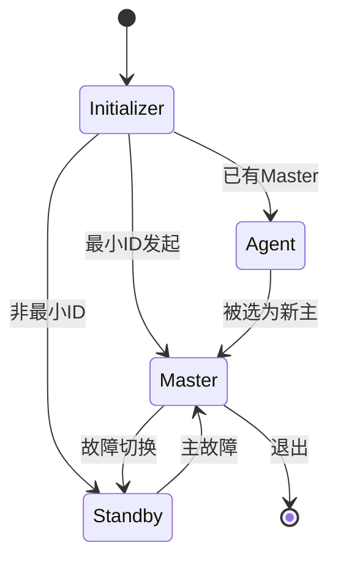

# UBS-Engine 技术架构设计文档

> 本文档从技术架构设计视角描述 UBS-Engine 的架构原则、分层设计、模块化机制、通信架构、高可用架构、安全架构、插件化架构与关键设计模式,作为架构评审、技术选型与演进决策的依据。
>
> 业务架构与部署形态详见 [architecture.md](architecture.md);代码细节与关键类/函数清单详见 [UBSE代码Wiki.md](UBSE代码Wiki.md)。

---

## 目录

- [1. 架构概述](#1-架构概述)
  - [1.1 系统定位](#11-系统定位)
  - [1.2 设计目标](#12-设计目标)
  - [1.3 架构原则](#13-架构原则)
  - [1.4 技术选型](#14-技术选型)
- [2. 分层架构设计](#2-分层架构设计)
  - [2.1 分层总览](#21-分层总览)
  - [2.2 Framework 框架层](#22-framework-框架层)
  - [2.3 Controllers 控制器层](#23-controllers-控制器层)
  - [2.4 API Server 接入层](#24-api-server-接入层)
  - [2.5 Adapter Plugins 适配层](#25-adapter-plugins-适配层)
  - [2.6 Addons 扩展层](#26-addons-扩展层)
  - [2.7 SDK / CLI 消费层](#27-sdk--cli-消费层)
- [3. 模块化机制(核心设计)](#3-模块化机制核心设计)
  - [3.1 UbseModule 基类与生命周期](#31-ubsemodule-基类与生命周期)
  - [3.2 依赖声明与拓扑排序](#32-依赖声明与拓扑排序)
  - [3.3 模块间通信](#33-模块间通信)
  - [3.4 服务注册与契约解耦](#34-服务注册与契约解耦)
- [4. 通信架构](#4-通信架构)
  - [4.1 通信通道总览](#41-通信通道总览)
  - [4.2 节点内 IPC(UDS)](#42-节点内-ipcuds)
  - [4.3 节点间 RPC(HCOM)](#43-节点间-rpchcom)
  - [4.4 北向 HTTP](#44-北向-http)
  - [4.5 路由设计](#45-路由设计)
- [5. 高可用架构](#5-高可用架构)
  - [5.1 分布式选主](#51-分布式选主)
  - [5.2 故障切换](#52-故障切换)
  - [5.3 数据一致性对账](#53-数据一致性对账)
- [6. 安全架构](#6-安全架构)
  - [6.1 进程权限](#61-进程权限)
  - [6.2 接入鉴权](#62-接入鉴权)
  - [6.3 审计日志](#63-审计日志)
- [7. 插件化架构](#7-插件化架构)
  - [7.1 插件分层](#71-插件分层)
  - [7.2 节点级适配器插件](#72-节点级适配器插件)
  - [7.3 Rack 级业务插件](#73-rack-级业务插件)
  - [7.4 插件准入与生命周期](#74-插件准入与生命周期)
- [8. 关键设计模式与亮点](#8-关键设计模式与亮点)
- [9. 部署架构](#9-部署架构)
- [10. 架构演进方向](#10-架构演进方向)
- [11. 附录](#11-附录)

---

## 1. 架构概述

### 1.1 系统定位

UBS-Engine(UB Service Core Engine)是软件定义计算场景下的**资源按需组合与分配引擎**,以 daemon(`ubse`)形式部署于集群每个节点,向上为业务应用提供统一的资源管理接口,向下对接硬件与底层能力,实现内存、节点拓扑、URMA、SSU 等资源的池化、调度与故障容错。

### 1.2 设计目标

| 目标 | 说明 |
|------|------|
| 资源池化 | 内存(FD/NUMA/Addr/SHM 四形态)、SSU、URMA 等资源的按需借用与归还 |
| 高可用 | 软件去中心化,支持 N-1 节点故障,池化资源故障不扩散 |
| 可扩展 | 节点级适配器插件 + Rack 级业务插件,动态加载 |
| 标准化 | 与普罗生态兼容的监控度量,北向 IPC+HTTP 双通道 |
| 高性能 | 内存借用 10ms/GB,内核页迁移 8GB/s |

### 1.3 架构原则

1. **分层解耦**:自底向上 Framework → Controllers → API Server → SDK/CLI,层间只通过契约接口交互
2. **模块化装配**:所有模块继承 `UbseModule`,通过依赖声明由上下文拓扑排序按序激活,可按需裁剪
3. **契约优先**:控制器对外接口以抽象基类形式定义于 `src/include/plugin_services/`,SDK 与内部模块解耦引用
4. **插件化扩展**:节点级适配器对接硬件,Rack 级插件承载完整业务子系统,二者均动态加载
5. **去中心化**:集群内动态选主,资源调度决策由主节点负责,主备倒换秒级完成
6. **幂等可重入**:核心操作(分配/释放/挂载/权限)幂等,故障处理流程可重入

### 1.4 技术选型

| 领域 | 选型 | 说明 |
|------|------|------|
| 语言标准 | C++17 / C11 | 命名空间统一 `ubse::*` |
| 构建 | CMake 3.22+ | Ninja 优先,支持 ASAN/UBSAN/覆盖率 |
| 目标平台 | openEuler Linux ARM64 | 兼容 x86_64 构建 |
| 测试 | GoogleTest + MockCpp | UT/IT/PT/FUZZ 四层 |
| RPC | HCOM(华为自研) | TCP/UDS/HCCS/UB 多协议 |
| HTTP | cpp-httplib | 含 OpenSSL 支持 |
| 配置 | INI 风格 | section/key 组织 |
| XML | libxml2 | 拓扑/配置解析 |
| JSON | rapidjson | 序列化 |
| 安全 | libaudit + capability + mTLS | 审计/权限/双向认证 |

---

## 2. 分层架构设计

### 2.1 分层总览

UBSE 采用**六层架构**,自底向上依次为:Adapter Plugins → Framework → Controllers → API Server → Addons → SDK/CLI。

```
┌─────────────────────────────────────────────────────────────┐
│  消费层:CLI(ubsectl) / C SDK / Go SDK / Python SDK          │
└───────────────┬──────────────────────────────┬──────────────┘
                │ UDS IPC                       │ HTTP
┌───────────────▼──────────────────────────────▼──────────────┐
│  API Server 层:UbseApiServerModule (UDS + 权限校验)         │
└───────────────┬─────────────────────────────────────────────┘
                │
┌───────────────▼─────────────────────────────────────────────┐
│  Controllers 层:mem / node / npu / ssu / urma 资源控制器    │
│  (通过 plugin_services 契约暴露)                            │
└───────────────┬─────────────────────────────────────────────┘
                │
┌───────────────▼─────────────────────────────────────────────┐
│  Framework 层:com / config / event / ha / http / ipc /      │
│                log / plugin_mgr / security / serde / ...     │
└───────────────┬─────────────────────────────────────────────┘
                │
┌───────────────▼─────────────────────────────────────────────┐
│  Adapter Plugins 层:mmi / mti / ssu / syssentry /           │
│                      urma_uvs / bandbridge(.ko)              │
├─────────────────────────────────────────────────────────────┤
│  Addons 层(Rack 插件):rmrs / ucache / virt_agent /          │
│                         process_mem                          │
├─────────────────────────────────────────────────────────────┤
│  RAS 故障处理 / Message 消息基类                              │
└─────────────────────────────────────────────────────────────┘
```

**层间依赖规则**:
- 上层可依赖下层,下层禁止反向依赖上层
- 同层模块间通过 Framework 提供的机制(event/com)通信,避免直接持有
- Controllers 通过 `plugin_services/` 契约被 API Server 与 SDK 引用,不直接暴露实现

### 2.2 Framework 框架层

`src/framework/` 提供 21 个子模块,是整个系统的基石,详见 [UBSE代码Wiki.md 第 6 章](UBSE代码Wiki.md#6-framework-框架层)。核心模块:

| 子模块 | 职责 | 关键设计 |
|--------|------|----------|
| context | 全局上下文,模块注册/拓扑排序/生命周期 | 单例 + 模板 GetModule<T> |
| config | INI 配置读取 | 静态注册 ConfigItem |
| log | 日志与审计 | ringbuffer 异步 + libaudit dlopen |
| com | 节点间 RPC | HCOM + 多跳路由 |
| ha | 分布式选主 | master/standby/agent + global 级联 |
| event | 事件总线 | 发布/订阅 + 三级优先级 |
| http | HTTP 服务端/客户端 | cpp-httplib + mTLS |
| ipc | UDS IPC | epoll + 短/长连接 + 用户限额 |
| plugin_mgr | 动态库加载 | 准入配置 + Init/DeInit 回调 |
| security | 进程权限 | Linux capability |
| misc | 工具集 | container/crc/lock/referable 等 |

### 2.3 Controllers 控制器层

`src/controllers/` 是资源调度的业务核心层,每个控制器以 `ServiceImp` 为编排中心,组合 Collector/Scheduler/ReservationMgr 等子模块:

| 控制器 | 核心职责 | 服务契约 |
|--------|----------|----------|
| mem | 内存池化借用归还(FD/NUMA/Addr/SHM) | `plugin_services/mem/` |
| node | 节点拓扑管理 | `plugin_services/node/`(规划中) |
| npu | NPU 资源管理与虚机状态监控 | —(暂无对外契约) |
| urma | URMA 远程内存访问设备管理 | `plugin_services/urma/`(规划中) |
| ssu | SSU 共享存储分配/释放/挂载 | `plugin_services/ssu/` |

> **现状说明**:`plugin_services/` 目前已落地 mem(含 service_def)与 ssu 契约,node/urma 契约待按目录规范补充。

控制器标准子模块结构:

```
controllers/<module>/
├── <module>_controller_module.{h,cpp}    # 模块入口(生命周期)
├── <module>_service_imp.{h,cpp}          # 服务实现(业务编排)
├── <module>_scheduler.{h,cpp}            # 调度器(责任链)
├── <module>_collector.{h,cpp}            # 收集器(设备采集)
├── <module>_http_handler.{h,cpp}         # HTTP 路由
├── <module>_rpc_processor.{h,cpp}        # 跨节点 RPC
├── <module>_reservation_mgr.{h,cpp}      # 预留管理(可选)
├── debt/                                 # 借欠账管理(可选)
├── ipc/                                  # IPC handler
└── message/                              # 跨节点消息定义
```

详见 [目录规范文档 2.4.1](../../conventions/目录规范文档.md)。

### 2.4 API Server 接入层

`src/api_server/` 是北向统一接入层,职责:
- 承载 SDK/CLI 的 UDS IPC 接入,按 `moduleCode/opCode` 分发到各控制器注册的 handler
- 权限校验(基于 mTLS 证书 CN/OU 提取身份)
- 对象管理(`UbseApiServerObjectManager`)

**归档位置**:鉴权管理器与对象管理器实现归档在框架层 IPC 模块下(`src/framework/ipc/auth/`),对外头文件在 `src/framework/ipc/include/`。

**设计要点**:API Server 自身不承载业务逻辑,仅做路由分发与鉴权,业务逻辑下沉到 Controllers,保证接入层轻量可替换。

### 2.5 Adapter Plugins 适配层

`src/adapter_plugins/` 对接外部系统与硬件,以动态库形式加载:

| 适配器 | 对接对象 |
|--------|----------|
| mmi | OBMM 内存管理接口 |
| mti | MTI 拓扑(lcne/out_of_band/smbios) |
| ssu | SSU 硬件适配 |
| syssentry | 系统哨兵(故障广播) |
| urma_uvs | URMA UVS |
| bandbridge | 带宽桥接(内核态 .ko) |

**设计要点**:适配器以 `dlopen` 加载,通过函数指针调用硬件能力,与 Controllers 解耦,便于跨硬件平台移植。

### 2.6 Addons 扩展层

`src/addons/` 是 Rack 级业务插件,每个都是完整子系统:

| 插件 | 职责 |
|------|------|
| rmrs | Rack Memory Pooling,机柜级内存碎片再利用 |
| ucache | 微缓存超分,集群级 IO 缓存池 |
| virt_agent | 虚拟机代理,VM 热迁移/确定性热迁移 |
| process_mem | 进程内存插件,进程级内存管理 |

**设计要点**:Addons 拥有独立的 common/conf/docs/include/interface 目录,可独立演进;通过 `rack_<plugin>_plugin` 入口接入主进程。

### 2.7 SDK / CLI 消费层

| 消费方 | 通信方式 | 说明 |
|--------|----------|------|
| C SDK | UDS IPC | `libubse`,供外部系统对接 |
| Go SDK | UDS IPC + dlopen 桥接 | engine/ipc/mem/ssu/urma 等包 |
| Python SDK | UDS IPC + FFI | models/ubse_engine.py |
| CLI(ubsectl) | UDS IPC | 命令注册器框架,按模块注册子命令 |

---

## 3. 模块化机制(核心设计)

### 3.1 UbseModule 基类与生命周期

所有模块继承 `ubse::module::UbseModule`,统一生命周期:

```
Init → Start → Stop → Destroy
```

- **Init**:注册 IPC dispatcher、HTTP 路由、依赖句柄获取
- **Start**:启动 collector(仅 master)、注册定时器、初始化状态机
- **Stop**:注销定时器、停止 collector、释放资源
- **Destroy**:清理模块状态

### 3.2 依赖声明与拓扑排序

模块通过宏声明依赖,由 `UbseContext` 拓扑排序后按序激活:

```cpp
CORE_MODULE_IMPL(UbseSsuControllerModule, UbseComModule, UbseHaModule, ...)    // 强依赖
OPTIONAL_MODULE_IMPL(UbseXxxModule, UbseLogModule)                              // 弱依赖
```

- `CORE_MODULE_IMPL`:依赖必须先激活
- `OPTIONAL_MODULE_IMPL`:依赖可选,缺失不影响本模块启动
- `UbseContext::TopologicalSort` 基于依赖图排序,`ResolveActivation` 解析激活顺序,`ActivateWithDependencies` 按序激活
- `CheckDependencyType<T>()` 编译期校验依赖类型完整

**典型激活顺序**:`config → log → trace_context → thread_pool → event → security → com → ha(election) → node_mgr → storage → http → vip → plugin_mgr → 业务模块(controllers/api_server/ras)`。

### 3.3 模块间通信

| 通信方式 | 适用场景 | 机制 |
|----------|----------|------|
| 直接调用 | 同进程内强依赖 | `UbseContext::GetModule<T>()` 获取句柄 |
| 事件总线 | 松耦合通知 | `UbseEventModule::UbseSubEvent/UbsePubEvent` |
| RPC | 跨节点 | `UbseComModule::RpcSend` |
| IPC | SDK↔daemon | `UbseIpcServer::RegisterHandler` |

### 3.4 服务注册与契约解耦

控制器对外接口以**抽象基类**形式定义于 `src/include/plugin_services/<module>/`,命名规范 `Ubse<Module>Service`:

```
src/include/plugin_services/
├── mem/    # UbseMemService(已落地,含 service_def)
├── ssu/    # UbseSsuService(已落地)
├── node/   # UbseNodeService(规划中)
└── urma/   # UbseUrmaService(规划中)
```

**设计价值**:SDK 与内部模块仅依赖契约头文件,不依赖控制器实现,实现消费方与提供方解耦,便于单元测试 Mock。

> **目录规范约束**:`src/include/controllers/<module>/` 已冻结,新增控制器对外接口一律归档到 `plugin_services/<module>/`,详见 [目录规范文档 2.2.3](../../conventions/目录规范文档.md)。

---

## 4. 通信架构

### 4.1 通信通道总览

UBSE 提供**两条对外通道** + **一条跨节点通道**:

```
┌────────────┐  UDS IPC   ┌─────────────┐  RPC(HCOM)  ┌────────────┐
│ SDK / CLI  │───────────▶│ API Server  │────────────▶│ 其他节点    │
└────────────┘            └─────────────┘             └────────────┘
       │                        │
       │  HTTP                  │  HTTP
       ▼                        ▼
┌────────────────────────────────────────┐
│  Controllers(via framework/http)       │
└────────────────────────────────────────┘
```

### 4.2 节点内 IPC(UDS)

- **Socket**:`/var/run/ubse/ubse.sock`
- **协议**:短连接(请求-响应)+ 长连接(事件订阅/异步通知)
- **并发控制**:按用户限额(`maxTransientConnectionsPerUser`、`maxPersistentConnectionsPerUser`)
- **消息格式**:`UbseRequestHeader{moduleCode, opCode, bodyLen, clientRequestId}` + body
- **底层**:epoll + 阻塞读写保证完整长度
- **同步等待**:长连接模式由 `UbseSyncReq` 单例管理 requestId → future 映射

### 4.3 节点间 RPC(HCOM)

- **多协议**:TCP / UDS / HCCS / UB
- **角色**:Server/Client 双角色,`UbseRpcServer` 承载服务端
- **TLS**:支持证书认证
- **C 风格 API**:`UbseRegRpcService` / `UbseRpcSend` / `UbseRpcAsyncSend`,根据当前角色(master/agent/standby)自动选择直发或转发到 master
- **Future 异步等待**:`CreateInstance + GetFuture` 模式,跨节点调用不阻塞主流程

### 4.4 北向 HTTP

- **服务端**:`UbseHttpServer`(基于 cpp-httplib,支持 TCP/UDS 监听、SSL)
- **路由注册**:`UbseHttpModule::RegHttpService(method, url, func)`,各控制器通过此接口注册 REST 路由
- **VIP 服务**:主节点额外启动独立 HTTP server(`UbseVipModule`)对外服务,VIP 漂移时自动迁移
- **mTLS**:从对端证书提取 CN/OU 作为身份信息(`UbseHttpPeerCert`)

### 4.5 路由设计

`UbseRouteTable` 支持三种路由类型:

| 类型 | capacity | 说明 |
|------|----------|------|
| 精确路由 | 0 | 精确匹配 dstNodeId |
| 分组路由 | 2^n | 将 dstNodeId 低 n 位置 0 分组匹配,适合机柜级转发 |
| 默认路由 | UINT32_MAX | dstNodeId="0",兜底路由 |

priority=0 保留给直连路由,其余按 priority 升序匹配。

---

## 5. 高可用架构

### 5.1 分布式选主

UBSE 在 MatrixServer 内形成分布式系统,通过选举解决 1~N-1 节点故障问题。

**三角色 + 全局级联**:
- 节点级:`Master / Standby / Agent / Initializer`
- 全局级:`GlobalMaster / GlobalStandby / GlobalAgent / GlobalInitializer`(多组级联)

**选举算法**:
- ID 最小者发起选举(`IsSmallestNode`)
- 心跳报文 + 选举报文 + 响应报文
- 任期机制(`GetTurnId`),防止脑裂
- 秒级完成选主,异常 6 秒内重新选主

**状态机**:



### 5.2 故障切换

- **主故障**:Standby 升主(`SwitchMasterFromStandby`),秒级完成
- **主降级**:Master 降为 Agent(`SwitchAgentFromMaster`)
- **事件通知**:`UbseElectionEventType` 13 种事件,通过 `RoleChangeNotify` 通知订阅方
- **链路容错**:基于 Urma 跨节点转发,单链路故障对选举无影响

### 5.3 数据一致性对账

| 对账类型 | 周期 | 原则 |
|----------|------|------|
| 周期对账 | 5 分钟(不可配) | master/agent 间 mem controller 数据对账,不与 OBMM 对账 |
| 初始启动对账 | 启动时 | 与周期对账逻辑合一 |
| 主从对账 | 主备倒换时 | 延迟清理机制确保集群分裂/合并时数据一致 |
| 节点内对账 | 触发式 | 与 OBMM 对账,确保进程/OBMM 故障后资源一致 |

**对账原则**:内存借入方数据以 agent(OBMM)为准,内存借出方数据以借入方为准。

---

## 6. 安全架构

### 6.1 进程权限

- 基于 Linux capability 机制管理 ubse 进程有效权限集
- 启动时设置初始 capability,运行时按需增删(`UbseSecurityModule`)
- 编译启用栈保护、FORTIFY_SOURCE、RELRO、NX 栈(见 `building.cmake`)

### 6.2 接入鉴权

| 通道 | 鉴权方式 |
|------|----------|
| UDS IPC | 文件权限 0660 + 用户限额 |
| HTTP | mTLS 双向认证,从证书 CN/OU 提取身份(`UbseApiServerAuthManager`) |
| RPC | TLS 证书认证 |
| 插件 | 准入配置(`ubse_plugin_admission.conf`)白名单 |

### 6.3 审计日志

基于 libaudit 动态加载,支持四类审计事件:

| 事件类型 | RecordType | 审计码 |
|----------|------------|--------|
| 操作审计 | AUDIT_OPERATE | AUDIT_USER_CMD(1123) |
| 资源分配 | AUDIT_RUNTIME_ALLOC | AUDIT_DEV_ALLOC(2307) |
| 资源释放 | AUDIT_RUNTIME_DEALLOC | AUDIT_DEV_DEALLOC(2308) |
| 安全审计 | AUDIT_SECURITY | AUDIT_CRYPTO_PARAM_CHANGE_USER(2401) |

---

## 7. 插件化架构

### 7.1 插件分层

UBSE 插件分**两层**:

```
┌─────────────────────────────────────────┐
│  Addons(Rack 级业务插件)                │
│  rmrs / ucache / virt_agent /           │
│  process_mem                            │
│  ├── 独立子系统(common/conf/include)    │
│  └── rack_<plugin>_plugin 入口          │
├─────────────────────────────────────────┤
│  Adapter Plugins(节点级适配器)          │
│  mmi / mti / ssu / syssentry / urma_uvs │
│  ├── dlopen 加载                        │
│  └── 函数指针调用硬件能力               │
└─────────────────────────────────────────┘
```

### 7.2 节点级适配器插件

- **加载方式**:`dlopen(".so")`,通过 `UbsePluginManager::LoadAndInitPlugin`
- **接口约定**:导出 `UbsePluginInitFunc` / `UbsePluginDeInitFunc`
- **硬件隔离**:适配器封装硬件差异,Controllers 通过抽象接口调用,不直接持有硬件句柄
- **典型场景**:mmi 调用 OBMM 完成快速内存借用(10ms/GB)

### 7.3 Rack 级业务插件

- **完整子系统**:每个 Addon 拥有独立的 common/conf/docs/include/interface,可独立演进
- **master/agent 形态**:支持 `<plugin>_master/` 与 `<plugin>_agent/` 双端实现
- **典型场景**:rmrs 机柜级内存池化、ucache 集群级 IO 缓存、virt_agent VM 热迁移

### 7.4 插件准入与生命周期

- **准入控制**:`ubse_plugin_admission.conf` 白名单,只加载允许的插件并分配 moduleCode
- **生命周期**:`Init(moduleCode)` → 业务运行 → `DeInit()`
- **就绪状态**:`NotifyPluginReadyStatus` 回调,主流程等待插件就绪后对外服务
- **统一加载**:`UbsePluginLoader::DiscoverAndLoad` 发现并加载,`UnloadAll` 统一卸载

---

## 8. 关键设计模式与亮点

| 模式/亮点 | 应用位置 | 价值 |
|-----------|----------|------|
| 模块化装配 | UbseModule + UbseContext | 拓扑排序按序激活,可裁剪 |
| 责任链模式 | Scheduler 的 FilterChain | 调度算法可插拔,filter 可扩展 |
| 模板方法模式 | UbseIpcHandler | 统一 Unpack/Handle/Pack 三阶段 |
| 服务契约 | plugin_services 抽象基类 | 消费方与提供方解耦,便于 Mock |
| COW + shared_ptr | DebtLedger | 高并发读写不互斥 |
| 预扣/预释放 | ReservationMgr | 弥补采集周期时延,防止超分 |
| Future 异步等待 | 跨节点 RPC | 不阻塞主流程 |
| 状态机 | Namespace/DirectToVmManager | 合法转换校验 + 容错转换 |
| 幂等性 | Alloc/Free/Attach/Permission | 重复调用无副作用 |
| 事件总线 | UbseEventModule | 松耦合通知,三级优先级 |
| 动态加载 | dlopen 插件 | 硬件隔离,可扩展 |

---

## 9. 部署架构

UBSE 支持两种部署形态(详见 [architecture.md 第 2 章](architecture.md)):

### 9.1 通算场景部署

- **形态**:均质无中心化部署,MatrixServer 范围内统一集群资源管理
- **北向**:各节点 SideCar 接入
- **内部**:动态选主,资源请求由主节点调度决策

### 9.2 智算场景部署

- **形态**:单 OS 域内部署,仅提供单机 OS 域内资源管理
- **北向**:各节点 SideCar 接入
- **带外**:与 UBFM 交互操控 UB 资源

### 9.3 进程模型

- **主进程**:`ubse` daemon,由 [src/ubse_main.cpp](../../../src/ubse_main.cpp) 构建
- **入口流程**:`InitializeAuditFunctions` → 注册信号 → `UbseContext::Run` → 主循环等待 → `Stop`
- **信号处理**:SIGINT/SIGTERM 触发优雅退出(`g_globalStop` + `g_globalCv`),SIGPIPE 忽略

---

## 10. 架构演进方向

| 方向 | 说明 |
|------|------|
| 头文件归档治理 | `src/include/` 按 `src/` 层级镜像归档,历史平铺目录逐步迁移(详见 [目录规范文档](../../conventions/目录规范文档.md)) |
| UT 目录镜像治理 | `test/UT/` 按 `src/` 层级镜像归档,历史平铺目录逐步迁移 |
| 控制器契约统一 | `controllers/` 冻结,新增对外接口统一走 `plugin_services/` |
| 文档体系完善 | 需求/设计/测试三件套覆盖所有核心模块(详见 [docs/design/README.md](../README.md)) |
| 插件契约标准化 | Addons 接入契约统一,支持第三方插件开发 |

---

## 11. 附录

### 11.1 缩略语

| 缩略语 | 全称 | 含义 |
|--------|------|------|
| UBSE | UB Service Core Engine | UB 服务核心引擎 |
| UDS | Unix Domain Socket | Unix 域套接字 |
| HCOM | Huawei Communication | 华为自研网络库 |
| HCCS | Huawei Cache Coherent System | 华为缓存一致性系统 |
| URMA | Unified Remote Memory Access | 统一远程内存访问 |
| SSU | Storage Subsystem Unit | 存储子系统单元 |
| OBMM | Out-of-Band Memory Manager | 带外内存管理器 |
| mTLS | mutual TLS | 双向 TLS 认证 |
| VIP | Virtual IP | 虚拟 IP |
| RAS | Reliability Availability Serviceability | 可靠性/可用性/可服务性 |

### 11.2 相关文档

- [业务架构 architecture.md](architecture.md)
- [代码 Wiki UBSE代码Wiki.md](UBSE代码Wiki.md)
- [目录规范文档](../../conventions/目录规范文档.md)
- [编码规范文档](../../conventions/编码规范文档.md)
- [设计文档索引](../README.md)
- [AGENTS.md](../../../AGENTS.md)
