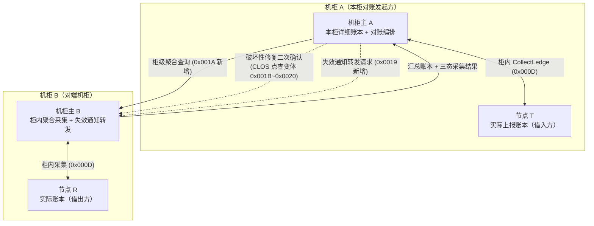
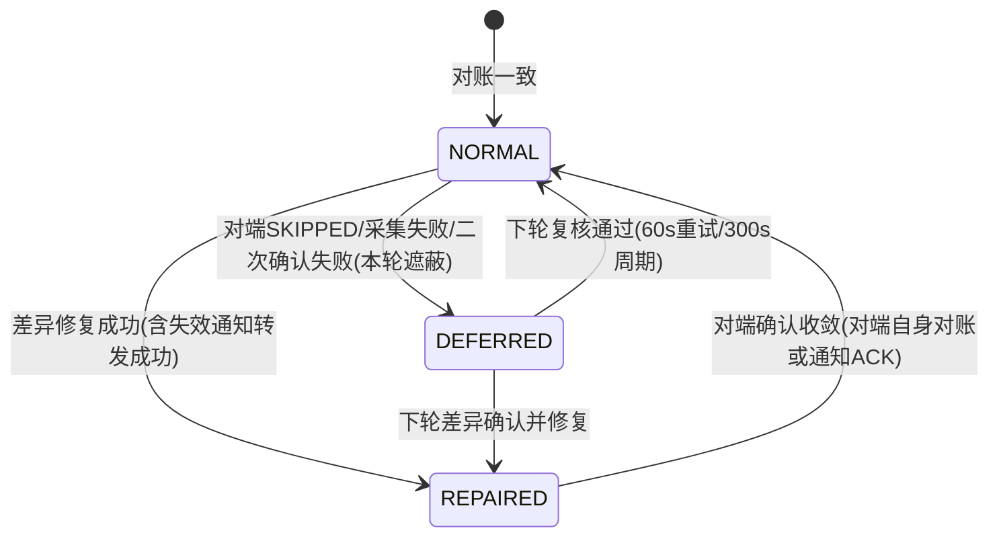
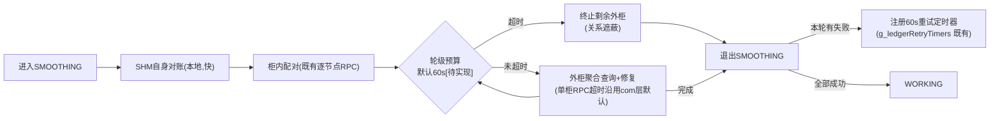

# 内存借用跨柜对账特性模块设计文档

## 1. 模块定位与职责

### 1.1 特性概述

CLOS 分层组网下，内存借入方与借出方可能位于不同机柜。**当前柜内对账对 FD/NUMA/ADDR 三类借用资源已完整实现并在线运行**，真正的缺口是跨柜场景：`LedgerHandler` 对外柜节点整体跳过（`ubse_mem_controller_ledger.cpp:603-608`），导致跨柜借用关系在节点重启、机柜主切换、通信恢复后无法收敛。共享内存（SHM）已通过专用 CLOS 查询通道（`UBSE_MEM_QUERY_CLOS_SHARE_EXPORT/IMPORT`，0x0018/0x0019）支持跨柜。

本特性目标：**在不改动存量柜内修复逻辑的前提下**，新增"柜级聚合账本查询"通道，将 FD/NUMA/ADDR 的对账能力从柜内扩展到跨柜，并配套解决两个跨柜特有问题：

1. 采集-修复时间窗内的竞态误清理（破坏性修复前二次确认）；
2. "export 已清、import 仍活"的危险窗口（跨柜失效通知路由）。

**关于"对账进度对调度的影响"（设计哲学）**：现有决策哲学是**未核实的记录默认按存在处理**——本轮没对完账的记录仍然在账本里，决策侧（容量计算、新借用授权）天然把它当作存在来考虑，不存在"标记一个考虑、一个不考虑"的分支。据此推演，对账与调度**彻底解耦**，无需受限视图（详见 §5.5）：

- 新借用记录两侧同名自洽，不依赖历史核实——新增记录不因"上轮没对完账"而出错；
- 清理按记录名字精确匹配，不波及对账窗口内新建的记录；
- 容量方向保守：未核实记录被多算占用，最坏效果是**暂时拒绝新借用**，不会超卖。

**现状能力基线与缺口**：

| 能力 | 柜内 | 跨柜 | 缺口本质 |
|------|------|------|---------|
| SHM 对账 | [已实现] `ShmBorrowLedger`（仅依赖 T 自身两份账本） | [已实现] 0x0018/0x0019 CLOS 查询 + 引用计数清理 | 无 |
| FD/NUMA/ADDR 对账 | [已实现] `FdBorrowLedger`/`NumaBorrowLedger`/`AddrBorrowLedger`（[ledger.cpp:628-631](../../../src/controllers/mem/mem_controller/ubse_mem_controller_ledger.cpp)） | **[缺口]** 外柜节点在 LedgerHandler 入口被跳过 | 缺跨柜账本采集通道，**不缺修复逻辑** |

**关键设计决策**：FD/NUMA/ADDR 的五个修复阶段（`MasterDiff*/Both*/AgentDiff*/MasterRunning*` Handler）柜内跨柜完全同构，差异仅在 `allDebtInfoMap` 的数据来源。因此本特性**复用全部修复函数**，新增的只有：

- 柜级聚合查询 RPC（替代逐节点跨柜 `CollectLedge`）；
- A 侧采集编排（`CollectAllLedger` 的跨柜分支）；
- 跳过节点的"关系遮蔽"机制（SKIPPED≠空账本）；
- 破坏性修复二次确认与失效通知跨柜转发。

### 1.2 核心职责

| 职责 | 说明 | 状态 |
|------|------|------|
| 柜级聚合采集 | A 柜主向 B 柜主发起一轮聚合查询，B 柜内采集并过滤"与 A 相关"的账本后汇总返回 | [待实现] |
| 跨柜对账编排 | LedgerHandler 对外柜 T 节点执行 SHM 自身对账 + FD/NUMA/ADDR 配对对账 | [待实现] |
| 关系遮蔽 | 采集失败/跳过的对端，其关联关系本轮不进 diff、不修复，留待下轮复核（见 §5.1） | [待实现] |
| 破坏性修复二次确认 | 跨柜破坏性动作（DESTROYED/清理/失效通知）执行前经 CLOS 点查变体点对点复核对端实时状态（§4.1.3） | [待实现] |
| 跨柜失效通知路由 | A 清理导出后经 B 柜主转发失效通知到 R，消除 import 存活危险窗口 | [待实现] |
| SMOOTHING 退出保障 | 跨柜采集引入长时延，必须有轮级超时，保证节点有界退出 SMOOTHING（上界 2×预算，§7.3） | [待实现] |

### 1.3 在系统中的位置



通信层级说明：柜主间/柜主与全局主间均为既有 `UbseComModule` RPC 通道；柜主定位复用 `UbseGetCascadeMasterNodeIdByAgentNodeId`（[ubse_mem_controller_helper.cpp:285](../../../src/controllers/mem/mem_controller/api/ubse_mem_controller_helper.cpp)）。挂载柜节点无独立柜主、由其 PD 主柜 GM 代管（业务面请求经 PD 主转发，借用侧设计 §2.3 路由模式）——本特性 0x001A 按节点定位柜主时**自然路由到 PD 主柜**，柜内聚合采集覆盖挂载柜节点，无需特判；对账面（柜主↔节点、柜主↔柜主）不经过 PD 主转发链。

边界说明：全局主与 0x0018 摘要上行**不在本特性范围**（对账与调度解耦，见 §5.5）。

### 1.4 非目标

以下事项明确**不在本特性范围**，防止后续实现阶段范围回潮：

| 非目标 | 说明 |
|--------|------|
| 受限视图/调度拦截 | 不做 `reconciliationPending` 标记、柜主受限集、全局主受限索引、调度 `IsPairRestricted` 接口——未核实记录默认按存在处理（§5.5），标记无失败模式可防 |
| 0x0018 摘要字段与传输 | 摘要结构（继承建模/serde 验证）与 MB 级报文传输均归借用侧，本特性不加任何字段（§4.4） |
| 大报文应用层分块 | hcom 内部自行拆包，0x001A 响应整包序列化后直接交付（§11） |
| SHM 通道收编 | 0x001A 稳定前不动 SHM 既有 0x0018/0x0019 查询通道（§11.3） |
| 全局主下行复核 | 不新增全局主→柜主的下行触发命令（§3.1） |
| 非 CLOS 单对象查询语义改动 | 既有 0x000E~0x0013 保持直发目标节点语义不变，跨柜场景一律走新增 CLOS 变体（§4.1.3） |
| B 侧柜内并行采集 | 固定串行，不做并行/阈值升级机制（§5.2） |
| 柜内对账逻辑改动 | 三个 BorrowLedger 函数签名与行为零变化，柜内路径不回归（§11） |

---

## 2. 目录结构与文件职责

### 2.1 源码目录树

```
src/controllers/mem/mem_controller/
├── ubse_mem_controller_ledger.{h,cpp}      # [已实现] 对账入口与四类 BorrowLedger 修复逻辑
│                                           # [改造] LedgerHandler 跨柜分支、CollectAllLedger 拆分
├── ubse_mem_cabinet_ledger.{h,cpp}         # [新增] 柜级聚合采集编排（A 侧）
├── ubse_mem_cabinet_ledger_util.{h,cpp}    # [新增] 公共工具：节点→柜号、柜内成员枚举、确认故障判定
├── ubse_mem_cabinet_ledger_agg.{h,cpp}     # [新增] 聚合查询服务（B 侧应答）
├── ubse_mem_repair_guard.{h,cpp}           # [新增] 破坏性修复二次确认 + 跨柜失效通知转发
│                                           # [新增] 跨柜单对象点查 CLOS 变体应答（B 柜主侧）
├── ubse_mem_global_ledger_report.{h,cpp}   # [已实现] 全局摘要上报（结构由借用侧维护，本特性不改）
├── ubse_mem_controller_msg.{h,cpp}         # [改造] 注册新增 RPC handler
├── message/
│   ├── ubse_mem_Ledger_resp_serial.h       # [已实现] 既有账本响应序列化
│   └── ubse_mem_cabinet_ledger_serial.h    # [新增] 柜级聚合查询/响应序列化
└── api/
    └── ubse_mem_controller_helper.{h,cpp}  # [已实现] UbseGetCascadeMasterNodeIdByAgentNodeId 柜主定位

src/include/
├── ubse_com_op_code.h                      # [改造] 新增 7 个 OpCode（0x0019 / 0x001A / 0x001B~0x0020）
└── ubse_error.h                            # [改造] 新增 UBSE_MEMCONTROLLER_ERROR_CABINET_BUSY（11004）
```

头文件归档说明：消息序列化头按既有先例（`ubse_mem_Ledger_resp_serial.h`）保留在源码 `message/` 目录；OpCode 定义在既有 `src/include/ubse_com_op_code.h` 中追加，无新增对外服务契约，不涉及 `plugin_services/` 归档。UT 目录镜像归档到 `test/UT/controllers/mem/`。

### 2.2 文件职责表

| 文件 | 关键函数/结构 | 职责 | 状态 |
|------|--------------|------|------|
| ubse_mem_controller_ledger.cpp | `LedgerHandler` | 对账入口；SMOOTHING 触发；[改造]跨柜 T 不再整体跳过，SHM 自身对账照常 + FD/NUMA/ADDR 走柜级通道 | 改造 |
| 同上 | `CollectAllLedger` | 全量账本收集；[改造]柜内节点维持逐节点 `CollectLedge`，外柜节点改由柜级聚合一次填充 | 改造 |
| 同上 | `FdBorrowLedger`/`NumaBorrowLedger`/`AddrBorrowLedger` | 三类资源五阶段修复 | [已实现]，**签名不动** |
| 同上 | `ShmBorrowLedger` | SHM 自身对账 | [已实现]，不动 |
| ubse_mem_cabinet_ledger.h | `CollectCrossCabinetLedgers` | A 侧：外柜提取、闸门、逐柜发起聚合查询、覆盖度校验、装配 | [新增] |
| 同上 | `ShadowFilterDeferredRelations` | 关系遮蔽：从 T 的账本视图剔除 SKIPPED 对端的记录，本轮不修复 | [新增] |
| ubse_mem_cabinet_ledger_agg.h | `CabinetLedgerQueryHandler` | B 侧：柜内串行采集、三态打标、按柜过滤、单飞保护 | [新增] |
| ubse_mem_cabinet_ledger_util.h | `GetCabinetGroupIdByNodeId` / `GetCabinetMemberNodeIds` / `IsConfirmedFaultClusterState` / `GetDebtPeerNodeIds` / `FilterDebtInfoByPeerNodeIds` | 公共工具：对端节点归柜、柜内成员枚举、确认故障三态判定、**对端 nodeId 提取（口径唯一源，既有 `CollectRelatedNodeIds` 已改为委托本函数）**、按对端集合投影账本（B 侧按柜过滤=A 侧遮蔽=同一实现，仅模式不同） | [新增] |
| ubse_mem_repair_guard.h | `ConfirmBeforeDestructiveRepair` | 破坏性动作前点对点二次确认 | [新增] |
| 同上 | `ForwardCrossCabinetInvalidate` | 失效通知跨柜转发（A 柜主 → B 柜主 → R） | [新增] |
| 同上 | `CrossCabinetQueryForwardHandler` | 跨柜单对象点查：B 柜主收 CLOS 变体请求后柜内直达 R 现拉，原样回包（§4.1.3） | [新增] |
| ubse_mem_controller_msg.cpp | `RegRespCtrlHandlers`/`RegQueryHandlers` | RPC 注册 | 改造 |
| ubse_com_op_code.h | `UbseMemQueryOpCode`/`UbseMemRespCtrlOpCode` | OpCode 分配 | 改造 |

---

## 3. 模块入口与生命周期

### 3.1 触发链路（复用既有节点状态机，无新增生命周期）

对账的触发与门控完全复用节点控制器既有机制，本特性不新增状态机入口：

| 触发时机 | 既有入口 | 位置 |
|---------|---------|------|
| 节点上线 | `UbseNodeUpLedger`（WORKING→SMOOTHING 触发 `LedgerHandler`） | ubse_node_controller_master.cpp:1188 |
| 周期核对 | `UbseNodeCycleLedger`（300s 定时器，仅 WORKING） | master.cpp:539，周期定义 :43 |
| 故障恢复 | `ExecuteNodeSmoothing`（150 次上报兜底） | master.cpp:778 |
| 机柜主接管 | 镜像消费 `ConsumeMirrorOnPromote` → 转 INIT 等 NODE_UP 重新对账 | master.cpp:2574 |
| 对账失败重试 | 60s 重试定时器 `UbseRegisterLedgerRetryTimer`（`g_ledgerRetryTimers`） | master.cpp:566-578 |

**关键时序约束**：`LedgerHandler` 由 SMOOTHING 状态迁移经 `RegClusterStateNotifyHandler` 异步触发（ubse_mem_controller_api.cpp:93），运行期间节点处于 SMOOTHING，被 per-node 写锁与状态机门控挡住其它对账入口。因此**跨柜采集必须受轮级超时约束**（见 §7.3），任何路径都必须保证节点最终离开 SMOOTHING——这是本特性新增的正确性红线。

**不新增全局主下行复核触发**：收敛由 60s 重试定时器 + 300s 周期对账保证自愈，下行复核只是加速器非必需品；新增下行命令需命令字 + 柜主处理逻辑 + 幂等保护，投入产出不成比例。

---

## 4. 服务接口与数据模型

### 4.1 新增 RPC 接口

#### 4.1.1 柜级聚合账本查询（核心新增接口，0x001A）

| 项 | 值 |
|----|----|
| OpCode | `UBSE_MEM_QUERY_CLOS_CABINET_LEDGER = 0x001A`（挂 `UbseMemQueryOpCode`） |
| 方向 | A 柜主 → B 柜主（单 RPC，单个 T 的对账轮内、每外柜一次） |
| 请求 | `UbseCabinetLedgerQueryReq` |
| 响应 | `UbseCabinetLedgerQueryResp` |
| 超时 | 沿用 com 层默认——B 侧采集失败由三态消化、总回包必有应答，A 侧超时仅发生在 B 柜主失联场景，定制更长超时只会延缓故障暴露。注：com 默认 60s 是引擎级全局配置（[ubse_com_def.h:239](../../../src/framework/com/ubse_com_def.h#L239)，`SendParam` 无单请求超时），在途查询可能占满整轮预算，退出上界见 §7.3 |
| 幂等性 | 天然幂等（只读采集），可安全重试 |

```cpp
// 采集结果三态：跳过不等于空账本
enum class UbseCollectStatus : uint8_t {
    SUCCESS = 0,        // 采集成功，debtInfo 有效（已过滤为与请求柜相关的记录）
    SKIPPED = 1,        // 节点采集失败/不可达（未上线、RPC 失败）
                        // ——关联关系本轮【不修复】（遮蔽），严禁按空账本处理
    CONFIRMED_FAULT = 2 // 节点确认 FAULT/PRE_BMC/UNKNOWN——关联关系走既有清理条件
};
// 状态语义与柜内 CollectAllLedger 对齐：仅排除 FAULT/PRE_BMC/UNKNOWN；
// INIT/SMOOTHING 节点【正常采集】——节点完成账本恢复后才开始选举与上报，
// 能应答采集即代表账本已恢复完整，不存在半空账本窗口。

struct UbseCabinetLedgerQueryReq {
    std::string requesterMasterNodeId;  // A 柜主 nodeId（不做请求方角色强校验，仅用于日志与一致观察，见 §6）
    uint32_t requesterGroupId;          // A 柜号：B 按此过滤"借自 A / 借给 A"的记录
};

struct UbseCabinetLedgerItem {
    std::string nodeId;                 // B 柜内节点
    UbseCollectStatus status;
    NodeMemDebtInfo debtInfo;           // 仅 SUCCESS 有效；已按对端 ∈ A 柜过滤
};

struct UbseCabinetLedgerQueryResp {
    UbseResult ret;                     // 整体查询结果（部分失败不算整体失败）
    std::string cabinetMasterNodeId;    // 应答柜主（与预期不一致时 A 丢弃本轮该柜结果，见 §7.1.4）
    std::vector<UbseCabinetLedgerItem> items;   // B 柜【全部成员节点】条目：无相关记录也返回 SUCCESS+空 debtInfo，缺席才等于采集失败（§5.2）
};
```

**B 侧过滤规则**（复用 `CollectRelatedNodeIds` 同源的对端字段，[ledger.cpp:231-244](../../../src/controllers/mem/mem_controller/ubse_mem_controller_ledger.cpp)）：记录的对端 nodeId 属于请求柜 `requesterGroupId` 才保留：

| 记录类型 | 对端字段（与 `CollectRelatedNodeIds` 同源） |
|---------|---------|
| fd / numa 导入 | `algoResult.importNumaInfos[0].nodeId` |
| fd / numa 导出 | `algoResult.exportNumaInfos[0].nodeId` |
| addr 导入 / 导出 | `algoResult.importNumaInfos[0].nodeId` / `algoResult.exportNumaInfos[0].nodeId` |
| share | **不在本期范围**（走既有 0x0018/0x0019 通道，见 §11.3） |

实现必须与 [`CollectRelatedNodeIds`](../../../src/controllers/mem/mem_controller/ubse_mem_controller_ledger.cpp#L210-L244) 同源取字段：代码对 fd/numa/addr 六个 map **统一**读 `algoResult.importNumaInfos[0].nodeId` / `algoResult.exportNumaInfos[0].nodeId`；`req.importNodeId`/`req.exportNodeId` 仅用于日志打印，**不得**作为过滤键。

**投影充分性论证**：下游对 `allDebtInfoMap` 的全部用途（fd/numa 配对校验、addr 配对、同 NUMA 多笔借用合并状态）都按"T 的配对记录 vs 对端记录"匹配，匹配键中的对端必然是 A 柜节点，全在投影保留范围内；投影丢弃的只有"R 与第三方柜 C 的记录"——那不属于 A 侧任何 T 的 diff 范围。故按柜投影信息充分，无需全量账本跨柜传输。

#### 4.1.2 失效通知跨柜转发（0x0019）

| 项 | 值 |
|----|----|
| OpCode | `UBSE_MEM_CABINET_INVALIDATE_FORWARD = 0x0019`（挂 `UbseMemRespCtrlOpCode`，0x0018 已被全局摘要上报占用） |
| 方向 | A 柜主 → B 柜主；B 柜主代为向本柜节点 R 转发既有 `UBSE_MEM_INVALIDATE_SINGLE_IMPORT_DEBT`（0x0017） |
| 语义 | A 已清理对 R 的导出，要求 R 失效对应导入记录；B 柜主转发后应答转发结果 |
| 幂等性 | 幂等（`AgentInvalidateImportDebtHelper` 对不存在的记录返回失败但不产生副作用，调用方按"已失效"处理） |

```cpp
struct UbseCabinetInvalidateItem {
    std::string nodeId;               // 目标导入节点 R
    UbseMemBorrowType borrowType;     // FD_BORROW/NUMA_BORROW/ADDR_BORROW（SHM 不走本通道）
    std::string debtName;             // 待失效的导入记录名
};

struct UbseCabinetInvalidateForwardReq {
    std::string requesterMasterNodeId;              // A 柜主 nodeId（B 侧校验柜主角色）
    std::vector<UbseCabinetInvalidateItem> items;   // 同一轮对同一 R 的多条通知合并为一次请求
};

struct UbseCabinetInvalidateForwardResp {
    UbseResult ret;                   // 整体转发结果
    uint32_t failCount;               // 转发失败条数（失败不回滚 A 侧清理，交对端周期对账兜底）
};
```

#### 4.1.3 跨柜单对象点查（CLOS 变体，0x001B~0x0020）

破坏性修复二次确认（§5.3）需要读取"对端某条记录的实时状态"，但既有单对象查询 `0x000E~0x0013` 的 SendParam 地址就是目标节点（`QueryFdExport` 直接以 `request.exportNodeId` 为 address），**无级联路由、跨柜不可直达**；既有 CLOS 变体只覆盖 SHM（`UBSE_MEM_QUERY_CLOS_SHARE_EXPORT/IMPORT` 0x0018/0x0019，`QueryShareExport` 在 `isClos` 时 `SetRemoteId(cascadeMasterNodeId)`）。故本特性为 FD/NUMA/ADDR 补齐 CLOS 变体（SHM 沿用既有通道，不收编）：

| OpCode | 值 | 对应非 CLOS 变体 | 用途 |
|--------|----|-----------------|------|
| `UBSE_MEM_QUERY_CLOS_FD_EXPORT` | 0x001B | 0x000E | 跨柜查 FD 导出实时状态 |
| `UBSE_MEM_QUERY_CLOS_FD_IMPORT` | 0x001C | 0x000F | 跨柜查 FD 导入实时状态 |
| `UBSE_MEM_QUERY_CLOS_NUMA_EXPORT` | 0x001D | 0x0010 | 跨柜查 NUMA 导出实时状态 |
| `UBSE_MEM_QUERY_CLOS_NUMA_IMPORT` | 0x001E | 0x0011 | 跨柜查 NUMA 导入实时状态 |
| `UBSE_MEM_QUERY_CLOS_ADDR_EXPORT` | 0x001F | 0x0012 | 跨柜查 ADDR 导出实时状态 |
| `UBSE_MEM_QUERY_CLOS_ADDR_IMPORT` | 0x0020 | 0x0013 | 跨柜查 ADDR 导入实时状态 |

| 项 | 值 |
|----|----|
| 方向 | A 柜主 → B 柜主（`SetRemoteId` = `UbseGetCascadeMasterNodeIdByAgentNodeId` 结果），B 柜主柜内直达 R |
| 请求/响应 | 复用既有 `UbseMemDebtQueryRequest` 与对应 obj simpo，无新增报文字段 |
| B 侧应答 | **必须向 R 现拉**（柜内 `0x000E~0x0013` 直达），不读柜主副本——二次确认要求实时，且与 §5.2 数据源红线一致 |
| 不存在语义 | 记录不存在时回空对象（`name` 为空）；RPC 失败/超时为"确认失败"，A 侧按 §5.3 保守放弃 |
| 权限 | 不做请求方角色强校验：跨柜查询天然只能由柜主发起（备/从节点的跨柜流量经本柜主转发，到不了对端柜主）；B 侧仅自检本机为柜主（§6），请求方身份只做一致观察 |
| 幂等性 | 只读，天然幂等可重试 |

### 4.2 接口错误码

内部 RPC，不新增对外错误码（沿用内部码体系）：

| 错误码 | 触发场景 | 处理策略 |
|--------|---------|---------|
| `UBSE_OK` | 查询成功（含部分节点 SKIPPED，`items` 内逐条体现） | 继续修复流程 |
| `UBSE_ERROR` | B 侧自检非柜主 / 序列化失败 / RPC 失败 | 本轮该柜全部关系遮蔽不修复；节点经 60s 重试定时器整轮重试 |
| `UBSE_ERROR_NULLPTR` | 消息构造失败 | 同上 |
| RPC 超时 | B 柜主失联或柜内采集超时 | 同上；二次确认查询超时按"放弃本次破坏性动作"处理（宁慢勿误删） |
| `UBSE_MEMCONTROLLER_ERROR_CABINET_BUSY`（`UBSE_INTERNAL_ERROR_DEF(1004)` = 11004，落 `ubse_error.h` Mem Controller 段 11000~11099，紧随现有 1000~1003） | B 侧单飞占用中（正在服务其它柜或本柜其它对账轮） | A 侧该柜整体按 SKIPPED 处理（§5.1），本轮不 diff、不修复；**不得**映射为 CONFIRMED_FAULT 或空账本 |

错误码选型说明：这是**内部 RPC 回包码**，对外经 `10000+` 统一映射为"内部错误"，不暴露 SDK。**不得**复用对外 `UBSE_ERR_RESOURCE_BUSY(11)`——它属于 SDK 对外语义，跨段使用会误导调用方。

### 4.3 新增 OpCode 汇总

| OpCode | 值 | 枚举 | 用途 |
|--------|----|------|------|
| UBSE_MEM_QUERY_CLOS_CABINET_LEDGER | 0x001A | UbseMemQueryOpCode | 柜级聚合账本查询 |
| UBSE_MEM_CABINET_INVALIDATE_FORWARD | 0x0019 | UbseMemRespCtrlOpCode | 失效通知跨柜转发 |
| UBSE_MEM_QUERY_CLOS_FD_EXPORT | 0x001B | UbseMemQueryOpCode | 跨柜查 FD 导出实时状态 |
| UBSE_MEM_QUERY_CLOS_FD_IMPORT | 0x001C | UbseMemQueryOpCode | 跨柜查 FD 导入实时状态 |
| UBSE_MEM_QUERY_CLOS_NUMA_EXPORT | 0x001D | UbseMemQueryOpCode | 跨柜查 NUMA 导出实时状态 |
| UBSE_MEM_QUERY_CLOS_NUMA_IMPORT | 0x001E | UbseMemQueryOpCode | 跨柜查 NUMA 导入实时状态 |
| UBSE_MEM_QUERY_CLOS_ADDR_EXPORT | 0x001F | UbseMemQueryOpCode | 跨柜查 ADDR 导出实时状态 |
| UBSE_MEM_QUERY_CLOS_ADDR_IMPORT | 0x0020 | UbseMemQueryOpCode | 跨柜查 ADDR 导入实时状态 |

注：新增 0x0019（RespCtrl 段）与既有 SHM 跨柜查询 0x0018/0x0019（Query 段，`UBSE_MEM_QUERY_CLOS_SHARE_EXPORT/IMPORT`）数值相同但属不同枚举段，无冲突；实现时若 RespCtrl 段有空闲号可顺手避让，仅为可读性，不做硬性要求。SHM 双通道终局：0x001A 稳定后收编，最终单通道（见 §11.3）。

### 4.4 账本摘要契约（借用侧维护，对账侧接口面）

账本摘要（0x0018 上行）**不在本特性范围**：其结构、构建、序列化全部归借用侧团队（目标结构见 §4.4.2）。对账侧与摘要的唯一交集是保留既有 `ReportNodeLedgerSummaryAfterLedger` 调用时序点不变（[ubse_mem_controller_ledger.cpp:96-120](../../../src/controllers/mem/mem_controller/ubse_mem_controller_ledger.cpp#L96-L120)，调用点 :651）：对账轮结束后触发上报，数据内容为借用侧摘要结构。摘要 MB 级报文的传输由 hcom 内部拆包承载，无需应用层处理。

**对账侧零字段改动**：本特性不给摘要结构、也不给 `NodeMemDebtInfo` 增加任何字段（含受限标记——受限视图已取消，见 §5.5）；摘要的新增字段与四类派生项全部由借用侧定义并填充。`memids` 保持 `uint16_t` 基线：摘要 serde 与 0x001A 报文（整包承载 `NodeMemDebtInfo`）同源按 16 位编解码；单条 memId 超过 65535 时记录 WARN 并截断（既有行为，见 `ubse_mem_global_ledger_report.cpp` 的 `BuildImportMemIds`/`BuildExportMemIds`）。

#### 4.4.1 归属边界

| 工作项 | 归属 | 说明 |
|--------|------|------|
| 摘要结构定义（BaseItem + 四派生 + 模板容器 + 节点容器） | 借用侧 | 以 §4.4.2 为准 |
| 摘要构建（fd/numa/addr 三类 builder，shm 存量迁移） | 借用侧 | 现有仅 `BuildShmSummaryItem`（import/export 两个重载） |
| 摘要序列化/反序列化（4 类 summary 全量编解码） | 借用侧 | 现有仅 `shmSummary` 两处编解码 |
| 上报触发时序 | **对账侧（保留不动）** | `ReportNodeLedgerSummaryAfterLedger`，对账轮收尾调用 |
| 0x001A 柜级聚合账本报文 | 本特性（对账侧） | 整包承载 `NodeMemDebtInfo`；与摘要 serde 同源按 `uint16_t` 编解码 |
| B 侧聚合 items 填充 | 本特性（对账侧） | 同上 |

**红线**：本特性**不得**修改摘要结构、摘要 builder、摘要 serde；如确需改动，先更新本节契约再改代码。

#### 4.4.2 目标结构

```cpp
// ===== 基类：字段全部来自现有 UbseGlobalLedgerSummaryItem 的公共子集 + 借用新增 =====
struct UbseGlobalLedgerSummaryBaseItem {
    // ---- 已存在（现有struct直接迁移，借用复用，字段语义不变） ----
    std::string name{};              // 查询主键/重名检查/return定位
    UbseMemState state{UBSE_MEM_STATE_INIT}; // stage映射/防并发/重名错误码（链路聚合状态，见3.5）
    UbseUdsInfo userInfo{};          // get/list权限过滤 + return权限校验（import与export摘要均需要，
                                     //   return权限优先取export侧udsInfo，numa_api.cpp:1290）
    std::vector<UbseMemDebtNumaInfo> exportNumaInfos{}; // [0].nodeId→exportNode/GM路由/对端定位、
                                     //   socketId/numaId→CLI展示、Σsize→addr的desc.size、算法账目借出侧
    uint8_t usrInfo[UBSE_MAX_USR_INFO_LEN]{}; // numa: get/list原样返回
    uint32_t blockSize{128};        // fd: unitSize = blockSize * MB
    std::vector<uint16_t> memids{}; // fd/shm 的 memId 按 uint16_t 编解码（与
                                    //   ubse_mem_global_ledger_report.cpp 的 SerializeMemIds 一致）；
                                    //   memId > 65535 时记 WARN 并截断，不预留其它位宽编码
    // ---- 新增（借用需要，import侧摘要有值） ----
    std::vector<UbseMemDebtNumaInfo> importNumaInfos{}; // 对齐UbseMemAlgoResult::importNumaInfos：
                                     //   [0].nodeId→算法账目borrowNodeId(FormImportLedger,
                                     //   ubse_mem_account.cpp:131-147)、portId/chipId→链路占用与
                                     //   端口故障命中(HasFaultPort, debt_info_query.cpp:278)
    std::vector<int64_t> numaIds{}; // importResults[*].numaId：numa/addr查询取[0](remoteNumaId)、
                                     //   numa handle查询需全量numaId集合(FillHandleInfoFromImportObj)
    size_t size{0};                 // req.size → numaDesc.size / fdDesc.totalMemSize
};

// ===== 共享内存摘要项：现有struct中shm专属字段下放到派生类（存量迁移） =====
struct UbseGlobalShmSummaryItem : UbseGlobalLedgerSummaryBaseItem {
    std::vector<UBMemFaultType> faultTypes{};       // 已存在，shm专属（memId故障与memids一一对应）
    std::vector<std::string> nodelist{};             // 已存在，shm专属（共享域节点列表）
    bool shmAnonymous{false};                       // 已存在，shm专属（零引用自动清理决策依据）
};

// ===== fd借用摘要项：无类型专属字段（基类blockSize/memids/size已覆盖查询契约） =====
struct UbseGlobalFdSummaryItem : UbseGlobalLedgerSummaryBaseItem {};

// ===== numa借用摘要项：无类型专属字段（基类usrInfo/numaIds已覆盖查询契约） =====
struct UbseGlobalNumaSummaryItem : UbseGlobalLedgerSummaryBaseItem {};

// ===== addr借用摘要项：lender信息（UbseMemAddrGet专属，全部新增） =====
struct UbseGlobalAddrSummaryItem : UbseGlobalLedgerSummaryBaseItem {
    // 注：导出节点不设专字段——SelectNumaForAddr无条件以req.exportNodeId填充
    //   exportNumaInfos[0].nodeId（scheduler_impl.cpp:203），值恒等，统一从基类exportNumaInfos取
    uint64_t exportPid{0};          // lender.pid
    int dstSocket{-1};              // lender.socketId（req.dstSocket；exportNumaInfos[0].socketId
                                     //   是attachSocketId非req值，不可替代）
    std::vector<UbseMemAddrInfo> exportAddrList{}; // lender.vaLists
};

// ===== 节点级摘要容器：importItems/exportItems 按派生类型实例化 =====
template <typename T>
struct UbseGlobalTypeLedgerSummary {
    std::map<std::string, T> importItems{}; // key: name，存于importNodeId下
    std::map<std::string, T> exportItems{}; // key: GenerateExportObjKey(name, importNodeId)，存于exportNodeId下
};

struct UbseGlobalNodeLedgerSummary {
    std::string nodeId{};
    std::string sourceMasterNodeId{};
    UbseGlobalTypeLedgerSummary<UbseGlobalShmSummaryItem> shmSummary{};  // 现有（UbseGlobalLedgerSummary泛化）
    UbseGlobalTypeLedgerSummary<UbseGlobalFdSummaryItem> fdSummary{};    // 新增
    UbseGlobalTypeLedgerSummary<UbseGlobalNumaSummaryItem> numaSummary{}; // 新增
    UbseGlobalTypeLedgerSummary<UbseGlobalAddrSummaryItem> addrSummary{};  // 新增
};
```

#### 4.4.3 与对账侧的接口面

| 项 | 约定 |
|----|------|
| 调用点 | `ReportNodeLedgerSummaryAfterLedger(nodeId)` 在 `LedgerHandler` 收尾调用，**位置不变、不得删除/移动** |
| 数据来源 | 摘要 builder 读本节点账本（`NodeMemDebtInfo`）；对账侧只保证收尾时账本已更新 |
| 判定解耦 | 对账侧不得依赖摘要内容做任何判定（§5.5） |
| `memids` 编解码口径 | `uint16_t`（与代码基线一致）：借用 obj 序列化与 **0x001A 报文格式同源按 16 位编解码**；memId > 65535 时告警并截断（`ubse_mem_global_ledger_report.cpp` 的 `BuildImportMemIds`/`BuildExportMemIds`）；单条记录 `memids` 上限 1024×2B，体积估算见 §5.2 |

---

## 5. 核心子模块设计

### 5.1 柜级聚合采集（CabinetLedgerCollector，A 侧编排）

**职责**：把"逐对端节点"的跨柜采集压缩为"逐外柜 × 一次聚合查询"，并将结果装配进既有修复管线。

**关键方法**：

| 方法 | 功能 | 关键逻辑 |
|------|------|---------|
| `ExtractCrossCabinetPeerGroups` | 提取本 T 的外柜集合 | 从该 T 的 master 账本与实际上报账本**两份**提取对端节点，按所属柜归并去重；T 两份账本均为空（冷启动）则该 T 不产生外柜查询（§7.1.4） |
| `CollectCrossCabinetLedgers` | 对本 T 涉及的外柜逐柜发起聚合查询 | 按对端所属柜合并去重；一次查询覆盖该 T 的全部外柜对端（`LedgerHandler` 按 node 触发、一轮只有一个 T，跨 T 不共享）；单柜失败不影响其它柜 |
| `CrossCabinetRoundGate` | A 侧跨柜并发闸 | 进程级 permit=2（`kCrossCabinetConcurrency = 2`，写死常量不做配置项，性能测试后可调）；**作用域=整个跨柜分支（采集+装配+修复），不是只包 RPC**——若按柜释放，多个 T 会在柜间反复进出并同时持有约 40MB `allDebtInfoMap`，§8.1 的并发峰值上界不成立；实现用文件级匿名命名空间的 mutex+condition_variable+计数器（C++17 无 `std::counting_semaphore`），RAII `RoundPermit` 保证 BUSY/超时/异常路径都归还；`wait_for(本 T 剩余轮预算)` 超时则本轮所有外柜按 SKIPPED 收尾 |
| `AssembleAllDebtInfoMap` | 将 SUCCESS 条目写入 `allDebtInfoMap` | 键为 B 柜节点 nodeId，值即过滤后的 `NodeMemDebtInfo`，**下游三个 BorrowLedger 无感知复用** |
| `VerifyItemsCoverage` | 响应覆盖度校验 | 用 A 本地全网成员视图（A 已知 B 柜全部节点）对比 items 清单：**缺失的 B 柜节点一律按 SKIPPED 遮蔽**——防御 B 柜主刚倒换、镜像未消费完时不认识某节点导致该节点从 items 中整体缺失（缺节点不能隐式等价于"无账本"） |
| `ShadowFilterDeferredRelations` | 关系遮蔽 | 按**对端节点**粒度，把 SKIPPED 对端的相关条目从 T 的 masterDebtInfo/agentDebtInfo 视图中剔除，本轮不进 diff、不修复；只过滤本轮内存视图——不删除、不置 DESTROYED、不写持久化，其它对端与本柜关系照常对账 |

**关系遮蔽的设计意图**：`FdBorrowLedger` 等函数的 diff 判定基于"T 的两份账本 vs allDebtInfoMap"。若 SKIPPED 节点缺席 `allDebtInfoMap`，其 export 记录会表现为"对端无对应记录"→ T 的导入被判为单导入差异 → 误清理。遮蔽方案（从 T 视图剔除该对端相关记录）使修复函数**看不到**这些关系，天然不修复——不改动任何存量函数签名，这是本方案相对"给 BorrowLedger 增加 deferred 参数"的核心取舍。

**被遮蔽关系的收敛路径（无需任何持久化"受限"状态）**：

- SKIPPED 属于本轮采集失败 → T 本轮对账以失败收尾 → 既有 60s 重试定时器整轮重试；
- 重试之外的兜底：300s 周期对账天然复核；
- 遮蔽是**每轮重建的临时视图**，不是跨轮维护的状态——不存在老化、清出、索引物化等附加机制。

**BUSY 快速失败的 A 侧处理（与 SKIPPED 同构）**：B 柜主单飞占用中会立即回 `UBSE_MEMCONTROLLER_ERROR_CABINET_BUSY`（§4.2），A 收到后：①该柜全部节点标记 SKIPPED（连带其关系遮蔽，本轮不 diff、不修复）；②**不重试、不等待**，直接继续下一柜；③本轮只要存在任一未完成柜，T 按既有"采集失败"收尾，交 60s 重试定时器整轮幂等重放。禁止把 BUSY 映射为 CONFIRMED_FAULT（会误清理）或空账本（会把 T 的单导入误判）；BUSY 只记日志计数（柜号/T/reason=busy），不产生任何账本写入。

### 5.2 柜侧聚合服务（CabinetLedgerAggregator，B 侧应答）

**职责**：应答 0x001A，柜内采集、过滤、汇总。

**量级估算**：单节点账本上限 2k 条，fd 单条记录最坏 ~2.5KB（其中 `memids` 上限 1024×2B）→ 单节点采集 ~5MB，8 节点柜聚合响应最坏 ~40MB；A 侧 permit=2 并发峰值 ≈80MB。该量级为设计估算，最终以性能测试结论为准。

**采集时序（固定串行）**：对柜内节点逐个串行采集，不做并行/阈值升级机制。量级依据：单节点采集 ~5MB/百毫秒级，8 节点串行 ~0.5~2s，在 60s 轮预算内安全；串行对 B 柜主的内存/CPU 峰值最平滑，并行收益不足以抵偿复杂度。

**并发保护（单飞）**：B 柜主同一时刻只服务一条 0x001A（CAS 单飞标志）。占用中再收到的请求**立即回 `UBSE_MEMCONTROLLER_ERROR_CABINET_BUSY`**，不排队、不阻塞 worker 线程——单请求峰值 ~40MB（见上方量级估算），多柜并发叠加会线性放大且互相拖长 RTT。A 侧另有进程级 permit=2 闸门（作用域=整个跨柜分支，§5.1），两侧配合后：本柜 8 个 T 同时上线按 2 个一批约 8s 完成；多柜同时压同一 B 柜时，超出者快速 BUSY、对应 T 整柜遮蔽后 60s 重试自愈。

**数据来源红线**：B 柜主对柜内每个节点**现拉**——对节点 R 发既有 0x000D `CollectLedge`，R 返回它自己内存里的实际上报账本；B 柜主自己保存的 master 侧账本副本**全程不参与返回数据**。B 柜主只是采集代理，其自身账本陈旧（刚倒换）不污染结果；三态标签也因此是真实采集动作的结果（SUCCESS/SKIPPED 反映 RPC 通断），而非"副本里有没有"这种弱信号。

处理流程：

1. 身份处理（不做请求方角色强校验）：自检本机 CLOS role 为 `CABINET_MASTER`/`PD_MASTER`，否则直接返回 `UBSE_ERROR`；请求方不做拦截——跨柜流量天然由柜主发起（§6），仅当 `requesterMasterNodeId` 与选举拓扑 `groups[requesterGroupId].groupMasterId` 不一致时打 WARN；
2. 遍历本柜节点，状态过滤语义与柜内 `CollectAllLedger` 对齐：
   - `FAULT/PRE_BMC/UNKNOWN` → CONFIRMED_FAULT（不采集）；
   - **其余状态（含 INIT/SMOOTHING/WORKING）一律尝试采集**——节点完成账本恢复后才开始选举与上报，能应答即账本完整；采集成功按 §4.1.1 过滤规则裁剪后置 SUCCESS；
   - 采集 RPC 失败/节点不可达（未上线）→ SKIPPED（不采集）；
   - **每个本柜成员节点都必须产出一条 item**：无与 A 相关记录时返回 SUCCESS + 空 `debtInfo`（"无相关记录" ≠ "缺条目"，否则 A 侧覆盖度校验会把整柜对端误判 SKIPPED，导致单导入关系永远被遮蔽）；
3. 单节点采集失败或响应整体超时不阻塞其它节点条目。

### 5.3 破坏性修复守卫（RepairGuard）

**职责**：为跨柜破坏性动作提供"宁慢勿误删"的二次确认。

**判定规则**：

| 动作类别 | 例子 | 是否二次确认 |
|---------|------|-------------|
| 破坏性 | master 独有 export 记 DESTROYED、清理、失效通知 | **是**（对端在外柜时） |
| 非破坏性 | running 记录重新拉取刷新、状态刷新 | 否 |

二次确认方式：走 §4.1.3 新增的 CLOS 点查变体（`UBSE_MEM_QUERY_CLOS_FD_EXPORT` 0x001B 等 6 个）——A 经 `UbseGetCascadeMasterNodeIdByAgentNodeId` 定位 B 柜主后发请求，B 柜主柜内直达 R 现拉**实时**状态并原样回包（不读柜主副本）。**不复用非 CLOS 变体**：0x000E~0x0013 直发目标节点，跨柜不可直达。获取对端该记录的实时状态后按表决策：

| 对端实时状态 | 决策 |
|-------------|------|
| 记录仍存在且 running | 放弃本次清理，按 `MasterRunning*Handler` 语义刷新 T 侧账本 |
| 记录确认不存在 / 对端节点确认 FAULT | 执行破坏性动作 |
| 查询失败/超时 | 放弃本次动作，交下轮再判（不设重试循环） |

**一致性窗口说明**：聚合采集（t1）与修复执行（t2）之间，B 柜可能新完成一笔对 A 的借用且 B 的增量不会出现在 t1 的快照里。二次确认把误删窗口从"整轮时长"压缩到"单条记录确认 RTT"，残余竞态（确认后又新建）由对端节点自身的周期对账兜底自愈。清理按记录名字精确匹配，不波及确认窗口内新建的其它记录。

### 5.4 跨柜失效通知路由（InvalidateRouter）

**职责**：A 清理导出后主动消除 R 侧"import 仍活"窗口。

路由链路：

```
A 柜主（清理 export 完成）
  → UbseGetCascadeMasterNodeIdByAgentNodeId(R) 定位 B 柜主
  → 0x0019 失效转发 → B 柜主
      → 既有 0x0017 SendInvalidateSingleImportDebtRpc(R)
      → R 执行 AgentInvalidateImportDebt（按 UbseMemBorrowType 分发到对应 importMap）
  → B 柜主应答转发结果
```

失败处理：转发失败不回滚 A 侧清理（清理本身依据的是二次确认后的状态），依赖 R 自身周期对账兜底收敛。**通知批量汇集**：同一轮内对同一 R 的多条失效通知合并为一次 0x0019 转发（列表载荷），避免跨柜 RPC 放大。

### 5.5 边界说明：对账与调度/摘要彻底解耦

**决策**：受限视图子系统**整体取消**——`reconciliationPending` 标记、柜主受限集、全局主受限索引物化、调度 `IsPairRestricted` 接口全部不做；0x0018 摘要上行整体移出本特性（归借用侧，见 §4.4）。

**取消依据（决策哲学推演）**——现有对账/决策体系对"未核实记录"的默认处理就是**按存在考虑**，逐项检验不存在需要"受限标记"拦截的失败模式：

| 关注点 | 未核实记录（默认按存在）的行为 | 结论 |
|--------|------------------------------|------|
| 新建借用记录 | 两侧同名自洽，T/R 各自记账即一致，不依赖历史核实 | 无需拦截 |
| 清理动作 | 按记录名字精确匹配，只影响匹配到的那条，不波及对账窗口内新建记录 | 无需拦截 |
| 容量决策 | 未核实记录被**多算占用**，方向保守——最坏是暂时拒绝新借用，不会超卖 | 无需拦截 |
| T 侧账本丢失的双借风险 | 属 (T, \*) 级风险——对 T 的全部对端都成立，冻结单个 (T, R) 关系防不住 | 由既有单导入失效路径兜底，受限标记无增量价值 |

标记找不到具体失败模式即不应存在——这是 YAGNI 的直接应用。

**解耦后的分工边界**：

| 事项 | 责任方 |
|------|--------|
| 逐条目摘要结构（`UbseGlobalLedgerSummaryBaseItem` + Shm/Fd/Numa/Addr 派生、serde 继承/模板序列化验证） | 借用侧团队 |
| 对账轮结束后调用 `ReportNodeLedgerSummaryAfterLedger` 上报（时序点不变，内容为借用侧结构） | 本特性（既有逻辑，不改） |
| "未核实记录容量保守暂拒"行为的可接受性验证 | 性能测试联合验证（见 §12） |
| 确认故障节点上借用记录的**主动清理** | 借用侧全局主故障处理通道（导入节点故障 → 全局主删摘要 + 通知导出侧柜主删本地账本 + 算法账目回收，借用侧设计 §3.6）；对账通道仅按 CONFIRMED_FAULT 走柜内既有清理条件，两者按"故障感知先后"天然互斥，不重复清理 |
| 调度的资源视图来源 | 借用侧调度用全网节点资源视图上报（节点信息上报框架，非账本摘要），与对账零耦合——解耦决策的旁证（借用侧设计 §2.4） |
| 对账正确性 | **不依赖摘要链路**：修复用柜主本地账本与 0x001A 实时采集；摘要异常最多影响调度侧视图新鲜度，不会误清理资源 |

---

## 6. 接入层设计

本特性无新增 IPC/HTTP/CLI 接入，仅扩展跨节点 RPC 注册（`ubse_mem_controller_msg.cpp`）：

| OpCode | Handler | 注册点 | 方向 |
|--------|---------|--------|------|
| `UBSE_MEM_QUERY_CLOS_CABINET_LEDGER (0x001A, Query)` | `CabinetLedgerQueryHandler` | `RegQueryHandlers` | 柜主→柜主 |
| `UBSE_MEM_CABINET_INVALIDATE_FORWARD (0x0019, RespCtrl)` | `CabinetInvalidateForwardHandler` | `RegRespCtrlHandlers` | 柜主→柜主 |
| `UBSE_MEM_QUERY_CLOS_* (0x001B~0x0020, Query)` | `CrossCabinetQueryForwardHandler` | `RegQueryHandlers` | 柜主→柜主→柜内节点 |

com 层 handler 签名为 `UbseResult(const UbseByteBuffer&, UbseByteBuffer&)`，**不携带 opcode**；因此 6 个 CLOS 变体不能靠"单 handler 从入参区分"，在 `RegQueryHandlers` 中用 lambda 捕获 opCode 注入 `CrossCabinetQueryForwardHandler(uint16_t opCode, ...)`。后续新增 CLOS 变体照此模式追加注册即可。

安全校验（不做请求方角色强校验）：跨柜查询天然只能由柜主发起——备/从节点不会向其它机柜的柜主发请求，柜间流量一律经本柜主转发；因此上述三类 handler 只做**自身身份自检**（`GetClosRole()` 为 `CABINET_MASTER` 或 `PD_MASTER`，[ubse_node_controller_util.cpp:364-378](../../../src/controllers/node/ubse_node_controller_util.cpp#L364-L378)），请求方身份仅做一致观察（`requesterMasterNodeId` 与选举拓扑 `HaTopologyInfo.groups[requesterGroupId].groupMasterId` 不等时 WARN，不拦截）。说明：`DetectClosRole()` 只判定**本机**角色（[ubse_node_controller_util.cpp:209-236](../../../src/controllers/node/ubse_node_controller_util.cpp#L209-L236)），无法按 nodeId 查对端角色；若后续确需核对对端身份，只能走选举拓扑的 `groupMasterId` 比对。

**日志规范**：跨柜对账统一使用单 tag `[CLOS_CAB]` + 关键字，便于一次 grep 后按关键字过滤（与 `[SIM]`/`[CLOS_STATE]` 的单 tag 风格一致）：

| 级别 | 内容 |
|------|------|
| INFO | 每轮每柜 1 行汇总：`round T=<nodeId> cabinet=<groupId> status=<OK/BUSY/SKIPPED> items=<n> cost=<ms>` |
| WARN | BUSY、SKIPPED、覆盖度缺失节点列表、请求方身份不一致 |
| ERROR | RPC 失败、序列化/反序列化失败 |

硬约束：**禁止逐条账本日志**（单节点 2k 条 × 多柜会刷爆日志），只允许柜级汇总行；二次确认与失效转发各打一条结果日志（`action=confirm/invalidate result=<ok/fail>`）。

---

## 7. 关键流程详解

### 7.1 跨柜对账主流程（单轮，机柜 A 视角）

#### 7.1.1 场景说明

节点 T 上线/周期/恢复触发对账，T 的配对借出方 R 位于外柜 B。目标：完成 T 的 SHM 自身对账、柜内配对对账（既有路径）与跨柜 FD/NUMA/ADDR 配对对账（本特性），并保证 T 最终离开 SMOOTHING。

#### 7.1.2 时序图

```mermaid
sequenceDiagram
    autonumber
    participant NC as 节点控制器
    participant LH as LedgerHandler(A柜主)
    participant CC as CabinetLedgerCollector
    participant MB as B柜主(Aggregator)
    participant BL as Fd/Numa/AddrBorrowLedger
    participant RG as RepairGuard
    participant IR as InvalidateRouter
    participant RB as R节点(B柜)

    NC->>LH: SMOOTHING 状态通知(node=T)
    Note over LH: 既有跨柜 skip 分支改造点
    LH->>CC: CollectAllLedger 改造版<br/>(柜内逐节点 + 外柜聚合)
    CC->>CC: 从该T主账本+实际账本提取外柜集合<br/>(归并去重; T两份账本均空则跳过)
    loop 每个外柜 B（该 T 的多对端合并为一次查询）
        CC->>MB: 0x001A 柜级聚合查询(requesterGroupId=A)
        MB->>MB: 柜内逐节点采集+三态分类+按A过滤
        MB-->>CC: 汇总响应(SUCCESS/SKIPPED/CONFIRMED_FAULT)
        CC->>CC: SUCCESS→allDebtInfoMap<br/>SKIPPED→遮蔽(本轮不修复)
        CC-->>LH: 本柜装配完成
    end
    LH->>BL: 四类BorrowLedger(T, master, agent, allDebtInfoMap)<br/>[存量函数,无改动; SHM仅依赖T自身两份账本]
    BL->>RG: 破坏性差异(对端在外柜)
    RG->>MB: CLOS 点查变体(0x001B~0x0020)
    MB->>RB: 柜内直达现拉(0x000E~0x0013)
    alt 对端仍running
        RG-->>BL: 放弃清理,按running刷新
    else 对端确认不存在/FAULT
        RG-->>BL: 执行清理
        BL->>IR: 通知失效(对R)
        IR->>MB: 0x0019 失效转发(批量合并)
        MB->>MB: 0x0017 转发至R, R失效import
    else 确认失败/超时
        RG-->>BL: 放弃动作,交下轮再判
    end
    LH->>LH: 轮级超时检查
    LH-->>NC: 返回, T离开SMOOTHING(失败走60s重试定时器)
```

#### 7.1.3 关键步骤说明

| 步骤 | 说明 |
|------|------|
| 2-3 | 进入跨柜分支并提取外柜集合：从该 T 的主账本与实际上报账本归并去重；T 两份账本均空则不产生任何跨柜查询；SHM 自身对账不依赖对端，跨柜 T 照常执行 |
| 4-9 | 按柜合并采集，单 T 一轮的 O(外柜数) 次 RPC 替代 O(对端节点数)；同一 T 的多个对端同柜合并为一次查询（`LedgerHandler` 按 node 触发，一轮只有一个 T，跨 T 不共享） |
| 10 | **遮蔽是正确性关键**：SKIPPED≠空账本，相关关系不进 diff、不修复，本轮带失败退出由 60s 重试/300s 周期复核 |
| 11-17 | 二次确认把误删窗口压缩到单条 RTT；确认失败宁可保守放弃 |
| 18 | SMOOTHING 退出是有界保证（最坏 ≤2×轮预算，见 §7.3），任何分支都不可无界滞留 |

#### 7.1.4 异常处理

| 异常场景 | 处理策略 |
|---------|---------|
| 单个外柜聚合查询失败/超时 | 该柜全部关系遮蔽（本轮不修复）；其它柜正常处理；T 本轮以失败收尾 → 既有 60s 重试定时器整轮重试 |
| B 柜主刚倒换（接管收敛中） | 采集数据源自节点实际上报账本（现拉），B 柜主自身主账本陈旧不直接污染结果；但刚倒换时其柜内成员视图可能不全 → items 缺失节点经 `VerifyItemsCoverage` 校出后按 SKIPPED 遮蔽 |
| B 柜内对端节点处于初始状态（INIT/冷启动） | 若节点可应答采集则正常采集（账本恢复先于选举上报，应答即完整）；不可应答（RPC 失败/未上线）→ SKIPPED 遮蔽，R 上线后自身 NODE_UP 对账从对端收敛，双兜底 |
| A 柜主初始状态（主账本为空） | 不影响外柜集合提取——对端从 T 的主账本与实际上报账本**两份**提取，柜主主账本空时 T 的实际账本仍可提取对端；对账本身 per-T 触发，柜主不自发扫描 |
| T 两份账本均为空（冷启动初始状态） | 无对端可提取 → 本轮**不发起任何外柜查询**，仅做 SHM 自身对账；与柜内"related 为空拉全量"刻意不对称——跨柜全量意味着所有外柜全部查询且无可对账配对，T 产生借用内容后由 300s 周期对账自然覆盖 |
| B 柜主主身份变化（应答者非预期柜主） | 丢弃本轮该柜结果按失败处理；下轮以重新确认的柜主为目标 |
| 轮级超时触发 | 终止剩余外柜处理（未处理柜关系遮蔽），已装配结果不回滚，T 退出 SMOOTHING（最坏再等一条在途 RPC 超时，上界见 §7.3） |
| 二次确认超时 | 放弃破坏性动作（不设重试循环，交下轮） |
| 失效通知转发失败 | 不回滚清理，依赖 R 自身周期对账兜底 |
| 采集窗口内借用回滚（借用侧导入失败自动解导出，回滚链见借用侧设计 §3.1） | 回滚中间态（`*_DESTROYING`/`*_DESTROYING_WAIT`）归运行态路径（§7.4 图 3/图 4），不进 diff 不清理；回滚已完成后呈现的单导入残留由既有单导入扫描兜底——柜内 fullmesh 同构语义，跨柜仅时延更大 |

### 7.2 关系修复的收敛循环（本地视角）

被遮蔽/修复失败的关系**不做跨模块上报、不建受限状态**，收敛完全由既有重试机制驱动：



DEFERRED 是**轮内临时判定**（当轮遮蔽、当轮退出），不跨轮持久化——下一轮要么整轮重试成功，要么周期对账自然复核，无状态机维护成本。

### 7.3 SMOOTHING 退出保障（时序预算）



预算取值依据：重试定时器间隔即 60s（master.cpp:44），轮级预算与之对齐，保证"一轮失败 → 60s 后整轮重试"的收敛节奏不叠加长尾。预算粒度按**单个 T 的对账轮**计（每次 `LedgerHandler` 独立 60s），不同节点的对账轮互不影响。

**超时检查机制**：deadline 于进入外柜处理循环前记录（进入时刻 + 60s），检查点位于**每柜处理循环开头**——超时后不再向新柜发起查询；已发出的在途 RPC 等待自然返回（同步 `RpcSend` 不中断），返回结果照常装配。不在途打断、语义简单且有界；~40MB 量级（§5.2 量级估算，**待性能测试验证**）下由 hcom 拆包传输的时延是否仍在轮预算内，同样以性能测试结论为准。

**退出时界（含在途 RPC）**：com 层 RPC 超时是引擎级全局配置、默认 60s（[ubse_com_def.h:239](../../../src/framework/com/ubse_com_def.h#L239)，`SendParam` 无单请求超时），且本设计规定在途 RPC 不打断。因此单轮最坏退出时长 = 轮预算 60s + 最后一条在途 0x001A 的 RPC 超时 60s ≈ 120s——SMOOTHING 的保证是**有界（≤2×预算）而非硬 60s**。该上界为常数且可预测，叠加 60s 重试定时器后不产生无界滞留；实现时不得依赖"在途 RPC 会被轮预算中断"这一不存在的能力。

### 7.4 账本差异判定矩阵（终态/运行态 × 导出/导入，共 4 张）

#### 7.4.1 判定前的两个架构事实

1. **node 账本是权威事实源，柜主副本是纯内存派生视图**：借用账本只在普通节点（node）上权威存在；柜主副本无持久化、无镜像，倒换后必然为空。对账的本质是**柜主副本向 node 账本看齐**——AgentDiff 是视图重建主路径，MasterDiff 是视图清理，所有破坏性动作前必须向 node 点对点求证。
2. **终态/运行态是条目级状态，判定只看柜主副本**：每条账本记录带 `UbseMemState` 字段（[ubse_mmi_def.h:69-86](../../../src/include/adapter_plugins/mmi/ubse_mmi_def.h)），`FilterRunning*` 遍历**柜主副本**条目按 state 分类；node 侧条目不参与分类，仅被"同名于柜主运行态记录"遮蔽出 diff。

| 分类 | 导出状态集合 | 导入状态集合 | 去向 |
|------|-------------|-------------|------|
| 运行态 | `SCHEDULING`/`EXPORT_RUNNING`/`EXPORT_DESTROYING`/`EXPORT_DESTROYING_WAIT` | `SCHEDULING`/`IMPORT_RUNNING`/`IMPORT_DESTROYING`/`IMPORT_DESTROYING_WAIT` | 图 3/图 4（点查刷新） |
| 终态 | `EXPORT_SUCCESS`/`EXPORT_DESTROYED` 等 | `IMPORT_SUCCESS`/`IMPORT_DESTROYED` 等 | 图 1/图 2（diff 五阶段） |

**判定流水**（对账轮内每个 T 节点）：

```
柜主副本条目 ──state∈运行态──→ 图3/图4：MasterRunning*Handler 点查 node 刷新
             └─state∈终态────→ 与 node 账本求差集 → 图1/图2：五阶段修复
node 侧同名于柜主运行态的条目 → 遮蔽剔除，不进图1/图2（防在途借用被误清理）
```

以下矩阵中 fd/numa/addr 三类资源同构（各有一套同名 handler）；SHM 不适用（仅依赖 T 自身两份账本，走既有通道）。

#### 7.4.2 图 1：终态导出账本（借用成功/已删除的导出记录）

| 柜主副本 | node 账本 | Handler | 动作 | 跨柜差异 |
|---------|----------|---------|------|---------|
| 有 | 有 | `BothFdExportHandler` | 拿对端账本核对配对一致性；无 `importNumaInfos` 或对端无 import → `DeleteFdExport`（柜主侧 running 导入保护优先） | 对端在外柜：对端账本来自 0x001A 投影 |
| 有 | 无 | `MasterDiffFdExportHandler` | 置 `EXPORT_DESTROYED`（清柜主视图；已 DESTROYED 跳过） | ★销毁前二次确认；销毁后 0x0019 失效转发 |
| 无 | 有 | `AgentDiffFdExportHandler` | 补录 `AddFdExport` → 查导入端核实：无 import 信息 → 删除；对端无 import 且无 running 保护 → 清理 | 导入端在外柜：0x001A 投影 / CLOS 点查变体（§4.1.3） |
| 无 | 无 | — | 无操作 | 无操作 |

#### 7.4.3 图 2：终态导入账本（借入成功/已删除的导入记录）

| 柜主副本 | node 账本 | Handler | 动作 | 跨柜差异 |
|---------|----------|---------|------|---------|
| 有 | 有 | —（**无 Both-import handler**） | 双侧一致，无动作 | — |
| 有 | 无 | `MasterDiffFdImportHandler` | 置 `IMPORT_DESTROYED` | ★同图 1 |
| 无 | 有 | `AgentDiffFdImportHandler` | `AddFdImport` 补录（日志原文 restore；**状态原样带入**） | 纯本地动作 |
| 无 | 无 | — | 无操作 | 无操作 |

导出/导入不对称是关键：导出侧同名也要向导入端三方核实（`Both*`），导入侧同名即视为一致——矩阵必须分开画的原因。

#### 7.4.4 图 3：运行态导出账本（调度中/运行中/删除中/删除等待）

"柜主副本无条目"象限为**空集**——running 分类只对柜主条目判定，柜主无条目则不存在运行态记录，实际为 1×2（`MasterRunningFdExportHandler`）：

| node 同名条目 | 动作 |
|--------------|------|
| 存在，state 一致 | 观察，等下一轮 |
| 存在，state 不一致 | 以 node 的 state 刷新柜主副本 |
| 不存在 | 置 `EXPORT_DESTROYED`（柜主单侧收敛） |

附：柜主 ctx 中该对象状态已变化 → WARN 等下一轮，本轮不动。

#### 7.4.5 图 4：运行态导入账本（借入中/导入账本删除中）

同上仅"柜主有"一行（`MasterRunningFdImportHandler`）：

| node 同名条目 | 动作 |
|--------------|------|
| 存在 | 处理中态（调度中/删除等待）→ 超量检查（`IsFdImportRunningObjExcess`），超量才置 `IMPORT_DESTROYED`；否则点查 node，state 不一致 → 刷新 |
| 不存在 | 置 `IMPORT_DESTROYED` |

#### 7.4.6 倒换重建路径（AgentDiff 是主路径，非异常修复）

柜主副本为纯内存视图、无镜像恢复机制，**倒换后首轮对账副本必然为空**：node 全量条目（运行态+终态）落入图 1/图 2 的"柜主无"行补录，运行态状态原样带入；第二轮起 `FilterRunning` 正常分流，运行态条目进入图 3/图 4 点查收敛。即**首轮恢复存在性，次轮起恢复运行态对账语义**。

#### 7.4.7 贯穿规则（叠加在四张矩阵之上）

1. **running 优先**：`FilterRunning*` 在所有 diff 分支之前切分，在途记录永远不进图 1/图 2——防误清理第一道闸；
2. **跨柜破坏性动作统一过 RepairGuard**：图 1/图 2 中对端在外柜的清理/DESTROYED/失效通知，一律经 CLOS 点查变体（0x001B~0x0020，§4.1.3）点对点二次确认，确认失败保守放弃交下轮；销毁后 0x0019 失效转发；
3. **InitLedgerDone 保护**：node 账本未恢复完（`InitLedgerDone=false`）→ 整体不动，防止重建期半账本被误判；
4. **单导入扫描是第二维度**：矩阵处理后 `MasterHandleSingleImportDebt` 再扫一遍，T 有导入但对端账本无对应导出 → 失效清理。SKIPPED 对端的相关记录已被遮蔽，**不进扫描范围**（否则"缺席当空账本"会误判单导入）。

---

## 8. 并发控制与一致性保证

### 8.1 并发层次（新增仅两处：A 侧跨柜闸门 + B 侧单飞标志）

| 层次 | 机制 | 保护对象 | 状态 |
|------|------|---------|------|
| 节点级 | `UbseNodeControllerLockMgr` per-node 写锁 | 同一节点的对账入口（NODE_UP/重试/150次上报/镜像消费）串行化 | [已实现] |
| 状态机级 | WORKING→SMOOTHING→WORKING 转换校验 | 对账期间阻断重复触发 | [已实现] |
| 轮内 | `LedgerHandler` 单线程顺序处理（SMOOTHING 通知异步触发，同节点天然串行） | 本轮采集-修复序列 | [已实现] |
| 跨柜柜间 | `CrossCabinetRoundGate`（permit=2，§5.1） | A 柜主**同时处于跨柜分支（采集+装配+修复）**的 T 数，而非仅在途 RPC 数 | [新增] |
| 跨柜柜内 | 0x001A 单飞标志（§5.2） | 同一 B 柜主的聚合采集，超限立即 BUSY | [新增] |
| 全局退出 | `g_globalStop` 检查（CollectAllLedger 循环内既有） | 进程退出中断采集 | [已实现]，跨柜循环沿用 |

跨柜 RPC 均为同步 `RpcSend`，本轮内不与其它节点的对账并发触碰同一账本条目（per-node 隔离），无新增数据竞争面。

**跨柜并发峰值**：A 侧最多 2 个 T 同时持有 ~40MB 的 `allDebtInfoMap` ≈80MB（§5.2 量级估算）；B 侧单飞保证任一时刻只构建一份聚合响应（~40MB + 序列化副本）。不同 A 柜同时向同一 B 柜发查询时，超出单飞的请求快速 BUSY，不排队堆积。

### 8.2 一致性保证

**1. 跳过≠空账本（本特性正确性基石）**：三态采集结果中，仅 SUCCESS 条目进入 `allDebtInfoMap` 参与差异判定；SKIPPED 关系经遮蔽后对本轮修复不可见；CONFIRMED_FAULT 走既有清理条件（与 `CollectAllLedger` 柜内既有跳过语义一致）。

**2. 破坏性动作二次确认**：所有跨柜 DESTROYED/清理/失效通知动作前，以点对点实时查询复核对端；确认失败一律保守（放弃，交下轮）。收敛方向单调：宁可多一轮，不可误清理。

**3. SMOOTHING 有界性**：轮级超时 + 失败转 60s 重试定时器，节点不会因外柜慢而**无界**滞留 SMOOTHING；退出上界为 2×轮预算（预算 60s + 最后一条在途 RPC 超时 60s，见 §7.3），有界但非硬 60s（呼应 b981e537 修复的卡死敏感区）。

**4. 幂等性**：聚合查询只读幂等可重试；失效转发幂等（对已失效记录无副作用）；修复动作由对账轮次驱动，天然可整体重放。

**5. 最终一致收敛路径**：
- 常规：本轮修复成功；
- 遮蔽/失败：60s 重试定时器整轮重试，或 300s 周期对账复核；
- 兜底：对端节点上线/恢复/周期对账自检单导入（"每个节点负责检查自己的单导入"，既有 `MasterHandleSingleImportDebt` 语义，本轮跨柜 T 不为清理 R 的单导入扫描全组网）。

**6. 跨柜并发放大受控**：A 侧 permit=2 + B 侧单飞，把"同柜 8 T × 每请求 ~40MB"的峰值压到 ≈80MB；B 返回 BUSY 时 A 按整柜 SKIPPED 处理，不写任何账本，仅推迟一轮（60s）收敛。

---

## 9. 依赖关系

### 9.1 模块内依赖

```
LedgerHandler (ledger.cpp) [改造]
  ├─▶ ShmBorrowLedger                [已实现,不动]
  ├─▶ Fd/Numa/AddrBorrowLedger       [已实现,不动]
  ├─▶ CollectAllLedger [改造]
  │     ├─▶ 柜内分支: CollectLedge RPC (0x000D)   [已实现]
  │     └─▶ 跨柜分支: CollectCrossCabinetLedgers (0x001A) [新增]
  │           └─▶ ShadowFilterDeferredRelations   [新增]
  ├─▶ RepairGuard: ConfirmBeforeDestructiveRepair [新增]
  │     ├─▶ CLOS 单对象点查 (0x001B~0x0020)      [新增]
  │     │     └─▶ B 柜主柜内直达 (0x000E~0x0013) [已实现]
  │     └─▶ UbseGetCascadeMasterNodeIdByAgentNodeId [已实现]
  └─▶ InvalidateRouter: ForwardCrossCabinetInvalidate [新增]
        └─▶ 既有 0x0017 失效 RPC                  [已实现]
```

### 9.2 模块外依赖

| 依赖 | 用途 | 状态 |
|------|------|------|
| `controllers/node` | CLOS 角色判定（`DetectClosRole`）、柜主定位（`UbseGetCascadeMasterNodeIdByAgentNodeId`）、SMOOTHING 状态通知、60s 重试定时器 | [已实现] |
| `framework/com` | 跨柜 RPC 通道 | [已实现] |
| `adapter_plugins/mmi` | `NodeMemDebtInfo` 等账本数据结构 | [已实现] |

无新增模块外依赖。与调度模块**零耦合**（对账与调度解耦，见 §5.5），无需跨模块接口对齐。

---

## 10. 关键设计模式与亮点

| 模式/亮点 | 应用位置 | 价值 |
|----------|---------|------|
| 适配器式数据装配 | `AssembleAllDebtInfoMap` 把聚合结果装进既有 `allDebtInfoMap` | **零改动复用**三个 BorrowLedger 全部修复逻辑，实施范围缩小一个量级 |
| 视图遮蔽（Shadow Filter） | `ShadowFilterDeferredRelations` | 不给存量函数加参数即可实现"跳过≠空账本"语义，避免侵入式改造引入回归风险 |
| 聚合-分发（扇出收敛） | 柜级聚合查询 0x001A | 跨柜 RPC 从 O(T×N) 降到 O(外柜数)；B 柜本地过滤避免全量账本跨柜传输 |
| 乐观快照 + 悲观确认 | 聚合采集用快照、破坏性动作前点对点确认 | 兼顾采集效率与误删防护，误删窗口压缩到单条 RTT |
| 三态采集协议 | `UbseCollectStatus` | 把"失败/故障/成功"显式编码进协议，杜绝下游把缺数据当空数据的隐式假设 |
| 未核实即存在（保守默认） | 全文决策哲学 | 未核实记录默认按存在处理——新借用同名自洽、清理按名字精确匹配、容量方向保守，对账与调度天然解耦，无需受限标记（§5.5） |
| 复用既有收敛骨架 | 60s 重试定时器、300s 周期、单导入自检 | 跨柜场景不发明新的收敛机制，运维与排障心智一致 |

---

## 11. 关键约束与注意事项

### 11.1 业务约束

| 约束 | 依据 |
|------|------|
| 仅链路连通、非 FAULT/PRE_BMC/UNKNOWN 状态的节点被采集；INIT/SMOOTHING 正常采集（账本恢复先于选举上报，应答即完整） | 与既有 `CollectAllLedger` 状态过滤语义一致 |
| 对账按 T/R 配对进行，采集在单 T 内按柜合并 | 本设计 §5.1；同一 T 的多个对端同柜合并为一次查询，不逐对端拉取 |
| 每个节点负责检查自己的单导入 | T 不为清理 R 的单导入扫描全组网；依赖节点自身周期/上线/恢复触发 |
| 柜主身份 | 跨柜流量天然由柜主发起，B 侧自检本机柜主身份即可，不做请求方强校验（§6） |
| 机柜主失联 | 由全局主既有节点故障感知兜底，60s 重试定时器保证自愈，跨柜对账不额外处理 |

### 11.2 技术约束

| 约束 | 依据 |
|------|------|
| 三个 BorrowLedger 函数签名不得变更 | 遮蔽方案的前提；柜内路径回归风险隔离 |
| T 的 SMOOTHING 必须有界 | b981e537 卡死敏感区；轮级预算 + 重试定时器 |
| OpCode 分配 | Query 段 0x001A（柜级聚合）+ 0x001B~0x0020（CLOS 点查，0x0019 已占），RespCtrl 段 0x0019（0x0018 已占） |
| 聚合响应体积 | 响应含 B 柜全部相关记录（最坏 ~40MB，§5.2 量级估算），**大报文由 hcom 内部自行拆包，应用层不做分块** |
| 聚合请求并发 | A 侧 permit=2、B 侧单飞，禁止并发构建多份 ~40MB 响应（§5.1/§5.2/§8.1） |
| 版本兼容 | 假设全集群同版本升级：混部期旧柜主不识别新增 OpCode，按"该柜采集中断"处理为该柜 SKIPPED 遮蔽（保守方向，升级完成后自愈）；若产品要求混部可用需另行设计降级路径 |
| 函数长度 ≤50 行、日志统一 tag | 项目工程约束；新增文件按此拆分 |

### 11.3 避坑指南

| 注意事项 | 说明 |
|---------|------|
| 严禁把 SKIPPED 条目写入 allDebtInfoMap 为空记录 | 空记录 = "对端无账本"，会触发单导入误清理——这正是三态协议要防的 |
| SHM 不走新通道 | SHM 跨柜已有 0x0018/0x0019 CLOS 查询 + IShareStore 引用计数清理，双通道并存但边界清晰；收编为统一通道列为非目标，待 FD/NUMA/ADDR 稳定后另行设计评估 |
| 遮蔽必须同时作用于 master/agent 两份视图 | 只遮一边会导致 diff 方向反转（master 独有被判 agent 独有） |
| 失效通知不阻塞主修复流程 | 转发失败仅放弃本条通知，禁止同步重试循环拖长 SMOOTHING |
| 不得在对账侧给摘要结构加任何字段 | 摘要归借用侧维护（§4.4/§5.5）；历史方案的 reconciliationPending 标记已取消，勿复活的实现 |

---

## 12. 测试要点

### 12.1 单元测试（UT）

建议手段：GTest（`bash build.sh ut`，UT 目录镜像归档到 `test/UT/controllers/mem/`），对纯逻辑函数隔离 RPC 依赖打桩覆盖。

| 测试对象 | 用例要点 |
|---------|---------|
| 三态分类 | `FAULT/PRE_BMC/UNKNOWN`→CONFIRMED_FAULT；`INIT/SMOOTHING/WORKING`→尝试采集；采集 RPC 失败→SKIPPED |
| B 侧过滤规则 | 对端字段与 `CollectRelatedNodeIds` 同源取值；对端不属于请求柜的记录剔除；`req.importNodeId/exportNodeId` 不参与过滤 |
| 关系遮蔽 | SKIPPED 对端相关条目从 master/agent **两份**视图剔除；不删除、不置 DESTROYED、不写持久化 |
| 二次确认决策表 | 对端 running→放弃清理；确认不存在/FAULT→执行；查询失败/超时→保守放弃 |
| CLOS 点查变体路由 | `SetRemoteId` 定位对端柜主；"记录不存在回空对象"与"RPC 失败"语义区分正确 |
| 报文序列化往返 | 0x001A/0x0019 请求响应 serde 编解码一致（含 `UbseCollectStatus`、memids、items 边界） |
| 覆盖度校验 | items 缺失节点→按 SKIPPED 遮蔽 |
| 并发闸门/单飞 | permit=2 计数与 RAII 归还（BUSY/超时/异常路径均归还）；单飞标志置位与 BUSY 返回 |

### 12.2 集成测试（IT，场景用例）

建议手段：双柜 IT 环境（bind-mount 证书隔离既有方案）部署 A/B 两柜 + 全局主，走真实 RPC 链路；跨柜借用 → 节点重启 → 对账收敛全链路（E2E）同环境执行。

| 场景 | 预期 | 对应设计 |
|------|------|---------|
| 跨柜借用后 T 重启，R 正常 | T 对账拉取 B 聚合账本，关系刷新，T 回 WORKING | §7.1 |
| 二次确认跨柜点查链路 | A→B 柜主→R 现拉生效；记录不存在与查询失败语义区分正确 | §4.1.3/§5.3 |
| A 清理导出后 R 的 import 失效 | 0x0019 转发链路生效 | §5.4 |
| 同柜 8 T 同时上线 | A 闸 permit=2 生效，约 8s 全部完成，内存峰值 ≈80MB | §5.1/§8.1 |
| 对账轮内 R 新建对 A 借用、本轮未核实 | 该记录按存在处理：容量多算仅暂拒新借用；下轮对账正常配对收敛 | §5.5 |
| 采集后、修复前对端新建借用 | 二次确认发现 running，放弃清理 | §5.3 |
| 柜内回归 | 既有柜内对账 UT/IT 全量通过，BorrowLedger 行为零变化 | §11 |

性能验证建议（可与借用侧联合执行）：B 柜主内存峰值 ~40MB（§5.2 量级估算）；40MB 大报文 hcom 拆包传输时延在 60s 轮预算内；"未核实记录容量保守暂拒"行为的暂拒时长与频率在实际负载下可接受（§5.5）。

### 12.3 故障注入

建议手段：com 层 RPC 注入失败/超时、节点状态模拟（FAULT/SMOOTHING/未上线）、柜主倒换（终止柜主进程触发镜像接管）、并发压力源模拟多柜同时查询。

| 注入场景 | 预期 | 对应设计 |
|---------|------|---------|
| 跨柜对端节点确认 FAULT | T 侧按既有清理条件处理，不误判 | 三态 CONFIRMED_FAULT |
| 对端节点 SKIPPED（SMOOTHING 中/不可达） | 关系遮蔽、T 正常完成本轮，60s 重试/300s 周期复核 | §5.1/§7.2 |
| 外柜整体失联 | 单柜超时，其它柜正常，T 退出 SMOOTHING，60s 后整轮重试 | §7.3 |
| B 柜主切换中发起查询 | 请求失败/应答者身份不符 → 本轮该柜失败，下轮重确认 | §7.1.4 |
| B 柜主倒换后 items 缺节点（镜像未消费完） | A 侧覆盖度校验命中，缺失节点按 SKIPPED 遮蔽，不误清理 | §5.1/§7.1.4 |
| B 柜内对端节点初始状态（INIT） | 可应答则正常采集；不可应答 → SKIPPED 遮蔽，R 上线后自身对账收敛 | §7.1.4 |
| 多柜同时压同一 B 柜 | 超出请求回 BUSY，对应 T 整柜遮蔽、无账本写入，60s 重试后自愈 | §4.2/§5.2 |
| 二次确认点查失败/超时 | 放弃破坏性动作，交下轮再判 | §5.3 |
| 失效通知转发失败 | 不回滚清理，依赖 R 自身周期对账兜底 | §5.4 |
| 轮级超时触发 | 终止剩余外柜（关系遮蔽），T 有界退出 SMOOTHING（≤2×预算） | §7.3 |

---

## 13. 附录

### 13.1 缩略语

| 缩略语 | 全称 | 含义 |
|--------|------|------|
| SHM | Shared Memory | 共享内存借用 |
| CLOS | — | 分层组网形态，节点分属机柜，柜上有全局主 |
| T/R | Target/Remote peer | 本轮对账目标节点/其配对借出方 |
| SMOOTHING | — | 节点对账进行中状态（WORKING→SMOOTHING→WORKING） |

### 13.2 相关文档

- [内存池化模块 scheduler.md](scheduler.md) —— 借用决策原理（对账与调度解耦，见 §5.5）
- [内存池化借用性能规格设计.md](内存池化借用性能规格设计.md)
- [clos组网支持numa/fd/addr借用设计](https://gitcode.com/lisong_hw/ubs-engine/blob/clos_borrow/%E8%AE%BE%E8%AE%A1%E6%96%87%E6%A1%A3/%E5%8E%9F%E5%A7%8B%E9%9C%80%E6%B1%82/clos%E6%94%AF%E6%8C%81%E5%80%9F%E7%94%A8/clos%E7%BB%84%E7%BD%91%E6%94%AF%E6%8C%81numa-fd-addr%E5%80%9F%E7%94%A8%E8%AE%BE%E8%AE%A1.md)（clos_borrow 分支）—— 借用侧/算法决策侧设计，本文档 §1.3/§5.5/§7.1 与其对齐
- [UBSE技术架构设计文档.md](../../architecture/UBSE技术架构设计文档.md) —— CLOS 分层组网与级联架构
