# SSU 模块特性设计文档

> 源码路径：`src/controllers/ssu/`
> 服务契约：`src/include/plugin_services/ssu/ubse_ssu_service.h`
> 适用版本：当前主线
> 文档版本：V1.3
> 编写日期：2026-07-25（初版）

---

## 1. 模块定位与职责

SSU（Storage Subsystem Unit）控制器是 UBS-Engine 中**存储资源调度与生命周期管理**的核心控制器，负责将底层 NVMe SSU 物理设备的容量按需抽象为命名空间（Namespace），并完成分配、释放、挂载、卸载、VFE 直通 VM 等全流程管理。

### 1.1 核心职责

| 职责 | 说明 |
|------|------|
| **设备视图维护** | 周期性采集 SSU 设备列表与命名空间状态，形成 master 节点的逻辑视图缓存 |
| **资源调度分配** | 基于责任链模式执行多 namespace 的容量分配算法，支持条带化（STRIPED）与线性（LINEAR）两种编址策略 |
| **命名空间生命周期** | 创建、删除 namespace，并通过 customData 持久化 name/userName/tenant/allocStrategy 等元信息 |
| **挂载/卸载管理** | 通过底层适配器执行 `attach_namespace` / `detach_namespace`，并提供线性聚合与条带化聚合（RAID0/RAID5） |
| **访问权限控制** | 维护 subsystem 的 allow_host_nqn 列表，按 Host NQN 控制访问授权 |
| **VFE 直通 VM** | 通过 MTI 层将 VFE 注册到 VM bus instance（设计详见 [SSU模块虚机化特性模块设计文档](./virt/SSU模块虚机化特性模块设计文档.md)） |
| **跨节点协同** | 在 master/agent 架构下，通过 RPC 完成跨节点的分配/释放/状态同步，以 DebtLedger 为"事实源" |
| **账本重建** | master 启动或重启时，从硬件 namespace 列表反推重建账本，保证状态恢复 |
| **多租户隔离** | 通过 `tenant` 字段实现设备级隔离，无租户请求不会被分配到已被租户隔离的设备 |

### 1.2 在系统中的位置

```
┌──────────────────────────────────────────────────────────────────┐
│                     北向接入层（HTTP / SDK / CLI）                 │
└──────────────┬───────────────────────────┬───────────────────────┘
               │                           │
        HTTP+TLS(RESTful)            UDS IPC(本机 SDK)
               │                           │
       ┌───────▼───────┐            ┌──────▼──────┐
       │ UbseSsuHttp   │            │ UbseSsuIpc  │  ← 17 个 Handler
       │ Handler       │            │ Handler族   │
       └───────┬───────┘            └──────┬──────┘
               │                           │
               └───────────┬───────────────┘
                           ▼
              ┌──────────────────────────┐
              │   UbseSsuServiceImp      │  ← 单例，业务编排核心
              │   (UbseSsuService 实现)  │
              └─┬───────┬───────┬────────┘
                │       │       │
        ┌───────▼─┐  ┌──▼───┐ ┌▼────────────────┐
        │Collector│  │Sched │ │DirectToVmMgr    │
        │设备采集 │  │调度器│ │VM 直通管理       │
        └───┬─────┘  └──┬───┘ └────────┬────────┘
            │           │              │
       ┌────▼────┐  ┌───▼────┐  ┌──────▼──────┐
       │Reservat-│  │Filter  │  │  MTI 层     │
       │ ionMgr  │  │ Chain  │  │(urma/bus)   │
       └─────────┘  └────────┘  └─────────────┘
            │           │
       ┌────▼───────────▼────┐
       │  UbseSsuAdapter     │  ← libssu.so 适配层
       │  Interface (dlopen) │
       └─────────────────────┘
```

> 注：VFE 直通管理组件（DirectToVmMgr）的设计详见虚机化特性设计文档，本文档不再展开。

**跨节点协同**：

```
SDK/HTTP ─▶ Agent UbseSsuServiceImp ─▶ RPC ─▶ Master UbseSsuServiceImp
                                                      │
                                                      ├─▶ DebtLedger（事实源）
                                                      ├─▶ Collector（设备缓存）
                                                      ├─▶ Scheduler（调度）
                                                      └─▶ Adapter（硬件操作）
```

---

## 2. 目录结构与文件职责

```
src/controllers/ssu/
├── CMakeLists.txt
├── ubse_ssu_controller_module.{h,cpp}      # 模块入口，注册插件模块
├── ubse_ssu_service_imp.{h,cpp}            # 服务实现（单例，业务编排）
├── ubse_ssu_collector.{h,cpp}              # 设备列表采集器（周期 30s）
├── ubse_ssu_scheduler.{h,cpp}              # 责任链调度器
├── ubse_ssu_reservation_mgr.{h,cpp}        # 预留容量管理（预扣/预释放）
├── ubse_ssu_direct_to_vm_manager.{h,cpp}   # VFE 直通 VM 管理
├── ubse_ssu_rpc_processor.{h,cpp}          # 跨节点 RPC handler 注册
├── ubse_ssu_http_handler.{h,cpp}           # 北向 HTTP 路由
├── ubse_ssu_utils.{h,cpp}                  # 工具函数（executor/hostNqn/uuid）
├── ubse_ssu_master_online_handler.{h,cpp}  # MASTER_ONLINE 事件处理（触发采集与账本重建）
├── ubse_ssu_attach_record.{h,cpp}          # 本节点挂载记录模型（PENDING/ATTACHED/SUSPECT）
├── ubse_ssu_attach_record_store.{h,cpp}    # 挂载记录持久化存储（单例）
├── ubse_ssu_reconcile_state.{h,cpp}        # 对账状态（疑似残留挂载/故障防抖/重挂计数/节点离线追踪）
├── ubse_ssu_mount_ops.{h,cpp}              # 挂载/卸载底层操作原语
├── ubse_ssu_vm_cache.{h,cpp}               # VM 模式本地只读缓存（JSON 落盘）
├── debt/
│   └── ubse_ssu_debt_ledger.{h,cpp}        # 债务账本（跨节点事实源）
├── ipc/
│   ├── ubse_ssu_ipc_handler.{h,cpp}        # IPC handler 基类（模板方法）
│   ├── CMakeLists.txt
│   ├── handler/                            # 17 个具体 handler
│   │   ├── ubse_alloc_space_handler.{h,cpp}
│   │   ├── ubse_free_space_handler.{h,cpp}
│   │   ├── ubse_attach_space_handler.{h,cpp}
│   │   ├── ubse_detach_space_handler.{h,cpp}
│   │   ├── ubse_attach_linear_space_handler.{h,cpp}
│   │   ├── ubse_detach_linear_space_handler.{h,cpp}
│   │   ├── ubse_attach_striped_space_handler.{h,cpp}
│   │   ├── ubse_detach_striped_space_handler.{h,cpp}
│   │   ├── ubse_add_access_permission_handler.{h,cpp}
│   │   ├── ubse_remove_access_permission_handler.{h,cpp}
│   │   ├── ubse_get_ns_stats_handler.{h,cpp}
│   │   ├── ubse_get_connect_info_handler.{h,cpp}
│   │   ├── ubse_list_alloc_info_handler.{h,cpp}
│   │   ├── ubse_get_alloc_info_by_name_handler.{h,cpp}
│   │   ├── ubse_fe_device_alloc_handler.{h,cpp}
│   │   ├── ubse_fe_device_free_handler.{h,cpp}
│   │   └── ubse_get_fe_device_list_handler.{h,cpp}
│   └── message/                            # IPC 序列化辅助
│       ├── ubse_ssu_handler_message.{h,cpp}
│       └── ubse_ssu_obj_message.{h,cpp}
└── message/                                # RPC 跨节点消息
    ├── ubse_ssu_alloc_msg.{h,cpp}
    ├── ubse_ssu_free_msg.{h,cpp}
    ├── ubse_ssu_perm_msg.{h,cpp}
    ├── ubse_ssu_status_update_msg.{h,cpp}
    ├── ubse_ssu_sync_resp_msg.{h,cpp}
    ├── ubse_ssu_attach_detach_verify_msg.{h,cpp}
    ├── ubse_ssu_mount_reconcile_msg.{h,cpp} # 挂载对账消息（MOUNT_SUMMARY_REQ/RECONCILE_REQ）
    └── ubse_ssu_query_verify_msg.{h,cpp}
```

---

## 3. 模块入口与生命周期

### 3.1 插件模块声明

`UbseSsuControllerModule` 通过 `PLUGIN_MODULE_IMPL` 宏注册为插件模块。依赖集按 `vm_mode` 配置在插件注册期分流：

- **host 模式**依赖四个模块：
  - `UbseNodeControllerModule`（节点信息）
  - `UbseElectionModule`（选主，决定 master/agent 角色）
  - `UbseComModule`（通信层，承载 RPC）
  - `UbseVipModule`（VIP HTTP Server，承载北向 HTTP）
- **VM 模式**（`vm_mode=true`）返回空依赖集，避免依赖解析先于 `Initialize` 中的 vm_mode 分流而误激活 node/election/com/vip。
- 配置读取失败时按 host 依赖集回落（依赖声明与运行态判定共用同一份 `vm_mode` 读取逻辑，保证两侧一致）。

### 3.2 生命周期阶段

| 阶段 | 方法 | 关键动作 |
|------|------|----------|
| **Initialize** | `Initialize()` | 读取 `vm_mode` 配置分流。host 模式：创建名为 `"ubseSsuController"` 的任务执行器（18 线程，队列容量 1000），并调用 `UbseSsuMasterOnlineHandler::Initial()` 注册 MASTER_ONLINE 事件回调（collector 启动与账本重建由该回调触发，不再在 `Start()` 中直接执行）。VM 模式：走 `InitializeVmMode()`——创建 `UbseSsuVmCache` 并从 `/var/lib/ubse/ssu_vm_cache.json` 加载（缺失/损坏仅告警，等待全量同步）、创建 `"ubseSsuVmFlush"` 执行器（2 线程，队列 256，executor 模块缺失时降级为仅 FullSync/Stop 落盘）、创建 `UbseVsockServer` 并注册推送 handler（分配信息/连接信息/全量同步） |
| **Start** | `Start()` | host 模式：1) `UbseSsuAttachRecordStore::Init()` 加载本地挂载记录（失败不阻断启动，恢复流程兜底重试）；2) 注册 `UbseSsuService` 到 `UbseServiceRegistry`（空删除器，单例由 GetInstance 管理）；3) `StartClearTimer()`（启动空 VM BusInstance 清理定时器）；4) `UbseSsuRpcProcessor::RegHandler()` 注册 RPC；5) `RegisterSsuHttpHandlers()` 注册 HTTP 路由；6) `RegisterSdkDispatcher()` 注册 IPC handler；7) `MarkModuleReady()` 置位模块就绪标志（恢复流程在账本对账前等待该标志）；8) `StartLocalMountReconcileTimer()` 启动本地挂载重挂对账定时器（失败仅降级，不阻断启动）。VM 模式：走 `StartVmMode()`——注册服务（空删除器）→ `RegisterVmModeDispatcher()`（仅查询/attach/detach 子集）→ 启动 vsock server |
| **Stop** | `Stop()` | host 模式：`ResetModuleReady()`（RPC 端点即将注销，恢复流程须重新等待就绪）→ 停本地挂载对账定时器 → 停清理定时器 → 停 collector → 从服务注册表注销。VM 模式：走 `StopVmMode()`——停 vsock server → 停 flush 执行器 → 缓存最终落盘 → 注销服务（`UnInitialize` 中 `ResetVmModeState` 释放 VM 侧资源） |

**关键设计**：
- **空删除器 shared_ptr**（host 模式 `ubse_ssu_controller_module.cpp:183`、VM 模式 `:391`）：单例由 `GetInstance()` 管理，`shared_ptr` 仅作注册占位，析构时不释放单例。
- **角色感知**：collector 启动与账本重建由 `MASTER_ONLINE_NOTIFICATION` 事件触发（`UbseSsuMasterOnlineHandler`），确保选举完成后再执行；`StartCollecting` 内部检查 `UbseGetRole()`，非 master 节点直接返回，不启动采集。

---

## 4. 服务接口与数据模型

### 4.1 服务接口列表（`UbseSsuService` 抽象基类）

定义于 [ubse_ssu_service.h](../../../../src/include/plugin_services/ssu/ubse_ssu_service.h)，共 17 个纯虚函数：

| 接口 | 功能 | 失败时是否幂等 |
|------|------|----------------|
| `AllocSpace(req, identity, result)` | 分配 namespace 集合 | 不幂等：同名条目存在且非 CREATING 状态时返回 `UBSE_ERR_ALREADY_ALLOCATED`（CREATING 为 agent RPC 路径预置的在途标记，放行续处理） |
| `FreeSpace(name, resourceUuid, identity)` | 释放空间及关联 namespace（`resourceUuid` 精确定位同名多次分配） | 不幂等：无可释放空间返回 `UBSE_ERR_NO_NEED_FREE` |
| `AddAccessPermission(name, nqn, identity)` | 添加 Host NQN 访问权限 | 重复添加返回成功 |
| `RemoveAccessPermission(name, nqn, identity)` | 移除 Host NQN 访问权限 | 不存在返回成功 |
| `AttachSpace(req, nsDevPaths)` | 挂载 namespace 到主机 | - |
| `DetachSpace(req)` | 卸载 namespace | - |
| `AttachLinearSpace` / `DetachLinearSpace` | 线性聚合挂载/卸载 | - |
| `AttachStripedSpace` / `DetachStripedSpace` | 条带化聚合挂载/卸载（RAID0/RAID5） | RAID5 至少需要 3 个成员设备 |
| `GetFeDeviceList(feList)` | 查询 FE 设备列表（PFE + VFE）（设计见虚机化特性文档） | - |
| `FeDeviceAlloc(upi, vfe, busInstanceGuid)` | VFE 直通到 VM bus instance（设计见虚机化特性文档） | 抢占式：VFE 已被占用时先反注册原 bus instance |
| `FeDeviceFree(upi, vfe)` | 释放 VFE（设计见虚机化特性文档） | 空 bus instance 自动销毁 |
| `ListAllocInfo(result, identity)` | 列出所有已分配空间 | - |
| `GetAllocInfoByName(name, result, identity)` | 按名称查询已分配空间 | - |
| `GetNsStats(name, statsList, identity)` | 查询 namespace 容量统计 | - |
| `GetConnectInfo(name, vfe, list, identity)` | 查询 NVMe 连接信息 | - |

> **attach/detach 身份前置校验**：不属于公开接口，由服务实现内部方法 `VerifyAttachDetachPrecondition(name, identity, requestNodeId, option, verifyResp, resourceUuid="")`（`ubse_ssu_service_imp.h`）承担——master 端校验 attach/detach 前置条件（identity、账本 state、条带化参数）并返回所需字段（defaultNqn/jettyId/guid）；identity 校验先于幂等/state 判断，防止幂等分支向非属主泄露 nsDevPath/devPath；`requestNodeId` 供 NORMAL 策略多节点共挂场景按节点维度判断；`resourceUuid` 仅 detach 精确卸载路径非空（按复合键定位，跳过多 uuid 歧义拒绝），attach 恒为空。

### 4.2 核心数据模型

#### 4.2.1 分配请求与结果

```cpp
struct UbseSsuAllocSpaceReq {
    std::string name;                     // 请求标识，最大 48 字符
    uint64_t nsSize;                      // 总容量（字节），STRIPED 时需整除 nsNum
    uint32_t nsNum;                       // namespace 数量
    UbseSsuLBAFormat lbaFormat;           // 512B 或 4K
    UbseSsuAllocStrategy strategy;        // STRIPED 或 LINEAR
    std::string tenant;                   // 租户隔离标识
};

struct UbseSsuNameSpaceInfo {
    std::string tgtEid;                   // Target EID
    std::string tgtNqn;                   // Target NQN
    std::string nsUuid;                   // 物理设备 UUID
    uint32_t namespaceId;                 // namespace ID
    std::string nsDevPath;                // /dev/disk/by-id/nvme-uuid.<hex>
    uint64_t nsSize;
    UbseSsuLBAFormat lbaFormat;
    std::vector<std::string> allowHostNqnList;
};
```

#### 4.2.2 状态机

```cpp
enum class UbseSsuNsState : uint8_t {
    IDLE = 0,      // 初始 / 失败回退
    CREATING = 1,  // Master 正在创建 NS
    CREATED = 2,   // NS 创建完成，等待 Agent Attach
    ATTACHING = 3, // Agent 正在 Attach
    ATTACHED = 4,  // 全部完成
    FAULTED = 5,   // 设备故障：空间 NS 连续多个采集周期从硬件消失
};
```

合法状态转换（`IsStatusTransitionValid`，agent 状态上报路径）：

```
CREATING   ─▶ CREATED     (master alloc 成功)
CREATED    ─▶ ATTACHING   (agent 开始 attach)
CREATED    ─▶ ATTACHED    (容错：容忍 ATTACHING 通知丢失)
ATTACHING  ─▶ ATTACHED    (attach 成功)
ATTACHING  ─▶ CREATED     (attach 失败回退)
ATTACHED   ─▶ CREATED     (agent detach 成功)
同状态上报  ─▶ 合法         (恢复期重报幂等消化，如 ATTACHED→ATTACHED)
```

注：`IDLE→CREATING` 不经该转换校验（由 master 本地 alloc 流程直接置位，agent 上报路径不出现 IDLE）。FAULTED 空间的状态上报一律拒收（回 `UBSE_SSU_ERROR_SPACE_FAULTED`），防止故障期间的上报覆盖 FAULTED 状态掩盖告警；非法转换不修改账本，并回 `UBSE_SSU_ERROR_STATE_INVALID` 拒绝码。

FE/VFE 数据模型（PFE/VFE/FE 设备结构）的设计说明已迁至 [SSU模块虚机化特性模块设计文档 §4.5](./virt/SSU模块虚机化特性模块设计文档.md)。

### 4.3 关键常量

| 常量 | 值 | 出处 |
|------|----|-----|
| `DEVICE_COLLECT_INTERVAL_SECONDS` | 30 | collector 周期 |
| `CLEAR_VM_BUS_INST_INTERVAL_SECONDS` | 60 | 空 bus instance 清理周期 |
| `MAX_NS_PER_DEV` | 128 | 单设备最大 namespace 数 |
| `MAX_TIMEOUT_SECONDS` | 30 | RPC future 等待超时 |
| `MAX_RETRY_COUNT` | 3 | 超时后重试次数 |
| `SSU_FE_ID` | 6 | SSU 使用的 PFE ID |
| `COMMON_RETRY_TIME` | 5 | MTI 调用重试次数 |
| `SLEEP_TIME` | 2 | MTI 调用重试间隔（秒） |

---

## 5. 核心子模块设计

### 5.1 UbseSsuServiceImp —— 业务编排核心

**单例模式**（Meyers singleton），实现 `UbseSsuService` 全部接口。

#### 5.1.1 角色分发模式

所有写操作（Alloc/Free/Perm）入口都先检查节点角色：

```cpp
uint32_t UbseSsuServiceImp::AllocSpace(...) {
    std::string role;
    UbseGetRole(role);
    if (role == ELECTION_ROLE_MASTER)  return ExecuteAlloc(...);
    if (role == ELECTION_ROLE_AGENT || role == ELECTION_ROLE_STANDBY)
        return AllocSpaceViaRpc(...);
    return UBSE_ERROR;
}
```

- **master 端**：调用 `Execute*` 系列方法，操作账本、调度器、底层适配器
- **agent/standby 端**：通过 RPC 转发到 master，使用 `UbseFutureMgr` 等待响应

#### 5.1.2 关键私有方法

| 方法 | 作用 |
|------|------|
| `ExecuteAlloc` | master 端分配主流程：账本幂等检查 → OnReserveBegin → ExecuteScheduler → BuildEidToSubNqnMap → CreateDevNameSpaces → OnReserveEnd → Put 账本 |
| `ExecuteScheduler` | 加锁串行化调度，调 `collector_.GetDevListWithReservations()` 获取含预留的设备视图，执行 scheduler，调 `AddReserveSpace` 预扣容量 |
| `ExecuteFree` | 遍历 namespace 调 `delete_namespace`，成功则 `AddReleasedSpace` 预释放，全部成功则 `Remove` 账本 |
| `ExecuteAccessPermission` | 复用于 Add/Remove，调底层 `add_namespace_allow_host` / `remove_namespace_allow_host` |
| `VerifyAttachDetachPrecondition` | master 端校验 attach/detach 前置条件（identity、账本 state、条带化参数），从账本返回所需字段（defaultNqn/jettyId/guid），见 [4.1](#41-服务接口列表ubsessuservice-抽象基类) 表后说明 |

#### 5.1.3 资源锁与并发控制

- **`schedulerLock_`**：互斥锁，串行化调度算法执行，保证预留容量计算正确
- **`UbseLoggingLockGuard(req.name)`**：按资源名加锁，串行化同一资源的并发请求（带日志记录）

### 5.2 UbseSsuCollector —— 设备采集器

#### 5.2.1 职责

周期性（30s）调用 `UbseSsuAdapterInterface::GetDevList()` 采集 SSU 设备列表，维护内存缓存 `cachedDevMap_`（EID → `UbseSsuDevInfoPtr`），为调度器提供设备视图。

#### 5.2.2 关键设计

**1. 启动防重**：使用 `std::atomic_bool timerStarted_` + `compare_exchange_strong` 保证只启动一次。

**2. 空列表保护**：采集到空列表时保持旧缓存不变（避免短暂硬件异常导致状态丢失）。

**3. 预留并发协议**（核心）：

```cpp
void OnReserveBegin() {
    std::shared_lock<std::shared_mutex> lock(devListCacheMtx_);  // 与 CollectDeviceList 的 unique_lock 互斥
    pendingOps_.fetch_add(1, std::memory_order_acq_rel);
}
```

`CollectDeviceList` 在更新缓存后：

```cpp
if (pendingOps_.load(std::memory_order_acquire) == 0) {
    reservationMgr_.Clear();  // 仅当无进行中的预留操作时才清空预留
}
```

**解决的竞态**：若无 `pendingOps_`，会发生"线程 A 进入 AddReserveSpace 前 → 线程 B 检查 pendingOps_==0 准备 Clear → A 完成 AddReserveSpace → B 执行 Clear 清掉 A 的预留 → 另一线程超分"的窗口。引入 `shared_lock + atomic counter` 后，"检查 + Clear"成为原子决策。

**4. 原子快照读**：`GetDevListWithReservations()` 在持 `shared_lock` 期间同时读 cache 和叠加预留调整量，避免读不一致。

#### 5.2.3 接口分类

| 接口 | 用途 |
|------|------|
| `Start() / Stop()` | 生命周期 |
| `CollectDeviceList()` | 主动采集一次（定时回调） |
| `GetCachedDevList()` | 返回原始缓存（不含预留调整） |
| `GetDevListWithReservations()` | 返回含预留调整的设备视图（调度器入口） |
| `GetCachedDevMap()` | 返回 EID → DevInfo 的 map（BuildEidToSubNqnMap 用） |
| `SetOnFirstCollectFailRecovery(cb)` | 设置首次采集失败后的恢复回调：首次采集失败置位，待采集成功（恢复）后触发一次，用于补建账本 |
| `IsFirstCollectPending()` | 首次采集是否失败且尚未恢复（true=空缓存不代表真实空账本），供账本重建区分语义 |
| `SetOnCollectSuccess(cb)` | 设置周期采集成功回调（缓存实际更新后触发，携带本周期设备列表），供上层周期增量对账（如 FAULTED 状态迁移） |
| `UpdateDevNameSpaces(nsList)` | 分配成功后将新建 namespace 立即合入设备缓存，使租户隔离即时生效（不等 30s 周期） |
| `RemoveDevNameSpaces(eidUuidList)` | free 成功后从设备缓存立即移除已删除 namespace（(eid, uuid) 列表，内部做 16 字节二进制转换比对） |
| `OnReserveBegin() / OnReserveEnd()` | 预留操作临界区保护 |
| `AddReserveSpace / ReleaseReservation / AddReleasedSpace` | 转发给 ReservationMgr |

### 5.3 UbseSsuReservationMgr —— 预留容量管理器

#### 5.3.1 设计动机

`Collector` 每 30s 刷新一次硬件视图（含 usedBytes），两次刷新之间的 alloc/free 操作无法立即反映到 cache，会导致调度器看到"过时"的可用容量。ReservationMgr 通过两本账弥补时延：

| 账本 | 含义 |
|------|------|
| `reservedBytes_` (eid → uint64) | 预扣除累计：alloc 调度成功后立即累加，等待下次 collector 刷新反映到硬件 usedBytes |
| `releasedBytes_` (eid → uint64) | 预释放累计：delete_namespace 成功后立即累加，等待下次 collector 刷新反映到硬件 usedBytes |

#### 5.3.2 净调整量计算

```cpp
int64_t GetPendingAdjustment(eid) {
    return reservedBytes_[eid] - releasedBytes_[eid];
}
```

- **正值**：净预扣除 → `dev.usedBytes += adjustment`（可用容量减小）
- **负值**：净预释放 → `dev.usedBytes -= |adjustment|`（可用容量增大）

#### 5.3.3 接口

| 方法 | 调用时机 |
|------|----------|
| `AddReserveSpace(list)` | `ExecuteScheduler` 成功后 |
| `ReleaseReservation(list)` | `CreateDevNameSpaces` 失败回滚时 |
| `AddReleasedSpace(list)` | `ExecuteFree` 中每个 namespace 删除成功后 |
| `Clear()` | `CollectDeviceList` 刷新后且 `pendingOps_ == 0` 时 |

### 5.4 UbseSsuScheduler —— 责任链调度器

#### 5.4.1 责任链结构

```cpp
UbseSsuScheduler::UbseSsuScheduler() {
    chain_.AddFilter(PRE_CHECK,    PreCheckHandler);
    chain_.AddFilter(PRE_CHECK,    UbseSsuTenantIsolationFilter);
    chain_.AddFilter(PRE_CHECK,    UbseSsuTenantQuotaFilter);
    chain_.AddFilter(ALGORITHM,    UbseSsuAllocateAlgorithmHandler);
}
```

按 `UbseSsuFilterGroupId` 顺序执行：`PRE_CHECK → ALGORITHM → POST_CHECK`。

#### 5.4.2 Filter 职责

| Filter | Group | 职责 |
|--------|-------|------|
| `PreCheckHandler` | PRE_CHECK | 1) 参数校验（allocSize/nsNum 非零；lbaSize 须为 512B/4096B 且 allocSize 整除 lbaSize；STRIPED 时 nsNum≥2 且 allocSize、singleNsSize 均整除 nsNum/lbaSize）；2) `PreprocessDevices`：过滤非 ONLINE 设备、已达 MAX_NS_PER_DEV 的设备（NORMAL 策略不因 nsCount 过滤，仅裁剪空间不足单 NS 的设备），按 freeBytes 降序+nsCount 升序排序；3) 在线设备数量校验（NORMAL 允许同设备多 NS，跳过 nsNum 对比） |
| `UbseSsuTenantIsolationFilter` | PRE_CHECK | 过滤掉 `dev.tenant != request.tenant` 的设备（dev.tenant 为空时保留） |
| `UbseSsuTenantQuotaFilter` | PRE_CHECK | 租户设备配额：按配置百分比（`per_tenant_max_device_pct`）限制单租户可圈占的设备数上限，向上取整（正配额至少 1 台）。基于原始列表统计在线设备总数与本租户已归属数，计算增量预算 allowedNew；LINEAR/STRIPED 快筛 `nsNum > 已归属 + allowedNew` 直接拒绝；NORMAL 对 selectedDevs 裁剪——已归属设备全保留，未归属设备按剩余空间降序保留前 allowedNew 个（非租户请求不受限） |
| `UbseSsuAllocateAlgorithmHandler` | ALGORITHM | 按策略分发：NORMAL → `AllocateNormal`（同设备可多 NS，贪心均分放置）、LINEAR → `AllocateLinear`、STRIPED → `AllocateStriped`；并按分配结果过滤 selectedDevs |

#### 5.4.3 分配算法

**1. 条带化分配（`AllocateStriped`）**：

- 约束：`allocSize % nsNum == 0`，每个 NS 大小相等
- 算法：取前 `nsNum` 个设备（已按 freeBytes 降序），每个设备分配 `singleNsSize = allocSize / nsNum`
- 校验：前 `nsNum` 个设备中最小剩余空间 `>= singleNsSize`

**2. 线性分配（`AllocateLinear`）**：

- 调用 `LoadBalanceAlgorithm` 进行负载均衡：
  - **第一轮**：按 `freeBytes` 占比权重分配，向下对齐到 `sectorSize`
  - **第二轮**：贪心轮询补齐第一轮向下对齐产生的余量
- 校验：剩余未分配容量为 0 且分配设备数等于 `nsNum`

**3. NORMAL 分配（`AllocateNormal`，逐 NS 贪心放置）**：

- 同设备可承载多个 NS（nsNum 可大于设备数），循环 `nsNum` 轮、每轮放置一个等大 NS（`baseNsSize = allocSize / nsNum`）
- 每轮先剔除已达 `MAX_NS_PER_DEV` 的设备，再按剩余空间降序重排，调用 `AllocateLinear`（nsNum=1，权重分配退化为贪心选最大）选出 1 台设备
- 放置后扣减该设备 freeBytes 并累加 nsCount，影响后续轮次排序与上限判断；任一轮无可用设备即整体失败

#### 5.4.4 扩展点

通过 `AddFilter(groupId, filter)` 可在任一 group 插入自定义 filter，无需修改现有代码（开闭原则）。

### 5.5 UbseSsuDebtLedger —— 债务账本

#### 5.5.1 设计定位

跨节点协同的"事实源"（source of truth），记录所有已分配空间的元信息，支持 master 重启后从硬件视图重建。

#### 5.5.2 数据结构

账本 key 为 **(name, resourceUuid) 复合键**（`ComposeResourceKey` 以 `'\x1f'` 单元分隔符拼接；空 resourceUuid 为遗留数据，同 name 归并为一条）。稳态下同 name 仅一条；脑裂合并后同 name 多 resourceUuid 各自成条目，可区分、可精确释放。

```cpp
struct UbseSsuLedgerEntry {
    std::string name;
    std::string devName;              // 聚合块设备名，attach 成功时写入
    UbseSsuAllocSpaceReq allocReq;
    UbseSsuNsState state{IDLE};       // 空间级聚合状态：任一节点挂载为 ATTACHED，全部卸载为 CREATED
    UbseSsuAllocResult allocResult;   // 含 resourceUuid
    std::unordered_set<std::string> attachNodes; // NORMAL：多节点共挂记录；LINEAR/STRIPED：attacher 记录（至多 1 个）
    bool restoredFromHardware{false}; // Rebuild 重建条目为 true，供恢复收敛窗口守卫区分
};
```

存储形式：`unordered_map<复合键, shared_ptr<const UbseSsuLedgerEntry>>` —— **COW（Copy-on-Write）** 关键设计。

#### 5.5.3 接口与并发

| 方法 | 锁 | 语义 |
|------|----|------|
| `Put(name, resourceUuid, entry)` | `unique_lock` | 复合键插入新条目，已存在则拒绝（幂等保证） |
| `Upsert(name, resourceUuid, entry)` | `unique_lock` | 插入或整体覆盖（原子），仅 Rebuild 使用：主备回切时以当前硬件清单刷新上一任期残留条目 |
| `Get(name, resourceUuid) const` | `shared_lock` | 复合键精确查询，不存在返回 nullptr |
| `GetByName(name) const` | `shared_lock` | name 维度查询，返回该 name 下全部条目（含不同 resourceUuid） |
| `Modify(name, resourceUuid, lambda)` | `unique_lock` | **COW**：拷贝旧 entry → 应用 lambda → 原子替换指针。写不阻塞读 |
| `Remove(name, resourceUuid)` | `unique_lock` | 删除指定复合键条目 |
| `RemoveByName(name)` | `unique_lock` | 删除 name 下全部条目（free 未指定 resourceUuid 时清理全部） |
| `GetAll() const` | `shared_lock` | 返回所有条目快照 |
| `Rebuild(devices)` | 串行 Upsert | 从硬件 namespace 列表重建账本，期间置未就绪 |
| `IsReady() / SetReady()` | `atomic` | 账本就绪标志：首次采集成功并完成 Rebuild 后置位；再次 Rebuild 期间清位（状态上报回 MASTER_NOT_READY） |
| `IsInReconcileWindow()` | `mtx_` | 恢复收敛窗口判定：距最近一次 Rebuild 完成是否在 `SSU_RECONCILE_WINDOW_SECONDS`(60s) 内，窗口内硬件恢复的独占空间拒绝其他节点首个 attach 防双重挂载 |

另有 name 维度便捷重载（`Get(name)` / `Put(name, entry)` / `Modify(name, lambda)` / `Remove(name)`，name 维度解析出 0 条或多条时失败），供测试与 name 唯一场景使用；生产路径优先复合键接口。

#### 5.5.4 Rebuild 算法

1. `SetReady(false)`：重建期间拒绝消费半新半旧账本（状态上报回 MASTER_NOT_READY）
2. 遍历所有设备的 namespace，按 `customData.name → resourceUuid` 二级分组（同 name 不同 resourceUuid 各自成条目）
3. 对每个分组还原 `UbseSsuAllocSpaceReq`（从 customData 提取 nsNum/nsSize/tenant，从 flbas 推断 lbaFormat；allocStrategy 非法值防御性回退 NORMAL）
4. 还原 `UbseSsuAllocResult`：构造 namespace 列表，`nsUuid`/`nsDevPath` 由 `StrToUuid(uuid)`（16 字节二进制 → 标准连字符 UUID）拼成 `/dev/disk/by-id/nvme-uuid.<uuid>`；单个 uuid 转换失败仅跳过该 NS
5. **状态恒置 `CREATED`**（挂载状态不依赖 Rebuild 推断，由 agent 重报与本地挂载记录对账收敛），并置 `restoredFromHardware = true`
6. 调 `Upsert` 覆盖写入（刷新上一任期残留条目，防陈旧 attachNodes 让对账跳过本应触发的 REMOUNT）；不在扫描中的条目维持不清（防部分扫描损伤）

UbseSsuDirectToVmManager（VM 直通管理）的设计已迁至 [SSU模块虚机化特性模块设计文档 §5.5](./virt/SSU模块虚机化特性模块设计文档.md)。

### 5.6 UbseSsuUtils —— 工具函数

| 函数 | 用途 |
|------|------|
| `GetSsuExecutor()` | 从 `UbseContext` 获取名为 `"ubseSsuController"` 的任务执行器（18 线程） |
| `StrToUuid(id)` | 16 字节二进制 UUID → 标准连字符格式 `xxxxxxxx-xxxx-xxxx-xxxx-xxxxxxxxxxxx`（长度非 16 字节返回空串） |
| `GenerateUuid()` | 生成 36 字符标准连字符 UUID，优先用 libuuid，回退到随机数实现（渐进降级），失败返回空串 |
| `GenerateHostNqn()` | 生成 `nqn.2024-01.org.nvmexpress:uuid:<uuid>` 格式的主机 NQN（创建 namespace 时写入 customData 持久化） |
| `IsValidHostNqn(hostNqn)` | 校验 NQN 格式：反向域名仅含 `[a-zA-Z0-9.-]`；含 `:uuid:` 时后续须为 8-4-4-4-12 十六进制；总长 ≤68 字节 |
| `IsOptionalNqnValid(nqn)` | 可选 NQN 校验：空串合法（使用 defaultNqn），非空须过 `IsValidHostNqn` |
| `MaskNqn(nqn)` | NQN 日志脱敏：仅保留末尾 4 字符，其余以 `****` 掩码替代 |
| `IsValidDevName(devName)` | 校验聚合块设备名：白名单 `[A-Za-z0-9_-]` 且长度 ≤32，防拼接 `/dev/ssu/{devName}` 路径穿越 |

---

## 6. 接入层设计

### 6.1 IPC Handler 层（本机 SDK 接入）

#### 6.1.1 模板方法模式

`UbseSsuHandler` 基类定义五阶段流水线：

```cpp
UbseResult Execute(buffer, context) {
    ret = Init(buffer, context);              // 保存 buffer/context，PopulateIdentityInfo
    if (ret != UBSE_OK) return ret;
    ret = Unpack();
    if (ret != UBSE_OK) return UBSE_ERROR_DESERIALIZE_FAILED;
    auto handleRet = Handle();
    // ALREADY_ATTACHED 视为业务半成功：仍需 Pack 响应体并携带错误码回给调用方
    if (handleRet != UBSE_OK && handleRet != UBSE_ERR_ALREADY_ATTACHED) return handleRet;
    ret = Pack(response);                     // 失败时 delete[] response.buffer 防泄漏
    if (ret != UBSE_OK) return ret;
    return SendResponse(handleRet, context.requestId, response);
}
```

子类只需实现三个纯虚函数：`Unpack / Handle / Pack`。每个具体 handler 的 cpp 仅约 50 行。

#### 6.1.2 17 个 Handler 分组

| 分组 | Handler | 数量 |
|------|---------|--------|
| Space | Alloc / Free / ListAllocInfo / GetAllocInfoByName | 4 个 |
| Info | GetNsStats / GetConnectInfo | 2 个 |
| Permission | AddAccessPermission / RemoveAccessPermission | 2 个 |
| AttachDetach | Attach / Detach / AttachLinear / DetachLinear / AttachStriped / DetachStriped | 6 个 |
| FeDevice | GetFeDeviceList / FeDeviceAlloc / FeDeviceFree | 3 个 |

统一权限串 `"ssu"`，SDK 客户端必须持有该权限才能调用。

**VM 模式子集**：`RegisterVmModeDispatcher()` 仅注册查询（ListAllocInfo/GetAllocInfoByName）+ Info（GetNsStats/GetConnectInfo）+ AttachDetach（6 个）共 10 个 handler；不注册 AllocSpace/FreeSpace/AddAccessPermission/RemoveAccessPermission 及 FeDevice 全部接口（VM 模式不支持分配/释放/权限/VFE 直通）。

#### 6.1.3 身份信息填充

`PopulateIdentityInfo()`：从 `UbseRequestContext::clientInfo.uid` 通过 `UbseOsUtil::GetUserNameById` 翻译成 userName，填充 `UbseSsuAllocIdentityInfo`。

### 6.2 RPC Processor 层（跨节点协同）

#### 6.2.1 注册的端点

`RegHandler()` 注册 8 类端点：

| 子注册器 | 端点 | 模式 |
|----------|------|------|
| `RegisterAllocHandlers` | ALLOC_REQ / ALLOC_RESP | 异步执行 + Future 等待 |
| `RegisterStatusHandler` | STATUS_UPDATE | 同步，账本状态机更新 |
| `RegisterFreeHandlers` | FREE_REQ / FREE_RESP | 异步执行 + Future 等待 |
| `RegisterAttachDetachVerifyHandlers` | ATTACH_DETACH_VERIFY_REQ | 同步返回验证结果 |
| `RegisterAddPermHandlers` | ADD_PERM_REQ / RESP | 异步执行 + Future 等待 |
| `RegisterRemovePermHandlers` | REMOVE_PERM_REQ / RESP | 异步执行 + Future 等待 |
| `RegisterQueryHandlers` | GET_NS_STATS / LIST_ALLOC_INFO / GET_ALLOC_INFO_BY_NAME / GET_CONNECT_INFO | 同步 sync resp |
| `RegisterMountReconcileHandlers` | MOUNT_SUMMARY_REQ / RECONCILE_REQ | 挂载对账：agent 上报本地挂载摘要，master 裁决并发起重挂/卸载对账 |

#### 6.2.2 处理模式

**模式 A：异步执行 + Future 等待**（耗时写操作）

```
Agent ──ALLOC_REQ──▶ Master handler
                       ├─ Put 账本(CREATING)  ← 占位防并发
                       ├─ executor->Execute([lambda])  ← 异步派发到 SSU 线程池
                       └─ SetReplySyncResp(UBSE_OK)  ← 立即 ack com 层
                       (lambda 内)
                       ├─ AllocSpace(...)
                       ├─ 成功：Modify(CREATED) + SendSsuAllocRespToAgent
                       └─ 失败：Remove(账本) + SendSsuAllocRespToAgent(errorCode)

Agent ──ALLOC_RESP──▶ HandleAllocRespReceiver
                       └─ UbseFutureMgr::SetResult(requestId, resp)  ← 唤醒等待方
```

**模式 B：同步执行 + sync resp 直接返回**（轻量查询/验证）

```
Agent ──VERIFY_REQ──▶ Master handler
                       ├─ VerifyAttachDetachPrecondition(...)
                       └─ resp = make_unique<...RespMsg>(respData)  ← 直接构造响应
```

**模式 C：状态更新 + 状态机校验**

`HandleStatusReceiver`：agent 完成 attach/detach 后上报状态，master 调账本 `Modify` 更新状态，经 `IsStatusTransitionValid` 校验合法性。

#### 6.2.3 跨节点协同总结

| 操作 | master 端 | agent 端 | RPC 模式 |
|------|-----------|----------|----------|
| Alloc | ExecuteAlloc（账本+调度） | 无 | 异步 + Future |
| Free | ExecuteFree | 无 | 异步 + Future |
| Attach | VerifyAttachDetachPrecondition | ExecuteAttach（本地） | 同步验证 + 异步 STATUS_UPDATE |
| Detach | VerifyAttachDetachPrecondition | ExecuteDetach（本地） | 同步验证 + 异步 STATUS_UPDATE |
| AddPerm | ExecuteAccessPermission | 无 | 异步 + Future |
| RemovePerm | ExecuteAccessPermission | 无 | 异步 + Future |
| 查询类 | 直接读账本/缓存 | 无 | 同步 sync resp |

### 6.3 HTTP Handler 层（北向 RESTful）

#### 6.3.1 路由表

| 方法 | URL | Handler |
|------|-----|---------|
| `POST` | `/ubse/v1/ssu/spaces` | `AllocSpaceHandler` |
| `DELETE` | `/ubse/v1/ssu/spaces/{name}` | `FreeSpaceHandler` |

通过 `ubse::vip::RegVipHttpService` 注册到 **VIP HTTP Server**，只在 master 节点生效，主备切换时跟随 VIP 漂移。

#### 6.3.2 身份认证

`BuildIdentityFromCert`：从 mTLS 对端证书提取：
- `peerCert.cn` → `identity.userName`（校验字符集 `a-z`/`0-9`/`-`，最大 64）
- `peerCert.ou` → `identity.uid`（`std::stoul` 转 uid_t）

CN 和 OU 都为空时返回 401 Unauthorized。

#### 6.3.3 错误码映射

| SSU 错误码 | HTTP 状态码 |
|------------|-------------|
| `UBSE_ERR_EXISTED` | 409 Conflict |
| 身份认证失败 | 401 Unauthorized |
| 请求参数错误 | 400 Bad Request |
| 服务不可用 | 503 Service Unavailable |
| 其他失败 | 500 Internal Server Error |
| `UBSE_ERR_NOT_EXIST`（Free 时） | 200 OK（防御性映射，保留） |

> 注：master 端 Free 路径对未命中条目实际返回 `NO_NEED_FREE`（释放不幂等，见 §8.2.2），走 500；`NOT_EXIST → 200` 仅为 HTTP 层保留的防御映射。

---

## 7. 关键流程详解

### 7.1 AllocSpace 完整流程（master 端）

#### 7.1.1 时序图（master 本地发起）

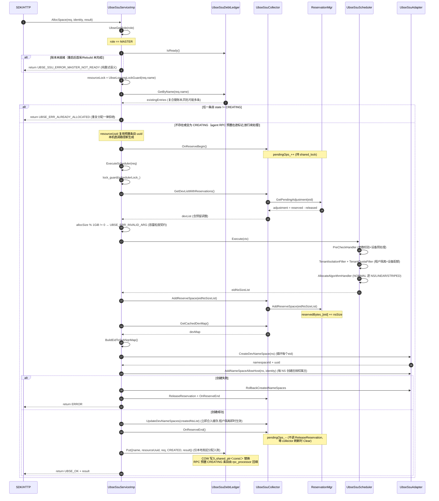

#### 7.1.2 时序图（agent 端通过 RPC 转发）

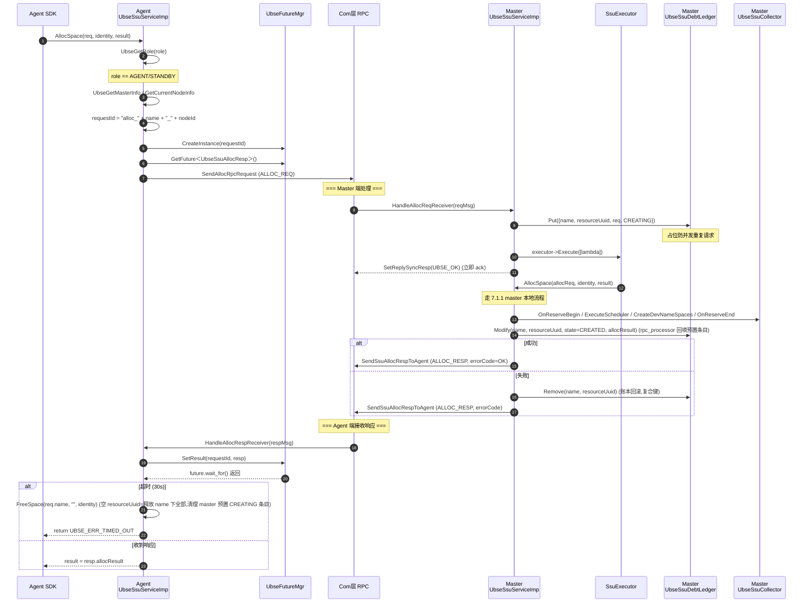

#### 7.1.3 流程伪代码

```
SDK/HTTP ─▶ AllocSpace(req, identity, result)
            │
            ├─ UbseGetRole(role)
            │
            ├─ [master] ExecuteAlloc(req, identity, result)
            │   ├─ if (!DebtLedger.IsReady()) return MASTER_NOT_READY  ← 重建完成前拒绝,防误判重复分配
            │   ├─ resourceLock = UbseLoggingLockGuard(req.name)  ← 按资源名串行化
            │   ├─ existingEntries = DebtLedger.GetByName(req.name)  ← 复合键账本,同名可能多条
            │   ├─ if (任一条目 state != CREATING) return ALREADY_ALLOCATED  ← 重复分配一律拒绝
            │   │   (CREATING 为 agent RPC 预置在途标记,放行并复用其 resourceUuid)
            │   ├─ collector_.OnReserveBegin()  ← pendingOps_++
            │   ├─ ExecuteScheduler(req, eidNsSizeList)
            │   │   ├─ lock_guard(schedulerLock_)  ← 串行化调度
            │   │   ├─ devList = collector_.GetDevListWithReservations()  ← 含预留调整
            │   │   ├─ if (allocSize % 1GiB != 0) return INVALID_ARG  ← 容量粒度契约
            │   │   ├─ ctx = UbseSsuAllocationContext(devList, schedReq)
            │   │   ├─ scheduler_.Execute(ctx)
            │   │   │   ├─ PreCheckHandler.Handle(ctx)        ← 参数校验+设备预处理
            │   │   │   ├─ UbseSsuTenantIsolationFilter.Handle(ctx)  ← 租户隔离
            │   │   │   ├─ UbseSsuTenantQuotaFilter.Handle(ctx)  ← 租户设备配额
            │   │   │   └─ UbseSsuAllocateAlgorithmHandler.Handle(ctx)  ← NORMAL 逐 NS/LINEAR/STRIPED
            │   │   └─ collector_.AddReserveSpace(eidNsSizeList)  ← 预扣容量
            │   ├─ devMap = collector_.GetCachedDevMap()
            │   ├─ BuildEidToSubNqnMap(eidNsSizeList, devMap, eidToSubNqn)
            │   │   └─ 失败 → ReleaseReservation + OnReserveEnd
            │   ├─ CreateDevNameSpaces(req, resourceUuid, eidNsSizeList, identity, eidToSubNqn, result)
            │   │   ├─ for each (eid, nsSize) in eidNsSizeList:
            │   │   │   ├─ FillNsCustomData(ns, req, identity)  ← name/userName/tenant/resourceUuid/defaultNqn
            │   │   │   ├─ Adapter.CreateDevNameSpace(ns)
            │   │   │   ├─ Adapter.AddNameSpaceAllowHost(ns, identity)  ← 每 NS 创建后授权属主
            │   │   │   ├─ 失败 → RollbackCreatedNameSpaces
            │   │   │   └─ result.nameSpaceList.push_back(nsInfo)
            │   │   └─ 失败 → ReleaseReservation + OnReserveEnd
            │   ├─ collector_.UpdateDevNameSpaces(createdNsList)  ← 立即合入设备缓存,租户隔离即时生效
            │   ├─ collector_.OnReserveEnd()  ← 不调 ReleaseReservation，等 collector 刷新时 Clear
            │   ├─ if (existingEntries.empty())  ← 仅本地发起分配入账
            │   │   DebtLedger.Put({name, resourceUuid, req, CREATED, result})
            │   │   (RPC 预置 CREATING 条目由 rpc_processor 回填,此处不重复入账)
            │   └─ return UBSE_OK
            │
            └─ [agent/standby] AllocSpaceViaRpc(req, identity, result)
                ├─ UbseGetMasterInfo / UbseGetCurrentNodeInfo
                ├─ requestId = "alloc_" + req.name + "_" + nodeId
                ├─ respMgr = UbseFutureMgr::CreateInstance(requestId)
                ├─ respFuture = respMgr->GetFuture<UbseSsuAllocResp>()
                ├─ SendAllocRpcRequest(...)  ← RPC 到 master
                ├─ respFuture.wait_for(30s)
                │   └─ 超时 → FreeSpace(req.name, "") 清理 → return UBSE_ERR_TIMED_OUT
                └─ result = resp.allocResult
```

### 7.2 FreeSpace 完整流程

#### 7.2.1 时序图（master 端）

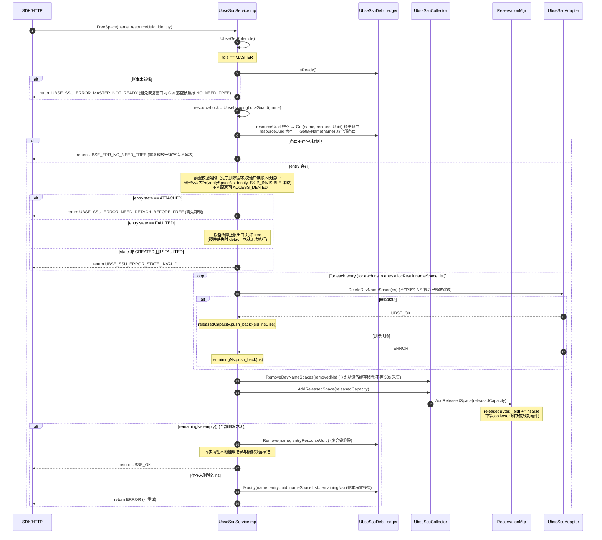

#### 7.2.2 时序图（agent 端通过 RPC 转发）

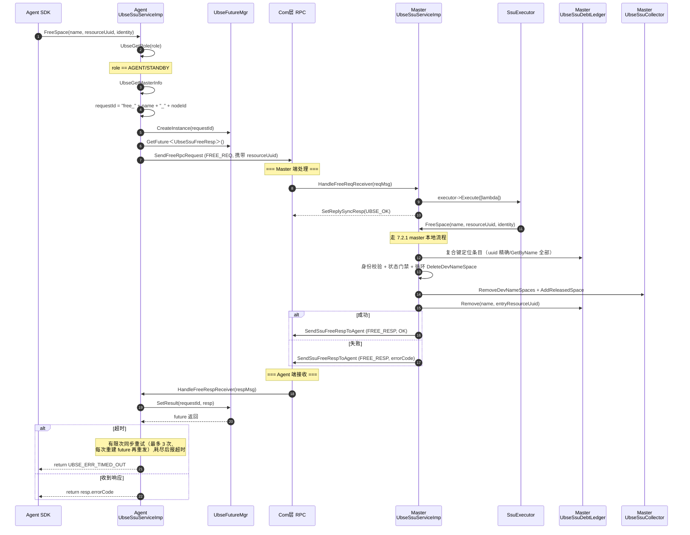

#### 7.2.3 流程伪代码

```
FreeSpace(name, resourceUuid, identity)
  ├─ [master] ExecuteFree(name, resourceUuid, identity)
  │   ├─ if (!DebtLedger.IsReady()) return MASTER_NOT_READY  ← 避免恢复窗口误报 NO_NEED_FREE
  │   ├─ resourceLock = UbseLoggingLockGuard(name)
  │   ├─ resourceUuid 非空 → entryPtr = DebtLedger.Get(name, resourceUuid)
  │   │   └─ nullptr → return NO_NEED_FREE (复合键未命中=空间不存在或已释放)
  │   ├─ resourceUuid 为空 → entries = DebtLedger.GetByName(name)
  │   │   └─ empty → return NO_NEED_FREE (重复释放一律报错)
  │   ├─ 前置校验阶段（先于删除循环,对全部条目先行通过）:
  │   │   ├─ VerifySpaceNsIdentity(nsList, identity, SKIP_INVISIBLE)  ← 身份校验先行
  │   │   │   └─ 不匹配 → return ACCESS_DENIED
  │   │   └─ 状态门禁逐条目:
  │   │       ├─ ATTACHED → return NEED_DETACH_BEFORE_FREE (需先卸载)
  │   │       ├─ FAULTED → 放行 (设备故障止损出口,不在线 NS 按已释放跳过)
  │   │       └─ 其他非 CREATED → return STATE_INVALID
  │   ├─ for each entry:
  │   │   ├─ for each ns in entry.allocResult.nameSpaceList:
  │   │   │   ├─ Adapter.DeleteDevNameSpace(ns)
  │   │   │   ├─ 成功 → releasedCapacity.push_back({eid, nsSize})
  │   │   │   └─ 失败 → remainingNs.push_back(ns)
  │   │   ├─ collector_.RemoveDevNameSpaces(removedNs)  ← 立即移出设备缓存(租户即时释放)
  │   │   ├─ collector_.AddReleasedSpace(releasedCapacity)  ← 预释放容量
  │   │   ├─ remainingNs.empty() → DebtLedger.Remove(name, entryUuid)  ← 复合键删除
  │   │   └─ 部分失败 → Modify 保留残条 (nameSpaceList=remainingNs,便于重试)
  │   └─ 全部成功 → RemoveLocalAttachRecord(name) + suspectedMountTable_.Erase(name)
  │
  └─ [agent] FreeSpaceViaRpc(name, resourceUuid, identity)
      ├─ 发送 FREE_REQ → master 异步处理 → FREE_RESP 唤醒
      └─ 超时有限次重试（最多 3 次,每次重建 future 重发）→ 耗尽返回 TIMED_OUT
```

### 7.3 AttachSpace 流程（agent 主导）

#### 7.3.1 时序图（跨节点协同）

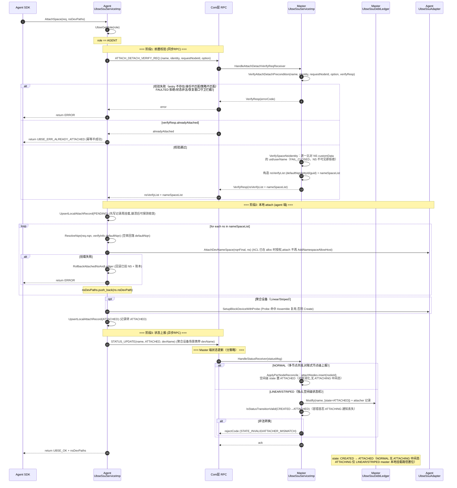

#### 7.3.2 时序图（master 本地 attach）

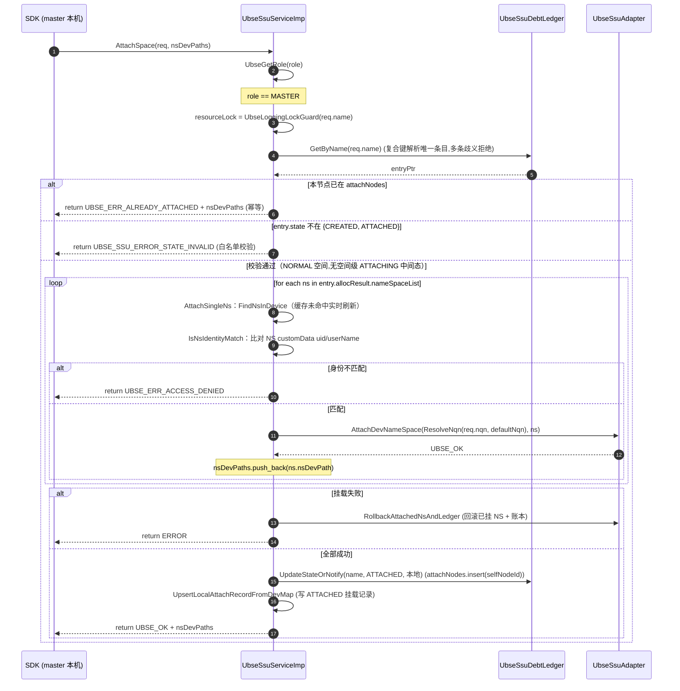

**LINEAR/STRIPED master 本地挂载差异**：仅 `CREATED` 状态可 attach；先 `UpdateStateOrNotify(ATTACHING)` 标记独占挂载中，经恢复期守卫（`CheckMasterAttachRecoveryGuards`）后 `AttachNsAndCreateBlockDevice`（挂 NS + 建/复用聚合块设备），成功后置 `ATTACHED` 并回填 `devPath`。

#### 7.3.3 流程伪代码

```
SDK ─▶ AttachSpace(req, nsDevPaths)  [agent 端]
        ├─ UbseGetRole(role)
        ├─ [agent] VerifyAttachDetachPreconditionViaRpc → ATTACH_DETACH_VERIFY_REQ 到 master
        │   └─ [master] VerifyAttachDetachPrecondition(name, identity, requestNodeId, option, verifyResp)
        │       ├─ DebtLedger 复合键定位条目（不存在/FAULTED/状态非法/策略不匹配 → 拒绝）
        │       ├─ VerifySpaceNsIdentity：比对 NS customData uid/userName（先于幂等分支,防信息泄露）
        │       ├─ 恢复收敛窗口守卫（硬件恢复的独占空间拒绝其他节点首个 attach）
        │       └─ 构造 nsVerifyList（defaultNqn/jettyId/guid）+ nameSpaceList + alreadyAttached
        ├─ alreadyAttached → return UBSE_ERR_ALREADY_ATTACHED (幂等半成功)
        ├─ UpsertLocalAttachRecord(PENDING)  ← 先写记录再挂载
        ├─ ExecuteAttach(req, verifyResp, nsDevPaths)
        │   ├─ for each (nsInfo, verifyInfo):
        │   │   ├─ nqnFinal = ResolveNqn(req.nqn, verifyInfo.defaultNqn)  ← 空串回落 defaultNqn
        │   │   ├─ Adapter.AttachDevNameSpace(nqnFinal, ns)  ← ACL 已在 alloc 时授权,不再 AddNamespaceAllowHost
        │   │   ├─ 失败 → RollbackAttachedNsAndLedger (回滚已挂 NS + 账本)
        │   │   └─ nsDevPaths.push_back(nsInfo.nsDevPath)
        │   ├─ [Linear/Striped] SetupBlockDeviceWithProbe（Probe 命中 Assemble 复用,否则 Create）
        │   └─ UpsertLocalAttachRecord(ATTACHED) (记录转 ATTACHED,上报失败由恢复流程补报)
        ├─ UpdateStateOrNotify(name, ATTACHED, devName)
        │   └─ agent → RPC STATUS_UPDATE(ATTACHED)；master 本地 → 直接改账本
        │     （NORMAL：ApplyPerNodeReconcile 节点级对账,无 ATTACHING 中间态；
        │       LINEAR/STRIPED：空间级状态机 + attacher 记录,ATTACHING 仅 master 本地挂载前置位）
        └─ return nsDevPaths
```

FeDeviceAlloc/FeDeviceFree（VFE 直通）关键流程已迁至 [SSU模块虚机化特性模块设计文档 §7.6](./virt/SSU模块虚机化特性模块设计文档.md)。

---

## 8. 并发控制与一致性保证

### 8.1 并发层次

| 层次 | 机制 | 保护对象 |
|------|------|----------|
| **资源级** | `UbseLoggingLockGuard(name)` | 同名资源的并发请求串行化 |
| **调度级** | `schedulerLock_` (mutex) | 调度算法串行执行 |
| **设备缓存** | `shared_mutex` + `shared_lock`/`unique_lock` | `cachedDevMap_` 读写分离 |
| **预留计数** | `pendingOps_` (atomic) + `shared_lock` | 预留操作与 collector 清理互斥 |
| **账本** | `shared_mutex` + COW `shared_ptr<const>` | 高并发读写不互斥 |
| **预留账本** | `mutex` + `lock_guard` | reservedBytes_/releasedBytes_ 操作 |
| **DirectToVm** | `mutex` + `condition_variable` + 状态机 | MTI 调用单工作者串行 |
| **定时器防重** | `atomic_bool` + CAS | 定时器只注册一次 |

### 8.2 一致性保证

#### 8.2.1 分配幂等性

- **重复分配一律拒绝**：`ExecuteAlloc` 经 `GetByName` 查重，同名任一非 CREATING 条目存在即返回 `UBSE_ERR_ALREADY_ALLOCATED`（分配不幂等，不做静默成功）
- **CREATING 占位放行**：RPC handler 在真正执行前先 `Put(CREATING)`（含 resourceUuid）占位防并发；后续同名请求放行进入 `ExecuteAlloc`，复用预置条目的 resourceUuid 续完成分配
- **账本未就绪门禁**：master 重启后首采/Rebuild 完成前 `IsReady()=false`，返回 `UBSE_SSU_ERROR_MASTER_NOT_READY`（纯重试语义），避免空账本误判"无同名空间"导致重复分配
- **复合键防同名碰撞**：账本 key 为 (name, resourceUuid)，本机直调路径新生成 resourceUuid，脑裂合并后同名多次分配各自成条目、可精确释放

#### 8.2.2 释放幂等性

- **释放不幂等**：`ExecuteFree` 定位不到条目（复合键未命中或 `GetByName` 为空）一律返回 `UBSE_ERR_NO_NEED_FREE`，重复释放显式报错
- **身份校验先行**：`VerifySpaceNsIdentity`（SKIP_INVISIBLE 策略）先于状态判断执行，非属主不得借状态错误码探测空间挂载状态
- **状态门禁**：ATTACHED → `UBSE_SSU_ERROR_NEED_DETACH_BEFORE_FREE`；FAULTED → 止损放行（硬件缺失时 detach 本就无法执行）；其他非 CREATED → `UBSE_SSU_ERROR_STATE_INVALID`
- **HTTP 层容错映射**：`UBSE_ERR_NOT_EXIST` → 200 的映射保留作防御，但 master free 路径实际返回 `NO_NEED_FREE`（走 500）

#### 8.2.3 容量一致性

- **预扣/预释放机制**：弥补 collector 30s 刷新间隔的容量时延
- **原子快照读**：`GetDevListWithReservations` 在持锁期间同时读 cache 和预留，避免读不一致
- **延迟清除容错**：`pendingOps_ != 0` 时不清除预留，延迟一个周期清除也不会错误（硬件 usedBytes 已更新）
- **缓存即时合入/移出**：alloc 成功 `UpdateDevNameSpaces`、free 成功 `RemoveDevNameSpaces` 立即更新设备缓存，租户隔离不等 30s 周期生效

#### 8.2.4 状态机一致性

- **合法转换校验**：`IsStatusTransitionValid` 严格限制状态转换路径，同状态重报幂等消化
- **容错转换**：容忍 ATTACHING 通知丢失（`CREATED → ATTACHED` 直接转换）
- **非法转换拒收**：不修改账本并回 `UBSE_SSU_ERROR_STATE_INVALID` 拒绝码（agent 侧有重试/对账兜底）
- **FAULTED 拦截**：FAULTED 空间的状态上报一律拒收（`UBSE_SSU_ERROR_SPACE_FAULTED`），防止故障期间的上报掩盖告警
- **attacher 单节点不变式**：LINEAR/STRIPED 空间 ATTACHED 上报时 attachNodes 已含其他节点 → `UBSE_SSU_ERROR_ATTACHER_MISMATCH` 拒收（恢复窗口双重挂载的最后防线）
- **NORMAL 节点级对账**：多节点共挂走 `ApplyPerNodeReconcile`，按 nodeId 对账式消化（insert/erase 幂等）

#### 8.2.5 跨节点恢复

- **账本重建**：MASTER_ONLINE 事件触发 collector 首采与 `Rebuild`，从硬件 customData 反推账本（name → resourceUuid 二级分组，`Upsert` 覆盖上一任期残留条目）
- **状态恒置 CREATED**：Rebuild 不推断挂载状态，由 agent 重报（5 次 × 2s 退避）与本地挂载记录对账收敛；重建期间账本置未就绪（状态上报回 MASTER_NOT_READY）
- **恢复收敛窗口**：`SSU_RECONCILE_WINDOW_SECONDS=60s`，窗口内硬件恢复的独占空间（attachNodes 为空）拒绝其他节点首个 attach，防双重挂载
- **本地挂载记录**：`UbseSsuAttachRecordStore` 持久化（PENDING/ATTACHED/SUSPECT），重启后恢复流程按记录重挂收敛；module ready 标志保证恢复流程在 RPC 端点注册后才进入对账阶段

---

## 9. 依赖关系

### 9.1 模块内依赖

```
ubse_ssu_controller_module
  ├─▶ ubse_ssu_master_online_handler
  │     └─▶ ubse_election（订阅 MASTER_ONLINE 事件，触发 collector 首采与账本重建）
  └─▶ ubse_ssu_service_imp
        ├─▶ ubse_ssu_collector
        │     └─▶ ubse_ssu_reservation_mgr
        ├─▶ ubse_ssu_scheduler
        │     └─▶ ubse_filter_chain (framework)
        ├─▶ ubse_ssu_direct_to_vm_manager
        │     └─▶ ubse_mti_urma / ubse_mti_bus_instance (adapter_plugins)
        ├─▶ debt/ubse_ssu_debt_ledger
        ├─▶ ubse_ssu_attach_record_store
        │     └─▶ ubse_ssu_attach_record（本地挂载记录持久化结构）
        ├─▶ ubse_ssu_reconcile_state（对账状态：60s 收敛窗口）
        ├─▶ ubse_ssu_mount_ops
        │     └─▶ UbseSsuAdapterInterface (adapter_plugins/ssu，挂载/聚合设备原语)
        ├─▶ ubse_ssu_vm_cache（VM 模式，缓存 VM 侧上报的 NS 信息）
        └─▶ ubse_ssu_utils

ubse_ssu_rpc_processor ──▶ ubse_ssu_service_imp, debt/ubse_ssu_debt_ledger, message/ubse_ssu_mount_reconcile_msg
ubse_ssu_http_handler   ──▶ ubse_ssu_service_imp (via GetSsuService)
ipc/ubse_ssu_ipc_handler + 17 个子类 ──▶ ubse_ssu_service_imp (via GetSsuService)
```

### 9.2 模块外依赖

| 依赖 | 用途 |
|------|------|
| `framework/com` | RPC 通信、`UbseRpcEndpointFactory`、`UbseRpcMessage` |
| `framework/ha` | 选主 `UbseGetRole` / `UbseGetMasterInfo`，订阅 MASTER_ONLINE 事件 |
| `framework/config` | 配置读取 `UbseGetBool` / `UbseGetUInt`（vm_mode、vsock 端口/TLS 开关、调度器阈值） |
| `framework/vscok` | `UbseVsockServer`（VM 模式 vsock 推送接收） |
| `framework/timer` | `UbseTimerHandlerRegister` / `Unregister` |
| `framework/thread_pool_module` | 任务执行器 `UbseTaskExecutorModule` |
| `framework/misc/future_mgr` | `UbseFutureMgr` 异步等待 |
| `framework/misc/logging_lock_guard` | `UbseLoggingLockGuard` 资源锁 |
| `framework/http` | VIP HTTP Server 注册 |
| `framework/service_registry` | `UbseServiceRegistry` 服务注册 |
| `framework/filter_chain` | `UbseFilterChain` 责任链 |
| `adapter_plugins/ssu` | `UbseSsuAdapterInterface`（dlopen libssu.so） |
| `adapter_plugins/mti` | `UbseMtiUrma` / `UbseMtiBusInstance` |
| `include/plugin_services/ssu` | `UbseSsuService` 抽象基类、数据结构定义 |

---

## 10. 关键设计模式与亮点

### 10.1 设计模式

| 模式 | 应用 |
|------|------|
| **单例** | `UbseSsuServiceImp`、`UbseSsuDebtLedger`、`UbseSsuDirectToVmManager`、`UbseSsuAdapterInterface`、`UbseSsuAttachRecordStore` |
| **模板方法** | `UbseSsuHandler::Execute` 固定五阶段流水线（Init → Unpack → Handle → Pack → SendResponse） |
| **责任链** | `UbseSsuScheduler` 通过 Filter Chain 处理分配请求 |
| **工厂方法** | `RegisterSsuIpcHandler` 工厂 lambda 注册 handler |
| **Copy-on-Write** | `UbseSsuDebtLedger::Modify` 拷贝旧 entry 后替换指针 |
| **状态机** | `UbseSsuNsState`（账本状态）、`SsuDirectToVmManagerState`（直通管理状态） |
| **Future/Promise** | `UbseFutureMgr` 跨节点 RPC 异步等待 |
| **空删除器 shared_ptr** | 单例注册到 service registry 但不被 shared_ptr 析构 |

### 10.2 设计亮点

1. **三通路汇聚单例**：IPC/RPC/HTTP 三条接入通路最终都汇聚到 `UbseSsuServiceImp` 单例，业务逻辑无重复。

2. **COW + shared_ptr<const>**：账本写不阻塞读，读端永远看到一致快照，高并发账本的经典做法。

3. **`pendingOps_` + shared_lock**：精妙解决"AddReserveSpace 与 CollectDeviceList.Clear 之间的竞态"，使"检查 + Clear"成为原子决策。

4. **DebtLedger 提前落账 CREATING**：分布式场景下"先占位后执行"的幂等模式，防止并发重复 alloc。

5. **同步 vs 异步 RPC 分流**：耗时写操作走异步 + Future，轻量查询走同步 sync resp，省去 future 等待开销。

6. **VIP HTTP Server**：HTTP 接口只在 master 节点暴露，主备切换时路由跟随 VIP 漂移，避免双写。

7. **渐进降级**：UUID 生成优先用 libuuid，回退到线程本地随机数，任何阶段失败均不阻断主流程。

8. **责任链扩展点**：通过 `AddFilter(groupId, filter)` 可在任一 group 插入自定义 filter，符合开闭原则。

---

## 11. 关键约束与注意事项

### 11.1 调用方约束

| 约束 | 说明 |
|------|------|
| STRIPED 分配 | `allocSize` 必须整除 `nsNum`，且整除后为 `chunkSize` 的整数倍（chunkSize 校验在 AttachStripedSpace 时进行） |
| LINEAR 分配 | `allocSize` 必须为 `lbaSize` 的整数倍（`PreCheckHandler` 校验拒绝，非向上对齐）；不满足直接返回分配失败 |
| 容量粒度 | `allocSize` 必须为 1GiB 的整数倍（`ExecuteScheduler` 入口统一校验） |
| RAID5 聚合 | 至少需要 3 个成员设备 |
| name 长度 | 最大 47 字符（`SSU_NAME_MAX_LEN` 为 48，含 `'\0'`） |
| tenant 长度 | 最大 16 字符 |
| identity 验证 | attach/detach 前必须调用 `VerifyAttachDetachPrecondition`（含 requestNodeId/resourceUuid 比对，见 §4.1） |

### 11.2 实现约束

- **agent 端无账本**：所有账本操作只在 master 端进行，agent 端通过 RPC 同步状态
- **collector 仅 master 启动**：`StartCollecting` 内部检查角色，非 master 直接返回
- **HTTP 仅 master 暴露**：通过 VIP HTTP Server 实现
- **MTI 调用单工作者**：DirectToVmManager 通过状态机保证 MTI 调用不并发
- **VFE 直通的抢占/独占语义**：见 [SSU模块虚机化特性模块设计文档 §11](./virt/SSU模块虚机化特性模块设计文档.md)。

### 11.3 可观测性

- **traceId 透传**：RPC handler 间通过 `TraceContext` 透传 traceId，保证跨节点调用链可串联
- **结构化日志**：`UBSE_LOG_INFO/WARN/ERROR` 贯穿所有路径，关键字段（name/eid/nsId/requestId/ret）齐全
- **资源锁日志**：`UbseLoggingLockGuard` 记录锁等待与持有时间，便于排查死锁

---

## 12. 测试要点

### 12.1 单元测试

| 测试对象 | 测试重点 |
|----------|----------|
| `UbseSsuScheduler` | 条带化/线性分配算法、租户隔离、参数校验、设备过滤排序 |
| `UbseSsuDebtLedger` | Put/Get/Modify/Remove 幂等性、COW 并发、Rebuild 状态推断 |
| `UbseSsuReservationMgr` | 预扣/预释放/净调整量计算、Clear 时机 |
| `UbseSsuCollector` | 空列表保护、pendingOps_ 并发协议、原子快照读 |
| `UbseSsuDirectToVmManager` | 状态机转换、抢占/独占语义、重试机制 |

测试位置：`test/UT/controllers/ssu/`，使用 GoogleTest + GoogleMock + mockcpp。

### 12.2 集成测试要点

- master/agent 角色切换时的账本一致性
- RPC 超时与重试
- 并发 alloc 同名资源
- collector 刷新期间的容量超分防护
- VFE 直通抢占场景：见虚机化特性设计文档测试要点

---

## 13. 附录

### 13.1 关键文件索引

| 文件 | 行数 | 说明 |
|------|------|------|
| [ubse_ssu_service.h](../../../../src/include/plugin_services/ssu/ubse_ssu_service.h) | ~430 | 服务契约，17 个纯虚接口 + 数据结构定义 |
| [ubse_ssu_service_imp.cpp](../../../../src/controllers/ssu/ubse_ssu_service_imp.cpp) | ~700+ | 业务编排核心实现 |
| [ubse_ssu_controller_module.cpp](../../../../src/controllers/ssu/ubse_ssu_controller_module.cpp) | ~122 | 模块入口与生命周期 |
| [ubse_ssu_scheduler.cpp](../../../../src/controllers/ssu/ubse_ssu_scheduler.cpp) | ~320 | 责任链调度器与分配算法 |
| [ubse_ssu_collector.cpp](../../../../src/controllers/ssu/ubse_ssu_collector.cpp) | ~193 | 设备采集器 |
| [ubse_ssu_reservation_mgr.cpp](../../../../src/controllers/ssu/ubse_ssu_reservation_mgr.cpp) | ~73 | 预留容量管理 |
| [ubse_ssu_debt_ledger.cpp](../../../../src/controllers/ssu/debt/ubse_ssu_debt_ledger.cpp) | ~200 | 债务账本与 Rebuild |
| [ubse_ssu_direct_to_vm_manager.cpp](../../../../src/controllers/ssu/ubse_ssu_direct_to_vm_manager.cpp) | ~550 | VM 直通管理 |
| [ubse_ssu_rpc_processor.cpp](../../../../src/controllers/ssu/ubse_ssu_rpc_processor.cpp) | ~760 | 跨节点 RPC 注册与处理 |
| [ubse_ssu_http_handler.cpp](../../../../src/controllers/ssu/ubse_ssu_http_handler.cpp) | ~360 | 北向 HTTP 路由 |
| [ubse_ssu_ipc_handler.cpp](../../../../src/controllers/ssu/ipc/ubse_ssu_ipc_handler.cpp) | ~220 | IPC handler 基类与注册 |

### 13.2 构建与测试命令

```shell
# 构建
bash build.sh              # Release
bash build.sh -D           # Debug

# 运行 SSU 相关 UT
bash build.sh ut -- --gtest_filter="*Ssu*"
bash build.sh ut -- --gtest_filter="TestUbseSsuScheduler.*"
bash build.sh ut -- --gtest_filter="TestUbseSsuDebtLedger.*"

# 覆盖率
bash build.sh ut -C
```

### 13.3 相关文档

- [UBSE代码Wiki.md](../../architecture/UBSE代码Wiki.md) —— 项目整体架构
- [AGENTS.md](../../../../AGENTS.md) —— 项目构建与测试指南
- [SSU模块开发指南.md](./SSU模块开发指南.md) —— SSU 控制器开发规范与排查指南
- [SSU模块测试设计文档.md](./SSU模块测试设计文档.md) —— UT/IT/PT/FUZZ/E2E 测试体系(含 CLI 特性测试设计)

## 14. CLI 特性设计

> **工作模式**：代码反推模式（从源码反推设计）
> **源码路径**：`src/cli/ssu/`
> **构建产物**：`ubsectl-ssu` 可执行文件
> **服务契约对端**：[ubse_ssu_service.h](../../../../src/include/plugin_services/ssu/ubse_ssu_service.h)
> **特性需求**：[SSU模块需求分析文档](SSU模块需求分析文档.md) §4.11（FR-CLI-* 编号）
> **测试设计**：[SSU模块测试设计文档](./SSU模块测试设计文档.md)（CLI 特性测试设计见其 §5.8~§5.12、§6.2.4~§6.2.6、§9.3.4~§9.3.9、§14.5）

> 本特性原独立成篇（`cli/SSU模块CLI特性设计文档.md` V1.0，2026-07-25），2026-10-27 并入本文档为第 14 章。原 FR-XXX 编号映射：FR-STARTUP → FR-CLI-STARTUP、FR-CMD-REG → FR-CLI-CMD-REG、FR-DISPLAY → FR-CLI-DISPLAY、FR-CREATE → FR-CLI-CREATE、FR-ATTACH → FR-CLI-ATTACH、FR-DETACH → FR-CLI-DETACH、FR-VALIDATE → FR-CLI-VALIDATE、FR-IPC → FR-CLI-IPC、FR-WIRE → FR-CLI-WIRE、FR-OUTPUT → FR-CLI-OUTPUT、FR-AUTH → FR-CLI-AUTH、FR-COVERAGE → FR-CLI-COVERAGE；对应 AC-XXX-* → AC-CLI-XXX-*。

### 14.1 模块定位与职责

#### 14.1.1 模块概述

SSU-CLI(`ubsectl-ssu`)是 UBS-Engine 的命令行入口之一,与主 `ubsectl`、`ubse_cert` 并列,定位为面向运维与自动化脚本的独立可执行程序。其通过 UDS 短连接与 `ubse` daemon 通信,完成 SSU 资源的查询、分配、挂载与卸载操作。CLI 自身不持有业务状态,所有业务逻辑由 daemon 完成,因此本模块的代码全部围绕"参数解析 → 校验 → wire 序列化 → IPC → 反序列化 → 输出格式化"这一单向链路展开。

#### 14.1.2 核心职责

| 职责 | 说明 | 对应 FR |
|------|------|---------|
| **程序启动与生命周期** | argc/argv 校验、隐式 type 注入、超时定时器、IPC 日志屏蔽、命令分发 | FR-STARTUP |
| **命令注册** | 通过 `UBSE_CLI_REGISTER_MODULE` 宏静态注册 SSU 模块 5 类命令(display/create/delete/attach/detach);VM 模式仅注册 display/attach/detach 子集 | FR-CMD-REG |
| **display 查询** | 概览(alloc_summary)、详情(alloc_detail)与连接信息(connect_info,仅 VM 模式)三种模式,分别走 0x0004/0x0005/0x0007 | FR-DISPLAY |
| **create 分配** | 校验 name/size/lba/ns_num/strategy,序列化请求走 0x000A | FR-CREATE |
| **delete 释放** | 校验 name 后序列化释放请求,走 0x000D | FR-CLI-DELETE |
| **attach 挂载** | 普通/Linear/Striped 三模式,分别走 0x000B/0x000E/0x0010 | FR-ATTACH |
| **detach 卸载** | 普通/Linear/Striped 三模式,分别走 0x000C/0x000F/0x0011 | FR-DETACH |
| **输入参数校验** | 客户端预校验 name/size/lba/ns_num/strategy/level/chunk_size/dev_name/host_nqn/src_eid,过滤非法输入 | FR-VALIDATE |
| **UDS IPC 通信** | 通过 `ubse_invoke_call` 发起 UDS 短连接,同步收发请求/响应 | FR-IPC |
| **wire 序列化/反序列化** | 使用 `UbsePackUtil` 编码裸 payload,严格对齐服务端 `Ssu*Pack/Ssu*Unpack` | FR-WIRE |
| **输出格式化** | 纯文本(`UbseCliStringEcho`)与结构化表格(`UbseCliVariableCellEcho`)两种格式 | FR-OUTPUT |
| **隐式认证委托** | 不显式认证,依赖 UDS peercred + daemon 侧 RBAC | FR-AUTH |

#### 14.1.3 在系统中的位置

```
┌──────────────────────────────────────────────────────────────────┐
│  运维用户 / 自动化脚本                                            │
│      │                                                            │
│      ▼ 执行 ubsectl-ssu <cmd> ssu <opts>                         │
│  ┌──────────────────────────────────────────────────────────┐    │
│  │  ubsectl-ssu (本模块, src/cli/ssu/)                      │    │
│  │  ┌──────────────────────────────────────────────────┐    │    │
│  │  │ ubse_cli_ssu_main.cpp                            │    │    │
│  │  │  - main()                                        │    │    │
│  │  │  - UbseCliValidateStartupConditions              │    │    │
│  │  │  - UbseCliBuildArgs(隐式 type 注入)              │    │    │
│  │  │  - UbseCliValidateArgsByWhitelist                │    │    │
│  │  │  - UbseCliStartTimeoutTimer (SIGALRM)            │    │    │
│  │  │  - UbseCliDisableIpcLog                          │    │    │
│  │  │  - UbseCliExecuteMatchedCommand                  │    │    │
│  │  └──────────────────────────────────────────────────┘    │    │
│  │  ┌──────────────────────────────────────────────────┐    │    │
│  │  │ ubse_cli_ssu_cmd_reg.cpp (命令注册与处理)        │    │    │
│  │  │  - UbseCliRegSsuModule (静态注册)                │    │    │
│  │  │  - 5 类命令处理函数:Display/Create/Delete/       │    │    │
│  │  │    Attach/Detach(VM 模式仅 Display/Attach/Detach)│    │    │
│  │  │  - Parse* / IsValid* 客户端预校验                │    │    │
│  │  │  - InvokeSsuIpcRaw/InvokeSsuIpc×3/               │    │    │
│  │  │    InvokeSsuAttachIpc 发送模板                   │    │    │
│  │  │  - BuildSummaryTable/BuildDetailTable/           │    │    │
│  │  │    BuildConnectInfoOutput 输出                   │    │    │
│  │  └──────────────────────────────────────────────────┘    │    │
│  │  ┌──────────────────────────────────────────────────┐    │    │
│  │  │ ubse_cli_ssu_struct.cpp (wire 契约)              │    │    │
│  │  │  - 请求结构 Serialize (UbsePackUtil)             │    │    │
│  │  │  - 响应结构 Deserialize (UbseUnpackUtil)         │    │    │
│  │  │  - 防御性常量校验 (枚举/列表上限)                │    │    │
│  │  └──────────────────────────────────────────────────┘    │    │
│  │  ┌──────────────────────────────────────────────────┐    │    │
│  │  │ ubse_cli_ssu_error.cpp (错误码→文案映射)         │    │    │
│  │  │  - GetSsuErrorMessage                            │    │    │
│  │  └──────────────────────────────────────────────────┘    │    │
│  │  ┌──────────────────────────────────────────────────┐    │    │
│  │  │ ubse_cli_ssu_limits.h (输入/wire 契约限制)       │    │    │
│  │  └──────────────────────────────────────────────────┘    │    │
│  └──────────────────┬───────────────────────────────────────┘    │
│                     │                                            │
│       ┌─────────────▼─────────────┐                              │
│       │ ubse_cli_framework        │ ← 提供注册表/Builder/解析器  │
│       │ ubse_cli_consumer         │ ← 提供 UbseCliBufferGuard    │
│       │ ubse_ipc_client           │ ← 提供 ubse_invoke_call      │
│       │ ubse_serial               │ ← 提供 UbsePackUtil          │
│       │ boundscheck               │ ← 提供 memcpy_s/strncpy_s    │
│       └─────────────┬─────────────┘                              │
└─────────────────────┼────────────────────────────────────────────┘
                      │ UDS (/var/run/ubse/ubse.sock, 0660)
┌─────────────────────▼────────────────────────────────────────────┐
│  ubse daemon (api_server)                                        │
│  ├── SO_PEERCRED 提取 uid                                        │
│  ├── GetUserNameById → CheckPermission (RBAC)                    │
│  └── dispatch by (moduleCode=UBSE_SSU=0x0007, opCode)            │
└─────────────────────┬────────────────────────────────────────────┘
                      │
┌─────────────────────▼────────────────────────────────────────────┐
│  SSU Controller (src/controllers/ssu/)                           │
│  └── UbseSsuService 实现:AllocSpace/AttachSpace/...             │
└──────────────────────────────────────────────────────────────────┘
```

**关键关系**:
1. CLI 是 daemon 的客户端,通过 UDS 短连接通信(每次 `ubse_invoke_call` 都 connect-send-recv-disconnect)
2. CLI 不直接调用 SSU 业务逻辑,所有请求经 daemon 鉴权后分发
3. CLI 的 wire 契约与服务端 `Ssu*Pack/Ssu*Unpack` 严格对应,字段顺序/宽度必须一致(双源同步)
4. CLI 不持有业务状态,无跨命令上下文

---

### 14.2 目录结构与文件职责

#### 14.2.1 源码目录树

```
src/cli/ssu/
├── CMakeLists.txt                       # 构建配置,产出 ubsectl-ssu 可执行文件
├── ubse_cli_ssu_main.cpp                # 程序入口,main() 函数
├── ubse_cli_ssu_cmd_reg.{h,cpp}         # 命令注册类与处理函数(校验/IPC/输出)
├── ubse_cli_ssu_struct.{h,cpp}          # wire 契约结构体(Serialize/Deserialize)
├── ubse_cli_ssu_error.{h,cpp}           # daemon 错误码 → CLI 文案映射(GetSsuErrorMessage)
└── ubse_cli_ssu_limits.h                # 输入/wire 契约限制常量
```

> **目录归档说明**:
> - 本模块位于 `src/cli/ssu/`,属于 CLI 层(非控制器层),目录规范中 `src/include/controllers/` 冻结与 `plugin_services/` 约束对本模块**不适用**
> - 本模块**无对外服务契约头文件**(CLI 是 daemon 的客户端,不向其他模块暴露接口),因此 `src/include/` 下无对应归档
> - 头文件 `ubse_cli_ssu_cmd_reg.h` 与 `ubse_cli_ssu_struct.h` 仅在模块内部使用,与源码同目录,符合 CLI 层惯例
> - UT 归档于 `test/UT/cli/`,与 `src/cli/` 层级对应(平铺于 `cli/` 下,因 CLI 层有多个并列子模块:framework/consumer/ssu/cert 等,采用 `cli/` 单层目录组织)

#### 14.2.2 文件职责表

| 文件 | 关键类/函数 | 职责 |
|------|-------------|------|
| `ubse_cli_ssu_main.cpp` | `main()`、`SSU_TYPE` 常量 | 程序入口,完成启动校验、注册、参数解析、超时定时器、命令分发 |
| `ubse_cli_ssu_cmd_reg.h` | `UbseCliRegSsuModule`、`ParseSsuVmModeConf`/`IsSsuVmModeConf`/`UBSE_SSU_VM_MODE_ENV` | 命令注册类,继承 `UbseCliRegModule`,声明 5 类命令的构建与处理函数;VM 模式检测(vm_mode 配置解析与环境变量覆盖) |
| `ubse_cli_ssu_cmd_reg.cpp` | `UBSE_CLI_REGISTER_MODULE` 宏、`UbseCliDisplaySsuFunc` 等 5 个处理函数、`HandleAttachSpace/Linear/Striped`、`HandleDetachSpace/Aggregated`、`InvokeSsuIpcRaw`/`InvokeSsuIpc`(3 重载)/`InvokeSsuAttachIpc` 发送模板、`Parse*`/`IsValid*` 校验函数、`BuildSummaryTable`/`BuildDetailTable`/`BuildDetailOutput`/`BuildConnectInfoOutput`/`FormatAttachOutput` 输出函数 | 命令注册、VM/host 模式命令子集注册、参数校验、IPC 调用、输出格式化 |
| `ubse_cli_ssu_struct.h` | `UbseCliSsuAllocDetailReq`、`UbseCliSsuFreeSpaceReq`、`UbseCliSsuAllocCreateReq`、`UbseCliSsuAttachSpaceReq/LinearReq/StripedReq`、`UbseCliSsuDetachSpaceReq/LinearReq/StripedReq`、`UbseCliSsuAttachSpaceRsp/AggregatedRsp`、`UbseCliSsuNameSpaceInfo`、`UbseCliSsuAllocResult`、`UbseCliSsuAllocListRsp`、`UbseCliSsuConnectInfoReq/ConnectInfo/ConnectInfoRsp` | wire 契约结构体定义 |
| `ubse_cli_ssu_struct.cpp` | `Serialize`/`Deserialize` 实现、`BuildPayload`/`DecodePayload`/`PackString`/`PackSpaceFields`/`UnpackString`/`UnpackNsDevPaths`/`UnpackNameSpace`/`UnpackAllocResult`、`IsValidLbaFormat/Strategy/RaidLevel/ChunkSize` | wire 序列化与反序列化实现,枚举合法性校验,列表上限防御 |
| `ubse_cli_ssu_error.h/.cpp` | `GetSsuErrorMessage` | daemon 错误码 → CLI 文案映射(参数/权限/超时/业务码),未命中走 `Internal error with error code N.` 兜底 |
| `ubse_cli_ssu_limits.h` | `SSU_CLI_BYTES_PER_GIB`、`SSU_CLI_MAX_NAME_LENGTH`、`SSU_CLI_MAX_TENANT_LENGTH`、`SSU_CLI_MAX_HOST_NQN_LENGTH`、`SSU_CLI_MAX_SRC_EID_LENGTH`、`SSU_CLI_MAX_DEV_NAME_LENGTH`、`SSU_CLI_DEFAULT_NS_NUM`、`SSU_CLI_MAX_NS_NUM`、`SSU_CLI_MIN_SIZE_BYTES`、`SSU_CLI_MAX_DESERIALIZED_*`、`SSU_CLI_DETACH_*` | 输入校验常量与反序列化防御阈值集中定义 |

#### 14.2.3 目录规范偏差检查

- [x] 本模块位于 `src/cli/ssu/`,符合 CLI 层目录组织(与 `src/cli/ubse_cert/`、`src/cli/ubse_cli_framework/`、`src/cli/ubse_cli_consumer/` 并列)
- [x] 头文件仅在模块内部使用,与源码同目录(CLI 层惯例,不归档到 `src/include/`)
- [x] UT 目录 `test/UT/cli/` 与 `src/cli/` 层级对应,采用单层组织(因 CLI 层有多个并列子模块)
- [x] 不涉及控制器对外接口归档,无 `plugin_services/` 约束适用
- [x] 无目录规范偏差

---

### 14.3 模块入口与生命周期

#### 14.3.1 模块入口类

本模块的入口为 `ubse_cli_ssu_main.cpp` 中的 `main()` 函数,**不继承 `UbseModule`**(CLI 不是 daemon 的子模块,而是独立可执行程序)。模块注册类为 `UbseCliRegSsuModule`,继承自 `UbseCliRegModule`。

```cpp
// ubse_cli_ssu_cmd_reg.h
class UbseCliRegSsuModule : public UbseCliRegModule {
public:
    void UbseCliSignUp() override;
private:
    static UbseCliCommandInfo UbseCliDisplaySsu();
    static UbseCliCommandInfo UbseCliCreateSsu();
    static UbseCliCommandInfo UbseCliDeleteSsu();
    static UbseCliCommandInfo UbseCliAttachSsu();
    static UbseCliCommandInfo UbseCliDetachSsu();
    static std::shared_ptr<UbseCliResultEcho> UbseCliDisplaySsuFunc(const std::map<std::string, std::string> &);
    static std::shared_ptr<UbseCliResultEcho> UbseCliCreateSsuFunc(const std::map<std::string, std::string> &);
    static std::shared_ptr<UbseCliResultEcho> UbseCliDeleteSsuFunc(const std::map<std::string, std::string> &);
    static std::shared_ptr<UbseCliResultEcho> UbseCliAttachSsuFunc(const std::map<std::string, std::string> &);
    static std::shared_ptr<UbseCliResultEcho> UbseCliDetachSsuFunc(const std::map<std::string, std::string> &);
    static std::shared_ptr<UbseCliResultEcho> DisplayAllocSummary();
    static std::shared_ptr<UbseCliResultEcho> DisplayAllocDetail(const std::map<std::string, std::string> &params);
    static std::shared_ptr<UbseCliResultEcho> DisplayConnectInfo(const std::map<std::string, std::string> &params);
};
```

#### 14.3.2 生命周期流程

CLI 是一次性执行模型,生命周期为:`启动 → 注册 → 解析 → 命令分发 → 退出`。

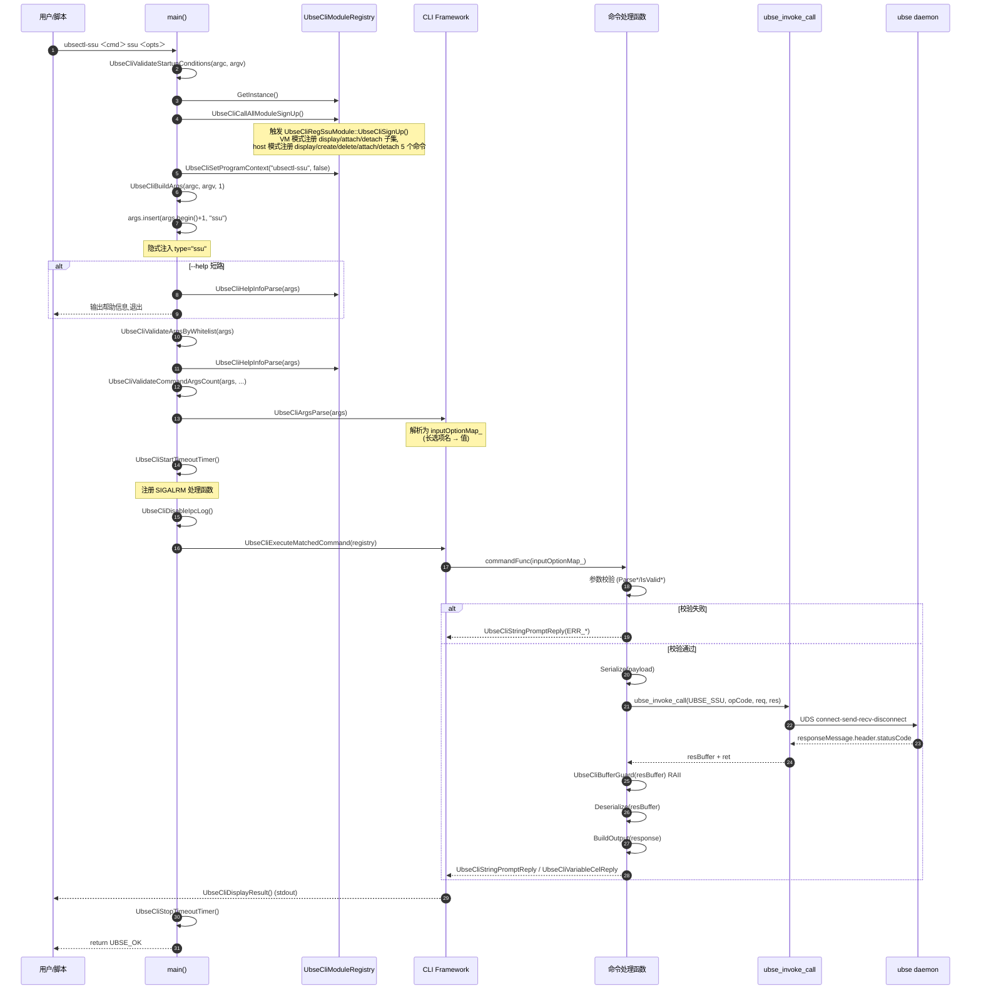

#### 14.3.3 关键初始化步骤

| 步骤 | 动作 | 依赖 |
|------|------|------|
| 1 | `UbseCliValidateStartupConditions`:校验 argc ∈ [1, 43]、argv 非空 | 无 |
| 2 | `UbseCliCallAllModuleSignUp`:触发所有静态注册的模块 `UbseCliSignUp()` | `UBSE_CLI_REGISTER_MODULE` 宏已执行 |
| 3 | `UbseCliSetProgramContext("ubsectl-ssu", false)`:设置程序名,关闭 usage 中 type 显示 | 无 |
| 4 | `UbseCliBuildArgs`:跳过 argv[0],预留 1 个位置供隐式 type | 无 |
| 5 | `args.insert(args.begin()+1, "ssu")`:在 command 后插入隐式 type | 步骤 4 |
| 6 | `UbseCliValidateArgsByWhitelist`:校验 command/type/option-name 合法性 | `ubse_cli_whitelist.h` |
| 7 | `UbseCliHelpInfoParse`:若 `--help` 则输出帮助并退出 | 步骤 6 |
| 8 | `UbseCliValidateCommandArgsCount`:校验 command 和 type 均已提供 | 步骤 6 |
| 9 | `UbseCliArgsParse`:解析为 `inputOptionMap_`(长选项名 → 值) | 步骤 8 |
| 10 | `UbseCliStartTimeoutTimer`:注册 SIGALRM 处理函数并启动定时器 | 无 |
| 11 | `UbseCliDisableIpcLog`:屏蔽 IPC 日志(避免噪声) | 无 |
| 12 | `UbseCliExecuteMatchedCommand`:回调匹配命令的 `commandFunc`,打印结果 | 步骤 9 |
| 13 | `UbseCliStopTimeoutTimer`:停止定时器 | 步骤 12 |

---

### 14.4 服务接口与数据模型

#### 14.4.1 服务契约

本模块是 daemon 的客户端,**不对外提供服务契约**。CLI 调用 daemon 的 `UbseSsuService`(`src/include/plugin_services/ssu/ubse_ssu_service.h`),通过 `(moduleCode=UBSE_SSU=0x0007, opCode)` 二元组定位 handler。模块码与 opCode 均定义于 IPC 层 `src/framework/ipc/include/ubse_ipc_common.h`(`ubse_ipc_module_code_t` / `ubse_ipc_ssu_op_code_t`),注意与 RPC 层 `ubse_com_op_code.h` 的 `UbseSsuOpCode` 取值不同。

CLI 命令与 daemon 服务接口的映射:

| CLI 命令 | opCode(hex) | daemon 服务接口 | 请求结构 | 响应结构 |
|----------|-------------|-----------------|----------|----------|
| `display ssu -t alloc_summary` | 0x0004 | `ListAllocInfo` | 无 | `UbseCliSsuAllocListRsp` |
| `display ssu -t alloc_detail -n` | 0x0005 | `GetAllocInfoByName` | `UbseCliSsuAllocDetailReq` | `UbseCliSsuAllocResult` |
| `display ssu -t connect_info -n`(仅 VM 模式) | 0x0007 | `GetConnectInfo` | `UbseCliSsuConnectInfoReq` | `UbseCliSsuConnectInfoRsp` |
| `create ssu -n -s` | 0x000A | `AllocSpace` | `UbseCliSsuAllocCreateReq` | `UbseCliSsuAllocResult` |
| `delete ssu -n` | 0x000D | `FreeSpace` | `UbseCliSsuFreeSpaceReq` | 无 |
| `attach ssu -n` | 0x000B | `AttachSpace` | `UbseCliSsuAttachSpaceReq` | `UbseCliSsuAttachSpaceRsp` |
| `attach ssu -t Linear -n -d` | 0x000E | `AttachLinearSpace` | `UbseCliSsuAttachLinearReq` | `UbseCliSsuAttachAggregatedRsp` |
| `attach ssu -t Striped -n -d -l -c` | 0x0010 | `AttachStripedSpace` | `UbseCliSsuAttachStripedReq` | `UbseCliSsuAttachAggregatedRsp` |
| `detach ssu -n` | 0x000C | `DetachSpace` | `UbseCliSsuDetachSpaceReq` | 无 |
| `detach ssu -t Linear -n -d` | 0x000F | `DetachLinearSpace` | `UbseCliSsuDetachLinearReq` | 无 |
| `detach ssu -t Striped -n -d` | 0x0011 | `DetachStripedSpace` | `UbseCliSsuDetachStripedReq` | 无 |

#### 14.4.2 关键枚举(从 `ubse_ssu_service.h` 引入)

```cpp
// 命名空间 LBA 格式
enum class UbseSsuLBAFormat : uint32_t {
    LBA_FORMAT_512 = 512,  // 512 字节块
    LBA_FORMAT_4K = 4096,  // 4K 字节块
};

// 分配策略
enum class UbseSsuAllocStrategy : uint8_t {
    STRIPED = 0,  // 条带化:尽量从多个设备分配,均等分配
    LINEAR = 1,   // 线性:尽量从单个设备分配
    NORMAL = 2,   // 普通:挂载 nvme 裸设备,不聚合块设备
};

// 聚合 RAID 级别
enum class UbseSsuAggregationRaidLevel : uint8_t {
    RAID0 = 0,
    RAID5 = 5,
};

// chunk 大小(条带化)
enum class UbseSsuChunkSize : uint32_t {
    CHUNK_SIZE_4K = 4,     // 4KB
    CHUNK_SIZE_16K = 16,   // 16KB
    CHUNK_SIZE_32K = 32,   // 32KB
    CHUNK_SIZE_64K = 64,   // 64KB
    CHUNK_SIZE_128K = 128, // 128KB
    CHUNK_SIZE_256K = 256, // 256KB
    CHUNK_SIZE_512K = 512, // 512KB
};
```

> **重要**:枚举宽度在 wire 协议中固定(`LBAFormat` uint32、`Strategy` uint8、`RaidLevel` uint8、`ChunkSize` uint32),不可变更,否则破坏与服务端 `Ssu*Pack/Ssu*Unpack` 的二进制兼容。

#### 14.4.3 关键数据结构

##### 14.4.3.1 请求结构(均有 `Serialize`)

```cpp
// 详情查询请求(ubse_cli_ssu_struct.h:33-36)
struct UbseCliSsuAllocDetailReq {
    std::string name;
};

// 空间释放请求(:39-42),delete ssu 使用,成功时无响应体
struct UbseCliSsuFreeSpaceReq {
    std::string name;
};

// 创建分配请求(:46-54),字段对齐服务层 UbseSsuAllocSpaceReq
struct UbseCliSsuAllocCreateReq {
    std::string name;
    uint64_t nsSize = SSU_CLI_MIN_SIZE_BYTES;
    uint32_t nsNum = SSU_CLI_DEFAULT_NS_NUM;
    UbseSsuLBAFormat lbaFormat = UbseSsuLBAFormat::LBA_FORMAT_512;
    UbseSsuAllocStrategy strategy = UbseSsuAllocStrategy::NORMAL;  // 未指定 -r 时默认 NORMAL
    std::string tenant;  // 线报文字段,默认空
};

// 普通 attach 请求(:58-63)
struct UbseCliSsuAttachSpaceReq {
    std::string name;
    std::string hostNqn = SSU_CLI_DEFAULT_HOST_NQN;  // 默认空,服务端推导
    std::string srcEid;
};

// 线性聚合 attach 请求(:67-73)
struct UbseCliSsuAttachLinearReq {
    std::string name;
    std::string hostNqn = SSU_CLI_DEFAULT_HOST_NQN;
    std::string srcEid;
    std::string devName;
};

// 条带化聚合 attach 请求(:77-85)
struct UbseCliSsuAttachStripedReq {
    std::string name;
    std::string hostNqn = SSU_CLI_DEFAULT_HOST_NQN;
    std::string srcEid;
    std::string devName;
    UbseSsuAggregationRaidLevel level = UbseSsuAggregationRaidLevel::RAID0;
    UbseSsuChunkSize chunkSize = UbseSsuChunkSize::CHUNK_SIZE_4K;
};

// detach 系列(:100-123),srcEid/level/chunkSize 用 SSU_CLI_DETACH_* 默认值
struct UbseCliSsuDetachSpaceReq {
    std::string name;
    std::string hostNqn = SSU_CLI_DEFAULT_HOST_NQN;
    std::string srcEid = SSU_CLI_DETACH_SRC_EID;
};

struct UbseCliSsuDetachLinearReq {
    std::string name;
    std::string hostNqn = SSU_CLI_DEFAULT_HOST_NQN;
    std::string srcEid = SSU_CLI_DETACH_SRC_EID;
    std::string devName;
};

struct UbseCliSsuDetachStripedReq {
    std::string name;
    std::string hostNqn = SSU_CLI_DEFAULT_HOST_NQN;
    std::string srcEid = SSU_CLI_DETACH_SRC_EID;
    std::string devName;
    UbseSsuAggregationRaidLevel level = SSU_CLI_DETACH_LEVEL;
    UbseSsuChunkSize chunkSize = SSU_CLI_DETACH_CHUNK_SIZE;
};

// 连接信息查询请求(:153-156),仅 VM 模式 display -t connect_info 使用;
// 对应服务端 SsuGetConnectInfoUnpack:name + hasVfe,CLI 无 VFE 过滤参数,hasVfe 固定 0
struct UbseCliSsuConnectInfoReq {
    std::string name;
};
```

##### 14.4.3.2 响应结构(均有 `Deserialize`)

```cpp
// 普通 attach 响应(:88-91)
struct UbseCliSsuAttachSpaceRsp {
    std::vector<std::string> nsDevPaths;
};

// 聚合 attach 响应(:94-98)
struct UbseCliSsuAttachAggregatedRsp {
    std::vector<std::string> nsDevPaths;
    std::string devPath;
};

// 命名空间信息(:126-135),对齐服务层 UbseSsuNameSpaceInfo
struct UbseCliSsuNameSpaceInfo {
    std::string tgtEid;
    std::string tgtNqn;
    std::string nsUuid;
    uint32_t namespaceId = 0;
    std::string nsDevPath;
    uint64_t nsSize = 0;
    UbseSsuLBAFormat lbaFormat = UbseSsuLBAFormat::LBA_FORMAT_512;
    std::vector<std::string> allowHostNqnList;
};

// 分配结果(:138-143)
struct UbseCliSsuAllocResult {
    std::string name;
    UbseSsuAllocStrategy strategy = UbseSsuAllocStrategy::LINEAR;
    std::vector<UbseCliSsuNameSpaceInfo> nameSpaceList;
};

// 分配列表响应(:146-149)
struct UbseCliSsuAllocListRsp {
    std::vector<UbseCliSsuAllocResult> allocations;
};

// 单条连接信息(:159-166),对齐服务层 UbseSsuConnectInfo
struct UbseCliSsuConnectInfo {
    std::string srcEid;
    std::string tgtEid;
    std::string tgtNqn;
    std::string hostNqn;
    std::string nsUuid;
    uint32_t nsId = 0;
};

// 连接信息查询响应(:169-172)
struct UbseCliSsuConnectInfoRsp {
    std::vector<UbseCliSsuConnectInfo> connectInfoList;
};
```

#### 14.4.4 核心实体关系

```
┌──────────────────────────┐
│ UbseCliSsuAllocListRsp   │ (摘要查询响应)
│  - allocations ──────────┼─▶ vector<UbseCliSsuAllocResult>
└──────────────────────────┘

┌──────────────────────────┐
│ UbseCliSsuAllocResult    │ (一次分配结果,create/detail 共用)
│  - name                  │
│  - strategy              │
│  - nameSpaceList ────────┼─▶ vector<UbseCliSsuNameSpaceInfo>
└──────────────────────────┘         │
                                     ▼
                          ┌──────────────────────────┐
                          │ UbseCliSsuNameSpaceInfo  │
                          │  - nsUuid/tgtEid/tgtNqn  │
                          │  - namespaceId           │
                          │  - nsDevPath/nsSize      │
                          │  - lbaFormat             │
                          │  - allowHostNqnList      │
                          └──────────────────────────┘
```

#### 14.4.5 状态机

本模块**无状态机**。CLI 是无状态的一次性执行程序,不持有跨命令的业务状态。每次 `ubse_invoke_call` 都是独立的 UDS 短连接,daemon 侧维护业务状态。

---

### 14.5 核心子模块设计

#### 14.5.1 子模块 `ubse_cli_ssu_main`(程序入口)

##### 14.5.1.1 职责

完成 CLI 启动保护、模块注册触发、隐式 type 注入、参数解析、超时定时器、IPC 日志屏蔽、命令分发,是 CLI 的"骨架"。

##### 14.5.1.2 类设计

无类,仅一个 `main()` 函数和 `SSU_TYPE = "ssu"` 常量。

##### 14.5.1.3 关键方法

| 方法 | 功能 | 关键逻辑 |
|------|------|----------|
| `main(argc, argv)` | 程序入口 | 13 步生命周期(见 14.3.3) |

##### 14.5.1.4 设计要点

- **隐式 type 注入**:在 `args[1]` 位置插入 `"ssu"`,使解析器收到的 args 形如 `[cmd, "ssu", -opt, val, ...]`。这样 CLI Framework 的通用解析逻辑不需要为 SSU CLI 做特殊处理,只需用户输入 `ubsectl-ssu display -t alloc_summary`,框架会自动看到 `display ssu -t alloc_summary`
- **`--help` 短路**:`args.size() == 1 && UbseCliHelpInfoParse(args)` 优先处理单独 `--help`,不进行后续解析,避免被白名单校验拒绝
- **超时定时器**:`SIGALRM` + `setitimer`,防止单命令卡死(默认阈值由 CLI Framework 决定,见 NFR-PERF-02)
- **IPC 日志屏蔽**:`UbseCliDisableIpcLog()` 在 CLI 执行期间屏蔽 IPC 日志,避免日志噪声污染 CLI 输出

#### 14.5.2 子模块 `ubse_cli_ssu_cmd_reg`(命令注册与处理)

##### 14.5.2.1 职责

通过静态注册宏注册 5 类命令(display/create/delete/attach/detach;VM 模式仅注册 display/attach/detach 子集),实现各命令的处理函数,完成参数校验、IPC 调用、输出格式化。

##### 14.5.2.2 类设计

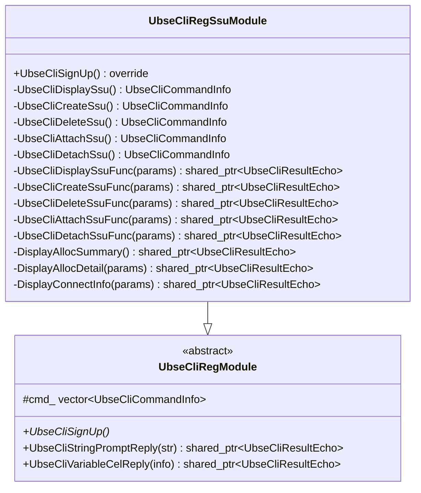

`UbseCliRegSsuModule` 继承自 `UbseCliRegModule`,实现 `UbseCliSignUp()`。在 `UbseCliSignUp()` 中,VM 模式按 display → attach → detach 顺序注册 3 个命令;host 模式按 display → create → delete → attach → detach 顺序 `emplace_back` 5 个 `UbseCliCommandInfo` 到 `cmd_` 成员。

##### 14.5.2.3 关键方法

| 方法 | 功能 | 关键逻辑 |
|------|------|----------|
| `UbseCliSignUp` | 注册命令子集 | VM 模式注册 display/attach/detach 3 个;host 模式注册 display/create/delete/attach/detach 5 个,顺序 `emplace_back` 影响帮助信息顺序 |
| `UbseCliDisplaySsu/CreateSsu/DeleteSsu/AttachSsu/DetachSsu` | 命令元信息构建 | 用 `UbseCliRegBuilder` 链式设置 command/type/options/func |
| `UbseCliDisplaySsuFunc` | display 入口 | 按 `-t` 分流到 summary/detail/connect_info;`-t` 缺失直接报错;summary 显式拒绝 `-n`;connect_info 仅 VM 模式放行,host 模式按非法类型拒绝 |
| `DisplayAllocSummary` | 概览查询 | `InvokeSsuIpc<UbseCliSsuAllocListRsp>` 无 req 模式,空列表输出 INFO_EMPTY |
| `DisplayAllocDetail` | 详情查询 | name 必填 + `IsValidName` 校验,序列化后 `InvokeSsuIpc` |
| `DisplayConnectInfo` | 连接信息查询(仅 VM 模式) | name 必填 + `IsValidName` 校验,走 `UBSE_IPC_SSU_GET_CONNECT_INFO`,空列表输出 INFO_EMPTY_CONNECT |
| `UbseCliCreateSsuFunc` | create 入口 | 必填校验 → 格式校验 → Striped 需 nsNum≥2 → 序列化 → IPC → BuildDetailOutput |
| `UbseCliDeleteSsuFunc` | delete 入口 | name 必填 + 校验,`InvokeSsuIpc` 有 req 无 rsp 模式 |
| `UbseCliAttachSsuFunc` | attach 入口 | 通用校验 → 按 `-t` 分流到 HandleAttachSpace/Linear/Striped |
| `UbseCliDetachSsuFunc` | detach 入口 | 通用校验 → 按 `-t` 分流到 HandleDetachSpace/Aggregated |
| `HandleAttachSpace/Linear/Striped` | attach 三模式 | 普通禁止聚合参数;Linear 必填 dev_name;Striped 必填 dev_name/level/chunk_size |
| `HandleDetachSpace/Aggregated` | detach 三模式 | 普通禁止 dev_name;聚合必填 dev_name |
| `InvokeSsuIpcRaw`/`InvokeSsuIpc`(3 重载)/`InvokeSsuAttachIpc` | IPC 发送模板 | Raw 不拦截返回码;普通模板非零返回码统一走 `GetSsuErrorMessage`;有 req 有 rsp / 无 req 有 rsp / 有 req 无 rsp 三重载;attach 模板对 `ALREADY_ATTACHED`(2001) 半成功继续反序列化输出设备路径并追加错误 |
| `ParseSize/ParseNsNum/ParseLba/ParseStrategy/ParseLevel/ParseChunkSize` | 字符串 → 数值/枚举 | 逐字符判数字防 stoull 隐式截断;枚举精确匹配规范字面量 |
| `IsValidName/IsValidDevName/IsValidLengthIfPresent` | 字符串校验 | 字符集 + 长度;`unsigned char` 转型避免 char 为负时 isalnum 未定义行为 |
| `BuildSummaryTable` | 概览表构建 | 3 列(name/size/strategy),列宽 80,size 由 `SumNameSpaceSize` 聚合各 ns 的 nsSize,直接展示原始字节值 |
| `BuildDetailTable` | 详情表构建 | 7 列(ns_uuid/tgt_eid/tgt_nqn/namespace_id/ns_dev_path/ns_size/lba_format) + 表头合并行 |
| `BuildConnectInfoOutput` | 连接信息表构建 | 6 列(src_eid/tgt_eid/tgt_nqn/host_nqn/ns_uuid/ns_id),空列表输出 INFO_EMPTY_CONNECT |
| `FormatAttachOutput`(2 重载) | attach 输出 | 普通输出 `ns_dev_paths: ...`;聚合输出 `ns_dev_paths: ...\ndev_path: ...` |

##### 14.5.2.4 协作关系

```
main → UbseCliModuleRegistry::UbseCliCallAllModuleSignUp
         │
         ▼
   UbseCliRegSsuModule::UbseCliSignUp
         │
         ▼
   UbseCliModuleRegistry::UbseCliRegister(cmd_)
         │
         ▼
   (用户输入匹配后)
   UbseCliExecuteMatchedCommand → commandFunc(inputOptionMap_)
         │
         ▼
   UbseCliDisplaySsuFunc / UbseCliCreateSsuFunc / ...
         │
         ├── Parse* / IsValid* (校验)
         │
         ├── InvokeSsuIpc (IPC)
         │      │
         │      ▼
         │   ubse_invoke_call → UDS → daemon
         │      │
         │      ▼
         │   UbseCliBufferGuard (RAII)
         │      │
         │      ▼
         │   response.Deserialize (struct.cpp)
         │
         └── BuildSummaryTable / BuildDetailTable / FormatAttachOutput
                │
                ▼
            UbseCliStringPromptReply / UbseCliVariableCelReply
```

##### 14.5.2.5 设计要点

- **静态注册**:`UBSE_CLI_REGISTER_MODULE("CLI_SSU_MODULE", UbseCliRegSsuModule)` 宏在全局静态对象初始化期向 `UbseCliModuleRegistry` 注册模块类,`main()` 调用 `UbseCliCallAllModuleSignUp()` 触发各模块的 `UbseCliSignUp()`,实现"模块自注册,主程序无需感知具体模块"
- **链式 Builder**:`UbseCliRegBuilder` 提供 `UbseCliSetCommand().UbseCliSetType().UbseCliAddOption().UbseCliSetFunc().UbseCliBuild()` 链式 API,使命令元信息构建声明式、可读
- **函数指针而非 std::function**:`UbseCliCommandFunc` 是 `shared_ptr<UbseCliResultEcho> (*)(const std::map<std::string, std::string> &)`(裸函数指针),避免 `std::function` 的堆分配开销,且支持静态注册场景
- **校验先行,IPC 后行**:任一校验失败即返回固定错误文案,**不进入 IPC 流程**,减少无效 IPC 调用
- **`-t` 分流**:display/attach/detach 均通过 `-t` 选项分流到不同子处理,代码结构清晰
- ** detach 隐藏选项**:`srcEid/level/chunkSize` 使用 `SSU_CLI_DETACH_*` 默认值,不对用户暴露(注册时仅注册 `-n/-q/-t/-d` 4 个选项)

#### 14.5.3 子模块 `ubse_cli_ssu_struct`(wire 契约)

##### 14.5.3.1 职责

定义 CLI ↔ daemon handler 的 wire 契约结构体,实现 `Serialize`/`Deserialize`,严格对齐服务端 `Ssu*Pack/Ssu*Unpack` 的字段顺序与宽度。

##### 14.5.3.2 类设计

wire 契约结构体均为 POD-like(含 `std::string`/`std::vector` 成员),每个结构体提供 `Serialize` 或 `Deserialize` 方法。无继承关系。

##### 14.5.3.3 关键方法

| 方法 | 功能 | 关键逻辑 |
|------|------|----------|
| `Serialize(payload)` | 请求编码 | `BuildPayload(size, payload, packFields)` 模板:预分配 size → pack → move 到 payload |
| `Deserialize(buffer, length)` | 响应解码 | `DecodePayload(buffer, length, decode)` 模板:校验 buffer 非空 → UnpackUtil 解码 |
| `PackString(pack, value, maxLength)` | 字符串编码 | 同时校验 `StringFits` 与 `pack.UbsePackString(maxLength)` |
| `PackSpaceFields` | attach/detach 公共字段编码 | name/hostNqn/srcEid 三字段统一编码,先 `SpaceFieldsFit` 长度校验 |
| `UnpackString(unpack, value, maxLength)` | 字符串解码 | `unpack.UnpackString(value, maxLength)` |
| `UnpackNsDevPaths` | 设备路径列表解码 | 先解码 count,校验 ≤ `SSU_CLI_MAX_NS_NUM`,再循环解码 |
| `UnpackNameSpace` | namespace 信息解码 | 解码各字段 + 校验 `IsValidLbaFormat` + 校验 hostNqnCount ≤ `SSU_CLI_MAX_DESERIALIZED_HOST_NQNS` |
| `UnpackAllocResult` | 分配结果解码 | 解码 name/strategy + 校验 `IsValidStrategy` + 校验 namespaceCount ≤ `SSU_CLI_MAX_NS_NUM` |
| `IsValidLbaFormat/Strategy/RaidLevel/ChunkSize` | 枚举合法性校验 | 防御性校验,拒绝非法枚举值 |

##### 14.5.3.4 设计要点

- **裸 payload,无 serde 头**:`UbsePackUtil` 直接编码字段,IPC body 是裸 payload,不带 serde 协议头(见 `CON-TECH-03`)
- **双源同步风险**:CLI 侧 pack/unpack 与服务端 `ubse_ssu_handler_message.cpp` 的 `Ssu*Pack/Ssu*Unpack` 字段顺序/宽度必须一致,目前靠注释强调 + 人工同步(见 `TBD-WIRE-GEN`)
- **预分配 + move**:`BuildPayload` 先按 size 预分配 `vector<uint8_t>`,pack 完成后 `std::move` 到出参,避免二次分配
- **防御性反序列化**:
  - 枚举合法性校验(`IsValidLbaFormat` 等),拒绝非法枚举值
  - 列表上限校验(`SSU_CLI_MAX_NS_NUM`、`SSU_CLI_MAX_DESERIALIZED_ALLOCATIONS/HOST_NQNS/CONNECT_INFOS = 1<<16`),防御不可信响应触发巨量容器预分配
  - 字符串长度校验(limits.h 各 `SSU_CLI_MAX_*_LENGTH` 常量),防止越界读取
- **`unsigned char` 转型**:`ParseSize/ParseNsNum` 中 `for (unsigned char ch : value)` 避免char为负时 `std::isdigit` 未定义行为

#### 14.5.4 子模块 `ubse_cli_ssu_limits`(契约常量)

##### 14.5.4.1 职责

集中定义 CLI 输入校验常量与反序列化防御阈值,作为用户可见校验范围与错误提示的"单一来源"。

##### 14.5.4.2 关键常量

| 类别 | 常量 | 值 | 说明 |
|------|------|----|------|
| 输入校验 | `SSU_CLI_BYTES_PER_GIB` | 1GiB | GiB 字节数 |
| 输入校验 | `SSU_CLI_MIN_SIZE_ARG_LENGTH` | 2 | size 参数最小长度(`<数字>G`) |
| 输入校验 | `SSU_CLI_MAX_NAME_LENGTH` | `48 - 1 = 47` | name 最大长度(线协议缓冲区 48 含 '\0',CLI 侧用 std::string 不含 '\0') |
| 输入校验 | `SSU_CLI_MAX_TENANT_LENGTH` | `17 - 1 = 16` | tenant 最大长度 |
| 输入校验 | `SSU_CLI_MAX_HOST_NQN_LENGTH` | `69 - 1 = 68` | host_nqn 最大长度 |
| 输入校验 | `SSU_CLI_MAX_SRC_EID_LENGTH` | `17 - 1 = 16` | src_eid 最大长度 |
| 输入校验 | `SSU_CLI_MAX_UUID_LENGTH` | `37 - 1 = 36` | UUID 最大长度 |
| 输入校验 | `SSU_CLI_MAX_DEV_PATH_LENGTH` | `63 - 1 = 62` | 设备路径最大长度 |
| 输入校验 | `SSU_CLI_MAX_DEV_NAME_LENGTH` | `33 - 1 = 32` | 聚合块设备名最大长度 |
| 输入校验 | `SSU_CLI_DEFAULT_NS_NUM` | 1 | namespace 默认数量 |
| 输入校验 | `SSU_CLI_MAX_NS_NUM` | 128 | namespace 最大数量 |
| 输入校验 | `SSU_CLI_MIN_SIZE_BYTES` | 1GiB | 最小分配容量 |
| 输入校验 | `SSU_CLI_DEFAULT_HOST_NQN` | `""` | host_nqn 默认空串(服务端推导) |
| 防御性限制 | `SSU_CLI_MAX_DESERIALIZED_ALLOCATIONS` | 1 << 16 | 反序列化分配列表上限(65536) |
| 防御性限制 | `SSU_CLI_MAX_DESERIALIZED_HOST_NQNS` | 1 << 16 | 反序列化 allowHostNqnList 上限 |
| 防御性限制 | `SSU_CLI_MAX_DESERIALIZED_CONNECT_INFOS` | 1 << 16 | 反序列化连接信息列表上限 |
| detach 默认 | `SSU_CLI_DETACH_SRC_EID` | `""` | detach 默认 srcEid |
| detach 默认 | `SSU_CLI_DETACH_LEVEL` | `RAID0` | detach 默认 level |
| detach 默认 | `SSU_CLI_DETACH_CHUNK_SIZE` | `CHUNK_SIZE_4K` | detach 默认 chunkSize |

> 注:各 `SSU_CLI_MAX_*_LENGTH` 常量同时用于 wire 编解码时的字符串长度上限(Pack/Unpack 的 maxLength 入参),即输入校验与 wire 契约共用同一组常量,不存在独立的 `SSU_CLI_WIRE_MAX_*` 常量族。

##### 14.5.4.3 设计要点

- **常量驱动错误文案**:`InvalidNsNumError()` 动态拼接 `[SSU_CLI_DEFAULT_NS_NUM, SSU_CLI_MAX_NS_NUM]`,避免改契约时错误文案与实际校验脱节
- **长度口径统一**:各长度常量写作「线协议缓冲区大小(含 '\0')减 1」的字面量表达式(如 `48 - 1`、`69 - 1`),与 SDK 线协议约束对齐;CLI 侧使用 C++ `std::string` 不含结尾 '\0',因此有效字符上限比 C 风格缓冲区少 1

---

### 14.6 接入层设计

#### 14.6.1 UDS IPC 接入层

本模块通过 `ubse_invoke_call`(由 `ubse_ipc_client` 库提供)与 daemon 通信,**不直接操作 UDS socket**。

##### 14.6.1.1 IPC 调用模板封装

`ubse_cli_ssu_cmd_reg.cpp` 中定义了 5 个 IPC 发送模板,覆盖所有 IPC 场景:

```cpp
// 模板 1:原始 buffer + 后处理回调,不拦截返回码(InvokeSsuIpcRaw)
template <typename PostCall>
std::shared_ptr<UbseCliResultEcho> InvokeSsuIpcRaw(ubse_ipc_module_code_t module, ubse_ipc_ssu_op_code_t op,
                                                   const ubse_api_buffer_t &reqBuffer, PostCall postCall);

// 模板 2:原始 buffer + 成功回调,非零返回码统一转 GetSsuErrorMessage(重载 1 的包装)
template <typename PostCall>
std::shared_ptr<UbseCliResultEcho> InvokeSsuIpc(ubse_ipc_module_code_t module, ubse_ipc_ssu_op_code_t op,
                                                const ubse_api_buffer_t &reqBuffer, PostCall postCall);

// 模板 3:有 req 有 rsp(请求结构 + 响应结构 + 输出构建器)
template <typename ReqT, typename RspT, typename BuildOutput>
std::shared_ptr<UbseCliResultEcho> InvokeSsuIpc(ubse_ipc_module_code_t module, ubse_ipc_ssu_op_code_t op,
                                                const ReqT &request, BuildOutput buildOutput);

// 模板 4:无 req 有 rsp(如 display summary)
template <typename RspT, typename BuildOutput>
std::shared_ptr<UbseCliResultEcho> InvokeSsuIpc(ubse_ipc_module_code_t module, ubse_ipc_ssu_op_code_t op,
                                                BuildOutput buildOutput);

// 模板 5:有 req 无 rsp(如 detach/delete)
template <typename ReqT>
std::shared_ptr<UbseCliResultEcho> InvokeSsuIpc(ubse_ipc_module_code_t module, ubse_ipc_ssu_op_code_t op,
                                                const ReqT &request);

// attach 专用:2001(ALREADY_ATTACHED)半成功也继续反序列化,输出设备路径并追加错误文案
template <typename ReqT, typename RspT>
std::shared_ptr<UbseCliResultEcho> InvokeSsuAttachIpc(ubse_ipc_module_code_t module, ubse_ipc_ssu_op_code_t op,
                                                      const ReqT &request);
```

##### 14.6.1.2 IPC 调用流程

```
InvokeSsuIpc
  │
  ▼
request.Serialize(payload)              // 序列化请求
  │
  ▼
ubse_invoke_call(UBSE_SSU, opCode, &reqBuffer, &resBuffer)  // UDS 短连接
  │
  ▼
UbseCliBufferGuard guard(resBuffer)     // RAII 包装响应缓冲
  │
  ▼
if (ret != UBSE_OK) return GetSsuErrorMessage(ret)  // daemon 返回非 0,统一错误文案
  │
  ▼
response.Deserialize(resBuffer.buffer, resBuffer.length)  // 反序列化
  │
  ▼
buildOutput(response)                   // 构建输出
```

> attach 命令走 `InvokeSsuAttachIpc`:`ret == UBSE_ERR_ALREADY_ATTACHED`(2001)时不拦截,继续反序列化响应并输出设备路径,再追加 "ERROR: The SSU allocation is already attached."(半成功语义);若重复挂载响应体缺失或损坏,保留 2001 错误文案,不覆盖为客户端反序列化错误。

##### 14.6.1.3 关键 IPC 协议

- **通信协议**:UDS(AF_UNIX),默认路径 `/var/run/ubse/ubse.sock`,可通过 `ubse_socket_path_set` 覆盖
- **连接模型**:短连接,每次 `ubse_invoke_call` 都 connect-send-recv-disconnect
- **请求格式**:`UbseRequestMessage` header = `{module_code, op_code, request_data->length}`,body 指向 `request_data->buffer`
- **响应格式**:`UbseResponseMessage` header = `{statusCode, bodyLen, clientRequestId}`,body 指向响应数据
- **超时**:默认 1800000ms(30 分钟,UDS client 默认),建议缩短到 30 秒(见 `TBD-TIMEOUT`)
- **鉴权**:daemon 侧通过 `SO_PEERCRED` 提取 uid → `GetUserNameById` → `CheckPermission(moduleCode, opCode)`,CLI 不显式认证

#### 14.6.2 CLI Framework 接入层

本模块依赖 `ubse_cli_framework` 库提供的命令注册与解析框架。

##### 14.6.2.1 注册机制

```cpp
// 静态注册宏,在全局静态对象初始化期向 registry 注册模块类
UBSE_CLI_REGISTER_MODULE("CLI_SSU_MODULE", UbseCliRegSsuModule);

// 宏展开后等价于:
static struct RegisterUbseCliRegSsuModuleHelper_N {
    RegisterUbseCliRegSsuModuleHelper_N() noexcept {
        UbseCliModuleRegistry::GetInstance().UbseCliLoadedModule(
            "CLI_SSU_MODULE", []() { return new UbseCliRegSsuModule(); });
    }
} g_registerUbseCliRegSsuModuleHelper_N;
```

##### 14.6.2.2 命令元信息构建

通过 `UbseCliRegBuilder` 链式 API 构建命令元信息:

```cpp
UbseCliCommandInfo UbseCliRegSsuModule::UbseCliCreateSsu() {
    UbseCliRegBuilder builder;
    builder.UbseCliSetCommand("create")
        .UbseCliSetType("ssu")
        .UbseCliAddOption("n", "name", "SSU allocation name.")
        .UbseCliAddOption("s", "size", "SSU allocation size.")
        .UbseCliAddOption("l", "lba", "SSU LBA format.")
        .UbseCliAddOption("m", "ns_num", "SSU namespace count.")
        .UbseCliAddOption("r", "strategy", "SSU allocation strategy.")
        .UbseCliSetFunc(UbseCliCreateSsuFunc);
    return builder.UbseCliBuild();
}
```

##### 14.6.2.3 输出格式化

通过 `UbseCliResultEcho` 抽象基类统一输出:

| 输出类型 | 实现类 | 用途 |
|----------|--------|------|
| 纯文本 | `UbseCliStringEcho` | 错误提示、INFO 提示、attach 命令的设备路径 |
| 结构化表格 | `UbseCliVariableCellEcho` | display/create 命令的概览表/详情表 |

构建器:

| 构建器 | 用途 |
|--------|------|
| `UbseCliResBuilder(列数, 列宽)` | 构建结构化表格,支持 `UbseCliAddRow`/`UbseCliSetCellData`/`UbseCliAddlineSeparate`/`UbseCliAddMergeRow`/`UbseCliAddBottomlineSeparate` |

#### 14.6.3 跨节点 RPC

**不适用**。CLI 是单机工具,只与本地 daemon 通信,不涉及跨节点 RPC。

---

### 14.7 关键流程详解

#### 14.7.1 display ssu 概览查询流程

##### 14.7.1.1 场景说明

运维执行 `ubsectl-ssu display ssu -t alloc_summary`,查询所有 SSU 分配信息概览。

##### 14.7.1.2 时序图

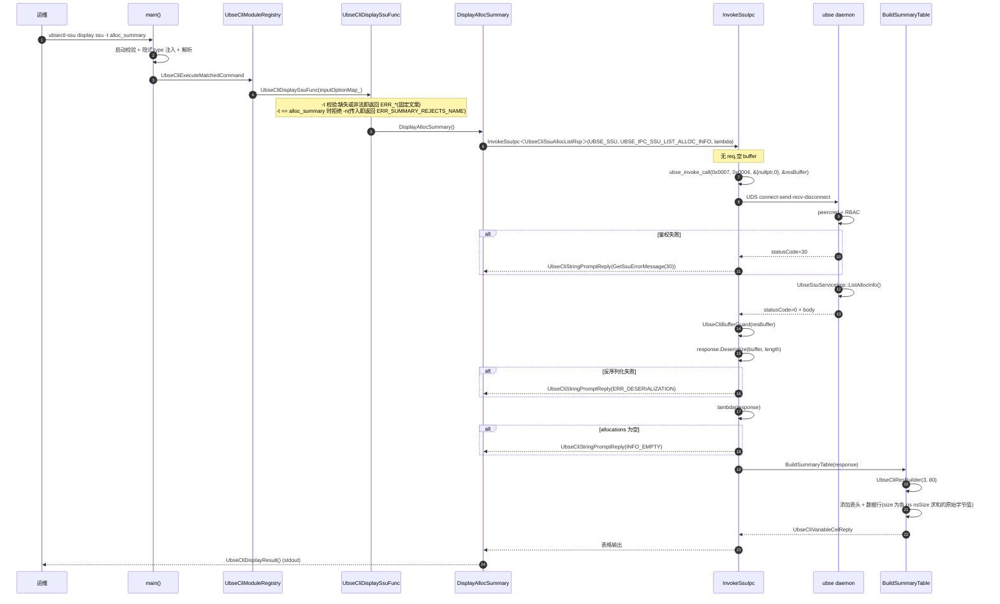

##### 14.7.1.3 关键步骤说明

| 步骤 | 说明 |
|------|------|
| 1 | 用户输入,main 完成启动保护、隐式 type 注入、参数解析 |
| 2 | `UbseCliDisplaySsuFunc` 校验 `-t` 选项存在,缺失或非法直接返回错误 |
| 3 | `DisplayAllocSummary` 调用 `InvokeSsuIpc` 无 req 模式(空 buffer) |
| 4 | `ubse_invoke_call` 完成 UDS 短连接通信,daemon 侧鉴权 + 处理 |
| 5 | `UbseCliBufferGuard` RAII 包装响应缓冲,析构时自动 `ubse_api_buffer_free` |
| 6 | 反序列化响应,空列表输出 INFO_EMPTY,非空构建 3 列表 |
| 7 | 表格 size 列由 `SumNameSpaceSize` 聚合各 namespace 的 nsSize,直接展示原始字节值(不做 GiB 换算或取整) |

##### 14.7.1.4 异常处理

| 异常场景 | 处理策略 |
|----------|----------|
| `-t` 缺失 | 返回 `ERROR: The option -t or --type is required.` |
| `-t` 非法值 | host 模式返回 `ERROR: Invalid type. The value must be alloc_summary or alloc_detail.`(VM 模式文案另含 connect_info) |
| summary 带 `-n` | 返回 `ERROR: The option -n or --name is only valid when --type is alloc_detail.` |
| daemon 未启动 | `ubse_invoke_call` 返回连接失败错误码,CLI 输出 `ERROR: Internal error with error code N.` |
| 鉴权失败 | daemon 返回 30,CLI 输出 `ERROR: Internal error with error code 30.` |
| 反序列化失败 | CLI 输出 `ERROR: Deserialization failed in client.` |
| 空结果 | CLI 输出 `INFO: No SSU allocation information found.` |

#### 14.7.2 create ssu 创建分配流程

##### 14.7.2.1 场景说明

存储管理员执行 `ubsectl-ssu create ssu -n test_space -s 10G -m 2 -r Striped`,创建一个 10GiB、2 namespace、条带化策略的存储空间。

##### 14.7.2.2 时序图

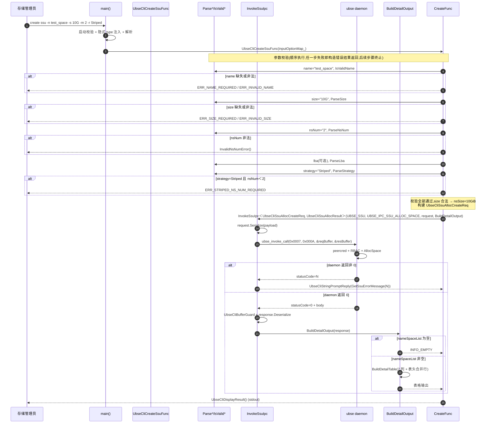

##### 14.7.2.3 关键步骤说明

| 步骤 | 说明 |
|------|------|
| 1 | 必填校验:`-n` → `-s`,缺失返回对应错误 |
| 2 | 格式校验:`IsValidName` → `ParseSize` → `ParseNsNum` → `ParseLba`(可选) → `ParseStrategy`(可选) |
| 3 | 策略约束:`-r Striped` 时 `nsNum` 必须 ≥ 2,否则返回 `ERR_STRIPED_NS_NUM_REQUIRED` |
| 4 | 序列化:`UbseCliSsuAllocCreateReq::Serialize` 编码 name/nsSize/nsNum/lbaFormat/strategy(uint8)/tenant |
| 5 | IPC:opCode=0x000A,daemon 侧 `AllocSpace` 处理 |
| 6 | 反序列化:`UbseCliSsuAllocResult::Deserialize`,校验 strategy 枚举合法性 + namespaceCount ≤ `SSU_CLI_MAX_NS_NUM` |
| 7 | 输出:空列表输出 INFO_EMPTY,非空构建 7 列详情表 + 表头合并行 |

##### 14.7.2.4 异常处理

| 异常场景 | 处理策略 |
|----------|----------|
| `-n` 缺失 | `ERR_NAME_REQUIRED` |
| `-n` 含非法字符 | `ERR_INVALID_NAME`(动态拼接长度) |
| `-s` 缺失 | `ERR_SIZE_REQUIRED` |
| `-s 10g`(小写) | `ERR_INVALID_SIZE` |
| `-s 0G` | `ERR_INVALID_SIZE`(< 1G) |
| `-s` 溢出 uint64 | `ParseSize` 先判 `gib > MAX/GiB` 再乘,避免回绕 |
| `-m 0` 或 `-m 129` | `InvalidNsNumError()`(动态拼接区间) |
| `-r Striped -m 1` | `ERR_STRIPED_NS_NUM_REQUIRED` |
| `-l 1K` | `ERR_INVALID_LBA` |
| `-r raid0` | `ERR_INVALID_STRATEGY` |
| daemon 分配失败 | 按 `GetSsuErrorMessage(N)` 输出,未命中映射时为 `ERROR: Internal error with error code N.` |
| 反序列化失败 | `ERR_DESERIALIZATION` |

#### 14.7.3 attach ssu 条带化聚合挂载流程

##### 14.7.3.1 场景说明

虚机编排执行 `ubsectl-ssu attach ssu -t Striped -n test_space -d dev1 -l raid0 -c 4K -q nqn.2026-01.host`,执行条带化聚合挂载。

##### 14.7.3.2 时序图

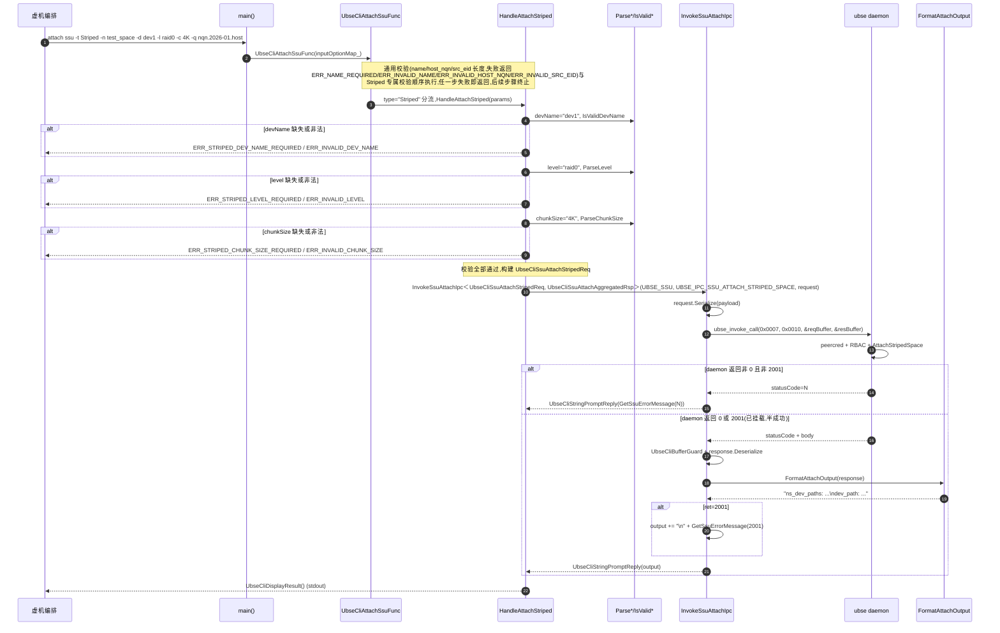

##### 14.7.3.3 关键步骤说明

| 步骤 | 说明 |
|------|------|
| 1 | 通用校验:`-n` 必填 + `IsValidName`;`-q`/`-e` 可选但提供时需 `IsValidLengthIfPresent` 校验 |
| 2 | `-t` 分流:`Striped` → `HandleAttachStriped` |
| 3 | Striped 必填项:`-d`(devName) → `-l`(level) → `-c`(chunkSize),任一缺失返回对应错误 |
| 4 | 序列化:`UbseCliSsuAttachStripedReq::Serialize` 编码 name/hostNqn/srcEid/devName/level(uint8)/chunkSize(uint32) |
| 5 | IPC:opCode=0x0010(`UBSE_IPC_SSU_ATTACH_STRIPED_SPACE`),daemon 侧 `AttachStripedSpace` 处理 |
| 6 | 输出:`FormatAttachOutput` 生成聚合挂载输出 `ns_dev_paths: ...\ndev_path: ...`;ret=2001 时仍输出设备路径并追加已挂载错误文案(半成功) |

##### 14.7.3.4 异常处理

| 异常场景 | 处理策略 |
|----------|----------|
| `-t` 缺失但带 `--dev_name` | `ERR_ATTACH_AGGREGATION_REQUIRES_TYPE` |
| `-t Linear` 缺少 `-d` | `ERR_LINEAR_DEV_NAME_REQUIRED` |
| `-t Striped` 缺少 `-l` | `ERR_STRIPED_LEVEL_REQUIRED` |
| `-l raid1` | `ERR_INVALID_LEVEL` |
| `-c 8K` | `ERR_INVALID_CHUNK_SIZE` |
| daemon 挂载失败(非 2001) | 按 `GetSsuErrorMessage(N)` 输出,未命中映射时为 `ERROR: Internal error with error code N.` |
| daemon 返回 2001(已挂载) | 半成功:仍反序列化输出设备路径,并追加 `ERROR: The SSU allocation is already attached.` 文案 |

#### 14.7.4 detach ssu 卸载流程

##### 14.7.4.1 场景说明

运维执行 `ubsectl-ssu detach ssu -t Linear -n test_space -d dev1`,卸载线性聚合挂载。

##### 14.7.4.2 时序图

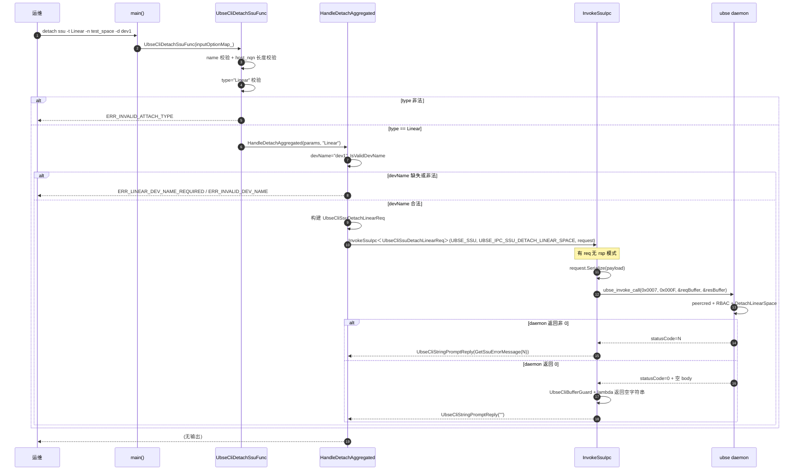

##### 14.7.4.3 关键步骤说明

| 步骤 | 说明 |
|------|------|
| 1 | 通用校验:`-n` 必填 + `IsValidName`;`-q` 可选但需长度校验 |
| 2 | `-t` 校验:未指定 → `HandleDetachSpace`;`Linear`/`Striped` → `HandleDetachAggregated`;其他 → `ERR_INVALID_ATTACH_TYPE` |
| 3 | 聚合必填 `-d`,`IsValidDevName` 校验 |
| 4 | 序列化:`UbseCliSsuDetachLinearReq::Serialize` 编码 name/hostNqn/srcEid/devName |
| 5 | IPC:opCode=0x000F,有 req 无 rsp 模式 |
| 6 | 输出:daemon 返回空 body,CLI 输出空字符串(无输出) |

##### 14.7.4.4 异常处理

| 异常场景 | 处理策略 |
|----------|----------|
| 未指定 `-t` 但带 `--dev_name` | `ERR_DETACH_DEV_NAME_REQUIRES_TYPE` |
| `-t Linear/Striped` 缺少 `-d` | `ERR_LINEAR_DEV_NAME_REQUIRED` / `ERR_STRIPED_DEV_NAME_REQUIRED` |
| daemon 卸载失败 | 按 `GetSsuErrorMessage(N)` 输出,未命中映射时为 `ERROR: Internal error with error code N.` |

#### 14.7.5 隐式认证流程

##### 14.7.5.1 场景说明

非授权用户执行 CLI,daemon 侧 RBAC 拒绝。

##### 14.7.5.2 时序图

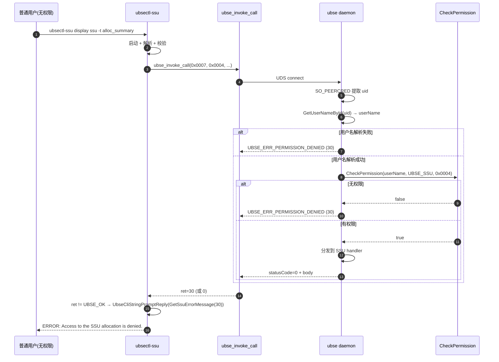

##### 14.7.5.3 关键步骤说明

| 步骤 | 说明 |
|------|------|
| 1 | CLI 不显式认证,通过 UDS 连接 daemon |
| 2 | daemon 侧 `SO_PEERCRED` 提取对端 uid,不可伪造 |
| 3 | `GetUserNameById` 反查用户名,失败返回 30 |
| 4 | `CheckPermission(userName, moduleCode, opCode)` 校验权限,失败返回 30 |
| 5 | CLI 收到 30,经 `GetSsuErrorMessage(30)` 输出 `ERROR: Access to the SSU allocation is denied.`(未命中映射的错误码才输出 `ERROR: Internal error with error code N.`) |

---

### 14.8 并发控制与一致性保证

#### 14.8.1 并发层次

本模块为**无状态一次性执行程序**,无跨命令共享状态,**无内部锁/并发原语**。

| 层次 | 机制 | 保护对象 |
|------|------|----------|
| 进程级 | 操作系统进程隔离 | CLI 进程间天然隔离,无共享内存 |
| UDS 连接级 | 短连接模型 | 每次 `ubse_invoke_call` 独立连接,无连接复用 |
| 响应缓冲级 | `UbseCliBufferGuard` RAII | 响应缓冲在作用域结束时自动 `ubse_api_buffer_free`,无泄漏 |
| 静态注册期 | 静态初始化 | `UBSE_CLI_REGISTER_MODULE` 宏在 `main()` 前执行,无并发风险 |

#### 14.8.2 一致性保证

- **wire 契约一致性**:CLI 侧 `ubse_cli_ssu_struct.cpp` 的 pack/unpack 与服务端 `ubse_ssu_handler_message.cpp` 的 `Ssu*Pack/Ssu*Unpack` 必须手动保持字段顺序/宽度一致(双源同步,见 `TBD-WIRE-GEN`)。当前通过注释强调,UT 通过字节级断言验证一致性(见 `test_ubse_cli_ssu_struct.cpp` 的 `CreateRequestMatchesHandlerFieldOrderAndEnumWidths`)
- **输入输出往返一致**:`Parse*` 函数与 `*ToString` 函数共用同一份规范字面量常量(如 `STRATEGY_LINEAR`、`LBA_4K`),保证输入解析与输出格式化的往返一致
- **错误文案单一来源**:固定错误文案集中在 `ubse_cli_ssu_cmd_reg.cpp` 的匿名命名空间常量,UT 期望文本与生产代码逐字一致(任何文案改动都会被 UT 捕获)
- **常量驱动错误文案**:`InvalidNsNumError()` 动态拼接 `[SSU_CLI_DEFAULT_NS_NUM, SSU_CLI_MAX_NS_NUM]`,避免改契约时错误文案与实际校验脱节

#### 14.8.3 防御性设计

| 防御点 | 实现 |
|--------|------|
| 枚举合法性 | `IsValidLbaFormat/IsValidStrategy/IsValidRaidLevel/IsValidChunkSize`,拒绝非法枚举值 |
| 列表上限 | 请求侧 `ParseNsNum` 上限 `SSU_CLI_MAX_NS_NUM`;响应侧防御阈值 `SSU_CLI_MAX_DESERIALIZED_ALLOCATIONS`/`SSU_CLI_MAX_DESERIALIZED_HOST_NQNS`/`SSU_CLI_MAX_DESERIALIZED_CONNECT_INFOS = 1<<16` |
| 字符串长度 | `StringFits` + `UbsePackString(maxLength)` 双重校验 |
| 整数溢出 | `ParseSize` 先判 `gib > MAX/GiB` 再乘,避免回绕;`ParseNsNum` 逐字符判数字后再 stoull |
| `unsigned char` 转型 | `for (unsigned char ch : value)` 避免 char 为负时 `isalnum`/`isdigit` 未定义行为 |
| 资源释放 | `UbseCliBufferGuard` RAII,即使反序列化抛异常也能释放 |
| 超时保护 | `SIGALRM` + `setitimer`,防止单命令卡死 |

---

### 14.9 依赖关系

#### 14.9.1 模块内依赖

```
ubse_cli_ssu_main.cpp
  ├─▶ ubse_cli_main_utils.h (CLI Framework)
  ├─▶ ubse_cli_reg.h (CLI Framework)
  └─▶ ubse_error.h

ubse_cli_ssu_cmd_reg.cpp
  ├─▶ ubse_cli_ssu_cmd_reg.h
  │     ├─▶ ubse_cli_reg.h (CLI Framework)
  │     └─▶ ubse_cli_reg_builder.h
  ├─▶ ubse_cli_ssu_struct.h
  │     └─▶ ubse_cli_ssu_limits.h
  │           └─▶ plugin_services/ssu/ubse_ssu_service.h
  ├─▶ ubse_cli_ssu_limits.h
  ├─▶ ubse_cli_ssu_error.h
  ├─▶ ubse_cli_buffer_guard.h
  ├─▶ ubse_ipc_common.h
  ├─▶ ubse_str_util.h
  └─▶ ubse_error.h

ubse_cli_ssu_struct.cpp
  └─▶ ubse_cli_ssu_struct.h
  └─▶ ubse_cli_ssu_limits.h
  └─▶ ubse_pack_util.h

ubse_cli_ssu_error.cpp
  └─▶ ubse_cli_ssu_error.h
  └─▶ ubse_error.h
```

#### 14.9.2 模块外依赖(CLI Framework)

| 依赖 | 用途 |
|------|------|
| `ubse_cli_framework` | 命令注册表(`UbseCliModuleRegistry`)、Builder(`UbseCliRegBuilder`)、解析器(`UbseCliParse`)、main utils(`UbseCliValidateStartupConditions` 等)、结果构建器(`UbseCliResBuilder`)、输出抽象(`UbseCliResultEcho`/`UbseCliStringEcho`/`UbseCliVariableCellEcho`)、白名单(`ubse_cli_whitelist.h`) |
| `ubse_cli_consumer` | `UbseCliBufferGuard`(RAII 包装响应缓冲) |
| `ubse_ipc_client` | `ubse_invoke_call`(UDS 短连接)、`ubse_api_buffer_t`、`ubse_api_buffer_free`、`ubse_socket_path_set` |
| `ubse_serial` | `UbsePackUtil`/`UbseUnpackUtil`(wire 序列化) |
| `boundscheck` | `memcpy_s`/`strncpy_s` 等安全函数 |
| `ubse_utils` | 通用工具 |
| `trace_context` | trace 上下文 |

#### 14.9.3 外部库依赖

本模块不通过 `dlopen` 加载任何动态库,所有依赖均为静态链接的共享库(见 `CMakeLists.txt` 的 `target_link_libraries`)。

#### 14.9.4 编译链接选项

```cmake
target_link_options(ubsectl-ssu PRIVATE -rdynamic -pie)
```

- `-rdynamic`:允许动态库访问可执行程序的全局符号(供 `UBSE_CLI_REGISTER_MODULE` 宏的静态注册对象在动态库中可见,虽然本模块当前不加载动态库,但保留以兼容 CLI Framework 的扩展场景)
- `-pie`:位置无关可执行文件,与 `-rdynamic` 配合使用

---

### 14.10 关键设计模式与亮点

#### 14.10.1 静态注册宏(Macro-based Static Registration)

**应用位置**:`UBSE_CLI_REGISTER_MODULE("CLI_SSU_MODULE", UbseCliRegSsuModule)` 宏

**价值**:模块自注册,主程序无需感知具体模块。新增 CLI 模块只需在源文件中调用宏,无需修改 `main()`。利用 C++ 静态对象初始化期执行的特性,在 `main()` 前完成注册。

#### 14.10.2 链式 Builder 模式(Chain Builder)

**应用位置**:`UbseCliRegBuilder` 的 `UbseCliSetCommand().UbseCliSetType().UbseCliAddOption().UbseCliSetFunc().UbseCliBuild()`

**价值**:声明式构建命令元信息,代码可读性高;每个方法返回 `*this`,支持链式调用;避免构造函数参数过长。

#### 14.10.3 模板 IPC 封装(Template IPC Wrapper)

**应用位置**:IPC 发送模板族(`InvokeSsuIpcRaw`、`InvokeSsuIpc` 3 个重载、`InvokeSsuAttachIpc`)

**价值**:统一 IPC 调用模式(序列化 → `ubse_invoke_call` → RAII → 反序列化 → 输出构建),消除样板代码;`InvokeSsuIpcRaw` 为公共底层入口(不拦截返回码),`InvokeSsuIpc` 3 个重载覆盖有 req 有 rsp / 无 req 有 rsp / 有 req 无 rsp 三类场景(非零返回码统一经 `GetSsuErrorMessage` 转换),`InvokeSsuAttachIpc` 专用于 attach(2001 已挂载半成功仍反序列化输出设备路径);模板在编译期生成,无运行时开销。

#### 14.10.4 RAII 资源管理(RAII Resource Management)

**应用位置**:`UbseCliBufferGuard` 包装 `ubse_api_buffer_t`

**价值**:响应缓冲在作用域结束时自动 `ubse_api_buffer_free`,即使反序列化抛异常也能释放,无内存泄漏。

#### 14.10.5 单一来源常量(Single Source of Truth)

**应用位置**:`ubse_cli_ssu_limits.h` 集中定义所有输入/wire 契约限制

**价值**:输入校验、wire 编码、错误文案均引用同一份常量,避免多处定义导致不一致;长度/上限常量在本模块 `ubse_cli_ssu_limits.h` 独立定义,limits.h 仅依赖 `plugin_services/ssu/ubse_ssu_service.h` 的枚举,不依赖适配器层定义。

#### 14.10.6 常量驱动错误文案(Dynamic Error Message)

**应用位置**:`InvalidNsNumError()` 动态拼接 `[SSU_CLI_DEFAULT_NS_NUM, SSU_CLI_MAX_NS_NUM]`;`ERR_INVALID_NAME`/`ERR_INVALID_SIZE` 等通过 `std::to_string(SSU_CLI_MAX_NAME_LENGTH)` 等动态拼接

**价值**:改契约常量时,错误文案自动更新,避免文案与实际校验脱节。

#### 14.10.7 防御性反序列化(Defensive Deserialization)

**应用位置**:`UnpackNameSpace`/`UnpackAllocResult`/`UnpackNsDevPaths` 中的枚举合法性校验 + 列表上限校验

**价值**:CLI 是 daemon 的客户端,daemon 返回的响应是不可信输入(可能因版本不匹配、内存损坏等导致非法值),防御性校验防止内存越界与巨量容器预分配。

#### 14.10.8 输入输出往返一致(Input-Output Round-trip Consistency)

**应用位置**:`Parse*` 函数与 `*ToString` 函数共用同一份规范字面量常量(如 `STRATEGY_LINEAR`、`LBA_4K`、`RAID0`、`CHUNK_SIZE_4K`)

**价值**:输入解析与输出格式化共用同一份字面量,保证 `Parse("Striped") → STRIPED → StrategyToString() == "Striped"` 往返一致,避免大小写/拼写漂移。

---

### 14.11 关键约束与注意事项

#### 14.11.1 业务约束

| 约束 | 依据 |
|------|------|
| name 最大 47 字符 | `SSU_CLI_MAX_NAME_LENGTH = 48 - 1 = 47`(48 含 `'\0'`,`ubse_cli_ssu_limits.h`) |
| host_nqn 最大 68 字符 | `SSU_CLI_MAX_HOST_NQN_LENGTH = 68`(`ubse_cli_ssu_limits.h`) |
| src_eid 最大 16 字符 | `SSU_CLI_MAX_SRC_EID_LENGTH = 16`(`ubse_cli_ssu_limits.h`) |
| dev_name 最大 32 字符 | `SSU_CLI_MAX_DEV_NAME_LENGTH = 32`(`ubse_cli_ssu_limits.h`) |
| namespace 数量范围 [1, 128] | `SSU_CLI_DEFAULT_NS_NUM=1`、`SSU_CLI_MAX_NS_NUM=128`(字面量,`ubse_cli_ssu_limits.h`) |
| 最小分配容量 1GiB | `SSU_CLI_MIN_SIZE_BYTES = 1GiB`(`ubse_cli_ssu_limits.h`) |
| 容量单位必须大写 G | `ParseSize` 强制 `value.back() == 'G'`(`ubse_cli_ssu_cmd_reg.cpp`) |
| LBA 仅支持 512B/4K | `ParseLba` 精确匹配 |
| 策略仅支持 Linear/Striped | `ParseStrategy` 精确匹配 |
| RAID 级别仅支持 raid0/raid5 | `ParseLevel` 精确匹配 |
| chunk_size 仅支持 4K~512K | `ParseChunkSize` 精确匹配 |

#### 14.11.2 技术约束

| 约束 | 依据 |
|------|------|
| 通过 UDS 短连接通信 | `ubse_invoke_call` 每次 connect-send-recv-disconnect(`ubse_ipc_client.cpp:78-118`) |
| UDS 默认路径 `/var/run/ubse/ubse.sock` | `UBSE_UDS_SOCKET_PATH`(`ubse_ipc_client.h:43`),可通过 `ubse_socket_path_set` 覆盖 |
| wire 协议不带 serde 头 | 直接 `UbsePackUtil` 裸 payload(`ubse_cli_ssu_struct.h:29-30`) |
| wire 字段顺序必须与服务端一致 | 双源同步,注释强调(`ubse_cli_ssu_struct.h:29-30`) |
| 模块码 `UBSE_SSU = 0x0007` | `ubse_ipc_common.h`(`ubse_ipc_module_code_t`);注意与 RPC 层 `ubse_com_op_code.h` 的 `UbseSsuOpCode` 数值不同 |
| 链接选项 `-rdynamic -pie` | `CMakeLists.txt`,供静态注册宏使用 |
| CLI 不显式认证 | 依赖 UDS peercred + daemon RBAC |
| 输出仅 plain text / ASCII table | CLI Framework 限制,无 JSON 序列化器 |
| UDS client 默认超时 1800000ms | `ubse_uds_client.h:29`(30 分钟,CLI 场景过长,见 `TBD-TIMEOUT`) |
| CLI 执行期间屏蔽 IPC 日志 | `UbseCliDisableIpcLog()`(`ubse_cli_ssu_main.cpp:60`) |

#### 14.11.3 避坑指南

| 注意事项 | 说明 |
|----------|------|
| wire 契约变更必须同步 CLI 与 handler | 修改 `Ssu*Pack/Ssu*Unpack` 时必须同步修改 `ubse_cli_ssu_struct.cpp`,否则解析失败 |
| 错误文案改动需同步 UT | UT 期望文本与生产代码逐字一致,任何文案改动都会被 UT 捕获 |
| 枚举宽度不可变更 | `LBAFormat` uint32、`Strategy` uint8、`RaidLevel` uint8、`ChunkSize` uint32,变更会破坏二进制兼容 |
| `unsigned char` 转型必须保留 | `for (unsigned char ch : value)` 避免 char 为负时 `isalnum`/`isdigit` 未定义行为 |
| 防御性常量不可放宽 | `SSU_CLI_MAX_DESERIALIZED_ALLOCATIONS = 1<<16` 是防御不可信响应的阈值,放宽会导致内存风险 |
| detach 隐藏选项不可对用户暴露 | `srcEid/level/chunkSize` 使用 `SSU_CLI_DETACH_*` 默认值,注册时不暴露 `-e/-l/-c` 选项 |
| 隐式 type 注入位置固定 | `args.insert(args.begin()+1, "ssu")` 必须在 command 之后,框架据此识别 type |
| `--help` 短路必须优先 | `args.size() == 1 && UbseCliHelpInfoParse(args)` 优先处理,否则 `--help` 会被白名单拒绝 |

---

### 14.12 测试要点

#### 14.12.1 测试策略

| 测试层 | 重点 |
|--------|------|
| UT | 命令注册、参数校验、wire 序列化/反序列化、输出格式化、防御性校验 |
| IT | CLI 与 daemon 的端到端 IPC 通信(需启动 daemon) |
| E2E | 端到端业务链路(需 SSU 设备) |

#### 14.12.2 关键测试场景

| 场景 | 测试文件 |
|------|----------|
| 命令注册(display/create/delete/attach/detach 5 类命令) | `test/UT/cli/test_ubse_cli_ssu_cmd_reg.cpp` |
| display summary 空结果返回 INFO_EMPTY | `test/UT/cli/test_ubse_cli_ssu_cmd_reg.cpp` |
| display summary 概览表(name/size/strategy 3 列) | 同上 |
| display summary 内部错误码透传 | 同上 |
| display summary 反序列化失败 | 同上 |
| display detail 缺失/非法 name 校验 | 同上 |
| display detail 详情表(7 列 + 表头合并行) | 同上 |
| create 必填校验(name/size) | 同上 |
| create name 长度边界(47 字符) | 同上 |
| create size 格式校验(小写/0G/溢出) | 同上 |
| create ns_num 范围校验([1, 128]) | 同上 |
| create lba/strategy 精确匹配 | 同上 |
| create 默认值应用 | 同上 |
| create 序列化所有显式选项 | 同上 |
| attach 普通/Linear/Striped 三模式 | 同上 |
| attach 缺失 type 但带聚合参数 | 同上 |
| attach Striped 缺失 level/chunk_size | 同上 |
| detach 普通/Linear/Striped 三模式 | 同上 |
| wire 请求结构与 handler 字段顺序一致 | `test/UT/cli/test_ubse_cli_ssu_struct.cpp` |
| wire 响应拒绝截断与非法字符串长度 | 同上 |
| wire 响应拒绝超大列表 | 同上 |
| wire 响应拒绝非法枚举与超大 allowHostNqnList | 同上 |
| wire 请求拒绝超长字符串与非法枚举 | 同上 |
| 公共常量复用 `ubse_cli_ssu_limits` | 同上 |

#### 14.12.3 现有 UT 覆盖情况

| 测试文件 | 测试用例数 |
|----------|-----------|
| `test_ubse_cli_ssu_cmd_reg.cpp` | 121 |
| `test_ubse_cli_ssu_struct.cpp` | 23 |
| `test_ubse_cli_ssu_vm.cpp` | 15 |
| `test_ubse_cli_ssu_mock_invoke.cpp` | (mock 辅助) |
| **合计** | **159** |

#### 14.12.4 待补 UT 场景

| 待补场景 | 优先级 |
|----------|--------|
| attach Striped 完整流程(含 IPC mock) | High |
| detach Striped 完整流程(含 IPC mock) | High |
| attach 普通模式带 `--dev_name` 拒绝 | Medium |
| attach Linear 带 `--level` 拒绝 | Medium |
| detach 普通 mode 带 `--dev_name` 拒绝 | Medium |
| UDS 路径覆盖(`ubse_socket_path_set`) | Low |
| 隐式 type 注入位置的边界测试 | Low |

---

### 14.13 附录

#### 14.13.1 缩略语

| 缩略语 | 全称 | 含义 |
|--------|------|------|
| SSU | Storage Subsystem Unit | 存储子系统单元 |
| CLI | Command-Line Interface | 命令行界面 |
| UDS | Unix Domain Socket | Unix 域套接字 |
| opCode | Operation Code | 操作码 |
| moduleCode | Module Code | 模块码 |
| wire 契约 | Wire Protocol Contract | 二进制序列化协议 |
| namespace | NVMe Namespace | NVMe 命名空间 |
| VFE | Virtual Function Element | 虚拟功能单元 |
| LBA | Logical Block Address | 逻辑块地址 |
| nqn | NVMe Qualified Name | NVMe 限定名 |
| eid | Element ID | 元素标识 |
| peercred | Peer Credentials | UDS 对端进程凭证 |
| RBAC | Role-Based Access Control | 基于角色的访问控制 |
| RAII | Resource Acquisition Is Initialization | 资源获取即初始化 |
| POD | Plain Old Data | 纯旧数据 |
| COW | Copy-On-Write | 写时复制 |

#### 14.13.2 错误码

##### 14.13.2.1 客户端固定错误文案(ubse_cli_ssu_cmd_reg.cpp 匿名命名空间)

| 错误常量 | 文案 | 触发场景 |
|----------|------|----------|
| `ERR_NAME_REQUIRED` | `ERROR: The option -n or --name is required.` | 缺少 `-n` |
| `ERR_SIZE_REQUIRED` | `ERROR: The option -s or --size is required.` | 缺少 `-s` |
| `ERR_INVALID_NAME` | `ERROR: Invalid name. The value must be 1-47 characters and contain only letters, digits, '.', ':', '-' or '_'.`(上限随 `SSU_CLI_MAX_NAME_LENGTH` 动态拼接) | 名称格式非法 |
| `ERR_INVALID_SIZE` | `ERROR: Invalid size. The value must be an integer number of GiB with uppercase G suffix, minimum 1G.` | 容量格式非法 |
| `ERR_INVALID_LBA` | `ERROR: Invalid lba. The value must be 512B or 4K.` | LBA 非法 |
| `ERR_INVALID_STRATEGY` | `ERROR: Invalid strategy. The value must be Linear or Striped.` | 策略非法 |
| `InvalidNsNumError()` | `ERROR: Invalid ns_num. The value must be an integer in range 1-128.`(动态) | namespace 数非法 |
| `ERR_STRIPED_NS_NUM_REQUIRED` | `ERROR: Striped strategy requires ns_num to be at least 2.` | Striped 策略 ns_num < 2 |
| `ERR_INVALID_HOST_NQN` | `ERROR: Invalid host_nqn. The value must be 1-68 characters.` | host_nqn 超长 |
| `ERR_INVALID_SRC_EID` | `ERROR: Invalid src_eid. The value must be 1-16 characters.` | src_eid 超长 |
| `ERR_INVALID_ATTACH_TYPE` | `ERROR: Invalid type. The value must be Linear or Striped.` | attach/detach 的 type 非法 |
| `ERR_INVALID_DEV_NAME` | `ERROR: Invalid dev_name. The value must be 1-32 characters and contain only letters, digits, '_', '-' or '.'.` | dev_name 非法 |
| `ERR_INVALID_LEVEL` | `ERROR: Invalid level. The value must be raid0 or raid5.` | RAID 级别非法 |
| `ERR_INVALID_CHUNK_SIZE` | `ERROR: Invalid chunk_size. The value must be 4K, 16K, 32K, 64K, 128K, 256K or 512K.` | chunk_size 非法 |
| `ERR_ATTACH_AGGREGATION_REQUIRES_TYPE` | `ERROR: The option --dev_name, --level or --chunk_size requires --type Linear or Striped.` | attach 缺 type |
| `ERR_DETACH_DEV_NAME_REQUIRES_TYPE` | `ERROR: The option --dev_name requires --type Linear or Striped.` | detach 缺 type |
| `ERR_SUMMARY_REJECTS_NAME` | `ERROR: The option -n or --name is only valid when --type is alloc_detail.` | alloc_summary 带 `-n` |
| `ERR_STRIPED_ONLY_OPTIONS` | `ERROR: The option --level or --chunk_size is only valid when --type is Striped.` | 非条带化带 level/chunk_size |
| `ERR_LINEAR_DEV_NAME_REQUIRED` | `ERROR: The option -d or --dev_name is required when --type is Linear.` | Linear 缺 dev_name |
| `ERR_STRIPED_DEV_NAME_REQUIRED` | `ERROR: The option -d or --dev_name is required when --type is Striped.` | Striped 缺 dev_name |
| `ERR_STRIPED_LEVEL_REQUIRED` | `ERROR: The option -l or --level is required when --type is Striped.` | Striped 缺 level |
| `ERR_STRIPED_CHUNK_SIZE_REQUIRED` | `ERROR: The option -c or --chunk_size is required when --type is Striped.` | Striped 缺 chunk_size |
| `ERR_SERIALIZATION` | `ERROR: Serialization failed in client.` | 请求序列化失败 |
| `ERR_DESERIALIZATION` | `ERROR: Deserialization failed in client.` | 响应反序列化失败 |
| `INFO_EMPTY` | `INFO: No SSU allocation information found.` | 查询结果为空 |
| `INFO_EMPTY_CONNECT` | `INFO: No SSU connect information found.` | connect_info 查询结果为空 |
| `ERR_INVALID_DISPLAY_TYPE_HOST` | `ERROR: Invalid type. The value must be alloc_summary or alloc_detail.` | host 模式 display `-t` 非法 |
| `ERR_INVALID_DISPLAY_TYPE_VM` | `ERROR: Invalid type. The value must be alloc_summary, alloc_detail or connect_info.` | VM 模式 display `-t` 非法 |

##### 14.13.2.2 daemon 返回错误码 CLI 侧映射(`GetSsuErrorMessage`)

`ubse_cli_ssu_error.cpp` 的 `GetSsuErrorMessage(errorCode)` 将 daemon 返回码统一转换为 CLI 文案,未命中映射时输出 `ERROR: Internal error with error code N.`:

| 错误码 | 常量 | 文案 |
|--------|------|------|
| 1 | `UBSE_ERR_INVALID_ARG` | `ERROR: The SSU request contains invalid arguments.` |
| 32 | `UBSE_ERR_ACCESS_DENIED` | `ERROR: Access to the SSU allocation is denied.` |
| 43 | `UBSE_ERR_TIMED_OUT` | `ERROR: The SSU operation timed out.` |
| 1200 | `UBSE_SSU_ERROR_SPACE_NOT_FOUND` | `INFO: The SSU allocation does not exist.` |
| 1201 | `UBSE_SSU_ERROR_NEED_DETACH_BEFORE_FREE` | `ERROR: The SSU allocation is attached. Detach it before deleting it.` |
| 1202 | `UBSE_SSU_ERROR_STRATEGY_MISMATCH` | `ERROR: The SSU allocation strategy does not match the attach or detach type.` |
| 2000 | `UBSE_ERR_ALREADY_ALLOCATED` | `ERROR: The SSU allocation already exists.` |
| 2001 | `UBSE_ERR_ALREADY_ATTACHED` | `ERROR: The SSU allocation is already attached.`(attach 场景半成功,仍输出设备路径) |
| 2002 | `UBSE_ERR_NO_NEED_FREE` | `ERROR: The SSU allocation does not exist or has already been deleted.` |
| 2003 | `UBSE_ERR_NO_NEED_DETACH` | `ERROR: The SSU allocation is already detached or has not been attached.` |
| 其他 | - | `ERROR: Internal error with error code N.`(N 为实际返回码) |

##### 14.13.2.3 daemon 错误码(传输层,透传)

| 错误码 | 含义 |
|--------|------|
| 0 | `UBSE_OK` |
| 20 | `UBSE_ERR_IPC_CONNECTION_FAILED`(IPC 连接失败) |
| 30 | `UBSE_ERR_PERMISSION_DENIED`(鉴权失败) |
| 50 | `UBSE_ERR_DAEMON_UNREACHABLE`(daemon 未就绪) |
| 1003 | `UBSE_ERR_AUTH_FAILED`(认证失败) |
| ≥10000 | 内部错误码 |

#### 14.13.3 相关文档

- [SSU模块需求分析文档](SSU模块需求分析文档.md)（CLI 特性需求已并入其 §4.11）
- [SSU模块特性设计文档](SSU模块特性设计文档.md)
- [SSU模块测试设计文档](SSU模块测试设计文档.md)
- [UBSE技术架构设计文档](../../architecture/UBSE技术架构设计文档.md)
- [目录规范文档](../../../conventions/目录规范文档.md)
- [UBSE代码Wiki.md](../../architecture/UBSE代码Wiki.md)
- [AGENTS.md](../../../../AGENTS.md)

#### 14.13.4 源码引用

- [ubse_cli_ssu_main.cpp](../../../../src/cli/ssu/ubse_cli_ssu_main.cpp)
- [ubse_cli_ssu_cmd_reg.h](../../../../src/cli/ssu/ubse_cli_ssu_cmd_reg.h)
- [ubse_cli_ssu_cmd_reg.cpp](../../../../src/cli/ssu/ubse_cli_ssu_cmd_reg.cpp)
- [ubse_cli_ssu_struct.h](../../../../src/cli/ssu/ubse_cli_ssu_struct.h)
- [ubse_cli_ssu_struct.cpp](../../../../src/cli/ssu/ubse_cli_ssu_struct.cpp)
- [ubse_cli_ssu_limits.h](../../../../src/cli/ssu/ubse_cli_ssu_limits.h)
- [ubse_cli_ssu_error.h](../../../../src/cli/ssu/ubse_cli_ssu_error.h)
- [ubse_cli_ssu_error.cpp](../../../../src/cli/ssu/ubse_cli_ssu_error.cpp)
- [CMakeLists.txt](../../../../src/cli/ssu/CMakeLists.txt)
- [ubse_ssu_service.h](../../../../src/include/plugin_services/ssu/ubse_ssu_service.h)
- [ubse_ipc_common.h](../../../../src/framework/ipc/include/ubse_ipc_common.h)
- [ubse_com_op_code.h](../../../../src/include/ubse_com_op_code.h)
- [ubse_ipc_client.cpp](../../../../src/framework/ipc/client/ubse_ipc_client.cpp)
