# SSU 模块虚机化特性模块设计文档

> **文档版本**:V1.4
> **工作模式**:混合模式(现有 SSU 模块代码反推 + 虚机化特性设计,特性已随当前主线代码落地,本文档为对照实现的全量校对版)
> **模块路径**:`src/controllers/ssu/`(现有模块,VM 侧特性归入本目录)+ `src/framework/vscok/`(vsock 通用框架扩展)
> **特性定位**:本特性为 SSU 模块的虚机化场景扩展,**不是新增模块**;VM 侧代码归入现有 SSU 模块目录,host 侧代码零修改
> **适用版本**:当前主线
> **编写日期**:2026-10-27
> **关联文档**:[SSU模块虚机化特性需求分析文档](./SSU模块虚机化特性需求分析文档.md)、[SSU模块特性设计文档](../SSU模块特性设计文档.md)、[UBSE技术架构设计文档](../../../architecture/UBSE技术架构设计文档.md)

---

## 1. 模块定位与职责

### 1.1 特性概述

SSU 模块虚机化特性(`vm_mode`)是现有 SSU 模块的能力扩展,实现"ubse@VM"部署形态:通过配置开关 `vm_mode` 让同一份 SSU 模块代码在 host 与 VM 两种形态下运行。

**关键边界**:
- **ubse@host**(vm_mode=false):现有行为,本特性**不修改任何 host 侧代码**;ubse@host 不与 VM 内 ubse 直接交互,不持有 vsock client,不感知 VM 内 ubse 的存在
- **ub-device-manager**(host 侧独立外部组件):负责通过 vsock 与 VM 内 ubse 通信,推送分配/连接信息;**不在本特性交付范围**
- **ubse@VM**(vm_mode=true,本特性核心交付):启动 vsock server 接收 ub-device-manager 推送,在 VM 内提供查询、attach、detach 能力与 CLI 接口

### 1.2 核心职责

| 职责 | 模式 | 说明 | 对应 FR |
|------|------|------|---------|
| vm_mode 配置分流 | 通用 | 插件注册期依赖裁剪 + 模块运行态分流(`IsSsuVmModeConfigured` 唯一判定入口) | FR-VM-DEPLOY |
| VM 内 vsock server | VM 模式 | 监听 ub-device-manager 的 vsock 连接,接收推送 | FR-VM-VSOCK-SERVER |
| VM 内查询服务 | VM 模式 | 从本地缓存查询分配信息与连接信息 | FR-VM-QUERY |
| VM 内 attach/detach | VM 模式 | 在 VM 内对已直通 namespace 执行 attach/detach(含聚合) | FR-VM-ATTACH/DETACH |
| VM 内 CLI 子集 | VM 模式 | 提供 display/attach/detach CLI 命令(display 新增 connect_info 类型) | FR-VM-CLI |
| VM 生命周期联动(VM 侧) | VM 模式 | VM 重启后等待 ub-device-manager 重连与全量同步 | FR-VM-LIFECYCLE |
| 缓存本地持久化 | VM 模式 | 推送后异步/同步落盘,重启加速恢复 | FR-VM-CACHE-PERSIST |
| host 侧零修改 | host 模式 | 不引入 vsock client、不引入推送执行器、不注册推送回调 | FR-BOUNDARY-01/02 |

### 1.3 在系统中的位置

```
┌──────────────────────────────────────────────────────────────────────────┐
│  Host 物理机                                                              │
│  ┌────────────────────────────────────────────────────────────────────┐  │
│  │  ubse@host(现有 SSU 模块,vm_mode=false,本特性不修改)            │  │
│  │  ┌──────────────────────────┐                                      │  │
│  │  │ UbseSsuControllerModule  │ 现有能力,代码零修改:                │  │
│  │  │ - AllocSpace/FreeSpace   │   - AllocSpace/FreeSpace             │  │
│  │  │ - FeDeviceAlloc/Free     │   - FeDeviceAlloc/Free(直通 VFE)    │  │
│  │  │ - AddAccessPermission    │   - AddAccessPermission              │  │
│  │  │ - 选举/账本/RPC(现有)   │   - 不感知 VM 内 ubse                │  │
│  │  └────────────┬─────────────┘                                      │  │
│  │               │ 现有 SDK/UDS IPC 契约(ub-device-manager 消费)     │  │
│  └───────────────┼────────────────────────────────────────────────────┘  │
│                  │                                                      │
│  ┌───────────────▼────────────────────────────────────────────────────┐  │
│  │  ub-device-manager(独立外部组件,不在本特性交付范围)              │  │
│  │  ├── 通过 SDK/IPC 查询 ubse@host 的分配/连接信息                  │  │
│  │  ├── 自带 vsock client,连接 VM 内 ubse@VM 的 vsock server         │  │
│  │  └── 推送触发/重试/全量同步策略由 ub-device-manager 自行决定      │  │
│  └───────────────┬────────────────────────────────────────────────────┘  │
│                  │ vsock(AF_VSOCK + TLS 1.3)                             │
└──────────────────┼──────────────────────────────────────────────────────┘
                   │
┌──────────────────▼──────────────────────────────────────────────────────┐
│  虚机(VM)                                                              │
│  ┌──────────────────────────────────────────────────────────────────┐  │
│  │  ubse@VM(本特性交付,同一 SSU 模块,vm_mode=true)                │  │
│  │  ┌──────────────────────────┐  ┌────────────────────────────────┐ │  │
│  │  │ UbseSsuControllerModule  │  │ framework/vscok(分层)         │ │  │
│  │  │ (现有,扩展 vm_mode 分流)│  │ UbseVsockServer(handler 路由) │ │  │
│  │  │ - InitializeVmMode       │  │ UbseVsockTransport(传输层)    │ │  │
│  │  │ - StartVmMode            │  │ - AF_VSOCK/TLS/epoll           │ │  │
│  │  │ - 推送 handler(3 个)   │◀─│ - 按序分发到线程池             │ │  │
│  │  └────────────┬─────────────┘  └────────────────────────────────┘ │  │
│  │  ┌────────────▼─────────────┐  ┌────────────────────────────────┐ │  │
│  │  │ UbseSsuServiceImp        │  │ UbseSsuVmCache                 │ │  │
│  │  │ (现有,扩展 VM 分支)     │  │ - 分配信息缓存                 │ │  │
│  │  │ - Query:走缓存           │─▶│ - 连接信息缓存                 │ │  │
│  │  │ - Attach:走本地适配      │  │ - attachedNames                │ │  │
│  │  │ - Alloc/Free:拒绝        │  │ - JSON 持久化                  │ │  │
│  │  └──────────────────────────┘  └────────────────────────────────┘ │  │
│  │  ┌──────────────────────────────────────────────────────────────┐ │  │
│  │  │ CLI(现有 src/cli/ssu/,扩展 vm_mode 命令集)                 │ │  │
│  │  │ - display/attach/detach(VM 模式)                           │ │  │
│  │  └──────────────────────────────────────────────────────────────┘ │  │
│  └──────────────────────────────────────────────────────────────────┘  │
│  ┌──────────────────────────────────────────────────────────────────┐  │
│  │  已直通的 SSU VFE 设备(via FeDeviceAlloc@ubse@host)            │  │
│  └──────────────────────────────────────────────────────────────────┘  │
└────────────────────────────────────────────────────────────────────────┘
```

**关键设计**:
1. host 与 VM 部署**同一份 SSU 模块代码**,通过 `vm_mode` 配置开关分流:插件注册期按 `GetSsuModuleDependencies()` 裁剪依赖,运行态在 `UbseSsuControllerModule::Initialize/Start/Stop` 中按 `vmMode_` 分流
2. ubse@host 与 ubse@VM 之间**没有直接通信通道**,完全解耦
3. 本特性交付范围:**仅 VM 侧**(vsock server 框架扩展、本地缓存、VM 模式分流、CLI 扩展);host 侧零修改
4. host 侧不新增 `UbseSsuVirtHostPusher`、`UbseVsockHostClient` 类(由 ub-device-manager 外部承担)

---

## 2. 目录结构与文件职责

### 2.1 源码目录树(特性扩展,仅 VM 侧新增)

```
src/
├── controllers/
│   └── ssu/                                   # 现有 SSU 模块(仅 VM 侧扩展)
│       ├── ubse_ssu_controller_module.{h,cpp}       # 扩展:vm_mode 分流(InitializeVmMode/StartVmMode/StopVmMode)
│       ├── ubse_ssu_service_imp.{h,cpp}             # 扩展:VM 模式分支(VmAttachSpace/VmDetachSpace/VmGetNsStats 等)
│       ├── ubse_ssu_vm_cache.{h,cpp}                # 新增:VM 模式本地缓存(JSON 持久化)
│       ├── ubse_ssu_direct_to_vm_manager.{h,cpp}    # 现有 host 侧(VFE 直通,零修改)
│       ├── ubse_ssu_scheduler.{h,cpp}               # 现有 host 侧(不涉及)
│       ├── ubse_ssu_collector.{h,cpp}               # 现有 host 侧(不涉及)
│       ├── ubse_ssu_attach_record{,_store}.{h,cpp}  # 现有 host 侧(挂载记录,不涉及)
│       ├── ubse_ssu_mount_ops.{h,cpp}               # 现有 host 侧(重挂对账,不涉及)
│       ├── ubse_ssu_reconcile_state.{h,cpp}         # 现有 host 侧(运营对账,不涉及)
│       ├── ubse_ssu_master_online_handler.{h,cpp}   # 现有 host 侧(MASTER_ONLINE 事件,不涉及)
│       ├── ubse_ssu_reservation_mgr.{h,cpp}         # 现有 host 侧(预留管理,不涉及)
│       ├── ubse_ssu_http_handler.{h,cpp}            # 现有 host 侧(HTTP 路由,VM 模式不注册)
│       ├── ubse_ssu_rpc_processor.{h,cpp}           # 现有 host 侧(跨节点 RPC,VM 模式不注册)
│       ├── debt/                                    # 现有 host 侧(账本,不涉及)
│       ├── ipc/
│       │   ├── ubse_ssu_ipc_handler.{h,cpp}         # 扩展:新增 RegisterVmModeDispatcher(VM 模式 handler 子集)
│       │   └── handler/                             # 现有 17 个 handler(VM 模式选择性注册 10 个)
│       └── message/                                 # 现有,不修改
├── framework/
│   └── vscok/                                 # 现有 vsock 模块(扩展 server)
│       ├── ubse_vsock_client.{h,cpp}                # 现有(短连接,保留,不修改)
│       ├── ubse_vsock_server.{h,cpp}                # 新增:vsock 服务层(handler 注册/路由/SendResponse)
│       ├── ubse_vsock_transport.{h,cpp}             # 新增:vsock 传输层(AF_VSOCK/TLS 1.3/epoll/编解码/线程池)
│       └── ubse_vsock_message.h                     # 新增:消息类型/连接状态枚举 + UbseVsockConfig
└── cli/
    └── ssu/                                   # 现有 SSU CLI(扩展)
        ├── ubse_cli_ssu_cmd_reg.{h,cpp}             # 扩展:IsVmMode 判定(env 优先)+ VM 命令子集 + connect_info 类型
        ├── ubse_cli_ssu_struct.{h,cpp}              # 扩展:新增 connect_info 请求/响应结构
        ├── ubse_cli_ssu_limits.h                    # 现有:name 上限 47 等约束
        ├── ubse_cli_ssu_error.{h,cpp}               # 扩展:VM 模式错误文案
        └── ubse_cli_ssu_main.cpp                    # CLI 入口(现有)

test/UT/
├── framework/vscok/                           # 归档:vsock UT(镜像层级)
│   ├── test_ubse_vsock_server.cpp                   # 新增:服务层 UT(14 例)
│   └── test_ubse_vsock_transport.cpp                # 新增:传输层 UT(19 例)
├── controllers/ssu/                           # 归档:SSU 模块 UT(镜像层级)
│   ├── test_ubse_ssu_vm_cache.cpp                   # 新增:VM 缓存 UT(37 例)
│   ├── test_ubse_ssu_service_imp_vm.cpp             # 新增:VM 模式服务分支 UT(29 例)
│   ├── test_ubse_ssu_controller_module_vm_mode.cpp  # 新增:模式分流/依赖裁剪 UT(9 例)
│   ├── test_ubse_ssu_controller_module_vm_handlers.cpp  # 新增:vsock 推送 handler UT(15 例)
│   ├── test_ubse_ssu_direct_to_vm_manager.cpp       # 现有:VFE 直通 UT(45 例)
│   └── ...(其余 host 模式既有套件)
└── cli/                                       # 归档:CLI UT
    ├── test_ubse_cli_ssu_cmd_reg.cpp                # 扩展:命令注册 UT(121 例,含 VM 子集场景)
    ├── test_ubse_cli_ssu_vm.cpp                     # 新增:VM 模式 CLI UT(15 例)
    ├── test_ubse_cli_ssu_mock_invoke.cpp            # 现有:IPC mock
    └── test_ubse_cli_ssu_struct.cpp                 # 现有:wire 结构 UT

test/IT/controllers/ssu/                       # IT(镜像层级)
├── test_ssu_virt_module_it.cpp                      # 新增:VM 模式模块装配 IT(4 例)
├── test_ssu_virt_push_it.cpp                        # 新增:端到端推送/TLS IT(7 例)
├── ssu_virt_it_mock_adapter.{cpp,h}                 # IT mock 适配器
├── ssu_virt_it_vsock_client.h                       # IT vsock client 模拟(ub-device-manager 角色)
└── vsock_sim/                                       # vsock 连接模拟器
```

> **目录规范约束与偏差**:
> - 不新建 `src/controllers/ssu_virt/` 目录,VM 侧新代码归入现有 `src/controllers/ssu/`
> - vsock 新增头文件**就地存放**于 `src/framework/vscok/`,以全路径引用(如 `#include "src/framework/vscok/ubse_vsock_server.h"`);未镜像归档到 `src/include/framework/vscok/`(偏差,迁移建议:后续将对外头文件归档至 `src/include/framework/vscok/`,详见 2.3)
> - UT 目录镜像 `src/` 层级:`test/UT/framework/vscok/`、`test/UT/controllers/ssu/`、`test/UT/cli/`、`test/IT/controllers/ssu/`
> - **host 侧不新增任何文件**(无 `ubse_ssu_virt_host_pusher.*`、无 `ubse_vsock_host_client.*`)

### 2.2 文件职责表

| 文件 | 类型 | 关键类/函数 | 职责 |
|------|------|-------------|------|
| `ubse_ssu_controller_module.{h,cpp}` | 现有扩展 | `UbseSsuControllerModule`/`GetSsuModuleDependencies`/`IsSsuVmModeConfigured` | 模块入口;插件注册期依赖裁剪 + vm_mode 分流;vsock 推送 handler(HandlePushAllocInfo 等) |
| `ubse_ssu_service_imp.{h,cpp}` | 现有扩展 | `UbseSsuServiceImp` | 服务实现;VM 分支走缓存/本地适配器(`VmAttachSpace`/`VmDetachSpace`/`VmAttachAggregated`/`VmDetachAggregated`/`VmGetNsStats`) |
| `ubse_ssu_vm_cache.{h,cpp}` | 新增 | `UbseSsuVmCache` | VM 模式本地缓存(分配/连接信息/attach 集合),`shared_mutex` 并发控制 + JSON 持久化 |
| `ubse_vsock_server.{h,cpp}` | 新增 | `ubse::vsock::UbseVsockServer` | vsock 服务层:handler 注册/路由/响应发送,不感知传输细节 |
| `ubse_vsock_transport.{h,cpp}` | 新增 | `ubse::vsock::UbseVsockTransport` | vsock 传输层:AF_VSOCK socket、TLS 1.3 双向认证、epoll ET 事件循环、粘包/半包编解码、线程池分发 |
| `ubse_vsock_message.h` | 新增 | `UbseVsockMsgType`/`UbseVsockConnState`/`UbseVsockConfig` | 消息类型与连接状态枚举、vsock 配置(端口/TLS/线程池) |
| `ipc/ubse_ssu_ipc_handler.{h,cpp}` | 现有扩展 | `RegisterVmModeDispatcher` | VM 模式仅注册查询/attach/detach handler 子集(10 个) |
| `ubse_cli_ssu_cmd_reg.{h,cpp}` | 现有扩展 | `UbseCliRegSsuModule`/`IsVmMode` | CLI 命令注册;VM 模式注册 display/attach/detach 子集,display 新增 connect_info 类型 |

### 2.3 目录规范偏差检查

- [x] 不新建独立模块目录,VM 侧新代码归入现有 `src/controllers/ssu/`
- [x] UT/IT 目录镜像 `src/` 层级(`test/UT/framework/vscok/`、`test/UT/controllers/ssu/`、`test/IT/controllers/ssu/`)
- [x] 控制器对外接口复用现有 `plugin_services/ssu/`,不新增契约
- [x] host 侧不新增任何文件,符合"host 侧零修改"约束
- [ ] **偏差**:`src/framework/vscok/` 新增头文件未镜像归档到 `src/include/framework/vscok/`(现状以 `src/framework/vscok/...` 全路径 include)。迁移建议:对外暴露的 `ubse_vsock_server.h`/`ubse_vsock_message.h` 后续归档至 `src/include/framework/vscok/`,传输层内部头可保留源码目录

---

## 3. 模块入口与生命周期

### 3.1 模块入口类(复用现有,扩展 VM 分支)

**入口类**:`UbseSsuControllerModule`(现有,扩展 `vm_mode` 分流)

```cpp
class UbseSsuControllerModule : public ubse::module::UbseModule {
public:
    static constexpr const char *kModuleName = "UbseSsuControllerModule";
    std::string Name() const override { return kModuleName; }
    UbseResult Initialize() override;
    void UnInitialize() override;
    UbseResult Start() override;
    void Stop() override;
private:
    // 复用 host 模式现有成员,VM 模式分支不修改其语义
    std::shared_ptr<UbseSsuService> ssuService_;
    // VM 模式新增成员(host 模式下保持为 nullptr,不初始化)
    std::unique_ptr<UbseVsockServer> vsockServer_;
    std::unique_ptr<UbseSsuVmCache> vmCache_;
    // VM 模式异步落盘线程池(单条推送触发,异步 FlushToDisk 不阻塞 ACK)
    ubse::task_executor::UbseTaskExecutorPtr vmFlushExecutor_{};
    bool vmFlushExecutorCreated_{false};
    bool vmMode_{false};
    // VM 分支:InitializeVmMode / StartVmMode / StopVmMode / ResetVmModeState
    // 配置:ReadVmModeConfig / BuildVsockConfig / RegisterVsockHandlers
    // vsock 推送 handler:HandlePushAllocInfo / HandlePushConnectInfo / HandleFullSync
};

// 配置常量(ubse_ssu_controller_module.h)
constexpr const char *UBSE_SSU_CONF_SECTION = "ubse.ssu";
constexpr const char *UBSE_SSU_CONF_VM_MODE_KEY = "vm_mode";
constexpr const char *UBSE_SSU_CONF_VSOCK_PORT_KEY = "vsockServerPort";
constexpr const char *UBSE_SSU_CONF_ENABLE_TLS_KEY = "enable_tls";
constexpr const char *UBSE_SSU_DEFAULT_CACHE_FILE = "/var/lib/ubse/ssu_vm_cache.json"; // 固定路径
constexpr uint16_t UBSE_VSOCK_SSU_MODULE_CODE = 0x0007;  // 与 IPC ubse_ipc_module_code_t::UBSE_SSU 对齐
```

**模式判定唯一入口**(`IsSsuVmModeConfigured`):

```cpp
// 插件依赖声明(注册期)与模块 Initialize(运行态分流)共用同一读取逻辑,
// 避免两处独立演进出现"节/键/失败回落语义漂移"
static bool IsSsuVmModeConfigured(uint32_t &readRet)
{
    bool vmMode = false;
    readRet = ubse::config::UbseGetBool(UBSE_SSU_CONF_SECTION, UBSE_SSU_CONF_VM_MODE_KEY, vmMode);
    return readRet == UBSE_OK && vmMode;
}

// 插件依赖在模块 Initialize 之前解析,须在插件注册阶段按 vm_mode 选择:
// VM 模式返回空依赖集(不激活 node/election/com/vip);配置读取失败按默认 host 模式返回完整依赖
std::vector<ubse::module::UbseOptionModule> GetSsuModuleDependencies();
```

**关键设计**:
- 不新增 `UbseSsuVmControllerModule` 类,而是在现有 `UbseSsuControllerModule` 中通过 `vmMode_` 标记分流
- 模式判定在 `Initialize` 阶段经 `ubse::config::UbseGetBool("ubse.ssu", "vm_mode")` 读取一次,后续只读;读取失败回落 host 模式(打 WARN)
- 插件注册期依赖裁剪:VM 模式返回空依赖集,host 模式依赖 `UbseNodeControllerModule`/`UbseElectionModule`/`UbseComModule`/`UbseVipModule` 四项
- **host 模式分支保持现有逻辑不变**(零修改),仅在 `if (vmMode_)` 条件下新增 VM 分支
- 不新增 host 模式的推送相关成员(无 `virtHostPusher_`)

### 3.2 生命周期流程(vm_mode 分流)

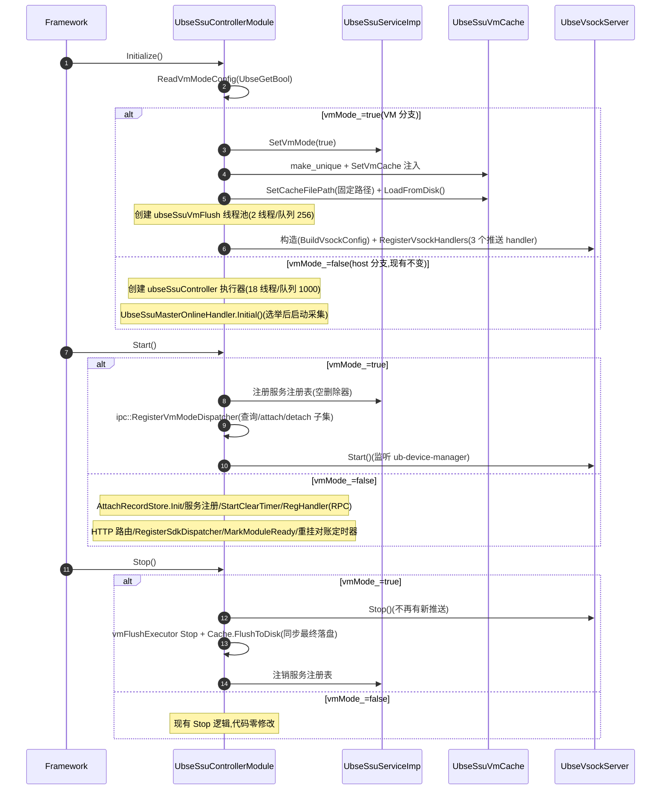

### 3.3 关键初始化步骤(分流对照)

| 步骤 | host 模式(vm_mode=false,现有不变) | VM 模式(vm_mode=true,本特性) |
|------|------------------------------------|--------------------------------|
| 0 | 插件注册期:`GetSsuModuleDependencies()` 返回 node/election/com/vip 四依赖 | 插件注册期:返回空依赖集(依赖解析先于 Initialize,按 vm_mode 选择) |
| 1 | Initialize:创建 `ubseSsuController` 任务执行器(18 线程/队列 1000) | Initialize:`SetVmMode(true)`,创建 `UbseSsuServiceImp` 单例引用 |
| 2 | Initialize:注册 MASTER_ONLINE 事件回调(选举完成后触发设备采集与账本重建) | Initialize:创建 `vmCache_` 并注入 `SetVmCache`,固定路径 `LoadFromDisk()` |
| 3 | Start:初始化 `UbseSsuAttachRecordStore`(挂载记录,失败不阻塞启动) | Initialize:创建 `ubseSsuVmFlush` flush 线程池(2 线程/队列 256);executor 缺失时降级跳过异步落盘 |
| 4 | Start:注册 `UbseSsuService` 到服务注册表 | Initialize:`BuildVsockConfig()`(端口/enable_tls 可配置)创建 `UbseVsockServer` |
| 5 | Start:`StartClearTimer`(空 VM bus instance 清理定时器) | Initialize:`RegisterVsockHandlers`(PUSH_ALLOC/PUSH_CONNECT/FULL_SYNC 三个 handler) |
| 6 | Start:`UbseSsuRpcProcessor::RegHandler`(RPC handler) | Start:注册服务注册表(空删除器,与 host 一致) |
| 7 | Start:注册 HTTP 路由 `RegisterSsuHttpHandlers` | Start:`ipc::RegisterVmModeDispatcher`(10 个 handler 子集) |
| 8 | Start:`ipc::RegisterSdkDispatcher`(全量 17 个 handler) | Start:`vsockServer_->Start()`(监听) |
| 9 | Start:`MarkModuleReady`(恢复流程等待的就绪标志) | Stop:`vsockServer_->Stop()` → flush 线程池 Stop → `FlushToDisk`(同步落盘) → 注销服务 |
| 10 | Start:`StartLocalMountReconcileTimer`(本地重挂对账定时器) | UnInitialize:`ResetVmModeState`(销毁 server → 移除 flush 执行器 → 撤销缓存指针) |
| 11 | Stop:`ResetModuleReady`/停止对账与清理定时器/停止采集/注销服务 | (VM 模式不注册 RPC/HTTP、不启动 collector、不重建账本) |

> **重要**:host 模式下各步骤代码完全不变,本特性仅在 `Initialize/Start/Stop/UnInitialize` 中添加 `if (vmMode_)` 分支,不影响 host 模式行为。`InitializeVmMode` 失败时 `ResetVmModeState` 回滚后返回错误,不会半初始化。

---

## 4. 服务接口与数据模型

### 4.1 服务契约(复用现有,不新增)

VM 模式**复用现有 `UbseSsuService` 契约**(`src/include/plugin_services/ssu/ubse_ssu_service.h`,17 个纯虚接口),不新建契约。`UbseSsuServiceImp` 在 VM 模式下实现该契约的子集,其余接口返回 `UBSE_ERR_NOT_SUPPORTED`(41)。

| 接口 | host 模式(现有不变) | VM 模式(本特性分支) | 说明 |
|------|----------------------|--------------------------|------|
| `ListAllocInfo` | ✅ 走账本 | ✅ 走 `UbseSsuVmCache` | 返回分配信息 |
| `GetAllocInfoByName` | ✅ 走账本 | ✅ 走 `UbseSsuVmCache` | 按名查询 |
| `GetNsStats` | ✅ 走账本 | ✅ 缓存命中后走本地适配器(取 nuse) | namespace 统计 |
| `GetConnectInfo` | ✅ 走账本 | ✅ 缓存命中后走 `UbseSsuVmCache` | 连接信息 |
| `AttachSpace` | ✅ 现有 | ✅ `VmAttachSpace`(缓存校验→身份校验→本地适配) | VM 内 attach |
| `DetachSpace` | ✅ 现有 | ✅ `VmDetachSpace`(缓存校验→身份预校验→本地适配) | VM 内 detach |
| `AttachLinearSpace` / `AttachStripedSpace` | ✅ 现有 | ✅ `VmAttachAggregated`(attach 全部 ns + `CreateBlockDevice`) | 聚合 attach |
| `DetachLinearSpace` / `DetachStripedSpace` | ✅ 现有 | ✅ `VmDetachAggregated`(`DeleteBlockDevice` + detach 全部 ns) | 聚合 detach |
| `AllocSpace` | ✅ 现有 | ❌ `UBSE_ERR_NOT_SUPPORTED` | 盘由 openstack 分配 |
| `FreeSpace` | ✅ 现有 | ❌ `UBSE_ERR_NOT_SUPPORTED` | 盘由 openstack 释放 |
| `AddAccessPermission` / `RemoveAccessPermission` | ✅ 现有 | ❌ `UBSE_ERR_NOT_SUPPORTED` | 权限由 host 管理 |
| `GetFeDeviceList` / `FeDeviceAlloc` / `FeDeviceFree` | ✅ 现有 | ❌ `UBSE_ERR_NOT_SUPPORTED` | VFE 由 host 管理 |

### 4.2 关键枚举(`ubse_vsock_message.h`)

```cpp
// vsock 消息类型(opCode 层)
// 消息由 host 侧 ub-device-manager 发送,VM 侧仅接收与响应
enum class UbseVsockMsgType : uint32_t {
    REQ_TYPE_SIGN = 0x0010,              // 签名请求(现有,保留)
    REQ_TYPE_VERIFY_AND_SIGN = 0x0012,   // 验签+重签(现有,保留)
    MSG_TYPE_PUSH_ALLOC_INFO = 0x0100,   // 推送分配信息(VM 接收)
    MSG_TYPE_PUSH_CONNECT_INFO = 0x0101, // 推送连接信息(VM 接收)
    MSG_TYPE_QUERY_VM_STATUS = 0x0102,   // 查询 VM 内状态(VM 接收,可选,预留)
    MSG_TYPE_LIFECYCLE_NOTIFY = 0x0103,  // 生命周期通知(VM 接收,预留)
    MSG_TYPE_FULL_SYNC_RESP = 0x0105,    // 全量同步(VM 接收)
    MSG_TYPE_ACK = 0x01FF,               // 通用 ACK(预留;实际响应复用 UbseResponseHeader.statusCode)
};

// vsock 连接状态(VM 侧 server 视角,传输层 connState_ 原子维护)
enum class UbseVsockConnState : uint8_t {
    WAITING_CONNECT = 0,    // 监听中,等待 ub-device-manager 连接
    CONNECTED = 1,          // ub-device-manager 已连接
    DISCONNECTED = 2,       // 连接断开,等待重连
};
```

> 注:`MSG_TYPE_LIFECYCLE_NOTIFY`(0x0103)仅预留类型值,代码未定义对应生命周期事件枚举与消息体;`MSG_TYPE_ACK` 亦为预留值——实际响应由传输层 `UbseResponseHeader{clientRequestId, statusCode}` 承载,handler 经 `UbseVsockServer::SendResponse` 发送。

### 4.3 配置项与消息体(实际实现)

**配置项**(ubse.conf `[ubse.ssu]` 段,经 `ubse::config::UbseGetBool/UbseGetUInt` 读取):

| 配置键 | 类型 | 默认值 | 说明 |
|--------|------|--------|------|
| `vm_mode` | bool | false | VM 模式开关;读取失败回落 host 模式 |
| `vsockServerPort` | uint32 | `UBSE_VSOCK_DEFAULT_PORT`(6174) | vsock 监听端口,配置为 0 时用默认值 |
| `enable_tls` | bool | true | 是否启用 TLS 1.3 双向认证 |

**固定路径**(不支持配置):
- 缓存文件:`/var/lib/ubse/ssu_vm_cache.json`(`UBSE_SSU_DEFAULT_CACHE_FILE`)
- TLS 证书目录:`/var/lib/ubse/lcne_cert/`(`UbseVsockConfig` 默认值)

**vsock 推送消息体**(无独立 struct,handler 内用 `ubse::serial::UbseDeSerialization` 按契约反序列化,与 IPC pack/unpack 格式对齐):

| 消息 | 载荷格式 | 条数上限 |
|------|----------|----------|
| `MSG_TYPE_PUSH_ALLOC_INFO` | `UbseSsuAllocResult`(operator>> 反序列化) | 单条 |
| `MSG_TYPE_PUSH_CONNECT_INFO` | `name(string)` + `count(uint32)` + `connectInfo[count]` | 4096(`MAX_PUSH_CONNECT_INFO_NUM`) |
| `MSG_TYPE_FULL_SYNC_RESP` | `allocCount(uint32)` + `alloc[allocCount]` + `connectCount(uint32)` + (`name` + `ciCount` + `connectInfo[ciCount]`)[connectCount] | alloc ≤ 8192,connect ≤ 8192(`MAX_FULL_SYNC_ALLOC_NUM`/`MAX_FULL_SYNC_CONNECT_NUM`) |

> 超限或反序列化失败统一回 `UBSE_ERR_INVALID_ARG`(框架自动回错误响应),防恶意 size 字段内存放大。

### 4.4 状态机

**vsock 连接状态机(VM 侧 server 视角,`UbseVsockTransport::connState_` 原子维护)**:

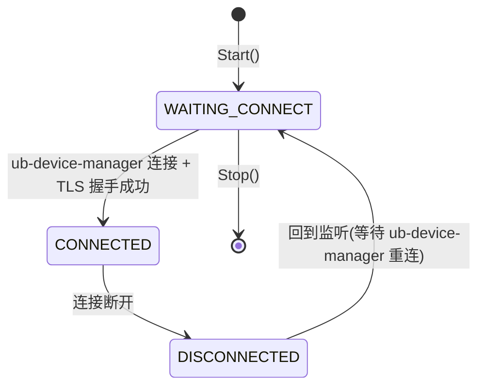

> 注:VM 侧 server 不主动重连,断开后回到监听状态,等待 ub-device-manager 侧重连;`Start()` 支持残留状态自愈(内部先 Stop 再重新初始化)。

**VM 内缓存数据流(逻辑视图,代码无显式状态机)**:

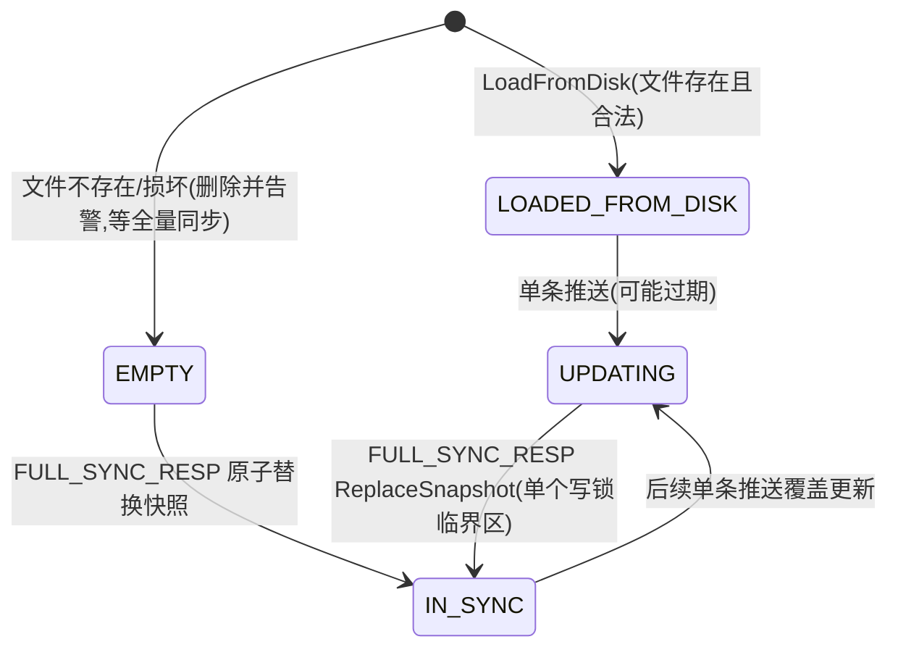

> 注:代码不维护 STALE 标记,加载自磁盘的数据仅作重启加速(可能过期);过期期间 attach 因本地适配器不可见而失败,不影响一致性;ub-device-manager 重连后的全量同步是权威修正。

### 4.5 FE/VFE 数据模型(自 SSU模块特性设计文档迁入)

> 迁入说明:VFE 直通涉及的 FE/VFE 设备结构定义于服务契约 `ubse_ssu_service.h`,为 host 模式能力;VM 模式不实现相关接口(见 4.1)。本节自 [SSU模块特性设计文档](../SSU模块特性设计文档.md) §4.2.3 迁入。

```cpp
struct UbseSsuVfe {
    uint8_t slotId, chipId, dieId;
    uint16_t pfeId;                       // 物理功能单元 ID（SSU 使用 PFE=6）
    uint16_t vfeId;                       // 虚拟功能单元 ID
    std::string vfeGuid;
    std::string bindBusInstanceGuid;      // 绑定的 VM bus instance
};

struct UbseSsuFe {
    uint8_t slotId, chipId, dieId;
    uint16_t pfeId;
    std::string pfeGuid;
    std::vector<UbseSsuVfe> vfeList;
};
```

---

## 5. 核心子模块设计

### 5.1 vsock 通用框架(服务层 UbseVsockServer + 传输层 UbseVsockTransport)

#### 5.1.1 职责

VM 模式下 SSU 模块的 vsock 通道采用**服务层/传输层分层**设计:
- **传输层 `UbseVsockTransport`**:负责 AF_VSOCK socket 管理、TLS 1.3 握手(enableTls 可配置)、epoll ET 事件循环、消息编解码(`UbseRequestHeader`/`UbseResponseHeader`,处理粘包/半包)、线程池分发与响应发送
- **服务层 `UbseVsockServer`**:负责 handler 注册管理与请求路由,编程模型与 IPC 框架(`UbseIpcServer`)一致,业务模块迁移成本最小
- **业务 handler**:VM 侧推送处理逻辑(`HandlePushAllocInfo`/`HandlePushConnectInfo`/`HandleFullSync`)实现在 `UbseSsuControllerModule`,经 `RegisterHandler(moduleCode, opCode, handler)` 注册,不在框架内

#### 5.1.2 类设计

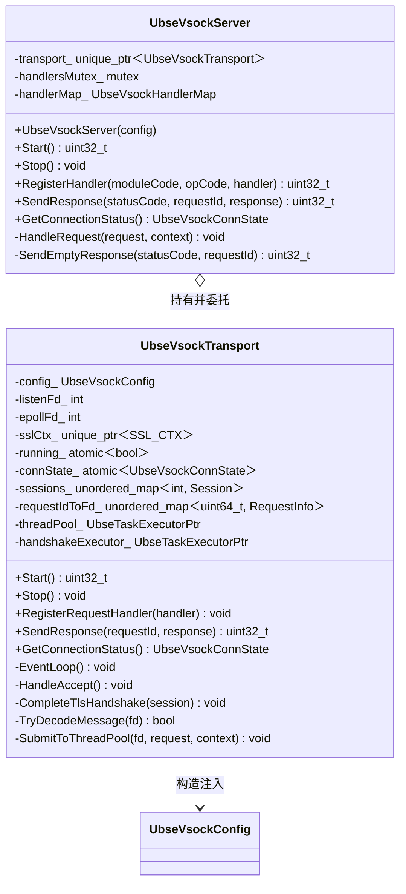

#### 5.1.3 关键方法

| 方法 | 归属 | 功能 | 关键逻辑 |
|------|------|------|----------|
| `UbseVsockServer(config)` | 服务层 | 构造 | 持有 `UbseVsockConfig`(端口/TLS/线程池),创建传输层 |
| `Start` / `Stop` | 服务层 | 启停 | 委托传输层创建/销毁监听与资源 |
| `RegisterHandler` | 服务层 | 注册处理函数 | (moduleCode, opCode) → handler 映射;重复注册返回 `UBSE_ERR_EXISTED` |
| `SendResponse` | 服务层 | 发送响应 | 按 requestId 定位连接;空 body + statusCode 表达 ACK/NACK |
| `GetConnectionStatus` | 服务层 | 查询连接状态 | 透传传输层 `connState_`(供监控) |
| `Start`(传输层) | 传输层 | 启动监听 | 残留状态自愈(先内部 Stop)→ socket/epoll/TLS 初始化 → 事件循环线程 |
| `EventLoop`(传输层) | 传输层 | epoll ET 主循环 | accept(握手移交专用线程)/读/写事件处理,保持事件循环非阻塞 |
| `CompleteTlsHandshake`(传输层) | 传输层 | TLS 握手 | 阻塞式 `SSL_accept` 移出事件循环,握手后注册会话 |
| `TryDecodeMessage`(传输层) | 传输层 | 消息编解码 | 处理粘包/半包,解出完整请求后提交线程池 |
| `SendResponse`(传输层) | 传输层 | 回写响应 | 按 requestId 定位连接与 clientRequestId 回填;对端持续不读时受写缓冲上限约束 |

**handler 契约**(与 IPC `UbseIpcHandler` 一致):
- handler 返回非 `UBSE_OK`:框架自动回该错误码响应(无需 handler 自行应答)
- handler 返回 `UBSE_OK`:由 handler 内自行调用 `SendResponse` 返回业务结果(支持异步场景)
- `request.buffer` 所有权归传输层,回调内不得调用 freeFunc(传输层特例契约,与 IPC 通用契约不同)

#### 5.1.4 设计要点

- **长连接**:区别于现有 `UbseVsockClient` 的短连接,server 维持长连接,ub-device-manager 连接后保持
- **单工作线程**:SSU 模块 `BuildVsockConfig` 设 `threadPoolSize = 1`,保证同一会话推送消息按接收顺序串行处理
- **TLS 1.3 双向认证**:`enable_tls` 可配置(默认开启),证书目录固定 `/var/lib/ubse/lcne_cert/`;TLS 握手在专用线程执行,不阻塞事件循环
- **不主动重连**:VM 侧 server 断开后回到监听状态,等待 ub-device-manager 侧重连(重连策略由 ub-device-manager 负责)
- **写背压保护**:对端持续不读时写缓冲未写出数据受上限约束,超限丢弃本次响应并返回 `UBSE_ERR_INTERNAL`
- **归入 vsock 框架模块**:与 `UbseVsockClient` 对称,同属 `src/framework/vscok/`

### 5.2 UbseSsuVmCache(VM 模式本地缓存)

#### 5.2.1 职责

VM 模式下 SSU 模块的只读缓存,存储 ub-device-manager 推送的分配信息与连接信息,支持并发读写;并将分配/连接信息持久化到本地文件,作为 VM 重启加速缓存。

#### 5.2.2 类设计

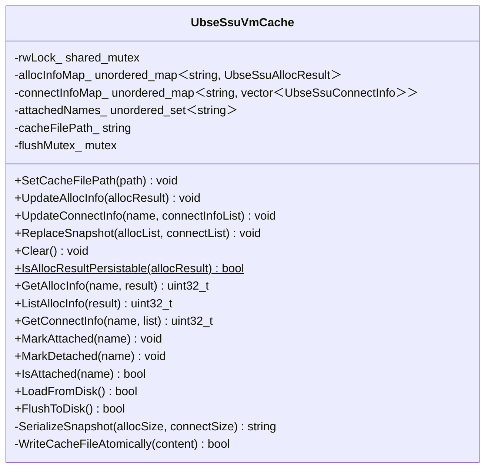

#### 5.2.3 设计要点

- **读写锁**:`std::shared_mutex` 保护,读操作用 `shared_lock`,写操作用 `unique_lock`
- **只读语义**:缓存数据由 vsock 推送更新,VM 内服务不可修改分配/连接内容(attach 状态标记除外)
- **原子快照替换**:`ReplaceSnapshot` 在缓存内部**单个写锁临界区**内完成全量替换,并发查询不会观察到清空与逐条更新之间的中间状态
- **落盘校验前置**:`IsAllocResultPersistable`(静态)在推送入口校验 name/strategy/lbaFormat 取值域,与 `LoadFromDisk` 逐字段严格解码保持一致——非法条目不落盘,避免重启时整个缓存文件被拒并删除(已缓存分配信息全部丢失)
- **归入 SSU 模块**:`src/controllers/ssu/ubse_ssu_vm_cache.{h,cpp}`

#### 5.2.4 持久化设计(内存+文件混合)

**持久化范围**:

| 数据成员 | 是否持久化 | 理由 |
|----------|-----------|------|
| `allocInfoMap_` | ✅ 持久化 | VM 重启后 VFE 直通若保持,分配信息仍有效 |
| `connectInfoMap_` | ✅ 持久化 | 连接参数(nqn/eid)在 VFE 存续期间不变 |
| `attachedNames_` | ❌ 不持久化 | VM 重启后 NVMe 连接断开,namespace 必然 detached;若持久化会导致状态错乱 |

**文件格式**(JSON,rapidjson):

```json
{
  "version": 1,
  "lastSyncTs": 1784964000,
  "allocList": [ { "name": "ns1", "size": 1073741824, "strategy": 0, "lbaFormat": 0, "...": "..." } ],
  "connectList": [ { "name": "ns1", "connectInfo": [ { "vfe": 0, "nqn": "...", "eid": "...", "connId": 1 } ] } ]
}
```

**加载流程**(`LoadFromDisk`,在 `InitializeVmMode` 阶段调用):

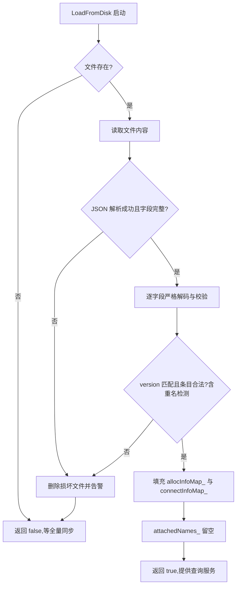

**写入流程**(`FlushToDisk`,原子写):

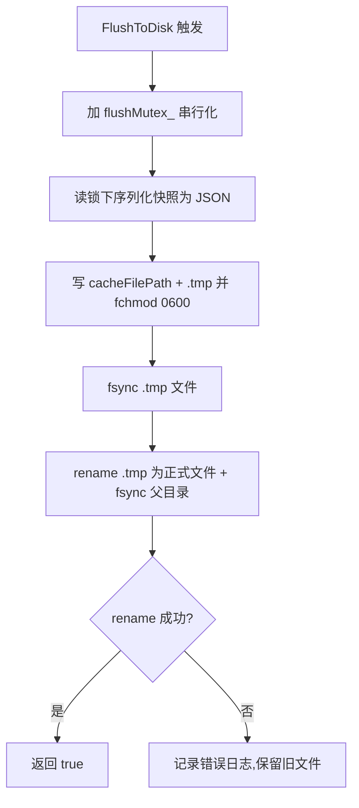

**触发时机**:

| 场景 | 触发动作 | 同步/异步 |
|------|----------|-----------|
| 单条推送(`UpdateAllocInfo`/`UpdateConnectInfo`) | 内存更新成功后投递 `ubseSsuVmFlush` 线程池执行 | 异步(不阻塞 ACK;executor 缺失时降级跳过,仅告警) |
| `MSG_TYPE_FULL_SYNC_RESP` 全量同步 | `ReplaceSnapshot` 后直接调用 | 同步(覆盖写) |
| `UbseSsuControllerModule::StopVmMode` | 停止 server 与 flush 线程池后最终落盘 | 同步 |

> 停机时序保证:先 `vsockServer_->Stop()`(无新任务投递)→ flush 线程池 `Stop()`(join 在途任务,排队中任务被丢弃)→ 同步 `FlushToDisk()` 兜底,保证停机不丢数据。

**关键约束**:
- 原子写:`.tmp` + `fchmod 0600` + `fsync` + `rename` + 父目录 `fsync`,避免掉电损坏与权限遗留
- 文件权限:`0600`(仅 root 读写),包含 nqn/devPath 等敏感信息
- 文件路径固定:`/var/lib/ubse/ssu_vm_cache.json`,不支持配置
- **非权威源**:文件仅作重启加速,ub-device-manager 全量同步后必须覆盖
- 过期容忍:文件可能过期,全量同步会修正;过期期间 attach 会因本地适配器不可见而失败,不影响一致性

### 5.3 UbseSsuServiceImp 扩展(VM 模式分支)

#### 5.3.1 职责

扩展现有 `UbseSsuServiceImp`,在 VM 模式下走本地缓存/本地适配器分支;`vmCache_` 由 controller 模块在 `InitializeVmMode` 时注入(`SetVmCache`,非拥有指针)。

#### 5.3.2 类设计(扩展)

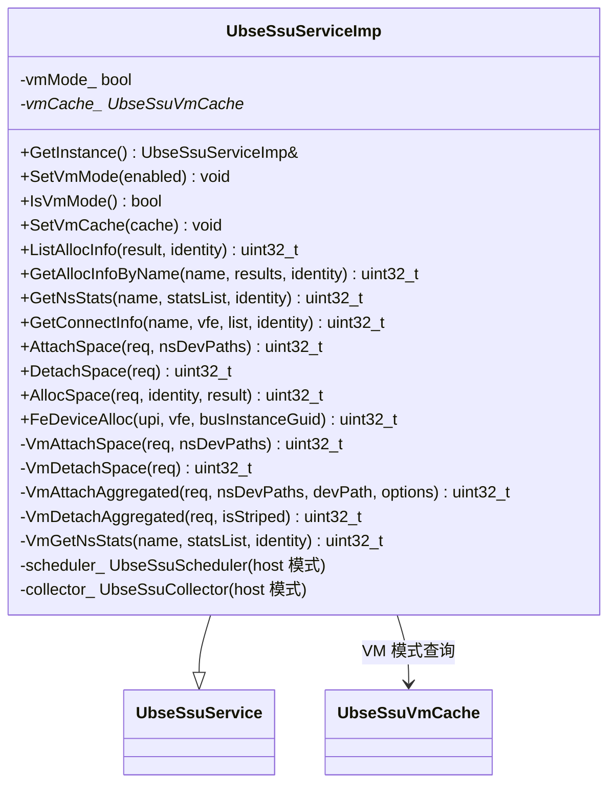

#### 5.3.3 关键方法(VM 模式分支)

| 方法 | host 模式(现有不变) | VM 模式实现 | 关键逻辑 |
|------|----------------------|-------------|----------|
| `ListAllocInfo` | 走账本 | 走 `vmCache_->ListAllocInfo` | 缓存为空返回空列表 |
| `GetAllocInfoByName` | 走账本 | 走 `vmCache_->GetAllocInfo` | 未命中返回查询失败 |
| `GetNsStats` | 走账本 | `VmGetNsStats` | 缓存未命中返回 `UBSE_SSU_ERROR_SPACE_NOT_FOUND`(1200);按需 `RefreshDevCache`(本地适配器 GetDevList)取 nuse;身份不匹配返回 `UBSE_ERR_ACCESS_DENIED` |
| `GetConnectInfo` | 走账本 | 缓存命中后走 `vmCache_->GetConnectInfo` | 先校验分配信息在缓存中 |
| `AttachSpace` | 现有逻辑 | `VmAttachSpace` | 见下方详述 |
| `DetachSpace` | 现有逻辑 | `VmDetachSpace` | 见下方详述 |
| `AttachLinearSpace`/`AttachStripedSpace` | 现有逻辑 | `VmAttachAggregated` | 先 `ValidateVmAllocStrategy`(策略不匹配返回 `UBSE_SSU_ERROR_STRATEGY_MISMATCH`)→ 复用 `VmAttachSpace` → `CreateBlockDevice`(失败回滚 detach);已 attach 幂等返回缓存 nsDevPaths + `/dev/ssu/{devName}` |
| `DetachLinearSpace`/`DetachStripedSpace` | 现有逻辑 | `VmDetachAggregated` | 先 `DeleteBlockDevice`(失败返回 `UBSE_SSU_ERROR_BLOCK_DEVICE_DELETE_FAILED`,不破坏依赖状态)→ 复用 `VmDetachSpace` |
| `AllocSpace`/`FreeSpace`/权限/FE 系列 | 现有逻辑 | 直接返回 `UBSE_ERR_NOT_SUPPORTED`(41) | VM 模式不支持 |

**`VmAttachSpace` 关键步骤**(与 master 路径 `AttachSingleNs` 语义对齐):
1. 缓存命中校验:未在缓存返回 `UBSE_SSU_ERROR_NS_NOT_FOUND`(1315)
2. 身份校验:逐 ns 经本地适配器 customData 校验 identity(`IsNsIdentityMatch`),不匹配返回 `UBSE_ERR_ACCESS_DENIED`(防非属主 attach 缓存中任意 namespace)
3. 幂等:已 attach 直接返回成功并回带缓存中的 nsDevPaths
4. 可见性预检:所有 namespace 必须在本地适配器可见(避免部分 attach 后回滚),不可见返回 `UBSE_SSU_ERROR_NS_NOT_FOUND`
5. 逐 ns 调 `adapter.AttachDevNameSpace`(nqn 归一化:未指定时用设备 customData.defaultNqn);中途失败**逆序回滚**已 attach 的 namespace
6. `MarkAttached(name)`

**`VmDetachSpace` 关键步骤**(与 master 路径 `DetachSingleNs` 语义对齐):
1. 缓存命中校验:未在缓存(VM 不感知)返回 `UBSE_SSU_ERROR_NS_NOT_FOUND`
2. 幂等:未 attach 直接返回成功
3. 身份预校验:任意 ns 不匹配返回 `UBSE_ERR_ACCESS_DENIED`(在任何设备操作前完成,避免部分 detach);ns 在本地适配器不可见视为已被外部 detach,跳过设备操作(幂等)
4. 逐 ns 调 `adapter.DetachDevNameSpace` → `MarkDetached(name)`

#### 5.3.4 设计要点

- **分支集中**:VM 模式分支集中在 `UbseSsuServiceImp` 内部(`Vm*` 系列私有方法),通过 `vmMode_` 标记分流,不新增 `UbseSsuVmServiceImp` 类
- **幂等性**:attach 重复返回成功(检查 `attachedNames`,回带缓存设备路径);detach 重复返回成功
- **缓存校验**:attach/detach 前必须校验 name 在本地缓存中,否则返回 `UBSE_SSU_ERROR_NS_NOT_FOUND`(1315,内部码);GetNsStats 未命中返回 `UBSE_SSU_ERROR_SPACE_NOT_FOUND`(1200,对外码)
- **身份验证**:复用 `UbseSsuAllocIdentityInfo`(uid/userName),经 IPC context 提取,与 master 路径一致走本地适配器 customData 校验
- **host 模式零修改**:`vmMode_=false` 时所有方法走现有分支,代码不变

### 5.4 不引入的子模块(重要)

本特性**不引入**以下子模块(由 ub-device-manager 外部组件承担):

| 不引入的类 | 原计划职责 | 不引入原因 | 承担方 |
|------------|------------|------------|--------|
| `UbseSsuVirtHostPusher` | host 侧推送执行器 | host 侧 ubse 不与 VM 直接交互 | ub-device-manager |
| `UbseVsockHostClient` | host 侧 vsock 长连接 client | host 侧 ubse 不持有 vsock client | ub-device-manager |

**约束依据**:
- FR-BOUNDARY-01:host 侧 ubse 不感知 VM
- FR-BOUNDARY-02:推送由 ub-device-manager 负责
- CON-HOST-NO-VM-AWARE:ubse@host 不引入对 VM 内 ubse 的依赖
- CON-PUSH-EXTERNAL:host→VM 的信息推送由 ub-device-manager 负责

### 5.5 UbseSsuDirectToVmManager —— VFE 直通管理(自 SSU模块特性设计文档迁入)

> 迁入说明:`UbseSsuDirectToVmManager` 为 **host 模式能力**(现有组件,本特性零修改,见 6.4/11.3);VM 模式不引入该子模块——VM 内 `FeDeviceAlloc/FeDeviceFree` 返回 `UBSE_ERR_NOT_SUPPORTED`(见 4.1),FR-BOUNDARY 边界不变。本节设计自 [SSU模块特性设计文档](../SSU模块特性设计文档.md) §5.6 迁入。

#### 5.5.1 职责

将 PFE=6 下的 VFE 注册（reg）/反注册（unreg）到 VM bus instance，实现 SSU 物理资源对虚拟机的直通。

#### 5.5.2 状态机（单工作者模型）

```cpp
enum class SsuDirectToVmManagerState {
    AVAILABLE,      // 空闲
    RUNNING_ALLOC,  // 正在 FeDeviceAlloc
    RUNNING_FREE,   // 正在 FeDeviceFree
    CLEARING_BG,    // 后台清理任务运行中
};
```

通过 `mutex + condition_variable` 实现单工作者互斥：任意时刻只允许一个 alloc/free/清理任务运行，保证底层 MTI 调用不并发冲突。

#### 5.5.3 FeDeviceAlloc 流程

1. **等待 AVAILABLE**：`cv_.wait` 直到状态可用，立即切到 `RUNNING_ALLOC`
2. **AllocPreparation**：查 PFE 列表 → 定位 VFE → 检查占用
3. **占用冲突处理**：
   - VFE 已被占用且目标 bus instance GUID 相同 → 幂等成功返回
   - 否则 `HandleOccupiedVfe` 抢占式反注册原 bus instance
4. **AllocExecution**：
   - 调用方指定 `busInstanceGuid` → 复用并清空其上其他 VFE（独占语义）
   - 未指定 → 新建 VM bus instance
5. **RegVfeToVmBusInst**：调 `UbseMtiUrma::RegDavidFeToVmBusInstance`

所有 MTI 调用都通过 `RetryWithBackoff` 重试 5 次（固定间隔 2 秒）。

#### 5.5.4 FeDeviceFree 流程

1. 校验 bus instance 的 upi 与请求一致（防跨 VM 误操作）
2. 反注册 VFE
3. 若 bus instance 上无其他 VFE → 销毁空实例；否则保留并打 WARN

#### 5.5.5 周期清理

`StartClearTimer` 注册 60s 周期定时器（`SsuClearEmptyVMBusInst`），回调 `ClearEmptyVMBusInstance`：销毁所有 `subDeviceGuids` 为空的 VM bus instance，回收 VM 异常退出后的残留资源。定时器与 alloc/free 通过状态机互斥：运行中则跳过本次清理。

#### 5.5.6 关键常量(ubse_ssu_direct_to_vm_manager.cpp)

| 常量 | 值 | 说明 |
|------|----|------|
| `CLEAR_VM_BUS_INST_INTERVAL_SECONDS` | 60 | 空 VM bus instance 清理周期(秒) |
| `COMMON_RETRY_TIME` | 5 | MTI 调用失败重试次数 |
| `SLEEP_TIME` | 2 | MTI 调用重试间隔(秒) |
| `SSU_FE_ID` | 6 | SSU 使用的 FE/PFE 编号(设计规定 1650 FE 6 给 SSU 使用) |

---

## 6. 接入层设计

### 6.1 IPC 接入层(VM 模式复用现有 handler)

VM 模式下 IPC 复用现有 `UbseSsuHandler` 模板方法模式(`Init → Unpack → Handle → Pack → SendResponse`),由 `ipc::RegisterVmModeDispatcher` 仅注册查询/attach/detach handler 子集(op code 为 `ubse_ipc_ssu_op_code_t`,`ubse_ipc_common.h`):

| OpCode | Handler 类(现有) | IPC op code | VM 模式注册 |
|--------|-------------------|-------------|-------------|
| `UBSE_IPC_SSU_LIST_ALLOC_INFO` | `UbseListAllocInfoHandler` | 0x0004 | ✅ |
| `UBSE_IPC_SSU_GET_ALLOC_INFO_BY_NAME` | `UbseGetAllocInfoByNameHandler` | 0x0005 | ✅ |
| `UBSE_IPC_SSU_GET_NS_STATS` | `UbseGetNsStatsHandler` | 0x0006 | ✅ |
| `UBSE_IPC_SSU_GET_CONNECT_INFO` | `UbseGetConnectInfoHandler` | 0x0007 | ✅ |
| `UBSE_IPC_SSU_ATTACH_SPACE` | `UbseAttachSpaceHandler` | 0x000B | ✅ |
| `UBSE_IPC_SSU_DETACH_SPACE` | `UbseDetachSpaceHandler` | 0x000C | ✅ |
| `UBSE_IPC_SSU_ATTACH_LINEAR_SPACE` | `UbseAttachLinearSpaceHandler` | 0x000E | ✅ |
| `UBSE_IPC_SSU_DETACH_LINEAR_SPACE` | `UbseDetachLinearSpaceHandler` | 0x000F | ✅ |
| `UBSE_IPC_SSU_ATTACH_STRIPED_SPACE` | `UbseAttachStripedSpaceHandler` | 0x0010 | ✅ |
| `UBSE_IPC_SSU_DETACH_STRIPED_SPACE` | `UbseDetachStripedSpaceHandler` | 0x0011 | ✅ |
| `UBSE_IPC_SSU_ALLOC_SPACE` | `UbseAllocSpaceHandler` | 0x000A | ❌ 不注册 |
| `UBSE_IPC_SSU_FREE_SPACE` | `UbseFreeSpaceHandler` | 0x000D | ❌ 不注册 |
| `UBSE_IPC_SSU_ADD_ACCESS_PERMISSION` | `UbseAddAccessPermissionHandler` | 0x0008 | ❌ 不注册 |
| `UBSE_IPC_SSU_REMOVE_ACCESS_PERMISSION` | `UbseRemoveAccessPermissionHandler` | 0x0009 | ❌ 不注册 |
| `UBSE_IPC_SSU_GET_FE_DEVICE_LIST` | `UbseGetFeDeviceListHandler` | 0x0012 | ❌ 不注册 |
| `UBSE_IPC_SSU_FE_DEVICE_ALLOC` | `UbseFeDeviceAllocHandler` | 0x0013 | ❌ 不注册 |
| `UBSE_IPC_SSU_FE_DEVICE_FREE` | `UbseFeDeviceFreeHandler` | 0x0014 | ❌ 不注册 |

**关键设计**:复用现有 handler 类(共 17 个),VM 模式注册 10 个子集,不注册的 7 个能力(alloc/free/权限/FE)由 `UbseSsuServiceImp` 的 `UBSE_ERR_NOT_SUPPORTED` 分支兜底(未注册即请求不可达,双保险)。host 模式 `RegisterSdkDispatcher` 注册逻辑不变。

### 6.2 vsock 接入层(仅 VM 侧 server)

vsock 作为 ub-device-manager↔VM 的专用通道,不走 IPC/HTTP。本特性仅交付 VM 侧 server:

- **分层**:传输层(`UbseVsockTransport`:AF_VSOCK/TLS/epoll ET/编解码/线程池)+ 服务层(`UbseVsockServer`:handler 注册/路由/SendResponse),业务 handler 在 SSU 控制器模块
- **协议头**:传输层编解码 `UbseRequestHeader`/`UbseResponseHeader`(处理粘包/半包);`UbseIpcMessage`/`UbseRequestContext` 与 IPC 复用
- **序列化**:消息体复用 IPC 的 `UbseDeSerialization` pack/unpack 模式(见 4.3 载荷格式),含条数上限防护
- **响应契约**:handler 返回非 `UBSE_OK` 时框架自动回错误响应;`UBSE_OK` 时 handler 经 `SendResponse(statusCode, requestId, 空 body)` 应答(即 ACK/NACK 语义,`statusCode`=0 表成功)
- **TLS**:双向认证,`enable_tls` 可配置(默认开启),证书目录固定 `/var/lib/ubse/lcne_cert/`
- **模块码对齐**:`UBSE_VSOCK_SSU_MODULE_CODE = 0x0007`,与 IPC `ubse_ipc_module_code_t::UBSE_SSU` 对齐
- **契约对齐**:vsock 协议契约对 ub-device-manager 公开(见 [需求分析文档](./SSU模块虚机化特性需求分析文档.md))
- **不交付 host 侧 client**:host 侧 vsock client 由 ub-device-manager 自带,不在 SSU 模块内

### 6.3 CLI 接入层(扩展现有命令注册)

扩展现有 `src/cli/ssu/ubse_cli_ssu_cmd_reg.{h,cpp}`,`UbseCliRegSsuModule::UbseCliSignUp` 根据 `IsVmMode()` 注册不同命令集:

| 命令 | host 模式(现有不变) | VM 模式(本特性) | 必填参数 | 可选参数 |
|------|----------------------|----------------------|----------|----------|
| `display ssu` | ✅(-t 仅 alloc_summary/alloc_detail) | ✅(-t 额外支持 connect_info) | `-t/--type` | `-n/--name`(仅 detail/connect_info) |
| `create ssu` | ✅ | ❌ 不注册 | `-n`、`-s` | `-l`、`-m`、`-r` |
| `delete ssu` | ✅ | ❌ 不注册 | `-n` | — |
| `attach ssu` | ✅ | ✅ | `-n` | `-q`、`-e`、`-t`(Linear/Striped)、`-d`、`-l`、`-c` |
| `detach ssu` | ✅ | ✅ | `-n` | `-q`、`-t`、`-d` |

**VM 模式判定(CLI 侧 `IsVmMode`)**:
- 环境变量 `UBSE_SSU_VM_MODE` 优先(非空即视为 VM 模式)
- 否则解析 `/etc/ubse/ubse.conf` 的 `[ubse.ssu] vm_mode`(与守护进程解析规则对齐,进程内首次读取后缓存;文件不存在或不可读回落 host 模式)
- 守护进程侧仅读配置文件(经 `ubse::config::UbseGetBool`),无环境变量覆盖

**connect_info 类型(VM 模式新增)**:`display ssu -t connect_info -n <name>` 经 `UBSE_IPC_SSU_GET_CONNECT_INFO` 调用 VM 侧 `GetConnectInfo`(走本地缓存);host 模式下该类型按非法 `-t` 拒绝,帮助文案亦不含该值(与命令集同源)。

### 6.4 host 侧接入层(零修改)

host 模式下:
- IPC dispatcher 注册逻辑不变(全量注册 17 个 handler)
- HTTP 路由注册不变
- RPC handler 注册不变
- **不新增推送回调注册**(本特性不引入 `UbseSsuVirtHostPusher`)
- **不新增 vsock client**(本特性不引入 `UbseVsockHostClient`)

ub-device-manager 通过现有 SDK/UDS IPC 接口消费 ubse@host 的能力,无需 ubse@host 任何改动。

---

## 7. 关键流程详解

### 7.1 流程一:首次部署与设备直通(FR-DEVICE-PASSTHROUGH)

#### 7.1.1 时序图

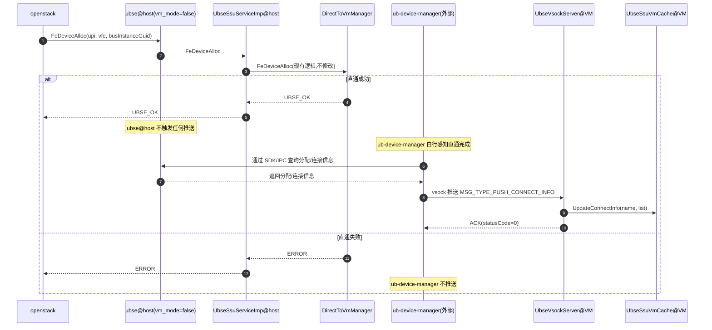

#### 7.1.2 关键步骤说明

| 步骤 | 说明 | 归属 |
|------|------|------|
| 1-3 | openstack 调用 ubse@host 的 FeDeviceAlloc,委托给 DirectToVmManager(现有逻辑,不修改) | ubse@host(现有) |
| 4-5 | 直通成功后,ubse@host 返回成功,**不触发任何推送** | ubse@host(本特性零修改) |
| 6 | ub-device-manager 自行感知直通完成(机制由 ub-device-manager 设计,不在本特性范围) | ub-device-manager(外部) |
| 7-8 | ub-device-manager 通过现有 SDK 查询 ubse@host 的分配/连接信息 | ub-device-manager(外部) |
| 9-11 | ub-device-manager 通过 vsock 推送到 VM,VM 内 server 路由到 SSU 推送 handler 并更新缓存 | ubse@VM(本特性) + ub-device-manager(外部) |

#### 7.1.3 异常处理

| 异常场景 | 处理策略 | 归属 |
|----------|----------|------|
| FeDeviceAlloc 失败 | ubse@host 返回错误码,ub-device-manager 不推送 | ubse@host(现有) |
| ub-device-manager 推送失败 | 由 ub-device-manager 侧重试策略处理(不在本特性范围) | ub-device-manager(外部) |
| VM 内缓存更新失败 | VM 侧框架回错误码响应(NACK 语义),ub-device-manager 侧记录告警 | ubse@VM(本特性) |

#### 7.1.4 本特性交付范围

- ✅ VM 侧 `UbseVsockServer` 接收推送(步骤 9-11 的 VM 侧)
- ✅ VM 侧 `UbseSsuVmCache` 更新缓存
- ❌ ubse@host 的 FeDeviceAlloc(现有,不修改)
- ❌ ub-device-manager 的感知、查询、推送(外部组件)

### 7.2 流程二:VM 内查询分配信息(FR-VM-QUERY)

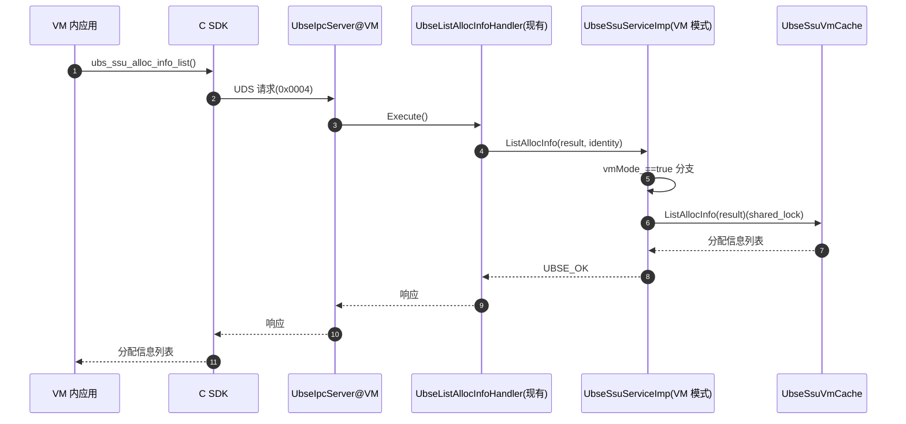

### 7.3 流程三:VM 内 attach(FR-VM-ATTACH)

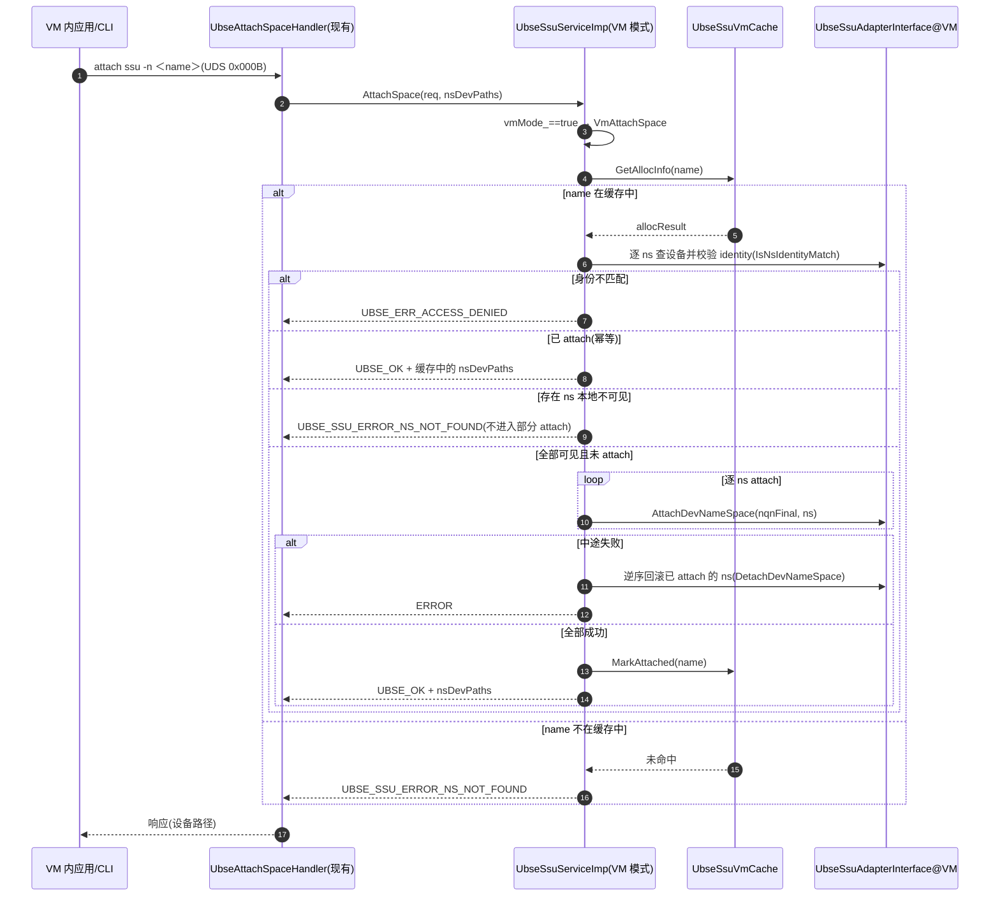

> 聚合 attach(`attach ssu -t Linear/Striped`)在 `VmAttachSpace` 成功后追加 `CreateBlockDevice`;失败时回滚(`VmDetachSpace`)。已 attach 时幂等返回缓存 nsDevPaths 与 `/dev/ssu/{devName}` 聚合路径。

### 7.4 流程四:VM 重启恢复(FR-VM-LIFECYCLE + FR-VM-CACHE-PERSIST)

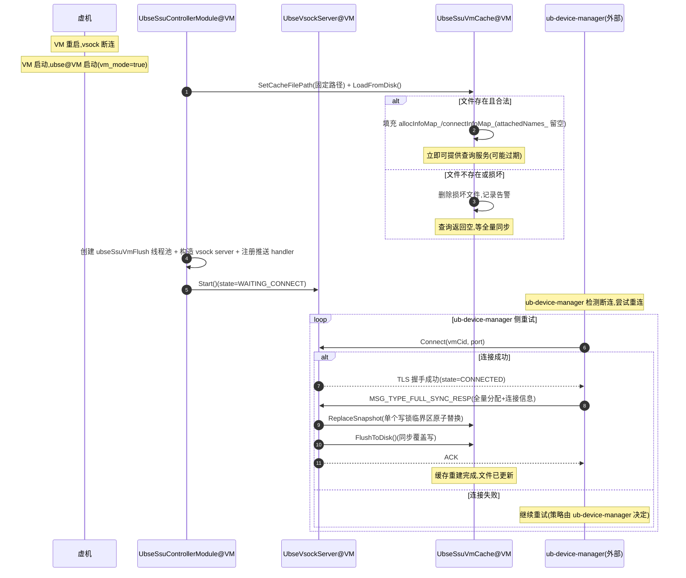

#### 7.4.1 本特性交付范围

- ✅ VM 侧 `UbseSsuVmCache.LoadFromDisk` 启动加载(失败不阻塞启动)
- ✅ VM 侧 `UbseVsockServer` 启动并监听(残留状态自愈)
- ✅ VM 侧接收 `MSG_TYPE_FULL_SYNC_RESP`,`ReplaceSnapshot` 原子重建缓存
- ✅ 全量同步后同步落盘;单条推送异步落盘(ubseSsuVmFlush 线程池)
- ❌ ub-device-manager 的断连检测与重连策略(外部组件)

### 7.5 流程五:VM 内 vsock 接收推送(VM 侧视角)

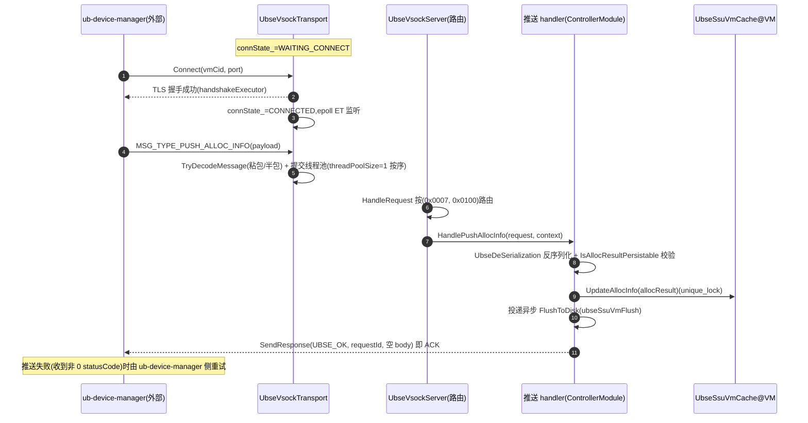

> 注:VM 侧只负责接收、校验、更新缓存、异步落盘、响应;推送触发、失败重试、全量同步触发等策略均由 ub-device-manager 主导。非法条目(name 空/strategy 或 lbaFormat 非法/条数超限)统一回 `UBSE_ERR_INVALID_ARG`。

### 7.6 流程六:FeDeviceAlloc/FeDeviceFree(VFE 直通)(自 SSU模块特性设计文档迁入)

> 迁入说明:本流程为 **host 模式现有能力**(openstack→ubse@host,由 `UbseSsuDirectToVmManager` 执行,见 5.5),本特性零修改;此处自 [SSU模块特性设计文档](../SSU模块特性设计文档.md) §7.4 迁入,以完整覆盖 VFE 直通域,并与 7.1 首次部署流程衔接(7.1 中 D2VM 的内部行为即本节流程)。

#### 7.6.1 时序图（VFE 直通 VM）

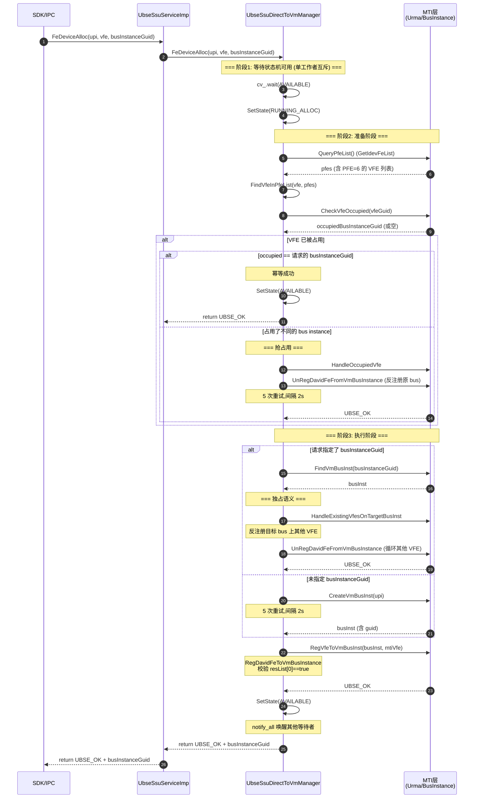

#### 7.6.2 时序图（FeDeviceFree 释放 VFE）

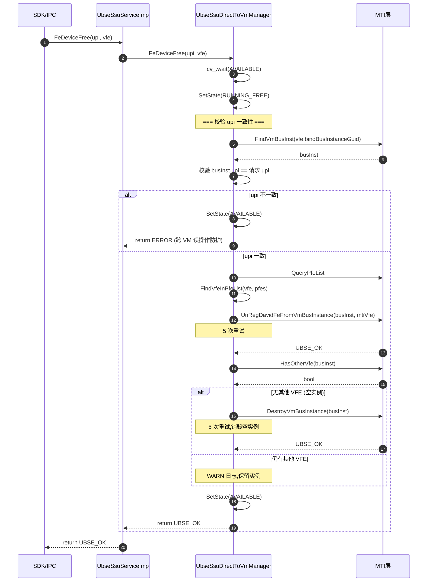

#### 7.6.3 流程伪代码

```
FeDeviceAlloc(upi, vfe, busInstanceGuid)
  └─ UbseSsuDirectToVmManager::GetInstance().FeDeviceAlloc(upi, vfe, busInstanceGuid)
      ├─ cv_.wait(AVAILABLE)  ← 单工作者互斥
      ├─ SetState(RUNNING_ALLOC)
      ├─ AllocPreparation(vfe, pfes, mtiVfe, occupiedBusInstanceGuid)
      │   ├─ QueryPfeList(pfes)
      │   ├─ FindVfeInPfeList(vfe, pfes, mtiVfe)
      │   └─ CheckVfeOccupied(vfeGuid, occupiedBusInstanceGuid)
      ├─ if (occupied):
      │   ├─ if (occupied == busInstanceGuid) return UBSE_OK  ← 幂等
      │   └─ HandleOccupiedVfe(vfe, occupiedBusInstanceGuid, mtiVfe)  ← 抢占
      ├─ AllocExecution(upi, vfe, busInstanceGuid, pfes, mtiVfe, busInst)
      │   ├─ if (busInstanceGuid 非空):
      │   │   ├─ FindVmBusInst(busInstanceGuid, busInst)
      │   │   └─ HandleExistingVfesOnTargetBusInst(busInst, vfe, pfes)  ← 独占语义
      │   ├─ else:
      │   │   └─ CreateVmBusInst(upi, busInst)  ← 5 次重试
      │   └─ RegVfeToVmBusInst(busInst, mtiVfe)
      └─ SetState(AVAILABLE)  ← notify_all 唤醒等待者
```

**异常处理**:MTI 调用（QueryPfeList/CheckVfeOccupied/UnReg/Create/Destroy/Reg）均经 `RetryWithBackoff` 重试 5 次（间隔 2s），重试耗尽后置回 `AVAILABLE` 并向上返回错误；FeDeviceFree 的 upi 不一致属跨 VM 误操作防护，直接拒绝且不修改任何状态；周期清理与 alloc/free 通过状态机互斥，运行中跳过本次清理。

---

## 8. 并发控制与一致性保证

### 8.1 并发层次

| 层次 | 机制 | 保护对象 | 模式 |
|------|------|----------|------|
| VM 内缓存级 | `UbseSsuVmCache::rwLock_`(shared_mutex) | allocInfoMap/connectInfoMap/attachedNames,读共享写互斥 | VM 模式 |
| 缓存落盘级 | `UbseSsuVmCache::flushMutex_`(mutex) | 文件写入串行化,与 rwLock_ 解耦(读内存不阻塞落盘) | VM 模式 |
| 推送处理级 | vsock 线程池 `threadPoolSize=1` | 同一会话推送消息按接收顺序串行执行 | VM 模式 |
| 异步落盘级 | `ubseSsuVmFlush` 线程池(2 线程/队列 256) | 单条推送 FlushToDisk 异步化,不阻塞 ACK | VM 模式 |
| 传输层连接级 | `sessionsMutex_`/`requestMapMutex_`/`handlerMutex_` + `connState_`/`running_` 原子量 | 会话表/requestId 映射/回调注册/连接状态 | VM 模式 |
| 服务层路由级 | `handlersMutex_` | (moduleCode, opCode) → handler 映射表 | VM 模式 |
| 现有 SSU 并发(host 侧) | 现有锁层次(不修改) | schedulerLock_/DebtLedger COW 等 | host 模式(本特性零修改) |

### 8.2 一致性保证

**缓存一致性**:
- VM 内缓存的分配/连接信息为只读,仅由 ub-device-manager vsock 推送更新,无多写冲突(单工作线程串行 + 写锁)
- 推送更新用 `unique_lock`,查询用 `shared_lock`,读写不互斥
- 全量同步经 `ReplaceSnapshot` 在**单个写锁临界区**内原子替换快照,并发查询不会观察到中间状态(无"先 Clear 再逐条更新"的空窗)
- 落盘前 `IsAllocResultPersistable` 前置校验,非法条目不进缓存不落盘,保证"缓存内容 ⟺ 文件可加载"不变式

**连接一致性**:
- vsock 连接断开后,VM 侧 server 回到监听状态,等待 ub-device-manager 侧重连
- ub-device-manager 重连成功后触发全量同步,确保 VM 内缓存与 host 一致(由 ub-device-manager 主导)

**停机一致性**:
- `StopVmMode` 顺序:vsock server Stop(无新推送)→ flush 线程池 Stop(join 在途任务,丢弃排队任务)→ 同步 `FlushToDisk` 兜底,保证停机不丢已确认推送

**模式隔离**:
- `vmMode_` 标记在插件注册期(`GetSsuModuleDependencies`)与 `Initialize` 阶段共用 `IsSsuVmModeConfigured` 读取,后续只读
- host 模式与 VM 模式的成员(`scheduler_`/`collector_` vs `vmCache_`/`vsockServer_`)互斥使用,不冲突
- host 模式下不初始化 VM 成员,VM 模式下不初始化 host 成员(依赖集为空,依赖模块不激活)

### 8.3 幂等性设计

| 操作 | 幂等性 | 实现方式 |
|------|--------|----------|
| 接收推送分配/连接信息 | 幂等 | 按 name 覆盖更新缓存,重复推送无副作用 |
| 全量同步 | 幂等 | `ReplaceSnapshot` 原子替换,重复执行结果一致 |
| VM 内 attach | 幂等 | 检查 `attachedNames`,已 attach 直接返回成功并回带缓存设备路径 |
| VM 内 detach | 幂等 | 检查 `attachedNames`,未 attach 直接返回成功;ns 不可见视为已 detach |
| 聚合 attach | 幂等 | 已 attach 不重复 `CreateBlockDevice`,返回既有路径 |
| 聚合 detach | 幂等 | `DeleteBlockDevice` 本身幂等(块设备已删不失败) |
| 边界(非幂等) | 报错 | attach/detach 的 name 不在缓存中返回 `UBSE_SSU_ERROR_NS_NOT_FOUND`,GetNsStats 未命中返回 `UBSE_SSU_ERROR_SPACE_NOT_FOUND` |

---

## 9. 依赖关系

### 9.1 模块内依赖

**VM 模式(本特性)**:

```
UbseSsuControllerModule(vm_mode=true)
  ├─▶ UbseSsuServiceImp(SetVmMode(true) + SetVmCache 注入)
  │     ├─▶ UbseSsuVmCache(查询/attach 标记)
  │     └─▶ UbseSsuAdapterInterface(VM 内本地适配器:attach/detach/统计/聚合块设备)
  ├─▶ UbseVsockServer
  │     └─▶ UbseVsockTransport(AF_VSOCK/TLS/epoll/线程池)
  ├─▶ 推送 handler(HandlePushAllocInfo/HandlePushConnectInfo/HandleFullSync)
  │     └─▶ UbseSsuVmCache(更新缓存/异步落盘)
  └─▶ ubseSsuVmFlush 线程池(framework/thread_pool)
```

**host 模式(现有,本特性零修改)**:

```
UbseSsuControllerModule(vm_mode=false)
  └─▶ UbseSsuServiceImp(现有,不修改)
        ├─▶ UbseSsuScheduler
        ├─▶ UbseSsuCollector
        ├─▶ UbseSsuDirectToVmManager
        ├─▶ UbseSsuReservationMgr
        ├─▶ debt/UbseSsuDebtLedger
        └─▶ UbseSsuAdapterInterface(host 适配器)
  (不依赖任何 VM 相关组件;依赖集含 node/election/com/vip)
```

### 9.2 模块外依赖

| 依赖 | 用途 | 模式 |
|------|------|------|
| `framework/log` | 日志 | 通用 |
| `framework/config` | 配置读取(vm_mode/vsockServerPort/enable_tls) | 通用 |
| `framework/context` | 模块注册与生命周期 | 通用 |
| `framework/thread_pool`(UbseTaskExecutorModule) | host:ubseSsuController 执行器;VM:ubseSsuVmFlush 异步落盘执行器 | 通用 |
| `framework/ipc` | IPC 接入(VM 模式 RegisterVmModeDispatcher) | VM 模式 |
| `framework/security` | IPC 权限校验(SSU_PERMISSION) | VM 模式 |
| `framework/vscok` | vsock 通信(server + transport) | VM 模式 |
| `framework/election`/`com`/`vip`/`node` | 选举/RPC/VIP/节点管理(host 依赖集,VM 模式依赖集为空不激活) | 仅 host 模式 |
| `adapter_plugins/ssu` | SSU 硬件适配(VM 内本地适配器后端) | 通用 |
| OpenSSL | 传输层 TLS 1.3 双向认证 | VM 模式 |

### 9.3 VM 模式不依赖的模块(裁剪)

| 模块 | 裁剪原因 |
|------|----------|
| `framework/ha` | VM 内不参与选举(依赖集为空,注册期即不激活) |
| `framework/com` | VM 内无跨节点 RPC |
| `framework/vip` | VM 内无 VIP |
| `framework/node_mgr` | VM 内无节点管理 |
| `controllers/mem` | VM 内不管理内存 |
| `controllers/urma` | VM 内不管理 URMA |
| `controllers/node` | VM 内不管理节点 |
| `ras` | VM 内不处理 RAS(由 host 负责) |
| `addons/*` | VM 内无扩展插件 |

### 9.4 与 ub-device-manager 的协作依赖

| 协作点 | ubse@VM 侧 | ub-device-manager 侧 |
|--------|------------|----------------------|
| vsock 协议 | server 监听,接收消息,响应 ACK/NACK | client 连接,发送消息,处理 ACK |
| 推送触发 | 被动接收 | 主动触发(感知 FeDeviceAlloc 完成) |
| 全量同步 | 被动接收 `MSG_TYPE_FULL_SYNC_RESP`,`ReplaceSnapshot` 重建 | 主动推送(VM 重启后) |
| 重连策略 | server 断开后回到监听 | client 主动重连 |
| 失败重试 | 回非 0 statusCode(NACK 语义) | 重试策略由 ub-device-manager 决定 |

> ub-device-manager 通过现有 SDK/IPC 接口查询 ubse@host 的分配/连接信息,**ubse@host 无需任何改动**。

### 9.5 缓存文件持久化约束(FR-VM-CACHE-PERSIST)

| 约束 | 说明 |
|------|------|
| 文件路径 | `/var/lib/ubse/ssu_vm_cache.json`(**固定**,不支持配置) |
| 文件权限 | `0600`(仅 root 读写),包含 nqn/devPath 等敏感信息 |
| 原子写 | `.tmp` + `fchmod 0600` + `fsync` + `rename` + 父目录 `fsync`,避免掉电损坏与权限遗留 |
| 持久化范围 | 仅 `allocInfoMap_` / `connectInfoMap_`;`attachedNames_` **不持久化** |
| 内容校验 | 加载逐字段严格解码(version/重名/取值域);推送入口 `IsAllocResultPersistable` 同标准前置校验 |
| 损坏恢复 | 解析失败或 version 不匹配 → 删除文件 + 告警日志,继续启动等待全量同步 |
| 权威性 | 文件非权威源,ub-device-manager 全量同步后必须覆盖 |
| 并发安全 | `flushMutex_` 串行化文件写入,与 `rwLock_` 解耦(读内存不阻塞落盘) |
| 性能影响 | 单条推送异步落盘(ubseSsuVmFlush 线程池),全量同步同步落盘,查询不走文件(纯内存读) |
| 停机落盘 | `StopVmMode` 阶段同步 `FlushToDisk` 保证最终一致(先停 server 与 flush 线程池) |

---

## 10. 关键设计模式与亮点

| 模式/亮点 | 应用位置 | 价值 |
|-----------|----------|------|
| 配置驱动的模式分流 | 插件注册期依赖裁剪 + `UbseSsuControllerModule` 按 `vm_mode` 分流(`IsSsuVmModeConfigured` 单一判定入口) | 同一份代码两种形态,避免模块分裂;注册期与运行态判定不漂移 |
| 传输/服务分层 | `UbseVsockTransport`(传输细节)/`UbseVsockServer`(路由) | 业务模块零感知 socket/TLS/epoll,编程模型与 IPC 框架一致,迁移成本最小 |
| 服务契约复用 | `UbseSsuServiceImp` VM 模式实现 `UbseSsuService` 子集 | VM 内与 host 侧接口一致,SDK 无感知 |
| IPC handler 复用 | VM 模式 `RegisterVmModeDispatcher` 选择性注册 10 个现有 handler | 不新增 handler 类,代码复用最大化;未注册能力由 NOT_SUPPORTED 分支双保险 |
| 读写分离 | `UbseSsuVmCache` 用 `shared_mutex` | 高并发查询不互斥 |
| 原子快照替换 | `ReplaceSnapshot` 单写锁临界区 | 全量同步期间查询无中间态空窗 |
| 校验前置不变式 | `IsAllocResultPersistable` 与 LoadFromDisk 同标准 | 非法条目不落盘,杜绝"一条脏数据毁掉整个缓存文件" |
| 长连接 server | `UbseVsockServer` 接收 ub-device-manager 长连接 | 通信稳定,故障自恢复(ub-device-manager 侧重连) |
| 单工作线程按序处理 | SSU 侧 vsock 线程池 `threadPoolSize=1` | 推送消息严格按接收顺序生效,免乱序一致性问题 |
| 组件职责严格分离 | ubse@host 不感知 VM,推送外置到 ub-device-manager | host 侧零修改,VM 特性独立演进 |
| 现有代码零侵入 | ubse@host 的 FeDeviceAlloc/DirectToVmManager 不修改 | 通过配置开关分流,不修改 host 核心逻辑 |
| 契约公开 | vsock 协议(消息类型/载荷格式)对 ub-device-manager 公开 | 外部组件可独立实现,解耦演进 |

---

## 11. 关键约束与注意事项

### 11.1 业务约束

| 约束 | 依据 |
|------|------|
| VM 模式不支持 alloc/free | CON-OPENSTACK:盘由 openstack 分配(接口返回 `UBSE_ERR_NOT_SUPPORTED` 且 handler 不注册) |
| VM 模式不支持 FeDeviceAlloc/Free | 设备直通由 ubse@host 负责 |
| VM 模式不支持权限管理 | 权限由 ubse@host 管理 |
| VM 模式角色固定为非 master | CON-ROLE:不参与选举(依赖集为空) |
| host 侧不与 VM 直接交互 | CON-HOST-NO-VM-AWARE:组件职责分离 |
| 推送由 ub-device-manager 负责 | CON-PUSH-EXTERNAL:推送逻辑外置 |
| attach/detach 需属主身份匹配 | identity(uid/userName)与设备 customData 不匹配返回 `UBSE_ERR_ACCESS_DENIED` |

### 11.2 技术约束

| 约束 | 依据 |
|------|------|
| vsock 通信默认 TLS 1.3 双向认证(`enable_tls` 可关) | NFR-SEC-01 |
| VM 模式下 ubse 复用 host 模式现有 UDS 路径 | CON-UDS-PATH |
| 缓存文件路径与证书目录固定,端口/enable_tls 可配置 | `UBSE_SSU_DEFAULT_CACHE_FILE`/`UbseVsockConfig` |
| host 与 VM 部署同一份代码 | CON-SAME-MODULE |
| host 侧代码零修改 | FR-BOUNDARY-01/02 + AC-BOUNDARY-03 |
| vsock 推送载荷有条数上限 | 4096(单条连接信息)/8192(全量 alloc/connect),防恶意 size |
| VFE 直通抢占语义(自模块文档迁入) | FeDeviceAlloc 时 VFE 已被占用,先反注册原 bus instance(详见 5.5/7.6) |
| VFE 直通独占语义(自模块文档迁入) | 目标 bus instance 上只保留本次要分配的 VFE,其他 VFE 强制反注册(详见 5.5/7.6) |

### 11.3 避坑指南

| 注意事项 | 说明 |
|----------|------|
| vm_mode 判定入口唯一 | 插件注册期依赖裁剪与运行态分流共用 `IsSsuVmModeConfigured`,新增判定场景不得绕过 |
| 配置读取失败回落 host 模式 | `UbseGetBool` 失败按 host 依赖与 host 分支启动,不阻塞进程 |
| VM 模式下 IPC handler 只注册子集 | 避免暴露 alloc/free 等不支持的能力;新增 handler 需同步评估 VM 注册策略 |
| VM 侧 server 不主动重连 | 重连由 ub-device-manager 负责,VM 侧仅回到监听 |
| vsock CID 由 hypervisor 分配 | ubse@VM 不主动管理 CID |
| VM 内 ubse 进程需 systemd 拉起 | 配置 systemd unit file,异常退出自动重启 |
| flush 线程池缺失属降级态 | 单元测试等场景 executor 缺失时跳过异步落盘(告警),依赖全量同步/Stop 落盘兜底 |
| 停机顺序不可颠倒 | 必须先停 vsock server(无新任务)→ 再停 flush 线程池 → 最后同步落盘,否则可能丢已 ACK 数据 |
| 全量同步 ReplaceSnapshot 原子 | 无需为"同步期间查询为空"做容错(历史方案遗留认知,现无空窗) |
| VM 内 attach 前必须校验缓存 | 未缓存的 namespace attach 返回 `UBSE_SSU_ERROR_NS_NOT_FOUND` |
| VM 内 attach 需设备可见 | namespace 未直通或已被外部 detach 时本地适配器不可见,attach 整体拒绝 |
| host 模式现有代码零侵入 | 不修改 FeDeviceAlloc/DirectToVmManager 核心逻辑,不引入推送回调 |
| 不引入 UbseSsuVirtHostPusher/UbseVsockHostClient | 这两类由 ub-device-manager 外部承担,SSU 模块内不实现 |
| ub-device-manager 通过现有 SDK 查询 | ubse@host 无需新增查询接口 |

---

## 12. 测试要点

### 12.1 测试策略(详见[测试设计文档](./SSU模块虚机化特性测试设计文档.md))

| 测试层 | 重点 | 落地位置 |
|--------|------|----------|
| UT(framework) | vsock 服务层路由/传输层编解码/连接状态 | `test/UT/framework/vscok/`(server 14 例 + transport 19 例) |
| UT(controllers) | 缓存并发与持久化、VM 服务分支、模式分流、推送 handler | `test/UT/controllers/ssu/`(cache 37 + vm 29 + vm_mode 9 + vm_handlers 15) |
| UT(cli) | VM 命令子集注册、connect_info、错误文案 | `test/UT/cli/`(ssu_cmd_reg 121 + ssu_vm 15 + mock_invoke/struct) |
| IT | vsock 端到端(模拟 ub-device-manager)、模块装配、TLS | `test/IT/controllers/ssu/`(module_it 4 例 + push_it 7 例 + vsock_sim) |
| PT | attach 响应、查询响应、vsock 接收吞吐 | 按 PT 计划执行 |
| FUZZ | vsock 消息 fuzz、缓存并发 fuzz | 按 FUZZ 计划执行 |
| E2E | 完整部署→直通→ub-device-manager 推送→VM 接收→查询→attach→detach 链路 | 联调环境 |

### 12.2 关键测试场景

| 场景 | 测试文件 | 套件/规模 |
|------|----------|-----------|
| vsock 服务层注册/路由/响应 | `test/UT/framework/vscok/test_ubse_vsock_server.cpp` | `TestUbseVsockServer`(14 例) |
| 传输层编解码/TLS/连接状态 | `test/UT/framework/vscok/test_ubse_vsock_transport.cpp` | `TestUbseVsockTransport`(19 例) |
| VM 内缓存并发读写/持久化加载落盘 | `test/UT/controllers/ssu/test_ubse_ssu_vm_cache.cpp` | `TestUbseSsuVmCache`(37 例) |
| VM 模式服务分支(attach/detach/聚合/查询) | `test/UT/controllers/ssu/test_ubse_ssu_service_imp_vm.cpp` | `TestUbseSsuServiceImpVm`(29 例) |
| 模式分流与依赖裁剪(Initialize/Start/Stop) | `test/UT/controllers/ssu/test_ubse_ssu_controller_module_vm_mode.cpp` | `TestUbseSsuControllerModuleVmMode`(9 例) |
| vsock 推送 handler(单条/连接/全量/非法载荷) | `test/UT/controllers/ssu/test_ubse_ssu_controller_module_vm_handlers.cpp` | `TestUbseSsuVmHandlers`(15 例) |
| VM 模式 CLI(命令子集/connect_info/env 判定) | `test/UT/cli/test_ubse_cli_ssu_vm.cpp` | `TestUbseCliSsuVm`(15 例) |
| CLI 命令注册(host+VM 场景) | `test/UT/cli/test_ubse_cli_ssu_cmd_reg.cpp` | `TestUbseCliSsuCmdReg`(121 例) |
| 模块装配/推送端到端 IT(模拟 ub-device-manager) | `test/IT/controllers/ssu/test_ssu_virt_module_it.cpp`、`test_ssu_virt_push_it.cpp` | `TestSsuVirtModuleMode`(4 例)/`TestSsuVirtPush`+`TestSsuVirtTls`(7 例) |
| VFE 直通(抢占/独占/幂等/upi 防护) | `test/UT/controllers/ssu/test_ubse_ssu_direct_to_vm_manager.cpp` | 45 例 |
| host 模式向后兼容 | 既有 host 套件回归(`test_ubse_ssu_service_imp_*.cpp` 等) | 全量回归 |

### 12.3 host 侧零修改验证

| 验证项 | 方法 |
|--------|------|
| 代码层面 | git diff 确认 host 模式分支无修改(仅新增 `if (vmMode_)` 分支与 VM 专属文件) |
| 行为层面 | host 模式 SSU 全量功能回归测试通过(既有 UT 套件) |
| 依赖层面 | VM 模式依赖集为空,node/election/com/vip 不激活(`TestUbseSsuControllerModuleVmMode` 覆盖) |

---

## 13. 附录

### 13.1 缩略语

| 缩略语 | 全称 | 含义 |
|--------|------|------|
| VM | Virtual Machine | 虚拟机 |
| VFE | Virtual Function Element | SSU 虚拟功能单元 |
| FE | Function Element | SSU 物理功能单元(含 PFE=6) |
| vsock | VM Socket | ub-device-manager↔VM 通信通道(AF_VSOCK) |
| UDS | Unix Domain Socket | Unix 域套接字 |
| CID | Context Identifier | vsock 上下文标识 |
| TLS | Transport Layer Security | 传输层安全协议 |
| epoll | event poll | Linux 事件轮询机制(ET 边缘触发模式) |
| ub-device-manager | UB Device Manager | host 侧独立组件,负责与 VM 内 ubse 通信 |

### 13.2 FR/NFR → 设计决策映射表

| 需求编号 | 需求描述 | 对应设计决策 | 设计文档章节 |
|----------|----------|--------------|--------------|
| FR-VM-DEPLOY | VM 模式部署 | `vm_mode` 配置 + `IsSsuVmModeConfigured` 唯一判定 + 注册期依赖裁剪 + 模块分流 | 3.1 + 3.2 + 3.3 |
| FR-VM-VSOCK-SERVER | VM 内 vsock server | `UbseVsockServer`/`UbseVsockTransport` 分层 + 长连接 + TLS 1.3 + 单工作线程 | 5.1 |
| FR-VM-QUERY | VM 内查询分配信息 | `UbseSsuServiceImp` VM 分支走 `UbseSsuVmCache` | 5.3 + 5.2 |
| FR-VM-ATTACH | VM 内 attach | `VmAttachSpace`(缓存校验→身份校验→可见性预检→本地适配→回滚) | 5.3 + 7.3 |
| FR-VM-DETACH | VM 内 detach | `VmDetachSpace` + 幂等性 + 聚合 `VmDetachAggregated` | 5.3 |
| FR-VM-CLI | VM 内 CLI | `UbseCliSignUp` 按模式注册子集 + display 新增 connect_info 类型 | 6.3 |
| FR-BOUNDARY-01 | host 侧 ubse 不感知 VM | host 模式分支零修改,不引入 vsock client | 3.3 + 5.4 + 6.4 |
| FR-BOUNDARY-02 | 推送由 ub-device-manager 负责 | 不引入 `UbseSsuVirtHostPusher`,vsock 协议契约公开 | 5.4 + 6.2 |
| FR-DEVICE-PASSTHROUGH | 设备直通编排 | 复用 `FeDeviceAlloc`(零侵入),推送由 ub-device-manager 自行编排;直通内部设计(FE/VFE 模型/DirectToVmManager/抢占独占)自模块文档迁入 | 7.1 + 5.5 + 7.6 |
| FR-VM-LIFECYCLE | VM 生命周期联动 | VM 侧 server 等待重连 + 接收全量同步(ReplaceSnapshot) | 7.4 |
| FR-VM-CACHE-PERSIST | VM 缓存本地持久化 | `LoadFromDisk/FlushToDisk` + 异步落盘线程池 + attachedNames 不持久化 | 5.2.4 + 7.4 + 9.5 |
| NFR-REL-01 | vsock 断连后 VM 侧 server 保持监听 | 传输层状态机 WAITING_CONNECT → CONNECTED → DISCONNECTED → WAITING_CONNECT | 4.4 + 5.1 |
| NFR-REL-02 | VM 重启后全量同步 | 接收 `MSG_TYPE_FULL_SYNC_RESP` 原子重建缓存 + 覆盖文件 | 7.4 |
| NFR-REL-03 | VM 内 ubse 进程 systemd 拉起 | systemd unit file(运维配置) | 11.3 |
| NFR-REL-04 | 缓存文件损坏不阻塞启动 | LoadFromDisk 失败时删除文件 + 告警,继续启动 | 5.2.4 + 9.5 |
| NFR-PERF-01 | attach 响应 ≤ 500ms | 本地适配器直接操作 | 5.3 |
| NFR-PERF-02 | 查询响应 ≤ 100ms | 内存缓存 + shared_lock | 5.2 |
| NFR-PERF-03 | 缓存文件加载 ≤ 50ms | 典型 ≤ 100 条 namespace,JSON 解析 + map 填充 | 5.2.4 |
| NFR-SEC-01 | TLS 1.3 双向认证 | 传输层 `InitSslCtx` + `enable_tls` 配置(默认开启),证书目录固定 | 5.1.4 |
| NFR-SEC-02 | 身份验证 | 复用 `UbseSsuAllocIdentityInfo`,本地适配器 customData 校验,不匹配 `UBSE_ERR_ACCESS_DENIED` | 5.3.4 |
| NFR-SEC-03 | 缓存文件权限 0600 | `.tmp` 写入前 `fchmod 0600`,含 nqn/devPath 等敏感信息 | 5.2.4 + 9.5 |
| NFR-OBS-01 | 审计日志 | VM 内推送接收、缓存更新、attach/detach 均记录日志 | 5.1 + 5.2 + 5.3 |
| NFR-OBS-02 | 连接状态监控 | `GetConnectionStatus` 接口(透传传输层原子状态) | 5.1.3 |
| NFR-COMPAT-01 | host 模式向后兼容 | `vm_mode=false` 时走现有分支,host 侧代码零修改 | 3.3 + 10 + 12.3 |
| NFR-COMPAT-02 | 复用 UbseModule 框架 | `UbseSsuControllerModule` 复用,扩展不新增 | 3.1 |

### 13.3 相关文档

- [SSU模块虚机化特性需求分析文档](./SSU模块虚机化特性需求分析文档.md)
- [SSU模块虚机化特性测试设计文档](./SSU模块虚机化特性测试设计文档.md)
- [SSU模块需求分析文档](../SSU模块需求分析文档.md)
- [SSU模块特性设计文档](../SSU模块特性设计文档.md)
- [SSU模块开发指南](../SSU模块开发指南.md)
- [UBSE技术架构设计文档](../../../architecture/UBSE技术架构设计文档.md)
- [目录规范文档](../../../../conventions/目录规范文档.md)
- [编码规范文档](../../../../conventions/编码规范文档.md)
